# Module 03 — Premières commandes

Les parties ci-dessous reprennent le cours original, dans le même ordre. Les encadrés et les schémas répètent ses formulations.

## Parcours de lecture

1. Énoncé · M03TP01 - Enoncé - Premières Commandes · 2 pages transcrites
2. Correction · M03TP01 - Solution - Premières Commandes · 4 pages transcrites

**Visuel externe**

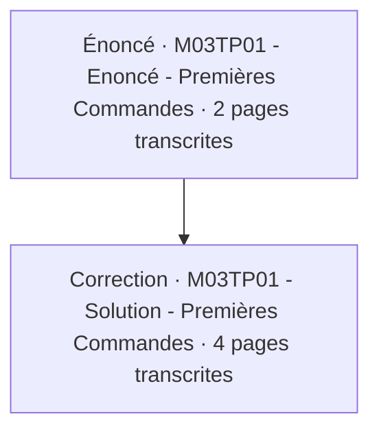

Le dossier de ce module contient des énoncés et corrections de TP, sans support de cours distinct. Les documents disponibles sont reproduits intégralement ; aucun support manquant n’a été reconstitué par IA.

SOURCE DRIVE · TRANSCRIPTION DU SUPPORT

Le contenu des documents du dossier TSSR est transcrit ci-dessous, page par page. Les textes et tableaux sont intégrés à la page Web. Aucun fichier PDF, aucune diapositive entière ni aucune reproduction de page n’est affiché. Seuls des croquis ou visuels isolés et vérifiés peuvent accompagner la transcription. Les versions et les consignes restent celles des supports de formation. Les compléments IA sont conservés dans leur onglet distinct.

## Énoncé · M03TP01 - Enoncé - Premières Commandes · 2 pages transcrites

#### Premières commandes

!!! note "À retenir"
    TP du Module 03 – Découverte du shell et premières commandes Avant de démarrer ce TP, il convient d’avoir suivi les vidéos des modules 3.

TP du Module 03 – Découverte du shell et premières commandes

Avant de démarrer ce TP, il convient d’avoir suivi les vidéos des modules 3.

Avoir effectué le TP précèdent

Durée estimée

45 à 60 minutes

#### Énoncé

!!! note "À retenir"
    En fonction du modules que vous venez de parcourir, vous trouverez les commandes nécessaires pour répondre aux questions.

!!! example "Exemple"
    A l'invite, afficher juste la date, suivant l'exemple : lundi 24 septembre 2009 Commande cal avec et sans argument : 1.

**Visuel externe**

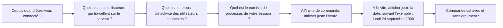

En fonction du modules que vous venez de parcourir, vous trouverez les commandes nécessaires pour répondre aux questions.

1. Changer votre mot de passe, fermer la session et reconnectez-vous pour vérifier le changement de mot de passe.
2. Depuis quand êtes-vous connecté ?
3. Quels sont les utilisateurs qui travaillent sur le serveur ?
4. Quel est le temps d'inactivité des utilisateurs connectés ?
5. Quel est le numéro de processus de votre session ?

1. Afficher vos identifiants d'utilisateur et de groupes (UID et GID) et relevez les noms de vos groupes d’appartenance.
2. A l'invite de commande, afficher juste l’heure.
3. A l'invite, afficher juste la date, suivant l'exemple : lundi 24 septembre 2009

1. Commande cal avec et sans argument :
   1. Afficher le calendrier de Janvier 1900 puis celui de toute l’année.
   2. Afficher le calendrier du mois de Janvier de l'année courante.
   3. Afficher le calendrier de septembre 1752, quelle est la particularité de ce mois ?

#### Solution

!!! note "À retenir"
    Une solution est proposée pour ce TP sous la forme d'un PDF commenté, disponible dans les ressources à télécharger.

Une solution est proposée pour ce TP sous la forme d'un PDF commenté, disponible dans les ressources à télécharger.

Référence du document : 1OIn_dxpEqPqSCFO5kih6P8WH7RtHTocT · SHA-256 de01dabfc58eec3d…

## Correction · M03TP01 - Solution - Premières Commandes · 4 pages transcrites

!!! note "À retenir"
    Correction originale : à consulter après avoir tenté l’exercice.

Correction originale : à consulter après avoir tenté l’exercice.

#### Premières commandes

!!! note "À retenir"
    TP du Module 03 – Découverte du shell et premières commandes Avant de démarrer ce TP, il convient d’avoir suivi les vidéos des modules 3.

TP du Module 03 – Découverte du shell et premières commandes

Avant de démarrer ce TP, il convient d’avoir suivi les vidéos des modules 3.

Avoir effectué le TP précèdent

Durée estimée

45 à 60 minutes

#### Proposition de solution

!!! note "À retenir"
    En fonction du module que vous venez de parcourir, vous trouverez les commandes nécessaires pour répondre aux questions.

!!! example "Exemple"
    Exemple de sortie du support : le nom du groupe propre au centre de formation est neutralisé en « groupe-formation ».

**Visuel externe**


En fonction du module que vous venez de parcourir, vous trouverez les commandes nécessaires pour répondre aux questions.

1. Changer votre mot de passe, fermer la session et reconnectez-vous pour vérifier le changement de mot de passe.

passwd (respectez la complexité requise), pensez à quitter et vous reconnecter

1. Depuis quand êtes-vous connecté ?

who am i

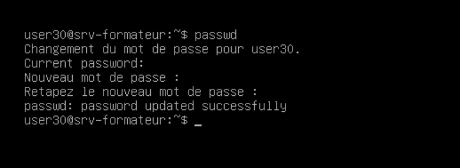

Visuel isolé du document — M03TP01 - Solution - Premières Commandes

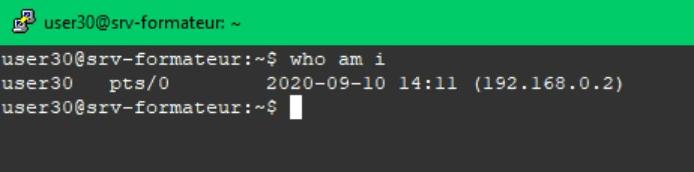

Visuel isolé du document — M03TP01 - Solution - Premières Commandes

1. Quels sont les utilisateurs qui travaillent sur le serveur ?

```
who
```

1. Quel est le temps d'inactivité des utilisateurs connectés ?

```
w -u
```

1. Quel est le numéro de processus de votre session ?

```
who am I –all --heading
```

1. Afficher vos identifiants d'utilisateur et de groupes (UID et GID) et relevez les noms de vos groupes d’appartenance.

```
id
```

Exemple de sortie du support : le nom du groupe propre au centre de formation est neutralisé en « groupe-formation ». Les UID et GID sont ceux de la machine d’exemple.

```
uid=1030(user30) gid=1030(user30) groupes=1030(user30),100(users),1000(groupe-formation)
```

1. A l'invite de commande, afficher juste l’heure.

```
Date +%X
```

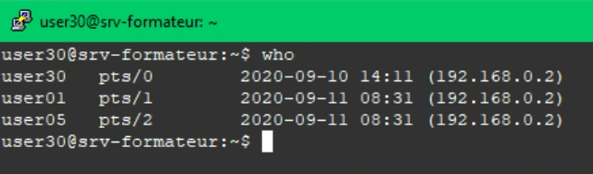

Visuel isolé du document — M03TP01 - Solution - Premières Commandes

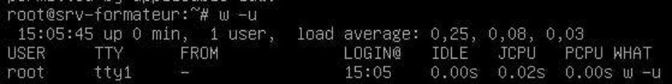

Visuel isolé du document — M03TP01 - Solution - Premières Commandes

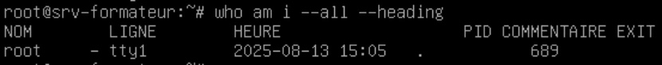

Visuel isolé du document — M03TP01 - Solution - Premières Commandes

1. A l'invite, afficher juste la date, suivant l'exemple : lundi 24 septembre 2009

```
date "+%A %d %B %Y"
```

1. Commande cal avec et sans argument :

a. Afficher le calendrier de Janvier 1900 puis celui de toute l’année.

```
cal 1 1900
```

b. Afficher le calendrier du mois de Janvier de l'année courante.

```
cal 1 2020
```

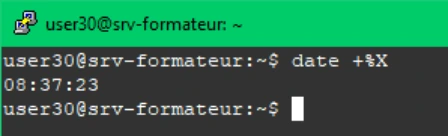

Visuel isolé du document — M03TP01 - Solution - Premières Commandes

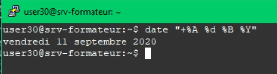

Visuel isolé du document — M03TP01 - Solution - Premières Commandes

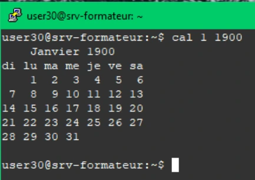

Visuel isolé du document — M03TP01 - Solution - Premières Commandes

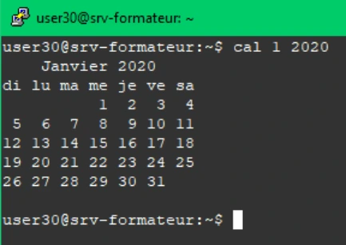

Visuel isolé du document — M03TP01 - Solution - Premières Commandes

c. Afficher le calendrier de septembre 1752, quelle est la particularité de ce mois ?

```
cal 9 1752
```

Voir le man en recherchant la mention 1752. C’est le mois du passage au calendrier grégorien, 11 jours ont sautés pour l'occasion, du 3 au 13.

#### Solution

Une solution est proposée pour ce TP sous la forme d'un PDF commenté, disponible dans les ressources à télécharger.

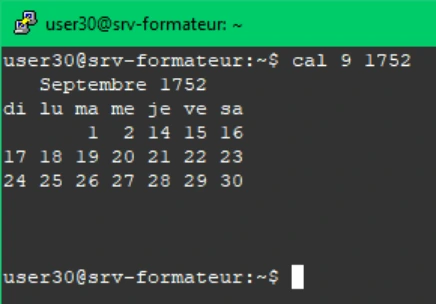

Visuel isolé du document — M03TP01 - Solution - Premières Commandes

Référence du document : 1T_24hs0UrEXhrpnPCZCYbuY2paK3h2GA · SHA-256 a99de2a7574cb337…

## Fiche de synthèse

Les lignes reprennent les titres du cours et la première phrase de chaque partie.

| Partie | Repère du cours |
| --- | --- |
| Correction · M03TP01 - Solution - Premières Commandes · 4 pages transcrites | Correction originale : à consulter après avoir tenté l’exercice. |
