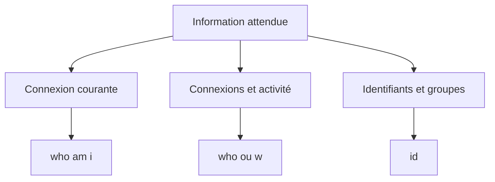

# Module 03 — Premières commandes

**Sources du module.** Énoncés et corrections des TP du module. Aucun support théorique distinct n’est fourni.

Identifier sa session, observer les utilisateurs et les identifiants, puis formater la date et lire des calendriers.

**Durée des ateliers.** 45 à 60 minutes. Lire chaque énoncé avant de commencer. Employer la machine et les fichiers de formation prévus.

## Objectifs

- Identifier une connexion, un utilisateur, ses groupes et le processus de session.
- Vérifier le changement de mot de passe par une nouvelle connexion.
- Afficher l’heure, une date formatée et un calendrier demandé.

## 1. Lire la commande et vérifier le résultat

Dans ce premier atelier, l’aide pédagogique consiste à relier chaque question à une information observable. Les commandes s’exécutent dans le terminal de la machine de formation ; les noms, dates et identifiants des captures sont des exemples historiques.

| Outil | Information recherchée |
|---|---|
| `passwd` | Changement du mot de passe de son compte |
| `who am i` | Informations sur la connexion de la session courante |
| `who` | Utilisateurs actuellement connectés |
| `w -u` | Sessions et temps d’inactivité affichés par cet outil |
| `who am i --all --heading` | Tableau enrichi, en-têtes et PID de session présenté par la correction |
| `id` | UID, GID et groupes d’appartenance |
| `date` | Heure et date avec une présentation choisie |
| `cal` | Calendriers mensuels et annuels |

La distinction essentielle est celle entre **l’utilisateur**, **une connexion de cet utilisateur** et **un processus**. Une même personne peut avoir plusieurs sessions. Le PID affiché dans le tableau de connexion ne doit pas être confondu avec l’ensemble des processus lancés par le compte.

**Illustration IA / externe au cours — Choisir la commande selon l’information attendue.**



## 2. Mot de passe et identité

Après `passwd`, suivre les demandes interactives de l’outil, respecter la complexité du laboratoire puis fermer et rouvrir la session. Aucun mot de passe n’est fourni dans cette page : le contrôle consiste à réussir une nouvelle authentification.

`id` affiche l’**UID** de l’utilisateur, le **GID** de son groupe principal et les groupes supplémentaires. Relever à la fois les numéros et leurs noms ; les valeurs des captures ne sont pas des valeurs attendues universelles.

## 3. Choisir la forme de la date

| Format | Élément |
|---|---|
| `%X` | Heure dans la représentation locale |
| `%A` | Nom complet du jour |
| `%d` | Numéro du jour |
| `%B` | Nom complet du mois |
| `%Y` | Année sur quatre chiffres |

Les guillemets de `date "+%A %d %B %Y"` permettent de conserver les espaces du format dans un seul argument. La langue de sortie dépend de la configuration locale.

## 4. Interpréter un calendrier

`cal 1 1900` vise janvier 1900 ; `cal 1900` vise l’année entière. Pour janvier de l’année courante, fournir le mois et l’année observée : `cal 1 "$(date +%Y)"`. Le document donne 2020 dans sa correction ; ce nombre appartient à sa capture et ne remplace pas l’énoncé « année courante ».

Pour septembre 1752, consulter également le manuel de la version de `cal` du laboratoire. Le support montre un saut des dates 3 à 13 dans la transition de calendrier représentée. Ce constat est celui de l’outil et du scénario source ; il ne décrit pas un changement simultané dans tous les pays.

## Ateliers complets

### TP01 — Premières commandes

#### Activité 1 — Changer le mot de passe, fermer la session puis se reconnecter pour vérifier le changement.

```bash
passwd
```
Suivre les demandes interactives puis réussir une nouvelle connexion.

#### Activité 2 — Depuis quand la session courante est-elle connectée ?

```bash
who am i
```
Relever la date et l’heure de connexion de sa propre ligne.

#### Activité 3 — Quels utilisateurs travaillent sur le serveur ?

```bash
who
```
Observer les sessions connectées ; plusieurs lignes peuvent concerner un même compte.

#### Activité 4 — Quel est le temps d’inactivité des utilisateurs connectés ?

```bash
w -u
```
Lire la colonne d’inactivité de chaque session.

#### Activité 5 — Quel est le numéro de processus de la session présenté par l’outil de connexion ?

```bash
who am i --all --heading
```
Lire la colonne PID du résultat, comme dans le document.

#### Activité 6 — Afficher UID, GID et noms des groupes d’appartenance.

```bash
id
```
Relever l’utilisateur, le groupe principal et les groupes supplémentaires.

#### Activité 7 — Afficher uniquement l’heure.

```bash
date +%X
```

#### Activité 8 — Afficher uniquement la date selon le modèle jour, numéro, mois, année.

```bash
date "+%A %d %B %Y"
```
Le résultat doit être la date courante dans la forme demandée ; la langue dépend du système.

#### Activité 9 — Afficher janvier 1900, toute l’année 1900, janvier de l’année courante, puis septembre 1752 et sa particularité.

```bash
cal 1 1900
cal 1900
cal 1 "$(date +%Y)"
cal 9 1752
man cal
```
Comparer les quatre sorties. Rechercher 1752 dans le manuel pour expliquer le saut observé dans le scénario.

## Écarts et précisions du document

!!! note "Lecture de la source"
    La correction imprime `Date +%X` avec une majuscule : l’aide pédagogique emploie `date`, conformément à la commande Linux.

!!! note "Lecture de la source"
    L’option de who est imprimée avec un tiret typographique et un I majuscule. La forme utilisable est `who am i --all --heading`.

!!! note "Lecture de la source"
    La date « lundi 24 septembre 2009 » est un modèle de présentation dans l’énoncé, pas une date à rendre fixe ni une validation du jour de semaine.

!!! note "Lecture de la source"
    La correction ne développe pas le calendrier annuel ; `cal 1900` répond à la seconde partie de la consigne.

## À retenir

`who am i` décrit la connexion courante, `who` et `w` décrivent les sessions et `id` décrit le compte et ses groupes. Pour produire une date lisible, transmettre le format complet dans un seul argument. Pour un calendrier, vérifier le mois et l’année dans l’en-tête obtenu.

## Mini-quiz

1. Quel contrôle termine l’activité de changement de mot de passe ?
2. Comment distinguer deux connexions du même compte ?
3. Quels champs de `id` distinguent groupe principal et groupes supplémentaires ?
4. Pourquoi entourer `+%A %d %B %Y` de guillemets ?
5. Comment afficher janvier de l’année en cours sans figer 2020 ?

??? note "Réponses commentées"
    1. Fermer la session, puis réussir une nouvelle connexion avec le nouveau mot de passe. Le contrôle porte sur l’authentification, pas uniquement sur le retour de `passwd`.
    2. Lire les terminaux et heures de connexion dans `who`. Deux lignes peuvent correspondre au même identifiant utilisateur.
    3. `gid` indique le groupe principal et `groups` énumère les appartenances affichées. `uid` identifie le compte.
    4. Le format contient des espaces. Les guillemets en font un seul argument pour `date`.
    5. Utiliser `cal 1 "$(date +%Y)"`. Le shell calcule l’année avant de lancer `cal`.

## Pour pratiquer et réviser

- [TP : énoncés et corrections](../../tp/utilisation-linux/module-03/index.md)
- [Fiche de révision](../../revision/utilisation-linux/module-03-premieres-commandes.md)
- [Kahoot existant du module](../../kahoot/04-utilisation-gnu-linux-module-03-premieres-commandes.md)
- [Commandes GNU/Linux](../../commandes/linux.md)
- [Présentation du cours](index.md)

## Provenance pédagogique

Les consignes, noms et exemples proviennent des documents de formation disponibles. Les explications, contrôles, variantes explicitement signalées et mini-quiz sont une aide pédagogique distincte de la transcription originale. Les sorties de captures sont des exemples, pas des valeurs à imposer à chaque machine.
