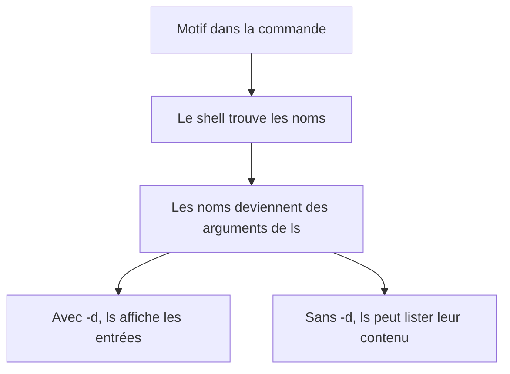

# Module 04 — Fichiers, dossiers et métacaractères

**Sources du module.** Énoncés et corrections des TP du module. Aucun support théorique distinct n’est fourni.

Se repérer dans l’arborescence, créer un fichier, lire ses attributs et distinguer le contenu d’un répertoire de ses propres caractéristiques. Le TP Métacaractères mal classé dans le dossier Module 4 reste étudié au module 06, conformément à son titre interne.

**Durée des ateliers.** 45 à 60 minutes. Lire chaque énoncé avant de commencer. Employer la machine et les fichiers de formation prévus.

## Objectifs

- Vérifier le répertoire courant avant une manipulation.
- Créer un fichier et identifier son propriétaire, son groupe et ses permissions.
- Lister des noms correspondant à un motif et afficher les attributs d’un répertoire.

## 1. Savoir où l’on travaille

`pwd` affiche le chemin du répertoire courant. Les commandes de cet atelier sont sensibles à la casse : **MonPremierFichier** doit conserver ses majuscules. Un chemin commençant par `/` est absolu ; un nom seul se résout depuis le répertoire courant.

`ls -A` montre les noms présents, y compris les noms cachés, sans les entrées spéciales `.` et `..`. Cette observation répond à la question « existe-t-il des fichiers et des répertoires ? » sans créer de contenu supplémentaire.

## 2. Créer puis observer

`touch MonPremierFichier` crée le fichier s’il n’existe pas. Si ce nom existe déjà, touch modifie ses horodatages ; il ne vide pas automatiquement un fichier existant. Dans le scénario, choisir le nom demandé et vérifier que l’on part d’un nouveau fichier.

`ls -l MonPremierFichier` affiche notamment les permissions, le nombre de liens, le propriétaire, le groupe, la taille et la date. Les noms et droits visibles sont les résultats à relever sur sa machine.

## 3. Un motif de noms n’est pas une recherche dans le contenu

```bash
ls -d -- /etc/*.conf
```

Le shell développe le motif `*.conf` en noms du répertoire /etc avant de lancer ls. L’option `-d` affiche chaque entrée trouvée par le shell, y compris un répertoire dont le nom se termine par `.conf`. Le support emploie `ls` sans cette option. [Manuel GNU de ls](https://www.gnu.org/software/coreutils/manual/html_node/What-information-is-listed.html) Les motifs plus élaborés, leur protection et la création de l’arborescence du TP Métacaractères sont détaillés au [module 06](module-06-recherches-et-expressions-regulieres.md).

**Illustration IA / externe au cours — Le shell développe le motif avant l’appel à ls.**



## 4. Le répertoire ou ce qu’il contient ?

| Commande | Objet observé |
|---|---|
| `ls -l /tmp` | Éléments contenus directement dans /tmp |
| `ls -ld /tmp` | Le répertoire /tmp lui-même |

L’option `-d` est donc décisive pour respecter la dernière consigne. Le support montre des permissions particulières de /tmp, avec un **t** final, le sticky bit. Dans ce répertoire partagé, ce bit limite la suppression ou le renommage des entrées selon leur propriétaire ; ce n’est pas une permission accordant tous les droits sur les fichiers.

## Ateliers complets

### TP01 — Fichiers et dossiers

#### Activité 1 — Indiquer sa position dans l’arborescence.

```bash
pwd
```

#### Activité 2 — Observer la présence de fichiers et de répertoires.

```bash
ls -A
```

#### Activité 3 — Créer un fichier vide appelé MonPremierFichier.

```bash
touch MonPremierFichier
```

#### Activité 4 — Afficher les permissions et le propriétaire de MonPremierFichier.

```bash
ls -l MonPremierFichier
```
Identifier les champs, sans recopier les valeurs de la capture comme des valeurs attendues.

#### Activité 5 — Afficher les noms terminés par .conf dans /etc.

```bash
ls -d -- /etc/*.conf
```

#### Activité 6 — Afficher les caractéristiques de /tmp lui-même, puis relever sa particularité.

```bash
ls -ld /tmp
```
L’option -d évite de lister son contenu. Observer notamment le t des permissions dans l’environnement présenté.

## Écarts et précisions du document

!!! note "Lecture de la source"
    Les permissions, propriétaires et dates de la capture illustrent le serveur source : relever ceux du laboratoire courant.

!!! note "Lecture de la source"
    Le titre du module inclut les métacaractères, mais son TP propre concerne fichiers et dossiers ; le second TP est rattaché au module06 d’après le titre écrit dans son document.

## À retenir

`pwd` indique où un nom relatif sera cherché. `ls -l` affiche les attributs et `ls -ld` permet d’examiner le répertoire lui-même. Dans `/tmp`, le `t` se lit dans le champ des permissions.

## Mini-quiz

1. Où `touch MonPremierFichier` crée-t-il le fichier ?
2. Que révèle `ls -l` après la création ?
3. Qui développe `/etc/*.conf` ?
4. Pourquoi ajouter `-d` à la liste des noms `.conf` ?
5. Pourquoi utiliser `ls -ld -- /tmp` dans le TP ?

??? note "Réponses commentées"
    1. Dans le répertoire courant si ce nom relatif n’existe pas. Utiliser `pwd` avant la création et `ls -l -- MonPremierFichier` ensuite.
    2. Entre autres, le type, les permissions, le propriétaire et le groupe du fichier.
    3. Le shell développe le motif en chemins correspondants avant de lancer `ls`. Le motif vise les noms directement sous `/etc`.
    4. Un répertoire peut aussi correspondre au motif. `-d` affiche son nom comme celui des autres entrées.
    5. `-d` sélectionne le répertoire `/tmp` lui-même et `-l` affiche ses permissions, dont le sticky bit s’il est présent.

## Pour pratiquer et réviser

- [TP : énoncés et corrections](../../tp/utilisation-linux/module-04/index.md)
- [Fiche de révision](../../revision/utilisation-linux/module-04-fichiers-dossiers-et-metacaracteres.md)
- [Kahoot existant du module](../../kahoot/04-utilisation-gnu-linux-module-04-fichiers-dossiers-et-metacaracteres.md)
- [Mémo sur les permissions Linux](../../memo/permissions-linux.md)
- [Présentation du cours](index.md)

## Provenance pédagogique

Les consignes, noms et exemples proviennent des documents de formation disponibles. Les explications, contrôles, variantes explicitement signalées et mini-quiz sont une aide pédagogique distincte de la transcription originale. Les sorties de captures sont des exemples, pas des valeurs à imposer à chaque machine.
