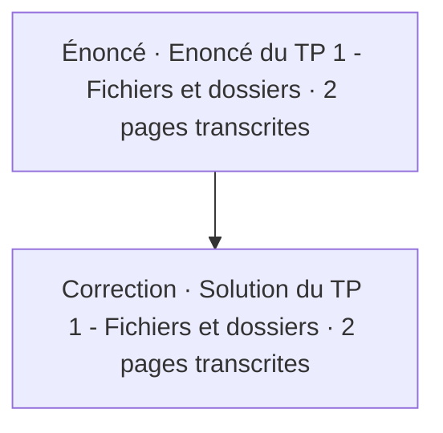
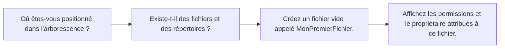
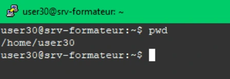
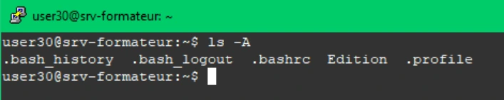
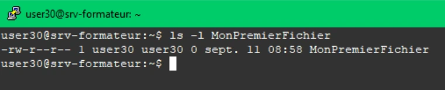
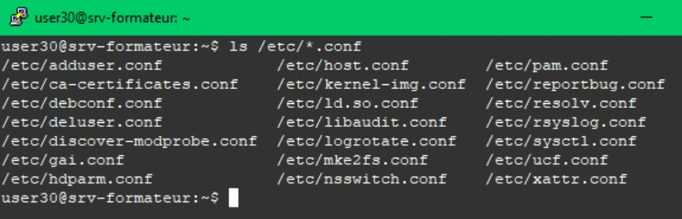
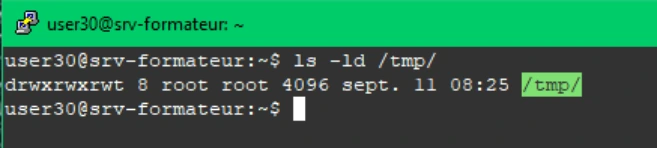

# Module 04 — Fichiers, dossiers et métacaractères

Les parties ci-dessous reprennent le cours original, dans le même ordre. Les encadrés et les schémas répètent ses formulations.

## Parcours de lecture

1. Énoncé · Enoncé du TP 1 - Fichiers et dossiers · 2 pages transcrites
2. Correction · Solution du TP 1 - Fichiers et dossiers · 2 pages transcrites

**Visuel externe**



Le dossier de ce module contient des énoncés et corrections de TP, sans support de cours distinct. Les documents disponibles sont reproduits intégralement ; aucun support manquant n’a été reconstitué par IA. Les fichiers M04TP02 stockés dans le dossier M04 du Drive portent le titre interne « TP du Module 06 » : ils sont donc consultables dans le module 06, avec cette anomalie documentaire signalée.

SOURCE DRIVE · TRANSCRIPTION DU SUPPORT

Le contenu des documents du dossier TSSR est transcrit ci-dessous, page par page. Les textes et tableaux sont intégrés à la page Web. Aucun fichier PDF, aucune diapositive entière ni aucune reproduction de page n’est affiché. Seuls des croquis ou visuels isolés et vérifiés peuvent accompagner la transcription. Les versions et les consignes restent celles des supports de formation. Les compléments IA sont conservés dans leur onglet distinct.

## Énoncé · Enoncé du TP 1 - Fichiers et dossiers · 2 pages transcrites

!!! note "À retenir"
    Utilisation d'une distribution GNU/Linux

Utilisation d'une distribution GNU/Linux

#### Fichiers et dossiers

!!! note "À retenir"
    TP du Module 04 – Fichiers et dossiers sous Linux Avant de démarrer ce TP, il convient d’avoir suivi les vidéos du module 4 et d’avoir effectué le TP précédent.

TP du Module 04 – Fichiers et dossiers sous Linux

Avant de démarrer ce TP, il convient d’avoir suivi les vidéos du module 4 et d’avoir effectué le TP précédent.

Durée estimée

45 à 60 minutes

#### Énoncé

!!! note "À retenir"
    Dans le module que vous venez de parcourir, vous trouverez les commandes nécessaires pour répondre aux questions.

Dans le module que vous venez de parcourir, vous trouverez les commandes nécessaires pour répondre aux questions.

Où êtes-vous positionné dans l'arborescence ?

Existe-t-il des fichiers et des répertoires ?

Créez un fichier vide appelé MonPremierFichier.

Affichez les permissions et le propriétaire attribués à ce fichier.

Affichez les fichiers se terminant par l'extension .conf dans le répertoire /etc.

Affichez les caractéristiques détaillées du répertoire /tmp (pas son contenu). Que remarquez-vous de particulier ?

#### Solution

!!! note "À retenir"
    Une solution est proposée pour ce TP sous la forme d'un PDF commenté, disponible dans les ressources à télécharger.

Une solution est proposée pour ce TP sous la forme d'un PDF commenté, disponible dans les ressources à télécharger.

Référence du document : 1il7AmAnsXZ_sEalyaeuxPkmrkLrTd345 · SHA-256 acc841d14127f89d…

## Correction · Solution du TP 1 - Fichiers et dossiers · 2 pages transcrites

!!! note "À retenir"
    Correction originale : à consulter après avoir tenté l’exercice.

Correction originale : à consulter après avoir tenté l’exercice.

#### Fichiers et dossiers

!!! note "À retenir"
    TP du Module 04 – Fichiers et dossiers sous Linux Avant de démarrer ce TP, il convient d’avoir suivi les vidéos du module 4 et d’avoir effectué le TP précédent.

TP du Module 04 – Fichiers et dossiers sous Linux

Avant de démarrer ce TP, il convient d’avoir suivi les vidéos du module 4 et d’avoir effectué le TP précédent.

Durée estimée

45 à 60 minutes

#### Proposition de solution

!!! note "À retenir"
    Dans le module que vous venez de parcourir, vous trouverez les commandes nécessaires pour répondre aux questions.

**Visuel externe**



Dans le module que vous venez de parcourir, vous trouverez les commandes nécessaires pour répondre aux questions.

1. Où êtes-vous positionné dans l'arborescence ?

```
pwd
```

1. Existe-t-il des fichiers et des répertoires ?

```
ls -A
```

1. Créez un fichier vide appelé MonPremierFichier.

```
touch MonPremierFichier
```

1. Affichez les permissions et le propriétaire attribués à ce fichier.

```
ls -l MonPremierFichier
```



Visuel isolé du document — Solution du TP 1 - Fichiers et dossiers



Visuel isolé du document — Solution du TP 1 - Fichiers et dossiers

1. Affichez les fichiers se terminant par l'extension .conf dans le répertoire /etc.

```
ls /etc/*.conf
```

1. Affichez les caractéristiques détaillées du répertoire /tmp (pas son contenu), que remarquez-vous de particulier ?

```
ls -ld /tmp
```



Visuel isolé du document — Solution du TP 1 - Fichiers et dossiers



Visuel isolé du document — Solution du TP 1 - Fichiers et dossiers



Visuel isolé du document — Solution du TP 1 - Fichiers et dossiers

Référence du document : 1mff_PKIvJil4tvcBDtmbMiDHiUQuqZKP · SHA-256 7455a0ec69483e30…

## Fiche de synthèse

Les lignes reprennent les titres du cours et la première phrase de chaque partie.

| Partie | Repère du cours |
| --- | --- |
| Énoncé · Enoncé du TP 1 - Fichiers et dossiers · 2 pages transcrites | Utilisation d'une distribution GNU/Linux |
| Correction · Solution du TP 1 - Fichiers et dossiers · 2 pages transcrites | Correction originale : à consulter après avoir tenté l’exercice. |
