# Module 05 — Lire des fichiers et gérer les liens

Les parties ci-dessous reprennent le cours original, dans le même ordre. Les encadrés et les schémas répètent ses formulations.

## Parcours de lecture

1. Énoncé · Enoncé du TP 1 - Lire des fichiers · 3 pages transcrites
2. Énoncé · Enoncé du TP 2 - Les liens · 2 pages transcrites
3. Correction · Solution du TP 1 - Lire des fichiers · 2 pages transcrites
4. Correction · Solution du TP 2 - Les liens · 3 pages transcrites

**Visuel externe**

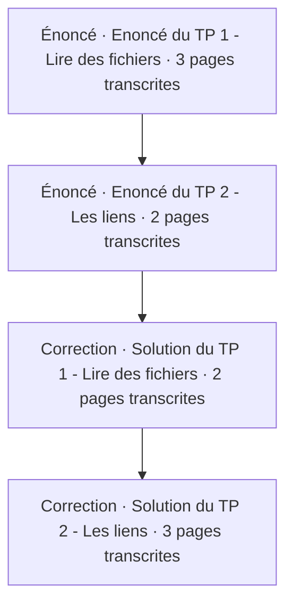

Le dossier de ce module contient des énoncés et corrections de TP, sans support de cours distinct. Les documents disponibles sont reproduits intégralement ; aucun support manquant n’a été reconstitué par IA.

SOURCE DRIVE · TRANSCRIPTION DU SUPPORT

Le contenu des documents du dossier TSSR est transcrit ci-dessous, page par page. Les textes et tableaux sont intégrés à la page Web. Aucun fichier PDF, aucune diapositive entière ni aucune reproduction de page n’est affiché. Seuls des croquis ou visuels isolés et vérifiés peuvent accompagner la transcription. Les versions et les consignes restent celles des supports de formation. Les compléments IA sont conservés dans leur onglet distinct.

## Énoncé · Enoncé du TP 1 - Lire des fichiers · 3 pages transcrites

!!! note "À retenir"
    Utilisation d'une distribution GNU/Linux

Utilisation d'une distribution GNU/Linux

#### Lire des fichiers

!!! note "À retenir"
    TP du Module 05 – Utiliser des fichiers sous Linux Avant de démarrer ce TP, il convient d’avoir suivi les vidéos du module 5 et d’avoir effectué le TP précédent.

TP du Module 05 – Utiliser des fichiers sous Linux

Avant de démarrer ce TP, il convient d’avoir suivi les vidéos du module 5 et d’avoir effectué le TP précédent.

Durée estimée

45 à 60 minutes

#### Énoncé

!!! note "À retenir"
    Dans le module que vous venez de parcourir, vous trouverez les commandes nécessaires pour répondre aux questions.

!!! warning "Attention"
    Créez un fichier MonTroisiemeFichier avec cat, contenant le texte : Ne pas oublier de lire au moins 4 pages de man avant d'aller se coucher Créez un nouveau fichier fichier2+3 par concaténation des deux fichiers qui viennent d'être créés.

Dans le module que vous venez de parcourir, vous trouverez les commandes nécessaires pour répondre aux questions.

1. Créez un nouveau fichier appelé MonDeuxiemeFichier à l'aide de la commande cat, dont le contenu sera :

Conseil :

pour bien utiliser la ligne de commande

faire des étirements de doigts avant chaque repas.

1. Créez un fichier MonTroisiemeFichier avec cat, contenant le texte :

Ne pas oublier de lire au moins 4 pages de man

avant d'aller se coucher

1. Créez un nouveau fichier fichier2+3 par concaténation des deux fichiers qui viennent d'être créés.
2. Combien de comptes d'utilisateurs ont été créés sur la machine, sachant que le fichier contenant les utilisateurs est /etc/passwd et qu'une ligne correspond à un utilisateur ?
3. Affichez uniquement les 2 premières lignes du fichier /etc/hosts

#### Utilisation d'une distribution GNU/Linux Solution

!!! note "À retenir"
    Une solution est proposée pour ce TP sous la forme d'un PDF commenté, disponible dans les ressources à télécharger.

Une solution est proposée pour ce TP sous la forme d'un PDF commenté, disponible dans les ressources à télécharger.

Référence du document : 1G8_Aa1e7ENpfp1PwLJtxqbwoxyrbkFsq · SHA-256 b78f64f571954fe6…

## Énoncé · Enoncé du TP 2 - Les liens · 2 pages transcrites

!!! note "À retenir"
    Utilisation d'une distribution GNU/Linux

Utilisation d'une distribution GNU/Linux

#### Les liens

!!! note "À retenir"
    TP du Module 05 – Utiliser des fichiers sous Linux Avant de démarrer ce TP, il convient d’avoir suivi les vidéos du module 5 et d’avoir effectué le TP précédent.

TP du Module 05 – Utiliser des fichiers sous Linux

Avant de démarrer ce TP, il convient d’avoir suivi les vidéos du module 5 et d’avoir effectué le TP précédent.

Durée estimée

45 à 60 minutes

#### Énoncé

!!! note "À retenir"
    Dans le module que vous venez de parcourir, vous trouverez les commandes nécessaires pour répondre aux questions.

Dans le module que vous venez de parcourir, vous trouverez les commandes nécessaires pour répondre aux questions.

1. Créez un lien physique du fichier Edition vers le fichier edition1.txt. Vérifiez que vous pouvez afficher son contenu.
2. Créez un lien symbolique du fichier edition1.txt vers le fichier /tmp/stagxx/edition2.txt, vérifiez que vous pouvez afficher son contenu.

1. Créez un lien physique du fichier edition1.txt vers le fichier edition3.txt, vérifiez que vous pouvez afficher son contenu.
2. Affichez avec la commande ls les caractéristiques de ces 4 fichiers en mettant en évidence les différences.
3. Supprimez le fichier edition1.txt ; pouvez-vous afficher le contenu de edition2.txt et edition3.txt ?

#### Solution

Une solution est proposée pour ce TP sous la forme d'un PDF commenté, disponible dans les ressources à télécharger.

Référence du document : 1GAwhjiJTIo4YDiLLShWTUbatcQbGzpIS · SHA-256 a6a1edcd9c60a18a…

## Correction · Solution du TP 1 - Lire des fichiers · 2 pages transcrites

Correction originale : à consulter après avoir tenté l’exercice.

#### Lire des fichiers

TP du Module 05 – Utiliser des fichiers sous Linux

Avant de démarrer ce TP, il convient d’avoir suivi les vidéos du module 5 et d’avoir effectué le TP précédent.

Durée estimée

45 à 60 minutes

#### Proposition de solution

Dans le module que vous venez de parcourir, vous trouverez les commandes nécessaires pour répondre aux questions.

1. Créez un nouveau fichier appelé MonDeuxiemeFichier à l'aide de la commande cat, dont le contenu sera :

Conseil :

pour bien utiliser la ligne de commande

faire des étirements de doigts avant chaque repas.

```
cat > MonDeuxiemeFichier
```

```
Conseil :
```

```
pour bien utiliser la ligne de commande
```

```
faire des étirements de doigts avant chaque repas.
```

1. Créez un fichier MonTroisiemeFichier avec cat, contenant le texte :

Ne pas oublier de lire au moins 4 pages de man

avant d'aller se coucher

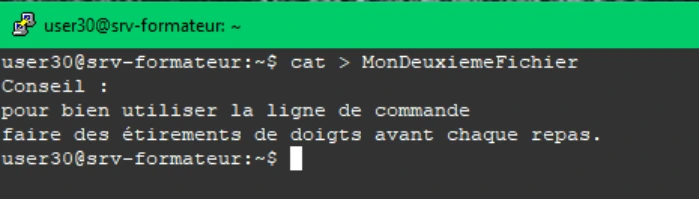

Visuel isolé du document — Solution du TP 1 - Lire des fichiers

```
cat > MonTroisiemeFichier
```

```
Ne pas oublier de lire au moins 4 pages de man
```

```
Avant d’aller se coucher
```

1. Créez un nouveau fichier fichier2+3 par concaténation des deux fichiers qui viennent d'être créés.

```
Cat MonDeuxiemeFichier MonTroisiemeFichier > fichier2+3
```

1. Combien de comptes d'utilisateurs ont été créés sur la machine, sachant que le fichier contenant les utilisateurs est /etc/passwd et qu'une ligne correspond à un utilisateur ?

```
wc -l /etc/passwd
```

1. Affichez uniquement les 2 premières lignes du fichier /etc/hosts

```
head -n 2 /etc/hosts
```

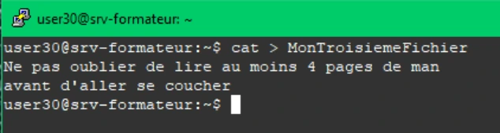

Visuel isolé du document — Solution du TP 1 - Lire des fichiers

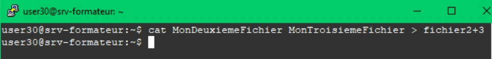

Visuel isolé du document — Solution du TP 1 - Lire des fichiers

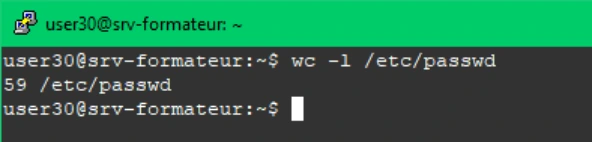

Visuel isolé du document — Solution du TP 1 - Lire des fichiers

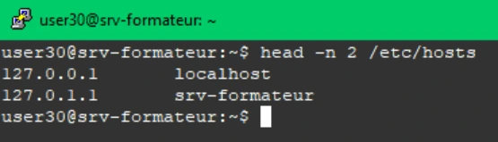

Visuel isolé du document — Solution du TP 1 - Lire des fichiers

Référence du document : 1945gKHO12jhPd0jsB4kE9EdT91tMRyWq · SHA-256 0d448896f01cbd8b…

## Correction · Solution du TP 2 - Les liens · 3 pages transcrites

Correction originale : à consulter après avoir tenté l’exercice.

#### Les liens

TP du Module 05 – Utiliser des fichiers sous Linux

Avant de démarrer ce TP, il convient d’avoir suivi les vidéos du module 5 et d’avoir effectué le TP précédent.

Durée estimée

45 à 60 minutes

#### Proposition de solution

Dans le module que vous venez de parcourir, vous trouverez les commandes nécessaires pour répondre aux questions.

1. Créez un lien physique du fichier Edition vers le fichier edition1.txt, vérifiez que vous pouvez afficher son contenu.

```
ln Edition edition1.txt
```

```
cat edition1.txt
```

1. Créez un lien symbolique du fichier edition1.txt vers le fichier /tmp/stagxx/edition2.txt, vérifiez que vous pouvez afficher son contenu.

```
mkdir /tmp/stag30
```

```
ln -s /home/user30/edition1.txt /tmp/stag30/edition2.txt
```

```
cat /tmp/stag30/edition2.txt
```

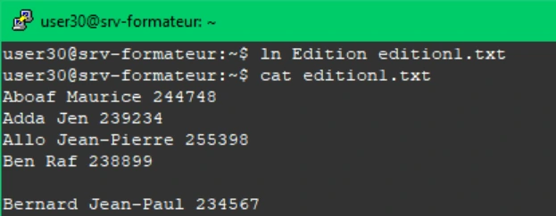

Visuel isolé du document — Solution du TP 2 - Les liens

1. Créez un lien physique du fichier edition1.txt vers le fichier edition3.txt, vérifiez que vous pouvez afficher son contenu.

```
ln edition1.txt edition3.txt
```

1. Affichez avec la commande ls les caractéristiques de ces 4 fichiers en mettant en évidence les différences.

```
ls -l edition* Edition /tmp/stag30/edition2.txt
```

1. Supprimez le fichier edition1.txt, pouvez-vous afficher le contenu de edition2.txt et edition3.txt ?

```
rm edition1.txt
```

```
cat /tmp/stag30/edition2.txt
```

```
cat: /tmp/stag30/edition2.txt: Aucun fichier ou dossier de ce type
```

```
cat edition3.txt
```

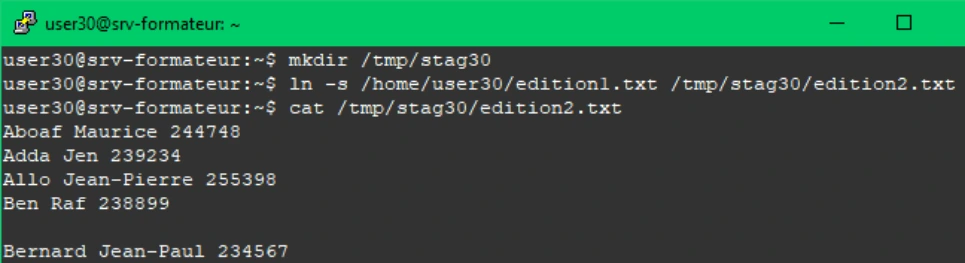

Visuel isolé du document — Solution du TP 2 - Les liens

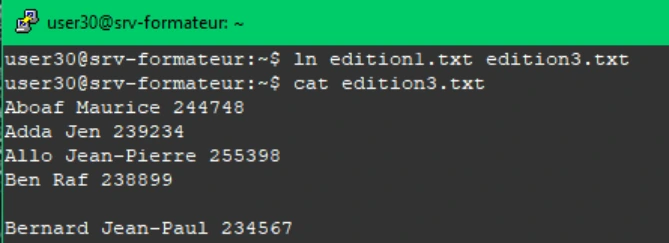

Visuel isolé du document — Solution du TP 2 - Les liens

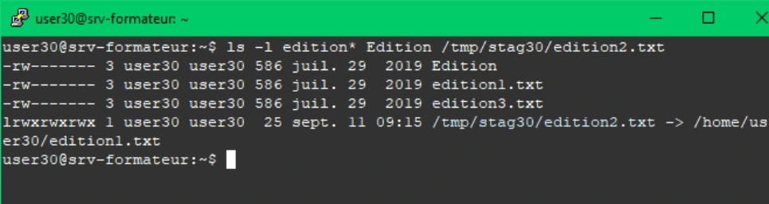

Visuel isolé du document — Solution du TP 2 - Les liens

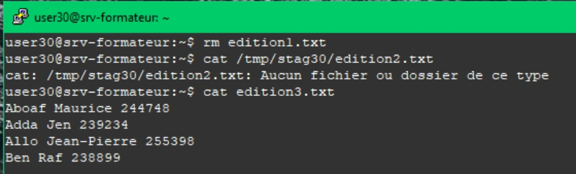

Visuel isolé du document — Solution du TP 2 - Les liens

Référence du document : 1qiNhvPoDt3_8j85ejHghAwcvbU4g6La5 · SHA-256 d8e50d555cefa72f…

## Fiche de synthèse

Les lignes reprennent les titres du cours et la première phrase de chaque partie.

| Partie | Repère du cours |
| --- | --- |
| Énoncé · Enoncé du TP 1 - Lire des fichiers · 3 pages transcrites | Utilisation d'une distribution GNU/Linux |
| Énoncé · Enoncé du TP 2 - Les liens · 2 pages transcrites | Utilisation d'une distribution GNU/Linux |
| Correction · Solution du TP 1 - Lire des fichiers · 2 pages transcrites | Correction originale : à consulter après avoir tenté l’exercice. |
| Correction · Solution du TP 2 - Les liens · 3 pages transcrites | Correction originale : à consulter après avoir tenté l’exercice. |
