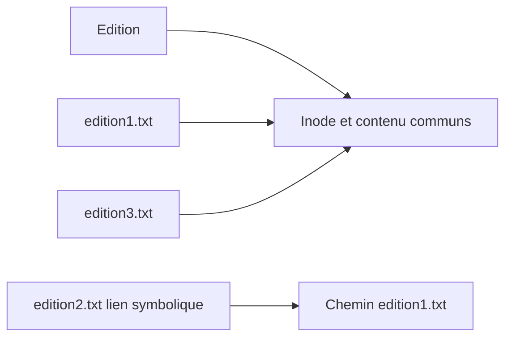

# Module 05 — Lire des fichiers et gérer les liens

**Sources du module.** énoncés et corrections des TP du module. Aucun support théorique distinct n’est fourni.

Écrire un contenu avec cat, concaténer des fichiers, compter des lignes puis comparer liens physiques et symboliques. Les deux ateliers utilisent les noms de fichiers du scénario source.

**Durée des ateliers.** Deux TP de 45 à 60 minutes. Lire chaque énoncé avant de commencer ; employer la machine et les fichiers de formation prévus.

## Objectifs

- Créer deux fichiers texte et réunir leurs contenus dans un troisième.
- Compter les lignes ou limiter l’affichage à l’aide de la commande adaptée.
- Distinguer un lien physique d’un lien symbolique par l’observation des inodes et des chemins.

## 1. Créer et lire des fichiers avec cat

Dans `cat > MonDeuxiemeFichier`, le shell redirige la sortie de cat vers le fichier. Saisir ensuite les lignes demandées, puis terminer l’entrée avec **Ctrl + D** sur une nouvelle ligne. L’affichage seul s’obtient avec `cat MonDeuxiemeFichier`.

La redirection `>` crée ou remplace le fichier cible. Dans la concaténation, les deux fichiers sources sont lus dans l’ordre et le résultat est écrit dans un troisième fichier ; ce dernier ne doit pas remplacer une des sources.

## 2. Compter ou limiter l’affichage

`wc -l /etc/passwd` compte les lignes de la base locale de comptes représentée par ce fichier. Le résultat n’est pas automatiquement le nombre de personnes qui se connectent : le fichier contient aussi des comptes de service et ne décrit pas nécessairement toutes les sources d’identité d’un système.

`head -n 2 /etc/hosts` affiche uniquement les deux premières lignes. Le contenu de la capture appartient à la machine source ; vérifier les lignes réellement présentes sur sa VM.

## 3. Deux sortes de liens

| Lien | Création | Ce qu’il désigne | Observation utile |
|---|---|---|---|
| **Physique** | `ln source nouveau_nom` | Un autre nom du même fichier, dans les limites du système de fichiers | Même inode et nombre de liens partagé |
| **Symbolique** | `ln -s cible nouveau_lien` | Un chemin vers une cible | Type l et flèche vers la cible dans ls -l |

Dans le TP, **Edition**, **edition1.txt** et **edition3.txt** sont les noms physiques du même contenu. **/tmp/stagxx/edition2.txt** est un lien symbolique vers le chemin edition1.txt.

**Illustration IA / externe au cours — liens du scénario.**



Supprimer **edition1.txt** laisse Edition et edition3.txt accéder au contenu, mais le lien symbolique reste dirigé vers un nom qui n’existe plus. Le contenu existe encore sans que ce chemin symbolique puisse le retrouver.

Les noms de compte **user30** et de dossier **stag30** sont des valeurs de la correction. L’aide pratique emploie **$HOME** et le dossier **/tmp/stagxx** à adapter aux consignes du laboratoire. Le fichier Edition doit déjà être fourni ; son contenu n’est pas inventé par le portail.

## Ateliers complets

### TP01 — Lire des fichiers

#### Activité 1 — Créer MonDeuxiemeFichier avec cat et le contenu exact de trois lignes demandé.

Lancer :

```bash
cat > MonDeuxiemeFichier
```

Saisir, puis terminer avec Ctrl + D :

```text
Conseil :
pour bien utiliser la ligne de commande
faire des étirements de doigts avant chaque repas.
```

#### Activité 2 — Créer MonTroisiemeFichier avec cat et les deux lignes demandées.

```bash
cat > MonTroisiemeFichier
```

Saisir, puis terminer avec Ctrl + D :

```text
Ne pas oublier de lire au moins 4 pages de man
avant d'aller se coucher
```

#### Activité 3 — Créer fichier2+3 par concaténation des deux fichiers.

```bash
cat MonDeuxiemeFichier MonTroisiemeFichier > fichier2+3
cat fichier2+3
```
Vérifier que les trois lignes du premier fichier précèdent les deux du second.

#### Activité 4 — Compter les lignes de /etc/passwd, une ligne correspondant à une entrée de compte.

```bash
wc -l /etc/passwd
```
Relever le résultat du système, pas le nombre de la capture.

#### Activité 5 — Afficher uniquement les deux premières lignes de /etc/hosts.

```bash
head -n 2 /etc/hosts
```

### TP02 — Les liens

#### Activité 1 — Créer un lien physique depuis Edition vers edition1.txt et vérifier la lecture.

```bash
ln Edition edition1.txt
cat edition1.txt
```

#### Activité 2 — Créer un lien symbolique depuis edition1.txt vers /tmp/stagxx/edition2.txt, puis vérifier.

Depuis le répertoire personnel :

```bash
mkdir -p /tmp/stagxx
ln -s "$HOME/edition1.txt" /tmp/stagxx/edition2.txt
cat /tmp/stagxx/edition2.txt
```
Le chemin absolu de la cible évite qu’elle soit interprétée relativement au dossier /tmp/stagxx.

#### Activité 3 — Créer un lien physique depuis edition1.txt vers edition3.txt.

```bash
ln edition1.txt edition3.txt
cat edition3.txt
```

#### Activité 4 — Afficher les caractéristiques des quatre noms et mettre les différences en évidence.

```bash
ls -l Edition edition1.txt edition3.txt /tmp/stagxx/edition2.txt
ls -li Edition edition1.txt edition3.txt /tmp/stagxx/edition2.txt
```
La seconde ligne est un contrôle pédagogique des inodes ; les trois liens physiques partagent le même numéro.

#### Activité 5 — Supprimer edition1.txt, puis tester les lectures via edition2.txt et edition3.txt.

```bash
rm edition1.txt
cat /tmp/stagxx/edition2.txt
cat edition3.txt
```
Le lien symbolique devient cassé et la lecture par edition3.txt reste possible, comme dans la correction.

## Écarts et précisions du document

!!! note "Lecture de la source"
    La correction écrit `Cat` dans la concaténation : utiliser `cat` en minuscules.

!!! note "Lecture de la source"
    L’énoncé du troisième fichier commence la seconde ligne par « avant » ; la correction la reproduit une fois avec « Avant ». L’exercice ci-dessous conserve le texte de l’énoncé.

!!! note "Lecture de la source"
    Le relevé des inodes avec ls -li est une aide de vérification ajoutée ; le document demande initialement les caractéristiques avec ls -l.

## À retenir

`cat` concatène les fichiers dans l’ordre des arguments. `wc -l` mesure les lignes terminées par un saut de ligne. Deux liens physiques partagent un inode, tandis qu’un lien symbolique désigne un chemin.

## Mini-quiz

1. Comment terminer une saisie interactive avec `cat` ?
2. Dans quel ordre `cat A B > C` assemble-t-il le contenu ?
3. Comment observer seulement deux lignes de `/etc/hosts` ?
4. Comment confirmer que deux noms sont des liens physiques du même fichier ?
5. Que se passe-t-il pour `edition2.txt` et `edition3.txt` après suppression de `edition1.txt` ?

??? note "Réponses commentées"
    1. Utiliser `Ctrl + D` sur une nouvelle ligne pour signaler la fin de l’entrée au terminal.
    2. Il écrit les octets de `A` puis ceux de `B` dans `C`. `>` remplace le contenu précédent de `C`.
    3. Utiliser `head -n 2 /etc/hosts`. `wc -l` compterait des lignes au lieu de les afficher.
    4. Comparer les numéros d’inode dans `ls -li`, sur le même système de fichiers. Ils sont identiques dans le scénario du TP.
    5. Le lien symbolique `edition2.txt` devient pendant si son chemin cible disparaît. Le lien physique `edition3.txt` donne encore accès au même inode.

## Pour pratiquer et réviser

- [TP : énoncés et corrections](../../tp/utilisation-linux/module-05/index.md)
- [Fiche de révision](../../revision/utilisation-linux/module-05-lire-des-fichiers-et-gerer-les-liens.md)
- [Kahoot existant du module](../../kahoot/04-utilisation-gnu-linux-module-05-lire-des-fichiers-et-gerer-les-liens.md)
- [Commandes GNU/Linux](../../commandes/linux.md)
- [Présentation du cours](index.md)

## Provenance pédagogique

Les consignes, noms et exemples proviennent des documents de formation disponibles. Les explications, contrôles, variantes explicitement signalées et mini-quiz sont une aide pédagogique distincte de la transcription originale. Les sorties de captures sont des exemples, pas des valeurs à imposer à chaque machine.
