# Module 06 — Recherches et expressions régulières

Les parties ci-dessous reprennent le cours original, dans le même ordre. Les encadrés et les schémas répètent ses formulations.

## Parcours de lecture

1. Énoncé · Enoncé du TP 1 - Recherches et regex · 3 pages transcrites
2. Énoncé · M04TP02 - Enoncé - Métacaractères · 2 pages transcrites
3. Correction · Solution du TP 1 - Recherches et regex · 3 pages transcrites
4. Correction · M04TP02 - Solution - Métacaractères · 3 pages transcrites

**Visuel externe**

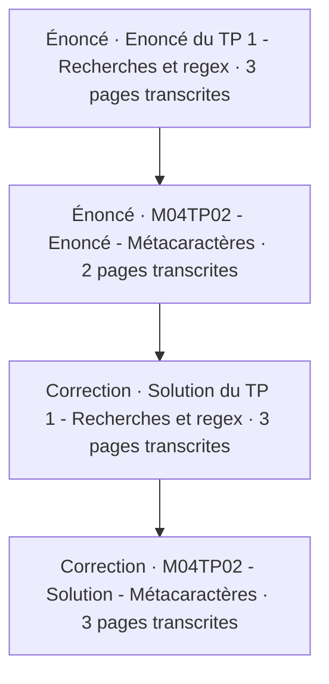

Le dossier de ce module contient des énoncés et corrections de TP, sans support de cours distinct. Les documents disponibles sont reproduits intégralement ; aucun support manquant n’a été reconstitué par IA.

SOURCE DRIVE · TRANSCRIPTION DU SUPPORT

Le contenu des documents du dossier TSSR est transcrit ci-dessous, page par page. Les textes et tableaux sont intégrés à la page Web. Aucun fichier PDF, aucune diapositive entière ni aucune reproduction de page n’est affiché. Seuls des croquis ou visuels isolés et vérifiés peuvent accompagner la transcription. Les versions et les consignes restent celles des supports de formation. Les compléments IA sont conservés dans leur onglet distinct.

## Énoncé · Enoncé du TP 1 - Recherches et regex · 3 pages transcrites

!!! note "À retenir"
    Utilisation d'une distribution GNU/Linux

Utilisation d'une distribution GNU/Linux

#### Recherches et regex

!!! note "À retenir"
    TP du Module 06 – Fichiers et dossiers sous Linux Avant de démarrer ce TP, il convient d’avoir suivi les vidéos du module 6 et d’avoir effectué le TP précédent.

TP du Module 06 – Fichiers et dossiers sous Linux

Avant de démarrer ce TP, il convient d’avoir suivi les vidéos du module 6 et d’avoir effectué le TP précédent.

Durée estimée

45 à 60 minutes

#### Énoncé

!!! note "À retenir"
    Dans le module que vous venez de parcourir, vous trouverez les commandes nécessaires pour répondre aux questions.

**Visuel externe**


Dans le module que vous venez de parcourir, vous trouverez les commandes nécessaires pour répondre aux questions.

1. Recherchez toutes les lignes contenant Dupont dans le fichier Edition.
2. Recherchez toutes les lignes contenant dupont quelle que soit la casse dans le fichier Edition.

1. Affichez toutes les lignes non vides du fichier Edition.
2. Listez les fichiers contenant localhost dans le répertoire /etc sans inclure les sous-répertoires.
3. Recherchez tous les fichiers standards commençant par ho à partir du répertoire /etc.
4. Recherchez tous les répertoires depuis votre répertoire personnel.

1. Recherchez tous les fichiers standards de votre répertoire personnel se terminant par txt et en faire une copie avec l'extension .save.

#### Solution

!!! note "À retenir"
    Une solution est proposée pour ce TP sous la forme d'un PDF commenté, disponible dans les ressources à télécharger.

Une solution est proposée pour ce TP sous la forme d'un PDF commenté, disponible dans les ressources à télécharger.

Référence du document : 116dD0Y9yfykwJumCShlSuHBvWNZeLMut · SHA-256 c8ed46b85b0ad434…

## Énoncé · M04TP02 - Enoncé - Métacaractères · 2 pages transcrites

!!! note "À retenir"
    Ce fichier est stocké sous Module 4 / TP2 dans le Drive et préfixé M04TP02, mais sa première page porte « TP du Module 06 – Spécificités du shell Bash ».

Ce fichier est stocké sous Module 4 / TP2 dans le Drive et préfixé M04TP02, mais sa première page porte « TP du Module 06 – Spécificités du shell Bash ». Son rattachement pédagogique est donc M06 ; le chemin et le fichier originaux sont conservés.

#### Les métacaractères

!!! note "À retenir"
    TP du Module 06 – Spécificités du shell Bash Avant de démarrer ce TP, il convient d’avoir suivi les vidéos des modules 6.

TP du Module 06 – Spécificités du shell Bash

Avant de démarrer ce TP, il convient d’avoir suivi les vidéos des modules 6.

Avoir effectué le TP précèdent

Durée estimée

#### 45 à 60 minutes Énoncé

!!! note "À retenir"
    En fonction du module que vous venez de parcourir, vous trouverez les commandes nécessaires pour répondre aux questions.

En fonction du module que vous venez de parcourir, vous trouverez les commandes nécessaires pour répondre aux questions.

1. Afficher les fichiers et répertoires (pas leur contenu) dont le nom commence par a, b, c ou d du répertoire /etc.
2. Créer l'arborescence suivante dans votre répertoire de travail ($HOME) en une seule ligne de commande :


Visuel isolé du document — M04TP02 - Enoncé - Métacaractères

1. Positionnez-vous dans le répertoire Sources. Dans ce répertoire, créer un fichier qui comporte, dans son nom, un astérisque.
2. Sans vous déplacez dans l’arborescence, essayer de supprimer le répertoire Sources en utilisant la commande rmdir. Que constatez-vous ?
3. Supprimer le répertoire Divers en utilisant la commande rm.

1. Après vous être positionné dans votre répertoire d'accueil, afficher la liste détaillée des fichiers répondants aux critères suivants :
   - ils sont présents directement dans /etc
   - leurs noms finissent par l'extension .conf
   - la première lettre est une consonne, celle précédant l'extension est comprise entre f et s
   - ils comportent exactement 6 lettres (hors extension).

#### Solution

!!! note "À retenir"
    Une solution est proposée pour ce TP sous la forme d'un PDF commenté, disponible dans les ressources à télécharger.

Une solution est proposée pour ce TP sous la forme d'un PDF commenté, disponible dans les ressources à télécharger.

Référence du document : 1UxNuienstNgVxtr1UyNDEU4GdedUSzJP · SHA-256 249cdf9a0cce0395…

## Correction · Solution du TP 1 - Recherches et regex · 3 pages transcrites

Correction originale : à consulter après avoir tenté l’exercice.

#### Recherches et regex

TP du Module 06 – Fichiers et dossiers sous Linux

Avant de démarrer ce TP, il convient d’avoir suivi les vidéos du module 6 et d’avoir effectué le TP précédent.

Durée estimée

45 à 60 minutes

#### Proposition de solution

**Visuel externe**


Dans le module que vous venez de parcourir, vous trouverez les commandes nécessaires pour répondre aux questions.

1. Recherchez toutes les lignes contenant Dupont dans le fichier Edition.

```
grep Dupont Edition
```

1. Recherchez toutes les lignes contenant dupont quelle que soit la casse dans le fichier Edition.

```
grep -i dupont Edition
```

1. Affichez toutes les lignes non vides du fichier Edition.

```
grep -v '^$' Edition
```

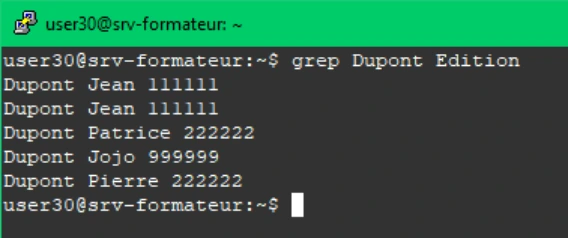

Visuel isolé du document — Solution du TP 1 - Recherches et regex

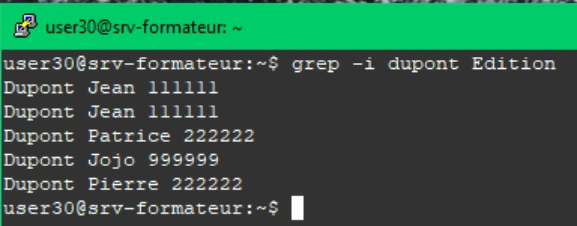

Visuel isolé du document — Solution du TP 1 - Recherches et regex

1. Listez les fichiers contenant localhost dans le répertoire /etc sans inclure les sous-répertoires.

```
grep -sl localhost /etc/*
```

1. Recherchez tous les fichiers standards commençant par ho à partir du répertoire /etc.

```
find /etc -type f -name "ho*"
```

1. Recherchez tous les répertoires depuis votre répertoire personnel.

```
find ~ -type d
```

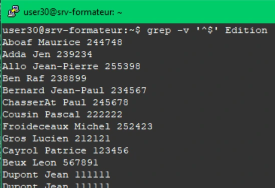

Visuel isolé du document — Solution du TP 1 - Recherches et regex

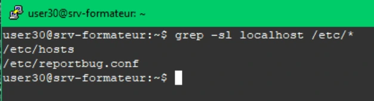

Visuel isolé du document — Solution du TP 1 - Recherches et regex

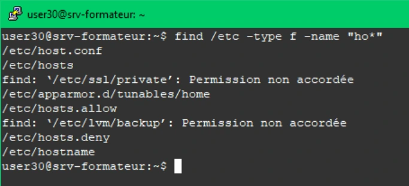

Visuel isolé du document — Solution du TP 1 - Recherches et regex

1. Recherchez tous les fichiers standards de votre répertoire personnel se terminant par txt et en faire une copie avec l'extension .save.

```
find ~ -type f -name "*txt" -exec cp {} {}.save \;
```

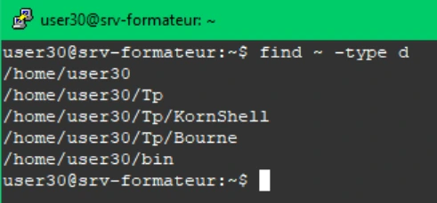

Visuel isolé du document — Solution du TP 1 - Recherches et regex

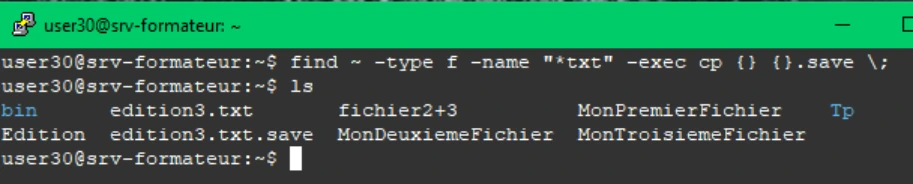

Visuel isolé du document — Solution du TP 1 - Recherches et regex

Référence du document : 1TTMm3YMJBJkNEW3msGC_fPMvC0tQCeYy · SHA-256 89832fa8712cd294…

## Correction · M04TP02 - Solution - Métacaractères · 3 pages transcrites

Ce fichier est stocké sous Module 4 / TP2 dans le Drive et préfixé M04TP02, mais sa première page porte « TP du Module 06 – Spécificités du shell Bash ». Son rattachement pédagogique est donc M06 ; le chemin et le fichier originaux sont conservés.

Correction originale : à consulter après avoir tenté l’exercice.

#### Les métacaractères

TP du Module 06 – Spécificités du shell Bash

Avant de démarrer ce TP, il convient d’avoir suivi les vidéos des modules 6.

Avoir effectué le TP précèdent

Durée estimée

45 à 60 minutes

#### Proposition de solution

En fonction du module que vous venez de parcourir, vous trouverez les commandes nécessaires pour répondre aux questions.

1. Afficher les fichiers et répertoires (pas leur contenu) dont le nom commence par a, b, c ou d du répertoire /etc.

```
ls -d /etc/[a-d]*
```

1. Créer l'arborescence suivante dans votre répertoire de travail ($HOME) en une seule ligne de commande :

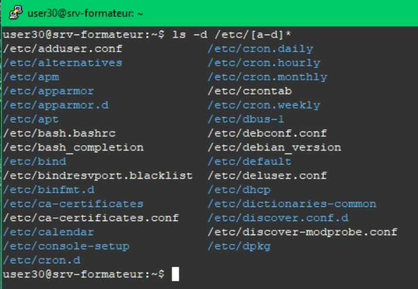

Visuel isolé du document — M04TP02 - Solution - Métacaractères

```
mkdir -p bin Tp/{Bourne,KornShell,Divers/{Sources,lib,Executables}}
```

1. Positionnez-vous dans le répertoire Sources. Dans ce répertoire, créer un fichier qui comporte, dans son nom, un astérisque.

```
cd Tp/Divers/Sources/
```

```
touch fic*ier
```

1. Sans vous déplacez dans l’arborescence, essayer de supprimer le répertoire Sources en utilisant la commande rmdir. Que constatez-vous ?

```
Remarque : La commande rmdir peut être utilisée uniquement pour supprimer des 
répertoires vides, alors que rm -r permet de supprimer des fichiers et des répertoires 
non vides ainsi que leurs contenus, si l'option -r (récursive) est utilisée.
```

```
rm -r $HOME/Tp/Divers/Sources/
```

On constate que même positionné dans un répertoire nous pouvons le supprimer

1. Supprimer le répertoire Divers en utilisant la commande rm.

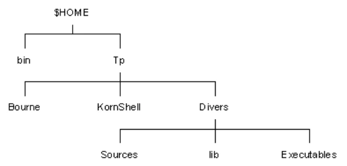

Visuel isolé du document — M04TP02 - Solution - Métacaractères

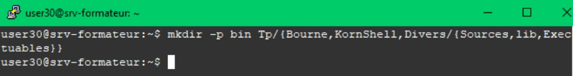

Visuel isolé du document — M04TP02 - Solution - Métacaractères

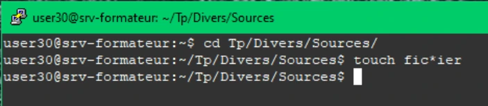

Visuel isolé du document — M04TP02 - Solution - Métacaractères

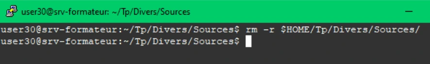

Visuel isolé du document — M04TP02 - Solution - Métacaractères

```
rm -r ../../Divers/
```

1. Après vous être positionné dans votre répertoire d'accueil, afficher la liste détaillée des fichiers répondants aux critères suivants :
   - ils sont présents directement dans /etc
   - leurs noms finissent par l'extension .conf
   - la première lettre est une consonne, celle précédant l'extension est comprise entre f et s
   - ils comportent exactement 6 lettres (hors extension).

```
ls -ld /etc/[!aeiouyAEIOUY][a-zA-Z][a-zA-Z][a-zA-Z][a-zA-Z][f-s].conf
```

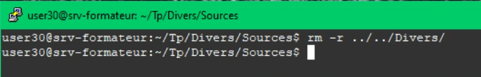

Visuel isolé du document — M04TP02 - Solution - Métacaractères

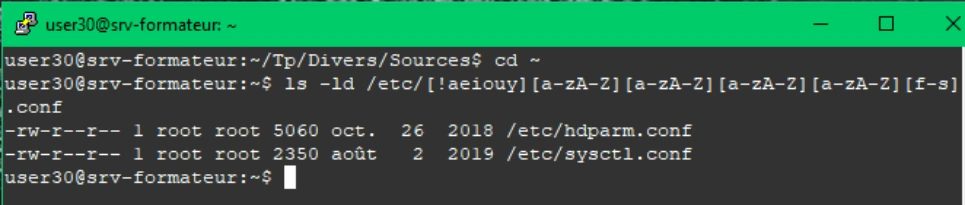

Visuel isolé du document — M04TP02 - Solution - Métacaractères

Référence du document : 1xGFJoYQKMrxSvb9Ksus3MoEavJ-d_aDa · SHA-256 277a72096d21b97f…

## Fiche de synthèse

Les lignes reprennent les titres du cours et la première phrase de chaque partie.

| Partie | Repère du cours |
| --- | --- |
| Énoncé · Enoncé du TP 1 - Recherches et regex · 3 pages transcrites | Utilisation d'une distribution GNU/Linux |
| Énoncé · M04TP02 - Enoncé - Métacaractères · 2 pages transcrites | Ce fichier est stocké sous Module 4 / TP2 dans le Drive et préfixé M04TP02, mais sa première page porte « TP du Module 06 – Spécificités du shell Bash ». |
| Correction · Solution du TP 1 - Recherches et regex · 3 pages transcrites | Correction originale : à consulter après avoir tenté l’exercice. |
| Correction · M04TP02 - Solution - Métacaractères · 3 pages transcrites | Ce fichier est stocké sous Module 4 / TP2 dans le Drive et préfixé M04TP02, mais sa première page porte « TP du Module 06 – Spécificités du shell Bash ». |
