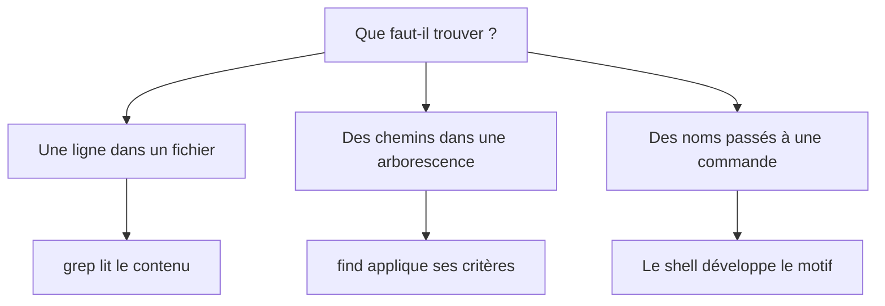

# Module 06 — Recherches et expressions régulières

**Sources du module.** énoncés et corrections des TP du module. Aucun support théorique distinct n’est fourni.

Rechercher dans le contenu avec grep, retrouver des chemins avec find puis utiliser les développements de noms du shell. Les deux TP sont conservés : Recherches et regex, puis Métacaractères.

**Durée des ateliers.** Deux TP de 45 à 60 minutes. Lire chaque énoncé avant de commencer ; employer la machine et les fichiers de formation prévus.

## Objectifs

- Choisir entre recherche dans le texte, parcours de l’arborescence et motif du shell.
- Écrire et protéger les motifs employés dans les deux ateliers.
- Contrôler la profondeur, le type de fichier et les chemins retenus avant de copier ou de supprimer.

## 1. Trois mécanismes à distinguer

| Besoin | Interprète | Exemple |
|---|---|---|
| Sélectionner des noms avant de lancer une commande | Shell Bash | `/etc/[a-d]*` |
| Sélectionner des lignes d’un fichier | Expression régulière de grep | `grep -v '^$' Edition` |
| Parcourir une arborescence et tester les chemins | find | `find /etc -type f -name 'ho*'` |

Un astérisque n’a pas le même rôle dans un motif de noms et dans une expression régulière. Les guillemets autour de `'ho*'` empêchent le shell de développer ce motif avant que find le reçoive.

**Illustration IA / externe au cours — Trois recherches, trois interprètes.**



## 2. Rechercher dans le texte

- `grep Dupont Edition` recherche cette casse dans les lignes.
- `grep -i dupont Edition` ignore la casse.
- `grep -v '^$' Edition` exclut les lignes vides. Une ligne composée uniquement d’espaces n’est pas une ligne vide au sens de cette expression.
- `grep -sl localhost /etc/*` affiche les noms de fichiers correspondants ; `-l` sélectionne les noms et `-s` supprime les messages d’erreur. Le motif /etc/* est développé une seule fois, sans recherche récursive.

Dans `^$`, **^** marque le début et **$** la fin : rien ne se trouve entre les deux. L’option **-v** inverse la sélection.

## 3. Parcourir avec find

**-type f** vise les fichiers standards, **-type d** les répertoires. Le point de départ détermine l’étendue de la recherche ; les noms sont testés par **-name**.

Dans `-exec cp {} {}.save \;`, **{}** est remplacé par le chemin trouvé, et **\;** termine l’action sans que le shell consomme son point-virgule. La consigne vise les noms se terminant par **txt** : le document utilise donc `'*txt'`, sans imposer un point avant txt.

## 4. Développer et protéger les noms

| Forme | Signification dans les exercices |
|---|---|
| `*` | Zéro ou plusieurs caractères dans un nom |
| `[a-d]` | Un caractère de a à d |
| `[a-zA-Z]` | Une lettre des plages ASCII indiquées |
| `[!aeiouyAEIOUY]` | Un caractère qui n’appartient pas à cet ensemble de voyelles |
| `{Bourne,KornShell,...}` | Développement d’accolades Bash pour produire plusieurs chemins |
| `'fic*ier'` | Nom littéral contenant un astérisque protégé |

Dans la correction, `touch fic*ier` n’est pas protégé. Avec le réglage habituel de Bash, un motif sans correspondance peut rester littéral ; si des noms correspondent déjà, il serait développé. Les guillemets rendent le but de l’énoncé explicite.

## 5. Respecter le rattachement du document

Le TP nommé **M04TP02 — Métacaractères** est stocké dans le dossier Module 4, mais sa première page porte **« TP du Module 06 — Spécificités du shell Bash »**. Il est donc présenté ici, avec cette notice de provenance, sans renommer les sources ni déplacer les fichiers du Drive.

La correction mélange également deux demandes : essayer **rmdir** sur Sources non vide et utiliser **rm -r**. La première doit échouer dans l’état demandé ; la seconde supprime réellement l’arborescence d’exercice. Observer le résultat demandé avant de poursuivre.

## Ateliers complets

### TP01 — Recherches et regex

#### Activité 1 — Rechercher les lignes contenant Dupont dans Edition.

```bash
grep Dupont Edition
```

#### Activité 2 — Rechercher dupont quelle que soit la casse.

```bash
grep -i dupont Edition
```

#### Activité 3 — Afficher toutes les lignes non vides.

```bash
grep -v '^$' Edition
```

#### Activité 4 — Lister les fichiers contenant localhost directement dans /etc, sans sous-répertoires.

```bash
grep -sl localhost /etc/*
```
Les noms du résultat dépendent des fichiers lisibles du système.

#### Activité 5 — Rechercher les fichiers standards commençant par ho à partir de /etc.

```bash
find /etc -type f -name 'ho*'
```

#### Activité 6 — Rechercher tous les répertoires depuis le répertoire personnel.

```bash
find "$HOME" -type d
```

#### Activité 7 — Trouver les fichiers standards de son répertoire personnel terminés par txt et en faire une copie .save.

```bash
find "$HOME" -type f -name '*txt' -exec cp {} {}.save \;
```
Vérifier la présence des copies et le maintien des originaux. Une copie nom.txt.save ne se termine plus par txt.

### TP02 — Métacaractères

#### Activité 1 — Afficher les noms de fichiers et répertoires commençant par a, b, c ou d directement dans /etc, sans lister leur contenu.

```bash
ls -d /etc/[a-d]*
```
-d conserve l’affichage des noms des répertoires eux-mêmes.

#### Activité 2 — Créer en une seule commande l’arborescence bin et Tp sous $HOME, puis Bourne, KornShell, Divers et ses trois sous-répertoires.

Se placer dans le répertoire personnel, puis lancer la commande unique de création :

```bash
cd "$HOME"
mkdir -p bin Tp/{Bourne,KornShell,Divers/{Sources,lib,Executables}}
```

```text
$HOME
├── bin
└── Tp
    ├── Bourne
    ├── KornShell
    └── Divers
        ├── Sources
        ├── lib
        └── Executables
```

#### Activité 3 — Se positionner dans Sources et créer un fichier dont le nom comporte un astérisque.

```bash
cd "$HOME/Tp/Divers/Sources"
touch 'fic*ier'
ls
```
Le nom attendu est littéralement fic*ier ; les guillemets ne font pas partie du nom.

#### Activité 4 — Sans changer de répertoire, essayer de supprimer Sources avec rmdir et expliquer le résultat.

```bash
rmdir "$HOME/Tp/Divers/Sources"
```
Sources contient le fichier créé : rmdir ne supprime que les répertoires vides. La correction illustre ensuite rm -r, une action différente qui supprime son contenu.

#### Activité 5 — Supprimer Divers avec rm.

Après l’observation précédente, revenir dans le répertoire personnel puis supprimer uniquement l’arborescence d’exercice :

```bash
cd "$HOME"
rm -r "$HOME/Tp/Divers"
```
La correction emploie un chemin relatif ../../Divers depuis son contexte de départ ; le chemin explicite évite la dépendance à un répertoire courant supprimé.

#### Activité 6 — Depuis le répertoire personnel, lister en détail les fichiers directement dans /etc : extension .conf, six lettres, initiale consonne et lettre avant l’extension entre f et s.

Le document propose :

```bash
ls -ld /etc/[!aeiouyAEIOUY][a-zA-Z][a-zA-Z][a-zA-Z][a-zA-Z][f-s].conf
```

Pour imposer une consonne ASCII au premier caractère, au lieu de tout caractère non voyelle :

```bash
ls -ld /etc/[b-df-hj-np-tv-xzB-DF-HJ-NP-TV-XZ][a-zA-Z][a-zA-Z][a-zA-Z][a-zA-Z][f-s].conf
```
Le premier ensemble fournit une lettre, les quatre suivants quatre lettres, puis [f-s] la sixième ; .conf suit ces six caractères.

## Écarts et précisions du document

!!! note "Lecture de la source"
    Le motif source `[!aeiouyAEIOUY]` exclut les voyelles, mais il n’impose pas que le premier caractère soit une lettre. Une variante stricte de consonnes est fournie pour respecter entièrement la consigne.

!!! note "Lecture de la source"
    La correction supprime Sources alors que le terminal y est positionné. Le chemin courant peut alors ne plus exister. Revenir dans $HOME avant la suppression finale de Divers rend la suite du TP lisible.

!!! note "Lecture de la source"
    L’énoncé demande des fichiers directement dans /etc : les exemples de glob et grep ne sont pas récursifs ; find est employé pour les consignes qui demandent un parcours.

## À retenir

`grep` examine des lignes, `find` parcourt des chemins et le shell développe les motifs de noms. Vérifier la casse, la profondeur et le type recherché. Protéger un motif quand il doit parvenir intact à `grep` ou `find`.

## Mini-quiz

1. Que sélectionne `grep -v '^$' Edition` ?
2. Pourquoi protéger `'ho*'` dans une commande `find` ?
3. Comment limiter `find` aux enfants directs de `/etc` ?
4. Pourquoi `rmdir` ne peut-il pas retirer `Sources` dans l’exercice ?
5. Pourquoi un motif qui exclut les voyelles ne suffit-il pas pour reconnaître une consonne ?

??? note "Réponses commentées"
    1. Les lignes qui ne sont pas complètement vides. Une ligne qui ne contient que des espaces est encore retenue par ce motif.
    2. Le shell transmet le motif intact. `find -name` le compare ensuite au nom de chaque entrée parcourue.
    3. Avec `-maxdepth 1` sur GNU find. `-type f` permet de garder les fichiers réguliers.
    4. `Sources` contient le fichier créé précédemment. L’atelier demande d’observer ce refus avant de poursuivre.
    5. Le motif peut encore accepter un chiffre ou un signe. Définir l’ensemble de lettres voulu ou utiliser un critère supplémentaire.

## Pour pratiquer et réviser

- [TP : énoncés et corrections](../../tp/utilisation-linux/module-06/index.md)
- [Fiche de révision](../../revision/utilisation-linux/module-06-recherches-et-expressions-regulieres.md)
- [Kahoot existant du module](../../kahoot/04-utilisation-gnu-linux-module-06-recherches-et-expressions-regulieres.md)
- [Commandes GNU/Linux](../../commandes/linux.md)
- [Présentation du cours](index.md)

## Provenance pédagogique

Les consignes, noms et exemples proviennent des documents de formation disponibles. Les explications, contrôles, variantes explicitement signalées et mini-quiz sont une aide pédagogique distincte de la transcription originale. Les sorties de captures sont des exemples, pas des valeurs à imposer à chaque machine.
