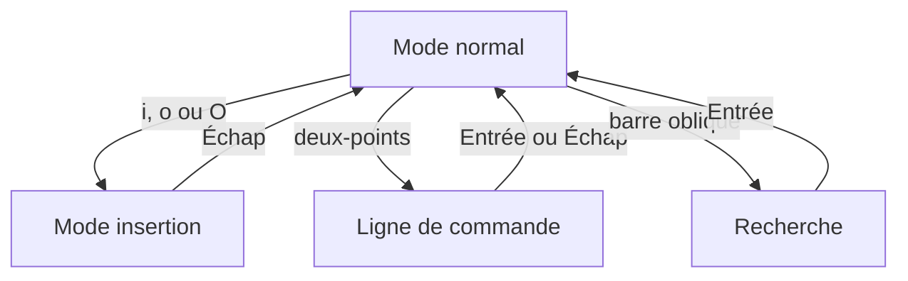

# Module 07 — Utilisation de Vi

**Sources du module.** Énoncés et corrections des TP du module. Aucun support théorique distinct n’est fourni.

Modifier le fichier Edition par déplacements, insertions, recherches, copies de lignes et substitutions. Les 22 consignes du TP sont conservées dans leur ordre ; la correction utilise des fonctionnalités Vim sous le nom Vi.

**Durée des ateliers.** 45 à 60 minutes. Lire chaque énoncé avant de commencer. Employer la machine et les fichiers de formation prévus.

## Objectifs

- Se déplacer et modifier un texte en identifiant le mode actif.
- Chercher, copier, déplacer et enregistrer des lignes.
- Choisir la portée, les ancrages et le séparateur d’une substitution, puis vérifier le résultat.

## 1. Reconnaître le mode avant de taper

| Mode | Ce que font les touches | Retour ou validation |
|---|---|---|
| **Normal** | Déplacer, rechercher, copier, supprimer, entrer dans un autre mode | Échap permet de s’y replacer |
| **Insertion** | Ajouter le texte demandé | Échap termine la saisie |
| **Commande Ex** | Exécuter une commande commençant par : | Entrée la valide |
| **Recherche** | Saisir un motif après / ou ? | Entrée, puis n ou N |

La même lettre peut donc être une action en mode normal et un caractère ajouté au fichier en mode insertion. Les blocs de touches des activités se lisent comme une séquence, pas comme une commande shell à copier dans le terminal.

**Illustration IA / externe au cours — Repérer le mode actif avant de taper.**



## 2. Se déplacer et insérer

| Touche | Action utilisée |
|---|---|
| `gg` / `G` | Début / fin de fichier |
| `w` / `e` | Mot suivant / fin de mot |
| `2e` | Répéter deux déplacements de fin de mot |
| `i` / `a` | Insérer avant / après le caractère |
| `O` / `o` | Ouvrir une ligne avant / après |
| `dd` | Supprimer la ligne |
| `yy` puis `p` | Copier la ligne puis coller après |
| `cw` | Changer le mot à partir du curseur |

Les recherches `/motif` et `?motif` vont respectivement en avant et en arrière. `n` continue dans le sens de la dernière recherche ; `N` inverse ce sens. Vérifier l’occurrence sélectionnée avant chaque modification.

## 3. Enregistrer, configurer et appeler le shell

`:wq` enregistre puis quitte. `:!date` exécute date sans fermer l’éditeur. Le fichier **$HOME/.vimrc** contient les options de Vim ; le document veut afficher les numéros, fixer tabstop à 5 et désactiver le mode compatible.

## 4. Lire une substitution

**Illustration IA / externe au cours — décomposition d’une commande.**

```text
:%s/Dupont/Durand/g
 ││ │       │      └─ toutes les occurrences de chaque ligne
 ││ │       └──────── texte de remplacement
 ││ └──────────────── motif recherché
 │└────────────────── substitution
 └─────────────────── toutes les lignes du fichier
```

La commande globale **:g/motif/action** applique une action aux lignes sélectionnées. `^` et `$` marquent début et fin ; **&** reprend le texte trouvé ; les groupes `\(...\)` peuvent être repris par **\1** dans le remplacement. La modification du séparateur facilite certains motifs, mais ne change pas le but de la substitution.

Les commandes proposées dans l’aide pratique clarifient les coquilles du document. Les graphies originales restent visibles dans l’onglet Original. Le fichier Edition et ses noms constituent un jeu d’exercice fourni ; aucune donnée réelle n’est requise.

## Ateliers complets

### TP — Utilisation de Vi

#### Activité 1 — Ouvrir Edition depuis son répertoire personnel.

```bash
vi "$HOME/Edition"
```

#### Activité 2 — Rechercher la première occurrence de Dupont Jean.

En mode normal, revenir au début avec gg, puis rechercher :

```text
/Dupont Jean
```
Valider par Entrée.

#### Activité 3 — Se placer sur le n de Jean et insérer -Jacques après lui.

La correction utilise 2e depuis le début du nom, puis a. Saisir -Jacques et revenir au mode normal avec Échap :

```text
2e
a
-Jacques
```
Le résultat attendu est Jean-Jacques.

#### Activité 4 — Rechercher Dupont Pierre puis insérer Jean- avant le P de Pierre.

```text
/Dupont Pierre
w
i
Jean-
```
Valider la recherche, saisir le préfixe en insertion puis Échap. Le prénom devient Jean-Pierre.

#### Activité 5 — Revenir au début du fichier.

Appuyer sur Échap puis :

```text
gg
```

#### Activité 6 — Retrouver le premier Dupont et insérer son propre nom et prénom sur la ligne précédente.

```text
/Dupont
O
```
Saisir le nom et le prénom demandés par le TP, puis Échap. O majuscule ouvre une ligne avant.

#### Activité 7 — Ajouter le nom et le prénom du voisin après la ligne du dernier Dupont et parcourir les occurrences avec n et N.

```text
G
?Dupont
o
```
G va en fin de fichier, ? recherche en arrière et o minuscule ouvre une ligne après. Saisir les informations de l’exercice, puis Échap. n répète la recherche dans son sens, N dans le sens opposé.

#### Activité 8 — Enregistrer les modifications et quitter.

```text
:wq
```

#### Activité 9 — Remplacer Dupont par Merlin-Duval pour le Jean visé par la consigne.

Rouvrir Edition, rechercher Dupont Jean et utiliser n pour sélectionner la bonne occurrence. Sur le mot Dupont :

```text
cwMerlin-Duval
```
Terminer avec Échap. Vérifier que les autres Dupont n’ont pas été modifiés.

#### Activité 10 — Retrouver Couteau Jean et supprimer sa ligne.

```text
/Couteau Jean
dd
```

#### Activité 11 — Changer tous les Dupont en Durand.

```text
:%s/Dupont/Durand/g
```
La correction utilise une commande globale : :g/Dupont/s//Durand/g. La forme ci-dessus explicite toutes les lignes et toutes les occurrences.

#### Activité 12 — Déplacer toutes les lignes contenant Durand à la fin du fichier.

```text
:g/Durand/m$
```
g sélectionne les lignes correspondantes et m$ les déplace vers la fin.

#### Activité 13 — Dupliquer la ligne Ben Raf.

```text
/Ben Raf
yy
p
```
yy copie la ligne et p la colle après.

#### Activité 14 — Afficher la date et l’heure sans quitter Vi.

```text
:!date
```
Lire la sortie de la commande externe, puis revenir à l’éditeur.

#### Activité 15 — Créer $HOME/.vimrc : numéros de ligne, tabulations de cinq caractères et mode non compatible.

Dans le fichier **.vimrc**, saisir :

```vim
set number
set tabstop=5
set nocompatible
```
Le nom .virmc imprimé dans la correction est une coquille. Revenir à Edition pour les remplacements suivants.

#### Activité 16 — Rechercher et remplacer tous les Durand en Dupont.

```text
:%s/Durand/Dupont/g
```

#### Activité 17 — Substituer Jean en Jean-Paul, en respectant l’espace après Jean indiqué par la correction.

```text
:%s/\<Jean\> /Jean-Paul /g
```
L’espace après le prénom fait partie du motif : il évite de transformer automatiquement les composés Jean-Jacques ou Jean-Pierre. La correction montre g/Jean /s/Jean/&-Paul ; l’aide rend la portée explicite.

#### Activité 18 — Substituer Jean en JEAN sans écrire JEAN dans l’expression.

```text
:%s/\(Jean\)/\U\1/g
```
Le groupe capturé est repris par \1 et converti en majuscules par \U, dans Vim utilisé par le laboratoire.

#### Activité 19 — Substituer JEAN en Jean en changeant le séparateur de la substitution.

```text
:%s#JEAN#Jean#g
```
Le séparateur # remplace /. La correction imprimée conserve / ; cette forme répond à la demande de l’énoncé.

#### Activité 20 — Substituer Jean en Jean-Jean sur tout le texte.

```text
:%s/Jean/Jean-Jean/g
```
% vise toutes les lignes et g toutes les occurrences d’une ligne. Le document omet g dans sa forme imprimée.

#### Activité 21 — Ajouter (033) avant chaque numéro situé en fin de ligne et commençant par 1, 2 ou 3.

```text
:%s/\<[123][0-9]*$/(033)&/
```
Le début de mot, les chiffres et la fin de ligne limitent le changement au numéro demandé. & reprend tout le numéro. La correction utilise seulement \<[1-3], sans ancrage de fin.

#### Activité 22 — Ajouter zéro à la fin de toutes les lignes qui commencent par F.

```text
:g/^F/s/$/0/
```
^F sélectionne les lignes ; $ positionne l’ajout à leur fin. Enregistrer et contrôler les dernières modifications.

## Écarts et précisions du document

!!! note "Lecture de la source"
    Le document écrit .virmc alors que l’énoncé demande .vimrc : la forme de travail est .vimrc.

!!! note "Lecture de la source"
    Quelques lignes omettent le deux-points d’entrée en commande Ex. Il est ajouté dans les exemples utilisables.

!!! note "Lecture de la source"
    La question19 demande un autre séparateur ; la correction ne le change pas. La forme avec # répond à cette partie de la consigne.

!!! note "Lecture de la source"
    Les formes source des questions20 et21 ont une portée plus étroite que leur formulation ; les ancrages et le drapeau g sont expliqués, sans modifier le texte de la source.

## À retenir

Revenir au mode normal avant une action sur les lignes. Tester une recherche avant de lancer une substitution globale. Vérifier les lignes modifiées avant d’enregistrer, et tester séparément les réglages de `.vimrc`.

## Mini-quiz

1. En mode insertion, que faire avant de taper `dd` ?
2. Quelle différence entre `O` et `o` ?
3. Que contrôlent `%` et le dernier `g` dans `:%s/a/b/g` ?
4. Comment changer le séparateur de la substitution ?
5. Que désigne `$` dans un motif de recherche ?

??? note "Réponses commentées"
    1. Appuyer sur Échap pour revenir au mode normal. Dans ce mode, `dd` supprime la ligne courante.
    2. `O` ouvre une ligne au-dessus de la ligne courante et `o` en ouvre une en dessous. Les deux passent en mode insertion.
    3. `%` étend l’opération à toutes les lignes et `g` à toutes les occurrences de chaque ligne concernée.
    4. Choisir un autre séparateur, par exemple `:%s#JEAN#Jean#g`. Le caractère `#` délimite ici le motif et le remplacement.
    5. La fin de ligne. Il sert notamment à cibler les numéros en fin de ligne dans l’activité 21.

## Pour pratiquer et réviser

- [TP : énoncés et corrections](../../tp/utilisation-linux/module-07/index.md)
- [Fiche de révision](../../revision/utilisation-linux/module-07-utilisation-de-vi.md)
- [Kahoot existant du module](../../kahoot/04-utilisation-gnu-linux-module-07-utilisation-de-vi.md)
- [Commandes GNU/Linux](../../commandes/linux.md)
- [Présentation du cours](index.md)

## Provenance pédagogique

Les consignes, noms et exemples proviennent des documents de formation disponibles. Les explications, contrôles, variantes explicitement signalées et mini-quiz sont une aide pédagogique distincte de la transcription originale. Les sorties de captures sont des exemples, pas des valeurs à imposer à chaque machine.
