# Module 07 — Utilisation de Vi

Les parties ci-dessous reprennent le cours original, dans le même ordre. Les encadrés et les schémas répètent ses formulations.

## Parcours de lecture

1. Énoncé · Enoncé du TP - Utilisation de Vi · 7 pages transcrites
2. Correction · Solution du TP - Utilisation de Vi · 13 pages transcrites

**Visuel externe**

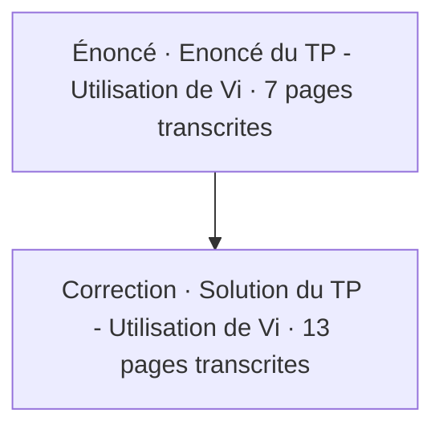

Le dossier de ce module contient des énoncés et corrections de TP, sans support de cours distinct. Les documents disponibles sont reproduits intégralement ; aucun support manquant n’a été reconstitué par IA.

SOURCE DRIVE · TRANSCRIPTION DU SUPPORT

Le contenu des documents du dossier TSSR est transcrit ci-dessous, page par page. Les textes et tableaux sont intégrés à la page Web. Aucun fichier PDF, aucune diapositive entière ni aucune reproduction de page n’est affiché. Seuls des croquis ou visuels isolés et vérifiés peuvent accompagner la transcription. Les versions et les consignes restent celles des supports de formation. Les compléments IA sont conservés dans leur onglet distinct.

## Énoncé · Enoncé du TP - Utilisation de Vi · 7 pages transcrites

!!! note "À retenir"
    Utilisation d'une distribution GNU/Linux

Utilisation d'une distribution GNU/Linux

#### Utilisation de Vi

!!! note "À retenir"
    TP du Module 07 – Editer du texte sous Linux Avant de démarrer ce TP, il convient d’avoir suivi les vidéos du module 7 et d’avoir effectué le TP précédent.

TP du Module 07 – Editer du texte sous Linux

Avant de démarrer ce TP, il convient d’avoir suivi les vidéos du module 7 et d’avoir effectué le TP précédent.

Durée estimée

45 à 60 minutes

#### Énoncé

!!! note "À retenir"
    Dans le module que vous venez de parcourir, vous trouverez les commandes nécessaires pour répondre aux questions.

**Visuel externe**


Dans le module que vous venez de parcourir, vous trouverez les commandes nécessaires pour répondre aux questions.

1. Ouvrez le fichier Edition de votre répertoire d'accueil avec vi .
2. Le premier Dupont Jean se prénomme en fait Jean-Jacques. Rechercher la première occurrence de Dupont Jean .

1. Déplacez-vous sur le n de Jean puis insérez -Jacques .
2. De la même manière, recherchez Dupont Pierre et insérez Jean-après vous être placé sur le 'P' de Pierre.
3. Replacez-vous en début de fichier .
4. Cherchez le premier Dupont et insérez sur la ligne précédente votre nom et prénom.

1. Entrez le nom et le prénom de votre voisin après la ligne du dernier Dupont. Déplacez-vous dans le fichier sur les différentes occurrences avec les touches 'n' et 'N'.
2. Enregistrez les modifications apportées au fichier et sortez de l'éditeur.
3. Dupont Jean s'appelle en fait Merlin-Duval Jean. Recherchez Dupont Jean et changez Dupont par Merlin-Duval.
4. Supprimez la ligne Couteau Jean après l'avoir retrouvé.

1. Changez tous les Dupont en Durand .
2. Déplacez toutes les lignes contenant Durand en fin de fichier.
3. Ajoutez un second Ben Raf, en dupliquant la ligne existante.
4. Sans sortir de la session vi, affichez la date et l'heure (pour savoir si c'est l'heure de la pause).

1. Créez un fichier .vimrc dans le répertoire de connexion ($HOME), dont le contenu va permettre d'afficher les numéros de lignes, de positionner les tabulations tous les 5 caractères et de passer en mode non compatible (Linux uniquement) .

Recherche globale avec remplacement.

1. Recherchez et remplacez tous les Durand en Dupont.
2. Substituez Jean en Jean-Paul.
3. Substituez Jean en JEAN (sans écrire JEAN dans l'expression régulière).

1. Substituez JEAN en Jean en modifiant le séparateur de l'expression régulière.
2. Substituez Jean en Jean-Jean sur tout le texte.
3. Ajoutez (033) devant chaque numéro (en fin de ligne) commençant par 1,2 ou 3.

```
Exemple: Frederic Thouin (033)124666
```

1. Ajoutez 0 (zéro) à la fin de toutes les lignes qui commencent par 'F'.

#### Solution

!!! note "À retenir"
    Une solution est proposée pour ce TP sous la forme d'un PDF commenté, disponible dans les ressources à télécharger.

Une solution est proposée pour ce TP sous la forme d'un PDF commenté, disponible dans

les ressources à télécharger.

Référence du document : 1_NcmRFZlM6nu_JCNLekgXw5bgCmPPgym · SHA-256 62f4e4cee5500e66…

## Correction · Solution du TP - Utilisation de Vi · 13 pages transcrites

!!! note "À retenir"
    Correction originale : à consulter après avoir tenté l’exercice.

Correction originale : à consulter après avoir tenté l’exercice.

#### Utilisation de Vi

!!! note "À retenir"
    TP du Module 07 – Editer du texte sous Linux Avant de démarrer ce TP, il convient d’avoir suivi les vidéos du module 7 et d’avoir effectué le TP précédent.

TP du Module 07 – Editer du texte sous Linux

Avant de démarrer ce TP, il convient d’avoir suivi les vidéos du module 7 et d’avoir effectué le TP précédent.

Durée estimée

45 à 60 minutes

#### Proposition de solution

!!! note "À retenir"
    Dans le module que vous venez de parcourir, vous trouverez les commandes nécessaires pour répondre aux questions.

!!! warning "Attention"
    (attention à mettre un espace après Jean comme vous pouvez le voir dans la capture d’écran suivante) Substituez Jean en JEAN (sans écrire JEAN dans l'expression régulière).

**Visuel externe**


Dans le module que vous venez de parcourir, vous trouverez les commandes nécessaires pour répondre aux questions.

1. Ouvrir le fichier Edition de votre répertoire d'accueil avec vi .

```
vi Edition
```

1. Le premier Dupont Jean se prénomme en fait Jean-Jacques. Recherchez la première occurrence de Dupont Jean .

```
/Dupont Jean
```

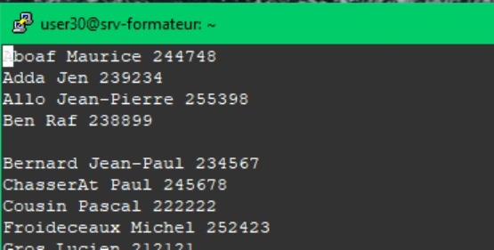

Visuel isolé du document — Solution du TP - Utilisation de Vi

1. Déplacez-vous sur le n de Jean puis insérez -Jacques .

```
2e
```

```
a
```

```
-Jacques
```

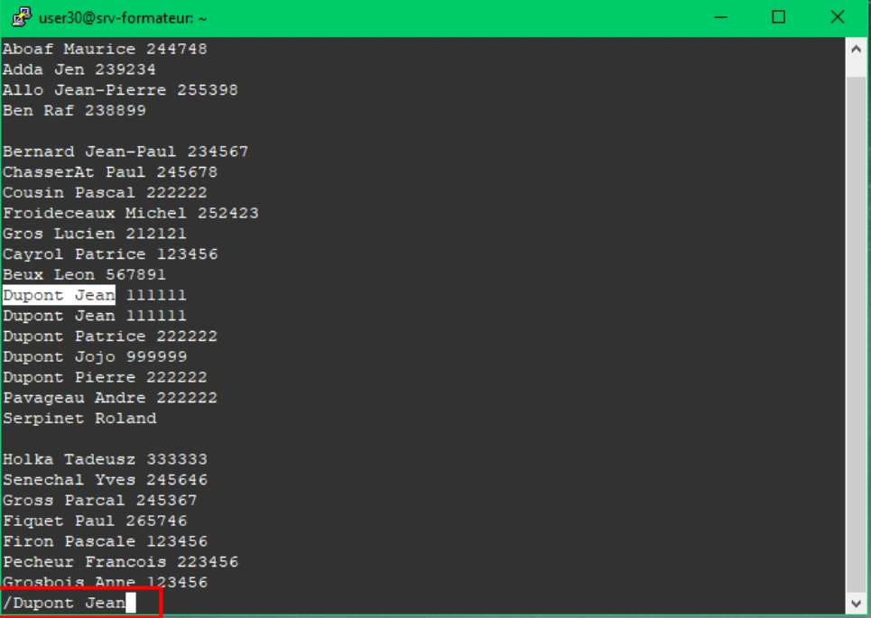

Visuel isolé du document — Solution du TP - Utilisation de Vi

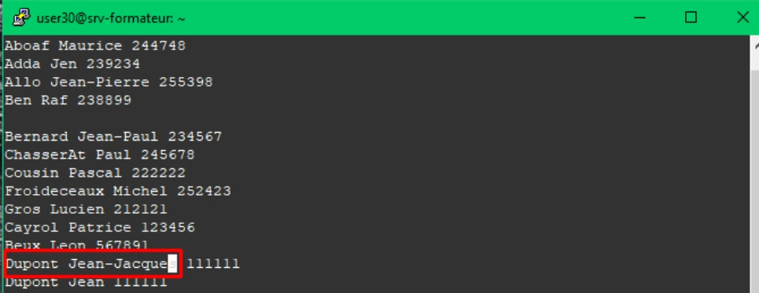

Visuel isolé du document — Solution du TP - Utilisation de Vi

1. De la même manière, recherchez Dupont Pierre et insérez Jean-après vous être placé sur le 'P' de Pierre.

```
/Dupont Pierre
```

```
w
```

```
i
```

```
Jean-
```

1. Replacez-vous en début de fichier.

```
esc
```

```
gg
```

1. Cherchez le premier Dupont et insérez sur la ligne précédente votre nom et prénom.

```
/Dupont
```

```
O
```

```
MARTIN Camille
```

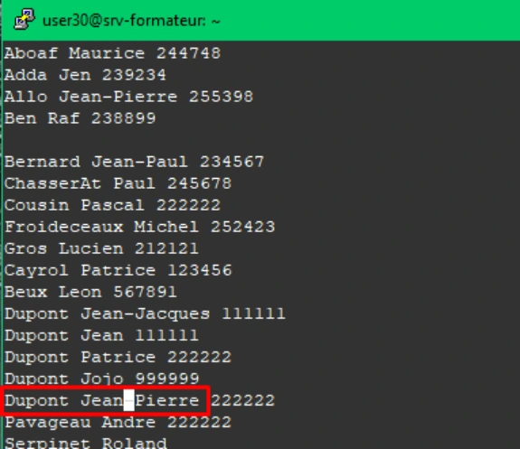

Visuel isolé du document — Solution du TP - Utilisation de Vi

1. Entrez le nom et le prénom de votre voisin après la ligne du dernier Dupont. Déplacez-vous dans le fichier sur les différentes occurrences avec les touches 'n' et 'N'.

```
G
```

```
?Dupont
```

```
o
```

```
BERNARD Alex
```

1. Enregistrez les modifications apportées au fichier et sortez de l'éditeur.

```
:wq
```

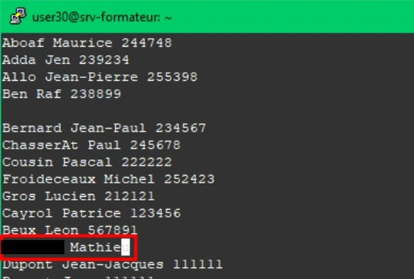

Visuel isolé du document — Solution du TP - Utilisation de Vi

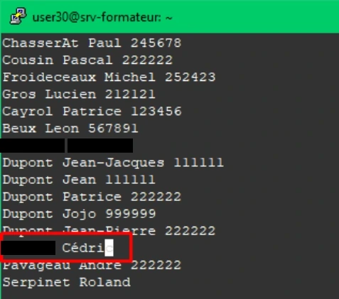

Visuel isolé du document — Solution du TP - Utilisation de Vi

1. Dupont Jean s'appelle en fait Merlin-Duval Jean. Recherchez Dupont Jean et changez Dupont par Merlin-Duval.

```
vi Edition
```

```
/Dupont Jean
```

```
n
```

```
cwMerlin-Duval
```

1. Supprimez la ligne Couteau Jean après l'avoir retrouvé.

```
/Couteau Jean
```

```
dd
```

1. Changez tous les Dupont en Durand .

```
: g/Dupont/s//Durand/g
```

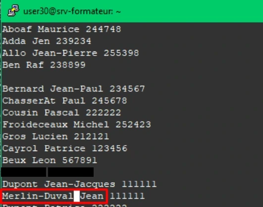

Visuel isolé du document — Solution du TP - Utilisation de Vi

1. Déplacez toutes les lignes contenant Durand en fin de fichier.

```
: g/Durand/m$
```

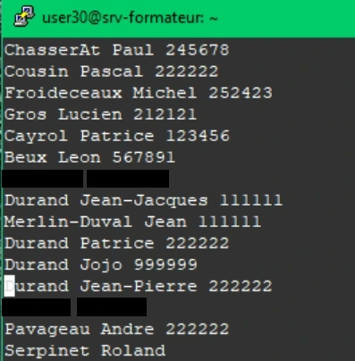

Visuel isolé du document — Solution du TP - Utilisation de Vi

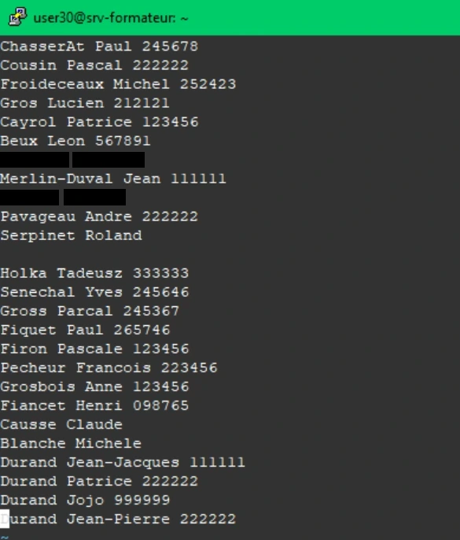

Visuel isolé du document — Solution du TP - Utilisation de Vi

1. Ajoutez un second Ben Raf, en dupliquant la ligne existante.

```
/Ben Raf
```

```
yy
```

```
p
```

1. Sans sortir de la session vi, affichez la date et l'heure (pour savoir si c'est l'heure de la pause).

```
:!date
```

1. Créez un fichier .vimrc dans le répertoire de connexion ($HOME), dont le contenu va permettre d'afficher les numéros de lignes, de positionner les tabulations tous les 5 caractères et de passer en mode non compatible (Linux uniquement) .

```
vi .virmc
```

```
i
```

```
set number
```

```
set tabstop=5
```

```
set nocompatible
```

Recherche globale avec remplacement.

1. Recherchez et remplacez tous les Durand en Dupont.

```
vi Edition
```

```
:g/ Durand/s//Dupont/
```

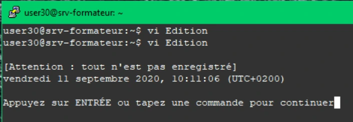

Visuel isolé du document — Solution du TP - Utilisation de Vi

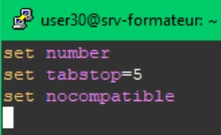

Visuel isolé du document — Solution du TP - Utilisation de Vi

1. Substituez Jean en Jean-Paul.

```
g/Jean /s/Jean/&-Paul
```

(attention à mettre un espace après Jean comme vous pouvez le voir dans la capture d’écran suivante)

1. Substituez Jean en JEAN (sans écrire JEAN dans l'expression régulière).

```
:g/\(Jean\)/s//\U\1/
```

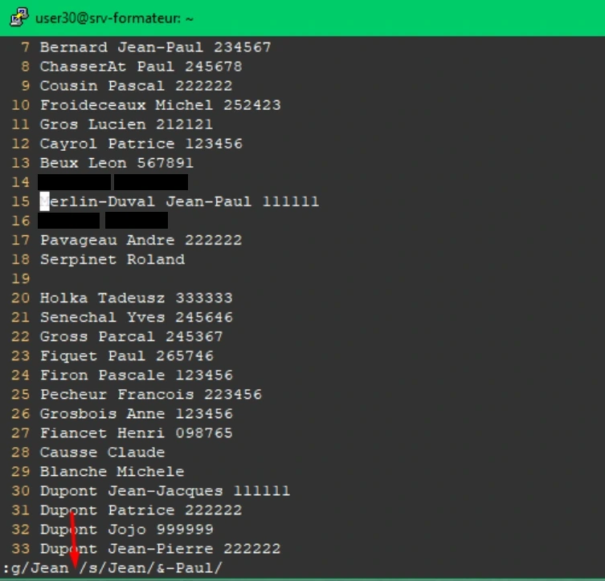

Visuel isolé du document — Solution du TP - Utilisation de Vi

1. Substituez JEAN en Jean en modifiant le séparateur de l'expression régulière.

```
:g/JEAN/s//Jean/
```

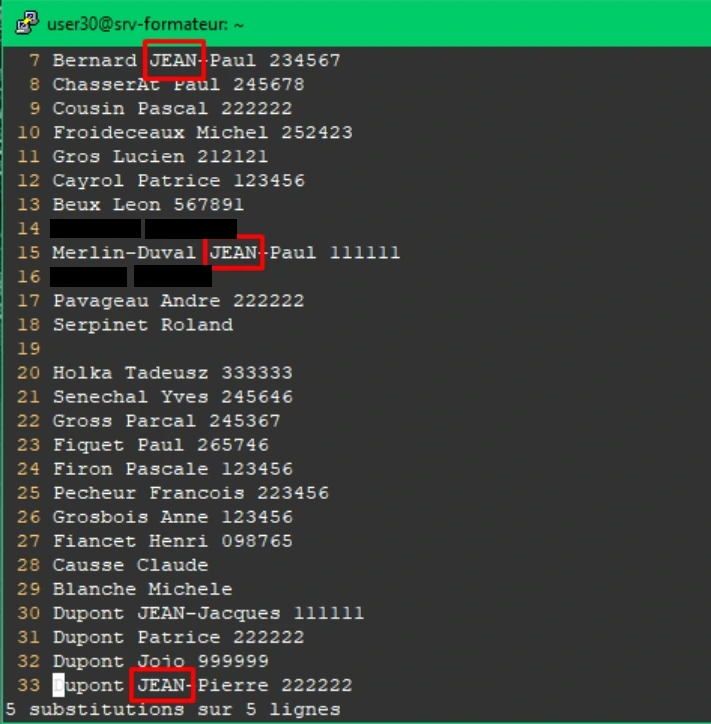

Visuel isolé du document — Solution du TP - Utilisation de Vi

1. Substituez Jean en Jean-Jean sur tout le texte.

```
:%s/Jean/Jean-Jean/
```

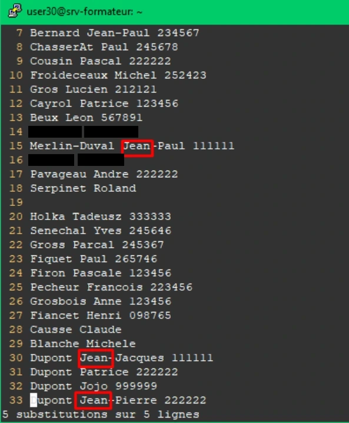

Visuel isolé du document — Solution du TP - Utilisation de Vi

1. Ajoutez (033) devant chaque numéro (en fin de ligne) commençant par 1,2 ou 3.

```
Exemple : Frederic Thouin (033)124666
```

```
:%s/\<[1-3]/(033)&/
```

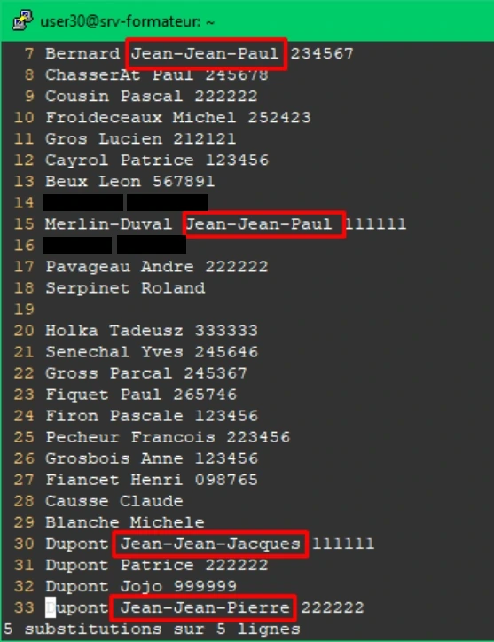

Visuel isolé du document — Solution du TP - Utilisation de Vi

1. Ajoutez 0 (zéro) à la fin de toutes les lignes qui commencent par 'F'.

```
g/^F/s/$/0/
```

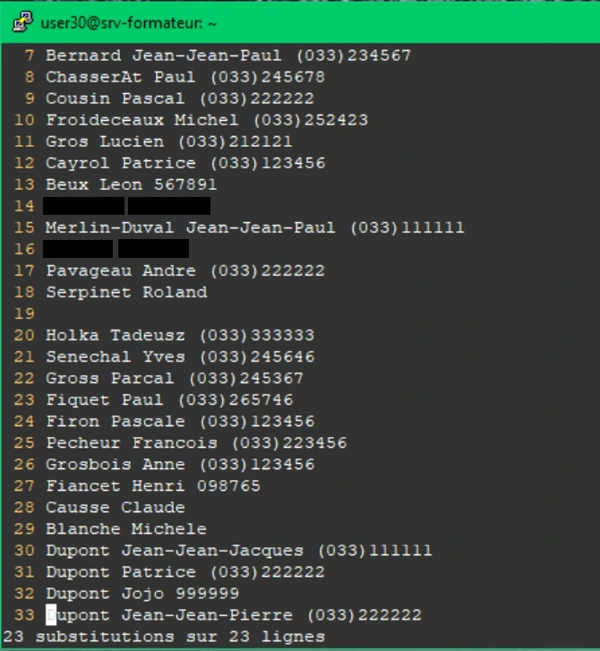

Visuel isolé du document — Solution du TP - Utilisation de Vi

#### Solution

Une solution est proposée pour ce TP sous la forme d'un PDF commenté, disponible dans les ressources à télécharger.

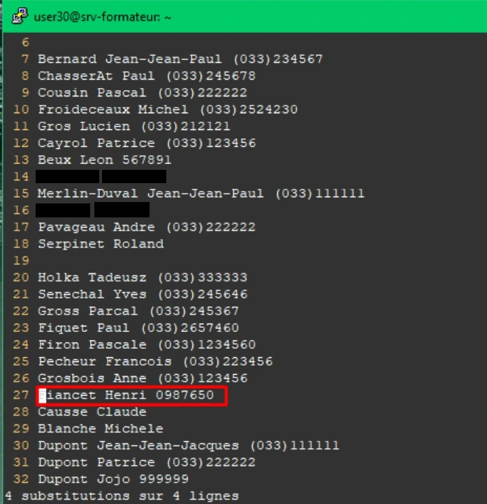

Visuel isolé du document — Solution du TP - Utilisation de Vi

Référence du document : 1cSuFMkKLzf-5P7v0aszRGy6bE4qiyZHs · SHA-256 91154f62451e05b1…

## Fiche de synthèse

Les lignes reprennent les titres du cours et la première phrase de chaque partie.

| Partie | Repère du cours |
| --- | --- |
| Énoncé · Enoncé du TP - Utilisation de Vi · 7 pages transcrites | Utilisation d'une distribution GNU/Linux |
| Correction · Solution du TP - Utilisation de Vi · 13 pages transcrites | Correction originale : à consulter après avoir tenté l’exercice. |
