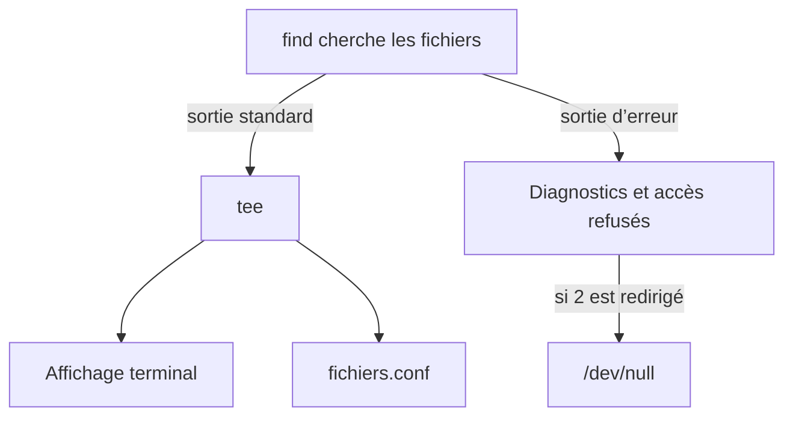

# Module 08 — Mécanismes Linux et Bash avancé

**Sources du module.** Énoncés et corrections des TP du module. Aucun support théorique distinct n’est fourni.

Combiner les commandes avec redirections et pipelines, mesurer leur exécution, archiver/restaurer, créer des alias et observer l’héritage des variables. Les quatre énoncés et leurs corrections restent distincts, même lorsque les scénarios se recoupent.

**Durée des ateliers.** Quatre TP : 45 à 60 minutes, sauf Alias 30 à 45 minutes. Lire chaque énoncé avant de commencer. Employer la machine et les fichiers de formation prévus.

## Objectifs

- Rediriger les deux flux et combiner les commandes pour produire les preuves demandées.
- Créer, contrôler et restaurer une archive, puis comparer les compressions.
- Composer un alias et observer ce qu’un sous-shell hérite après `export`.

## 1. Suivre les flux

| Syntaxe | Rôle dans les TP |
|---|---|
| `>` | Écrire le résultat standard dans un fichier, en le remplaçant |
| `>>` | Ajouter à la suite du fichier |
| `2>/dev/null` | Rediriger la sortie d’erreur vers `/dev/null` et conserver la sortie standard |
| `commande1 \| commande2` | Transmettre la sortie standard à l’entrée de la commande suivante |
| `tee fichier` | Afficher le flux tout en l’enregistrant |
| `time ...` | Mesurer l’exécution de la commande ou du pipeline visé |

Le fichier **fichiers.conf** contient des chemins trouvés, et non le contenu des fichiers .conf. Le fichier **compteur.txt** doit ne contenir que le nombre demandé. Les répertoires process et resultats doivent exister avant la redirection.

Les exemples utilisent le répertoire personnel comme point de départ. Les chemins relatifs **resultats/...** de la correction dépendent de cette position ; les chemins **$HOME/resultats/...** permettent de l’expliciter.

**Illustration IA / externe au cours — Suivre la sortie de find jusqu’au terminal et au fichier.**



## 2. Limiter une recherche au système de fichiers racine

```bash
find / -mount -type f -name '*.conf' 2>/dev/null
```

La recherche commence à **/** ; **-mount** évite de descendre vers d’autres systèmes de fichiers ; **-type f** vise les fichiers standards. Le motif est protégé pour être interprété par find. Une recherche peut rencontrer des accès refusés ; la redirection d’erreur les retire de la sortie utilisée dans le TP.

`time` doit encadrer une exécution : il ne reconstruit pas rétroactivement la durée exacte d’une commande déjà terminée si elle n’a pas été mesurée. Les sorties real, user et sys du document sont des observations historiques à comparer aux résultats de son laboratoire.

!!! note "Lire le résultat de la recherche"
    `2>/dev/null` masque les diagnostics, notamment les accès refusés. Une liste non vide peut donc être partielle. Relancer sans redirection si le TP demande de justifier le périmètre réellement parcouru.

## 3. Archive et compression sont deux opérations

| Forme GNU tar du scénario | But |
|---|---|
| `-c` | Créer une archive |
| `-t` | Lister son contenu |
| `-x` | Extraire |
| `-u` | Mettre à jour une archive non compressée |
| `-f fichier` | Choisir le fichier archive |
| `-v` | Afficher les noms traités |
| `-z` | Utiliser gzip |
| `-j` | Utiliser bzip2 |
| `-C répertoire` | Changer le répertoire de destination de l’opération |
| `--exclude=...` | Exclure les chemins correspondants |

Le document archive **$HOME** dans **/tmp**, en nommant l’archive avec **$LOGNAME**. GNU tar signale qu’il enlève le `/` initial des chemins enregistrés : lors de la restauration, le contenu peut donc apparaître sous **Restaurations/home/nom_utilisateur/**. Lire `tar -tf` pour vérifier les chemins réels plutôt que supposer leur emplacement.

Les captures comparent environ 50 K pour l’archive brute, 6,3 K pour gzip et 6,2 K pour bzip2 dans leur jeu d’essai. Le résultat de son propre répertoire peut différer : comparer les tailles réellement obtenues, sans promettre le même classement.

## 4. Alias : nom court d’une instruction

Un alias simplifie l’appel d’une ligne répétée. Les **guillemets simples** de sa définition conservent les variables pour l’exécution future de l’alias. Le TP les définit dans le shell interactif courant ; ils ne deviennent pas automatiquement des réglages permanents.

Le TP Redirections et Alias reprend les quatre questions du TP Utilisation des systèmes, puis demande de les reproduire avec des alias. Cette répétition est conservée comme entraînement, sans présenter les deux documents comme un seul énoncé.

## 5. Variables locales et environnement

**$HOME** désigne le répertoire personnel ; **$PATH** contient les répertoires de recherche des programmes, séparés par `:` ; **$LOGNAME** contient le login dans le contexte du laboratoire.

```bash
monnom="$LOGNAME"
```

Cette affectation sans espaces crée une variable dans le shell courant. Un sous-shell lancé par **bash** ne l’hérite pas automatiquement. **export monnom** la place dans l’environnement transmis aux futurs processus enfants.

**env** affiche les variables d’environnement exportées ; il ne liste pas toutes les variables locales. **set** permet d’examiner les variables du shell et peut afficher également d’autres définitions ; cette distinction explique pourquoi env ne suffit pas à vérifier une variable locale.

Pour rendre un ajout au PATH pérenne dans le shell interactif de l’exercice, placer une seule fois la ligne voulue dans **$HOME/.bashrc**. Éviter de développer les variables au moment d’écrire cette ligne : le fichier doit conserver les références `$PATH` et `$HOME`.

## Ateliers complets

### TP01 — Utilisation des systèmes

#### Activité 1 — Lister tous les processus dont l’affichage se termine par d et enregistrer dans $HOME/process/daemons.txt.

```bash
mkdir -p "$HOME/process"
ps -e | grep 'd$' > "$HOME/process/daemons.txt"
cat "$HOME/process/daemons.txt"
```
Le motif filtre ici la fin des lignes de l’affichage ps du scénario.

#### Activité 2 — Rechercher depuis / les fichiers .conf, sans quitter son système de fichiers, et afficher/enregistrer simultanément les chemins.

```bash
mkdir -p "$HOME/resultats"
find / -mount -type f -name '*.conf' 2>/dev/null |
    tee "$HOME/resultats/fichiers.conf"
```
Comparer les chemins affichés et ceux enregistrés.

#### Activité 3 — Mesurer le temps exact de cette exécution.

Relancer la recherche en l’encadrant par time :

```bash
time find / -mount -type f -name '*.conf' 2>/dev/null |
    tee "$HOME/resultats/fichiers.conf"
```
Observer les informations de temps ; une exécution non mesurée ne peut pas être chronométrée rétroactivement avec cette seule commande.

#### Activité 4 — En une commande, enregistrer uniquement le nombre de fichiers trouvés sans relire fichiers.conf.

```bash
find / -mount -type f -name '*.conf' 2>/dev/null |
    wc -l > "$HOME/resultats/compteur.txt"
cat "$HOME/resultats/compteur.txt"
```
La commande principale effectue la recherche et le comptage ; cat est le contrôle séparé du livrable.

### TP02 — Archivage et compression

#### Activité 1 — Archiver son répertoire personnel dans /tmp sous son login et noter la taille.

```bash
tar -cvf "/tmp/$LOGNAME.tar" "$HOME"
ls -lh "/tmp/$LOGNAME.tar"
```
Le chemin de sortie est hors du répertoire archivé.

#### Activité 2 — Créer l’archive compressée avec gzip en une seule instruction.

```bash
tar -czvf "/tmp/$LOGNAME.tar.gz" "$HOME"
ls -lh "/tmp/$LOGNAME.tar.gz"
```

#### Activité 3 — Répéter avec bzip2.

```bash
tar -cjvf "/tmp/$LOGNAME.tar.bz2" "$HOME"
ls -lh "/tmp/$LOGNAME.tar.bz2"
```

#### Activité 4 — Comparer les trois tailles et identifier la plus petite de son essai.

```bash
ls -l /tmp/"$LOGNAME".tar*
```
Relever les octets ou les unités cohérentes avant de conclure.

#### Activité 5 — Créer Restaurations dans son répertoire personnel et y restaurer en une instruction d’extraction.

```bash
mkdir -p "$HOME/Restaurations"
tar -xzvf "/tmp/$LOGNAME.tar.gz" -C "$HOME/Restaurations"
```
Inspecter les chemins extraits : l’archive de $HOME peut contenir le préfixe home/login sous Restaurations.

#### Activité 6 — Créer une nouvelle sauvegarde non compressée en excluant Restaurations.

```bash
tar -cvf "/tmp/$LOGNAME-v2.tar" --exclude=Restaurations "$HOME"
tar -tf "/tmp/$LOGNAME-v2.tar"
```
La seconde commande vérifie l’absence du répertoire exclu.

#### Activité 7 — Créer un fichier vide puis mettre à jour l’archive et vérifier sa présence.

```bash
touch "$HOME/new_fichier.txt"
tar -uvf "/tmp/$LOGNAME-v2.tar" "$HOME/new_fichier.txt"
tar -tf "/tmp/$LOGNAME-v2.tar"
```
L’opération de mise à jour concerne l’archive non compressée v2, comme dans le document.

### TP03 — Redirections et Alias

#### Activité 1 — Reproduire les quatre actions processus/recherche/durée/comptage avec leurs livrables, puis créer des alias correspondants.

Les quatre premières demandes sont identiques à celles du TP01 : conserver les chemins daemons.txt, fichiers.conf et compteur.txt, la limite -mount, le double affichage tee et le comptage sans relire le fichier.

```bash
mkdir -p "$HOME/process" "$HOME/resultats"
alias lister_daemons='ps -e | grep "d$" > "$HOME/process/daemons.txt"'
alias rechercher_conf='find / -mount -type f -name "*.conf" 2>/dev/null | tee "$HOME/resultats/fichiers.conf"'
alias compter_fichiers='find / -mount -type f -name "*.conf" 2>/dev/null | wc -l > "$HOME/resultats/compteur.txt"'

lister_daemons
rechercher_conf
time rechercher_conf
compter_fichiers
```
Les alias sont à définir puis à appeler dans le shell interactif, avec des validations distinctes. Vérifier le contenu des trois fichiers produits. Les variantes cat fichiers.conf | wc -l et grep -c f$ sont montrées dans la correction mais ne satisfont pas l’interdiction de relire ce fichier.

### TP04 — Manipuler des variables

#### Activité 1 — Afficher le répertoire personnel avec une variable adéquate.

Pour afficher le chemin :

```bash
printf '%s\n' "$HOME"
```
La correction utilise ls $HOME ou ls ~ : ces commandes affichent son contenu. Pour reproduire cette interprétation :

```bash
ls "$HOME"
```

#### Activité 2 — Afficher les chemins des binaires usuels.

```bash
printf '%s\n' "$PATH"
```
Le document utilise echo $PATH ; chaque répertoire est séparé par un deux-points.

#### Activité 3 — Créer scripts sous $HOME, l’ajouter au PATH et rendre l’ajout pérenne.

```bash
mkdir -p "$HOME/scripts"
export PATH="$PATH:$HOME/scripts"
```

Ajouter une seule fois dans **$HOME/.bashrc** la ligne suivante, telle quelle :

```bash
export PATH="$PATH:$HOME/scripts"
```

Vérifier le PATH d’un nouveau shell interactif. Le slash ajouté avant $HOME dans la correction n’est pas nécessaire.

#### Activité 4 — Créer la variable monnom avec le login de l’utilisateur.

```bash
monnom="$LOGNAME"
```
La variante monnom=$(logname) reprend l’autre méthode de la source lorsque logname fonctionne dans la session. Conserver un seul nom de variable pour tout l’exercice.

#### Activité 5 — Afficher les variables de l’utilisateur et distinguer locales et environnement.

```bash
set
env
```
env, employé par la correction, ne présente que l’environnement exporté ; set permet de retrouver aussi monnom local dans le shell courant.

#### Activité 6 — Ouvrir un sous-shell, vérifier que monnom n’est pas hérité puis le fermer.

```bash
bash
printf '%s\n' "$monnom"
exit
```
Avant export, le nouveau shell ne reçoit pas la variable locale ; revenir au parent pour la suite.

#### Activité 7 — Transformer la variable locale en variable d’environnement.

```bash
export monnom
```

#### Activité 8 — Ouvrir un nouveau sous-shell et vérifier la valeur héritée.

```bash
bash
printf '%s\n' "$monnom"
exit
```
Cette fois le login doit être visible. Quitter le sous-shell ramène au parent ; l’enfant ne modifie pas automatiquement les variables de son parent.

## Écarts et précisions du document

!!! note "Lecture de la source"
    Le document Alias écrit parfois `find / mount`, sans le tiret de -mount, et un tiret typographique dans ps –e : les exemples utilisables rétablissent les options ASCII.

!!! note "Lecture de la source"
    Deux variantes de comptage de la correction relisent fichiers.conf, contrairement à la consigne. Seule la variante find | wc -l respecte la demande « sans utiliser ce fichier ».

!!! note "Lecture de la source"
    Les sources alternent monnom et monom. La pratique emploie monnom de façon cohérente dans l’affectation, l’export et les vérifications.

!!! note "Lecture de la source"
    La source ajoute /$HOME/scripts au PATH et utilise echo avec expansion immédiate pour .bashrc. L’aide utilise $HOME/scripts et une ligne de configuration dont les variables restent littérales.

!!! note "Lecture de la source"
    Les en-têtes « Archivage et compression » du TP Variables et « Titre exact du cours complet » du TP Alias sont des résidus de gabarit, pas de nouvelles matières.

## À retenir

Distinguer la sortie standard des diagnostics avant de filtrer. Inspecter une archive avec `tar -t` avant d’extraire vers le répertoire prévu. Utiliser `export` pour transmettre une variable aux futurs processus enfants.

## Mini-quiz

1. Pourquoi utiliser `tee` pour la liste des fichiers ?
2. Comment compter sans relire `fichiers.conf` ?
3. Que masque `2>/dev/null` pendant la recherche ?
4. À quoi servent `-z` et `-j` avec `tar` ?
5. Pourquoi le premier sous-shell ne reçoit-il pas `monnom` ?

??? note "Réponses commentées"
    1. `tee` recopie son entrée à la fois sur sa sortie standard et dans le fichier demandé.
    2. Passer la sortie de `find` directement à `wc -l`, puis rediriger le compteur vers `compteur.txt`.
    3. Les diagnostics envoyés sur la sortie d’erreur, comme les accès refusés. Une liste affichée peut donc être partielle.
    4. Ils sélectionnent respectivement gzip et bzip2. Le TP demande de comparer les tailles réellement obtenues.
    5. La variable n’est pas encore exportée. Après `export monnom`, un nouveau processus enfant hérite de sa valeur.

## Pour pratiquer et réviser

- [TP : énoncés et corrections](../../tp/utilisation-linux/module-08/index.md)
- [Fiche de révision](../../revision/utilisation-linux/module-08-mecanismes-linux-et-bash-avance.md)
- [Kahoot existant du module](../../kahoot/04-utilisation-gnu-linux-module-08-mecanismes-linux-et-bash-avance.md)
- [Commandes GNU/Linux](../../commandes/linux.md)
- [Manuel des redirections Bash](https://www.gnu.org/s/bash/manual/html_node/Redirections.html)
- [Présentation du cours](index.md)

## Provenance pédagogique

Les consignes, noms et exemples proviennent des documents de formation disponibles. Les explications, contrôles, variantes explicitement signalées et mini-quiz sont une aide pédagogique distincte de la transcription originale. Les sorties de captures sont des exemples, pas des valeurs à imposer à chaque machine.
