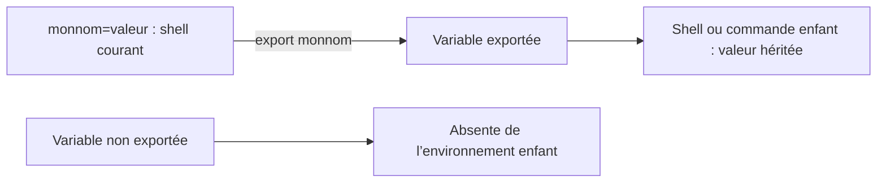

# Module 08 — Mécanismes Linux et Bash avancé

> **Sources A :** huit PDF TP M08 ; aucun support séparé n'est disponible.

## TP1 — Utilisation des systèmes

```text
mkdir $HOME/process
ps -e | grep d$ > $HOME/process/daemons.txt
cat process/daemons.txt
mkdir $HOME/resultats
find / -mount -type f -name "*.conf" 2>/dev/null | tee resultats/fichiers.conf
cat resultats/fichiers.conf
time find / -mount -type f -name "*.conf" 2>/dev/null | tee resultats/fichiers.conf
find / -mount -type f -name "*.conf" 2>/dev/null | wc -l > resultats/compteur.txt
```

## TP2 — Archivages et Compression

```text
tar -cvf /tmp/$LOGNAME.tar $HOME
tar -czvf /tmp/$LOGNAME.tar.gz $HOME
tar -cjvf /tmp/$LOGNAME.tar.bz2 $HOME
tar -xzvf /tmp/$LOGNAME.tar.gz -C Restaurations
tar -cvf /tmp/$LOGNAME-v2.tar --exclude=Restaurations $HOME
tar -uvf /tmp/$LOGNAME-v2.tar ~/new_fichier.txt
tar -tf /tmp/$LOGNAME-v2.tar
```

## TP3 — Redirections et Alias

```text
alias lister_daemons='ps -e | grep d$ > $HOME/process/daemons.txt'
alias rechercher_conf='find / -mount -type f -name "*.conf" 2>/dev/null | tee $HOME/resultats/fichiers.conf'
alias compter_fichiers='find / -mount -type f -name "*.conf" 2>/dev/null | wc -l > $HOME/resultats/compteur.txt'
```

Les alias sont valables pour la session courante selon la solution.

## TP4 — Manipuler des Variables

```text
ls $HOME
ls ~
echo $PATH
mkdir $HOME/scripts
PATH=$PATH:/$HOME/scripts
echo PATH=$PATH:/$HOME/scripts >> ~/.bashrc
monom="$LOGNAME"
monom=$(logname)
env
bash
echo $monnom
exit
export monnom
```

!!! warning "NEEDS_REVIEW"

    L'énoncé indique `monnom`, la solution `monom`. La forme
    `PATH=$PATH:/$HOME/scripts` et l'en-tête « Archivage et compression » de la
    solution sont conservés à l'identique.

## Liens

- [TP M08](../../tp/utilisation-linux/module-08/index.md)
- [Fiche de révision](../../revision/utilisation-linux/module-08-mecanismes-linux-et-bash-avance.md)
- [Kahoot M08](../../kahoot/04-utilisation-gnu-linux-module-08-mecanismes-linux-et-bash-avance.md)
- [Présentation de la séquence](index.md)

<!-- TSSR-LINUX-VISUAL-20261020 -->

## Complément IA / externe au cours — Distinguer variable du shell et environnement

**Illustration IA / externe au cours.**



La solution mélange `monom` et `monnom` : ce sont deux noms distincts. Pour tester l’héritage, garder un nom unique, par exemple `monnom="$LOGNAME"`, puis `export monnom` avant de lancer le shell enfant. Cet exemple corrigé est un ajout externe ; les commandes des PDF restent intactes. [Référence externe — manuel Bash, Environment](https://www.gnu.org/software/bash/manual/html_node/Environment.html).
