# Module 08 — Mécanismes Linux et Bash avancé

Les parties ci-dessous reprennent le cours original, dans le même ordre. Les encadrés et les schémas répètent ses formulations.

## Parcours de lecture

1. Énoncé · Enoncé du TP 1 - Utilisation des systèmes · 2 pages transcrites
2. Énoncé · M08TP02 - Enoncé - Archivages et Compression · 2 pages transcrites
3. Énoncé · M08TP03 - Enoncé - Redirections et Alias · 2 pages transcrites
4. Énoncé · M08TP04 - Enoncé - Manipuler des Variables · 2 pages transcrites
5. Correction · Solution du TP 1 - Utilisation des systèmes · 3 pages transcrites
6. Correction · M08TP02 - Solution - Archivages et Compression · 4 pages transcrites
7. Correction · M08TP03 - Solution - Alias et Redirections · 2 pages transcrites
8. Correction · M08TP04 - Solution - Manipuler des Variables · 2 pages transcrites

**Visuel externe**

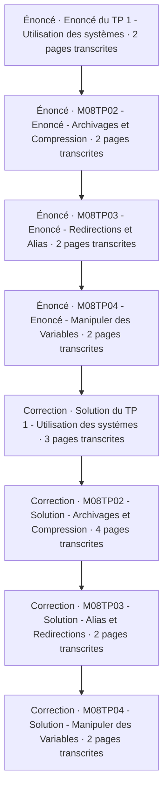

Le dossier de ce module contient des énoncés et corrections de TP, sans support de cours distinct. Les documents disponibles sont reproduits intégralement ; aucun support manquant n’a été reconstitué par IA.

SOURCE DRIVE · TRANSCRIPTION DU SUPPORT

Le contenu des documents du dossier TSSR est transcrit ci-dessous, page par page. Les textes et tableaux sont intégrés à la page Web. Aucun fichier PDF, aucune diapositive entière ni aucune reproduction de page n’est affiché. Seuls des croquis ou visuels isolés et vérifiés peuvent accompagner la transcription. Les versions et les consignes restent celles des supports de formation. Les compléments IA sont conservés dans leur onglet distinct.

## Énoncé · Enoncé du TP 1 - Utilisation des systèmes · 2 pages transcrites

!!! note "À retenir"
    Utilisation d'une distribution GNU/Linux

Utilisation d'une distribution GNU/Linux

#### Utilisation des systèmes

!!! note "À retenir"
    TP du Module 08 – Mécanismes avancés de Linux et Bash Avant de démarrer ce TP, il convient d’avoir suivi les vidéos du module 8 et d’avoir effectué le TP précédent.

TP du Module 08 – Mécanismes avancés de Linux et Bash

Avant de démarrer ce TP, il convient d’avoir suivi les vidéos du module 8 et d’avoir effectué le TP précédent.

Durée estimée

45 à 60 minutes

#### Énoncé

!!! note "À retenir"
    Dans le module que vous venez de parcourir, vous trouverez les commandes nécessaires pour répondre aux questions.

Dans le module que vous venez de parcourir, vous trouverez les commandes nécessaires pour répondre aux questions.

1. Listez tous les processus qui finissent par un d. Le résultat sera stocké dans $HOME/process/daemons.txt.
2. Recherchez les fichiers dont le nom se termine par .conf à partir de la racine. Cette recherche ne devra être effectuée que sur le système de fichier racine. Le résultat sera affiché à l'écran tout en étant stocké dans le fichier $HOME/resultats/fichiers.conf.

1. L’exécution de la commande précédente a duré un certain temps ; comment connaître le temps exact d’exécution de celle-ci ?
2. En une commande, renvoyez dans le fichier $HOME/resultats/compteur.txt le nombre de fichiers trouvés au point 2, sans utiliser le fichier fichiers.conf. Le résultat devra comporter uniquement ce nombre (ce résultat sera réutilisé dans des scripts).

#### Solution

!!! note "À retenir"
    Une solution est proposée pour ce TP sous la forme d'un PDF commenté, disponible dans les ressources à télécharger.

Une solution est proposée pour ce TP sous la forme d'un PDF commenté, disponible dans les ressources à télécharger.

Référence du document : 1zGIoKu66CadvcIDDcB39xveeioWRwruw · SHA-256 c195b2e8d913b711…

## Énoncé · M08TP02 - Enoncé - Archivages et Compression · 2 pages transcrites

#### .Archivage et compression

!!! note "À retenir"
    TP du Module 08 – Mécanismes Linux et Bash avancé Avant de démarrer ce TP, il convient d’avoir suivi les vidéos des modules 8.

TP du Module 08 – Mécanismes Linux et Bash avancé

Avant de démarrer ce TP, il convient d’avoir suivi les vidéos des modules 8.

Avoir effectué le TP précèdent

Durée estimée

45 à 60 minutes

#### Énoncé

!!! note "À retenir"
    En fonction du module que vous venez de parcourir, vous trouverez les commandes nécessaires pour répondre aux questions.

**Visuel externe**


En fonction du module que vous venez de parcourir, vous trouverez les commandes nécessaires pour répondre aux questions.

1. Réaliser une sauvegarde de votre répertoire personnel dans /tmp, en utilisant votre login pour le nommage du fichier, noter sa taille.
2. Créer une nouvelle archive de votre répertoire personnel, mais cette fois-ci en la compressant avec gzip, l'opération devant être réalisée en une seule instruction.
3. Répéter l'étape précédente en utilisant cette fois-ci une compression au format bzip2.

1. Comparer la taille des trois archives, laquelle est la moins volumineuse ?
2. Dans votre répertoire de connexion, créer le répertoire Restaurations.

Restaurer votre sauvegarde dans ce répertoire en une seule instruction.

1. Créer une nouvelle sauvegarde, non compressée, en excluant ce répertoire.
2. Créer dans votre répertoire d'accueil un nouveau fichier vide et réaliser une mise à jour de votre archive avec votre répertoire d’accueil.

- Aidez-vous de la commande vous permettant de lister le contenu de l'archive.

#### Solution

!!! note "À retenir"
    Une solution est proposée pour ce TP sous la forme d'un PDF commenté, disponible dans les ressources à télécharger.

Une solution est proposée pour ce TP sous la forme d'un PDF commenté, disponible dans les ressources à télécharger.

Référence du document : 1849gpp2Ws7VdMW-vLZ_wDCfr2wDQ3ciU · SHA-256 08975db62419d231…

## Énoncé · M08TP03 - Enoncé - Redirections et Alias · 2 pages transcrites

#### Redirections et Alias

!!! note "À retenir"
    TP du Module 08 – Mécanismes avancés de Linux et Bash Avant de démarrer ce TP, il convient d’avoir suivi les vidéos du module à 8 et d’avoir réalisé les TP proposés.

TP du Module 08 – Mécanismes avancés de Linux et Bash

Avant de démarrer ce TP, il convient d’avoir suivi les vidéos du module à 8 et d’avoir réalisé les TP proposés.

Durée estimée

30 à 45 mn

#### Énoncé

- Lister tous les processus qui finissent par un d. Le résultat sera stocké dans $HOME/process/daemons.txt.

- Recherchez les fichiers dont le nom se termine par .conf à partir de la racine. Cette recherche ne devra être effectuée que sur le système de fichier racine. Le résultat sera affiché à l'écran tout en étant stocké dans le fichier $HOME/resultats/fichiers.conf.

- La commande précédente a duré un certain temps, comment connaître le temps exact d’exécution de celle-ci ?

- En une commande, renvoyez dans le fichier $HOME/resultats/compteur.txt le nombre de fichiers trouvés au point 2, sans utiliser le fichier fichiers.conf.

Le résultat devra comporter uniquement ce nombre (ce résultat sera réutilisé dans des scripts).

- Reproduire toutes les actions précédentes, mais avec la création d’alias…

#### Solution

Une solution est proposée pour ce TP sous la forme d'un PDF commenté, disponible dans les

ressources à télécharger.

Référence du document : 1plmKj5RcQ-PzKQ2c-Mc3K8JjSMT91G8S · SHA-256 5c47e61141614e56…

## Énoncé · M08TP04 - Enoncé - Manipuler des Variables · 2 pages transcrites

#### Manipuler des variables

TP du Module 08 – Mécanismes Linux et Bash avancé

Avant de démarrer ce TP, il convient d’avoir suivi les vidéos des modules 8.

Durée estimée

45 à 60 minutes

#### Proposition de solution

**Visuel externe**


En fonction du module que vous venez de parcourir, vous trouverez les commandes nécessaires pour répondre aux questions.

1. Afficher le répertoire personnel en utilisant une variable adéquate
2. Afficher le contenu de la variable contenant les chemins vers les binaires usuels de l’utilisateur.
3. Créer un dossier scripts à la racine du répertoire personnel et ajouter le aux chemins usuels. Faire en sorte que la manipulation soit pérenne.

1. Créer une variable "monnom" contenant le login de l’utilisateur
2. Afficher les variables de l’utilisateurs
3. Ouvrir un sous-shell et vérifier le contenu de la variable monom. Il doit être vide. Fermer le sous-shell
4. Transformer la variable locale de la question 4 en variable d’environnement
5. Ouvrir un sous-shell et vérifier le contenu de la variable monom. Il doit contenir le login de l’utilisateur. Fermer le sous-shell

#### Solution

Une solution est proposée pour ce TP sous la forme d'un PDF commenté, disponible dans les ressources à télécharger.

Référence du document : 1cL5Li6UGrq2tMk87-RYuk-voQS56_T_i · SHA-256 386ff594282d51a1…

## Correction · Solution du TP 1 - Utilisation des systèmes · 3 pages transcrites

Correction originale : à consulter après avoir tenté l’exercice.

#### Utilisation des systèmes

TP du Module 08 – Mécanismes Linux et Bash avancé

Avant de démarrer ce TP, il convient d’avoir suivi les vidéos du module 8 et d’avoir effectué le TP précédent.

Durée estimée

45 à 60 minutes

#### Proposition de solution

Dans le module que vous venez de parcourir, vous trouverez les commandes nécessaires pour répondre aux questions.

1. Listez tous les processus qui finissent par un d. Le résultat sera stocké dans $HOME/process/daemons.txt.

```
mkdir $HOME/process
```

```
ps -e | grep d$ > $HOME/process/daemons.txt
```

```
cat process/daemons.txt
```

1. Recherchez les fichiers dont le nom se termine par .conf à partir de la racine. Cette recherche ne devra être effectuée que sur le système de fichier racine. Le résultat sera affiché à l'écran tout en étant stocké dans le fichier

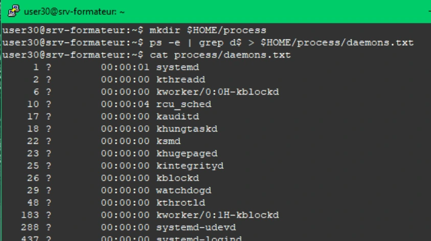

Visuel isolé du document — Solution du TP 1 - Utilisation des systèmes

$HOME/resultats/fichiers.conf.

```
mkdir $HOME/resultats
```

```
find 
/ 
-mount 
-type 
f 
-name 
"*.conf" 
2>/dev/null 
| 
tee 
resultats/fichiers.conf
```

```
cat resultats/fichiers.conf
```

1. L’exécution de la commande précédente a duré un certain temps ; comment connaître le temps exact d’exécution de celle-ci ?

```
time 
find / 
-mount 
-type f 
-name 
"*.conf" 
2>/dev/null | 
tee 
resultats/fichiers.conf
```

1. En une commande, renvoyez dans le fichier $HOME/resultats/compteur.txt le nombre de fichiers trouvés au point 2, sans utiliser le fichier fichiers.conf. Le résultat devra comporter uniquement ce nombre (ce résultat sera réutilisé dans des scripts).

```
find / -mount 
-type f -name "*.conf" 2>/dev/null | wc 
-l > 
resultats/compteur.txt
```

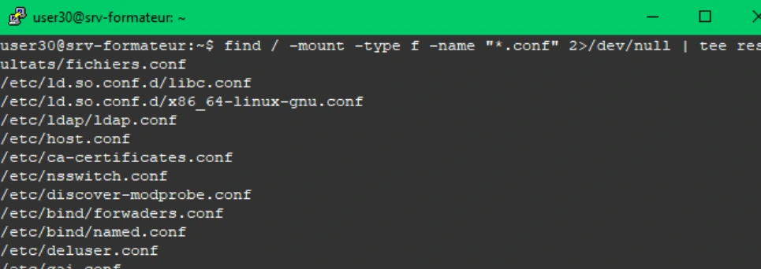

Visuel isolé du document — Solution du TP 1 - Utilisation des systèmes

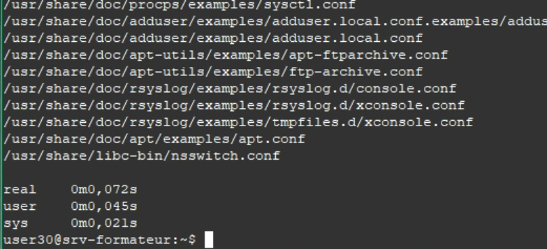

Visuel isolé du document — Solution du TP 1 - Utilisation des systèmes

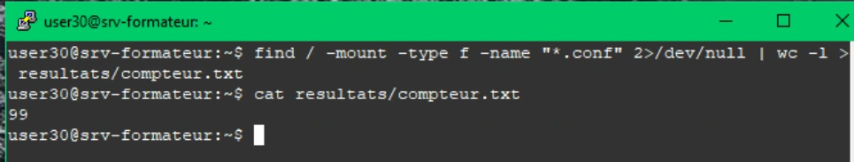

Visuel isolé du document — Solution du TP 1 - Utilisation des systèmes

Référence du document : 1A_l5ftbuPhXgvu64ds_oOADq33XA0S5l · SHA-256 22be2935f155b285…

## Correction · M08TP02 - Solution - Archivages et Compression · 4 pages transcrites

Correction originale : à consulter après avoir tenté l’exercice.

#### Archivage et compression

TP du Module 08 – Mécanismes Linux et Bash avancé

Avant de démarrer ce TP, il convient d’avoir suivi les vidéos des modules 8.

Avoir effectué le TP précèdent

Durée estimée

45 à 60 minutes

#### Proposition de solution

**Visuel externe**


En fonction du module que vous venez de parcourir, vous trouverez les commandes nécessaires pour répondre aux questions.

1. Réaliser une sauvegarde de votre répertoire personnel dans /tmp, en utilisant votre login pour le nommage du fichier, noter sa taille.

```
tar -cvf /tmp/$LOGNAME.tar $HOME
```

```
ls -lh /tmp/$LOGNAME.tar
```

1. Créer une nouvelle archive de votre répertoire personnel, mais cette fois-ci en la compressant avec gzip, l'opération devant être réalisée en une seule instruction.

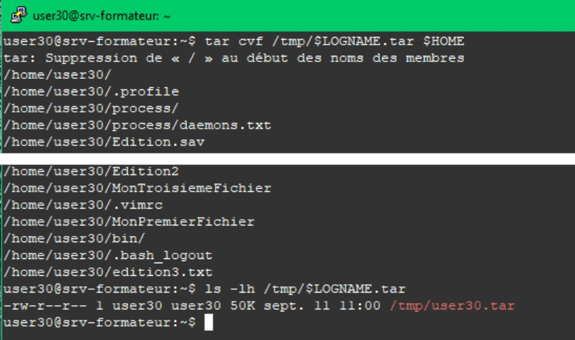

Visuel isolé du document — M08TP02 - Solution - Archivages et Compression

```
tar -czvf /tmp/$LOGNAME.tar.gz $HOME
```

```
ls -lh /tmp/$LOGNAME.tar.gz
```

1. Répéter l'étape précédente en utilisant cette fois-ci une compression au format bzip2.

```
tar -cjvf /tmp/$LOGNAME.tar.bz2 $HOME
```

```
ls -lh /tmp/$LOGNAME.tar.bz2
```

1. Comparer la taille des trois archives, laquelle est la moins volumineuse ?

```
ls -l /tmp/$LOGNAME.tar*
```

1. Dans votre répertoire de connexion, créer le répertoire Restaurations.

Restaurer votre sauvegarde dans ce répertoire en une seule instruction.

```
mkdir $HOME/Restaurations
```

```
tar -xzvf /tmp/$LOGNAME.tar.gz -C Restaurations
```

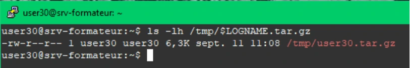

Visuel isolé du document — M08TP02 - Solution - Archivages et Compression

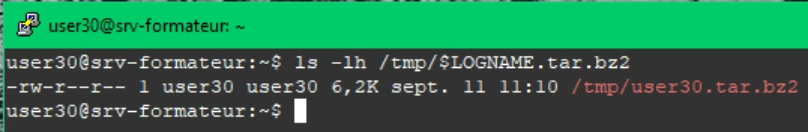

Visuel isolé du document — M08TP02 - Solution - Archivages et Compression

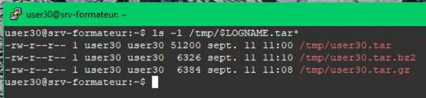

Visuel isolé du document — M08TP02 - Solution - Archivages et Compression

1. Créer une nouvelle sauvegarde, non compressée, en excluant ce répertoire.

```
tar -cvf /tmp/$LOGNAME-v2.tar --exclude=Restaurations $HOME
```

1. Créer dans votre répertoire d'accueil un nouveau fichier vide, et réaliser une mise à jour de votre archive avec votre répertoire d’accueil.

- Aidez-vous de la commande vous permettant de lister le contenu de l'archive.

```
touch new_fichier.txt
```

```
tar -uvf /tmp/$LOGNAME-v2.tar ~/new_fichier.txt
```

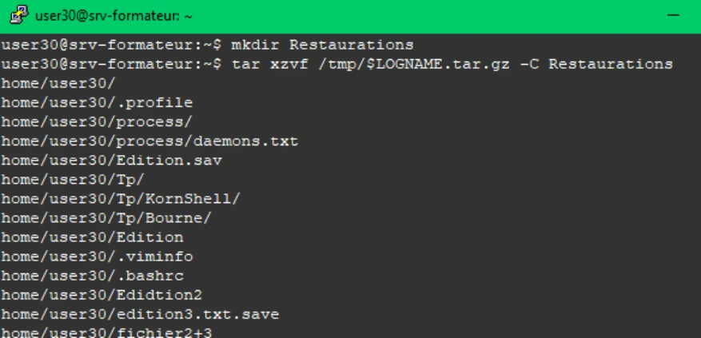

Visuel isolé du document — M08TP02 - Solution - Archivages et Compression

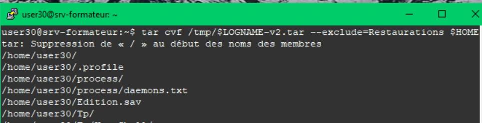

Visuel isolé du document — M08TP02 - Solution - Archivages et Compression

```
tar -tf /tmp/$LOGNAME-v2.tar 
/home/user30/.profile 
/home/user30/process/ 
/home/user30/process/daemons.txt 
/home/user30/Edition.sav 
/home/user30/new_fichier.txt 
/home/user30/Tp/ 
/home/user30/Tp/KornShell/ 
/home/user30/Tp/Bourne/ 
/home/user30/Edition 
/home/user30/.viminfo 
/home/user30/.bashrc 
/home/user30/Edidtion2 
/home/user30/edition3.txt.save 
/home/user30/fichier2+3 
/home/user30/.bash_history 
/home/user30/MonDeuxiemeFichier 
/home/user30/resultats/ 
/home/user30/resultats/compteur.txt 
/home/user30/resultats/fichiers.conf 
/home/user30/Edition2 
/home/user30/MonTroisiemeFichier 
/home/user30/.vimrc 
/home/user30/MonPremierFichier 
/home/user30/bin/ 
/home/user30/.bash_logout 
/home/user30/edition3.txt
```

Référence du document : 1FfhJtjSREwl6y0VQpHRdneF4OUkTwI45 · SHA-256 8702440981273989…

## Correction · M08TP03 - Solution - Alias et Redirections · 2 pages transcrites

Correction originale : à consulter après avoir tenté l’exercice.

#### Redirections et Alias

TP du Module 08 – Mécanismes avancés de Linux et Bash

Avant de démarrer ce TP, il convient d’avoir suivi les vidéos du module à 8 et d’avoir réalisé les TP proposés.

Durée estimée

30 à 45 mn

#### Énoncé

```
• 
Lister tous les processus qui finissent par un d. 
 
Le résultat sera stocké dans $HOME/process/daemons.txt. 
mkdir $HOME/process 
ps –e |grep d$ > $HOME/process/daemons.txt
```

```
• 
Recherchez les fichiers dont le nom se termine par .conf à partir de la racine.  
Cette recherche ne devra être effectuée que sur le système de fichier racine.  
Le 
résultat 
sera 
affiché 
à 
l'écran 
tout 
en 
étant 
stocké 
dans 
le 
fichier 
$HOME/resultats/fichiers.conf. 
mkdir $HOME/resultats  
find / mount -type f -name "*.conf" 2>/dev/null |tee $HOME/resultats/fichiers.conf
```

```
• 
La commande précédente a duré un certain temps, comment connaître le temps 
exact d’exécution de celle-ci ? 
time find / mount -type f -name "*.conf" 2>/dev/null |tee $HOME/resultats/fichiers.conf
```

```
• 
En une commande, renvoyez dans le fichier $HOME/resultats/compteur.txt le nombre 
de fichiers trouvés au point 2, sans utiliser le fichier fichiers.conf.   
Le résultat devra comporter uniquement ce nombre (ce résultat sera réutilisé dans des 
scripts). 
cat resultats/fichiers.conf |wc -l > resultats/compteur.txt 
 
# Alternativement 
grep –c f$ resultats/fichiers.conf > resultats/compteur.txt 
 
# Alternativement sans utiliser le fichier fichier.conf 
find / -mount -type f -name "*.conf" 2>/dev/null |wc -l > resultats/compteur.txt
```

```
• 
Reproduire toutes les actions précédentes, mais avec la création d’alias… 
# Créer les répertoires nécessaires 
mkdir -p $HOME/process 
mkdir -p $HOME/resultats 
 
# Définir des alias pour les commandes 
alias lister_daemons='ps -e | grep d$ > $HOME/process/daemons.txt' 
alias rechercher_conf='find / -mount -type f -name "*.conf" 2>/dev/null | tee 
$HOME/resultats/fichiers.conf' 
alias compter_fichiers='find / -mount -type f -name "*.conf" 2>/dev/null | wc -l > 
$HOME/resultats/compteur.txt' 
 
# Lister tous les processus qui finissent par un d 
lister_daemons 
 
# Rechercher les fichiers .conf à partir de la racine 
rechercher_conf 
 
# Mesurer le temps d'exécution de la recherche 
time rechercher_conf 
 
# Compter le nombre de fichiers trouvés et stocker le résultat 
compter_fichiers 
 
# Alternative pour compter les fichiers à partir du fichier fichiers.conf 
cat $HOME/resultats/fichiers.conf | wc -l > $HOME/resultats/compteur.txt 
 
# Alternative avec grep pour compter les fichiers à partir du fichier fichiers.conf 
grep -c f$ $HOME/resultats/fichiers.conf > $HOME/resultats/compteur.txt 
 
# Alternative sans utiliser le fichier fichiers.conf 
compter_fichiers
```

- Explication des alias

```
• 
lister_daemons : Alias pour lister les processus qui se terminent par d et stocker le 
résultat dans daemons.txt.
```

```
• 
rechercher_conf : Alias pour rechercher les fichiers .conf à partir de la racine et 
afficher le résultat à l'écran tout en le stockant dans fichiers.conf.
```

```
• 
compter_fichiers : Alias pour compter le nombre de fichiers.conf trouvés et 
stocker ce nombre dans compteur.txt.
```

- Remarques

- Les alias sont définis pour simplifier l'exécution des commandes, mais ils ne sont valables que pour la session actuelle.

Référence du document : 1WnpSJp6H8sn81c2zptNez04ulEMacnMF · SHA-256 be3c60614c14cbcd…

## Correction · M08TP04 - Solution - Manipuler des Variables · 2 pages transcrites

Correction originale : à consulter après avoir tenté l’exercice.

#### Manipuler des variables

TP du Module 08 – Mécanismes Linux et Bash avancé

Avant de démarrer ce TP, il convient d’avoir suivi les vidéos des modules 8.

Durée estimée

45 à 60 minutes

#### Proposition de solution

**Visuel externe**


En fonction du module que vous venez de parcourir, vous trouverez les commandes nécessaires pour répondre aux questions.

1. Afficher le répertoire personnel en utilisant une variable adéquate

```
ls $HOME
```

ou

```
ls ~
```

1. Afficher le contenu de la variable contenant les chemins vers les binaires usuels de l’utilisateur.

```
echo $PATH
```

1. Créer un dossier scripts à la racine du répertoire personnel et ajouter le aux chemins usuels. Faire en sorte que la manipulation soit pérenne.

```
mkdir $HOME/scripts
```

```
PATH=$PATH:/$HOME/scripts
```

```
echo PATH=$PATH:/$HOME/scripts >> ~/.bashrc
```

1. Créer une variable "monnom" contenant le login de l’utilisateur

```
monom="$LOGNAME"
```

ou

```
monom=$(logname)
```

1. Afficher les variables de l’utilisateurs

```
env
```

1. Ouvrir un sous-shell et vérifier le contenu de la variable monom. Il doit être vide. Fermer le sous-shell

```
bash
```

```
echo $monnom
```

```
exit
```

1. Transformer la variable locale de la question 4 en variable d’environnement

```
export monnom
```

1. Ouvrir un sous-shell et vérifier le contenu de la variable monom. Il doit contenir le login de l’utilisateur. Fermer le sous-shell

```
bash
```

```
echo $monnom
```

```
exit
```

Référence du document : 1Sjrk6fcYKzpsxbi0jhG3s_b-jECxhqqu · SHA-256 8ad17bc349e75f78…

## Fiche de synthèse

Les lignes reprennent les titres du cours et la première phrase de chaque partie.

| Partie | Repère du cours |
| --- | --- |
| Énoncé · Enoncé du TP 1 - Utilisation des systèmes · 2 pages transcrites | Utilisation d'une distribution GNU/Linux |
| Correction · Solution du TP 1 - Utilisation des systèmes · 3 pages transcrites | Correction originale : à consulter après avoir tenté l’exercice. |
| Correction · M08TP02 - Solution - Archivages et Compression · 4 pages transcrites | Correction originale : à consulter après avoir tenté l’exercice. |
| Correction · M08TP03 - Solution - Alias et Redirections · 2 pages transcrites | Correction originale : à consulter après avoir tenté l’exercice. |
| Correction · M08TP04 - Solution - Manipuler des Variables · 2 pages transcrites | Correction originale : à consulter après avoir tenté l’exercice. |
