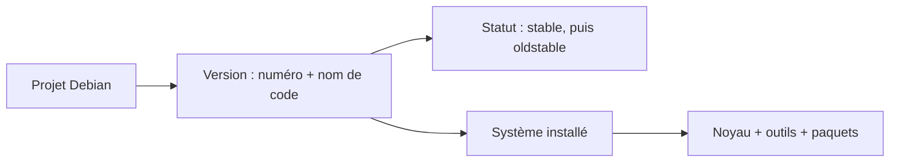

# Module 01 — Présentation de Debian GNU/Linux

**Cours optimisé — reformulation pédagogique du support et des TP associés.** Les exemples du parcours conservent leur contexte Debian 11 ; les corrections et actualisations sont identifiées comme compléments externes. Les transcriptions intégrales se consultent dans l’onglet Original.
## Objectifs et repères

Debian est une distribution GNU/Linux : elle assemble le noyau Linux, les outils utilisateur, un système de paquets et des logiciels organisés en dépôts. Le projet naît en août 1993. Ses versions portent les noms de personnages de *Toy Story*. Pour administrer une machine, il faut distinguer le **numéro de version**, son **nom de code**, sa **branche** et la **version du noyau** : ces informations ne sont pas interchangeables.

Le support présente Debian comme une base particulièrement adaptée aux serveurs et cite Ubuntu et Linux Mint parmi ses dérivées. Cette orientation pédagogique explique le choix d’un serveur en console dans les TP ; Debian propose également des environnements de bureau.

## Lire les commandes du cours

Dans une syntaxe documentaire comme `commande [options] <argument>`, les crochets signalent généralement une partie facultative et les chevrons un élément à remplacer. On ne saisit pas littéralement ces signes : le shell les interpréterait notamment comme des redirections. Les espaces séparent les mots ; les guillemets permettent de conserver un argument contenant des espaces.

```bash
ls -l /home
```

Dans `user30@deb:~$`, le nom d’utilisateur, le nom de machine et le répertoire précèdent l’invite. Le `$` désigne conventionnellement un utilisateur ordinaire ; `#` une session privilégiée. **L’invite et les lignes de résultat ne font pas partie de la commande.** La commande ci-dessus liste le contenu de `/home` avec les métadonnées détaillées ; elle ne change aucun fichier.

## Philosophie et contrat social

Le support associe Debian à la qualité, à un projet communautaire non commercial, à la redistribution et à l’accès au code source. Les licences déterminent les droits réels : « gratuit » et « libre » ne signifient pas la même chose.

Le contrat social présenté repose sur cinq engagements : maintenir Debian libre, rendre les contributions à la communauté du logiciel libre, rendre les problèmes visibles, donner priorité aux utilisateurs et aux logiciels libres, et traiter séparément les travaux qui ne satisfont pas ces principes. Les sections de dépôts étudiées au module 6 matérialisent cette distinction ; une section disponible sur un miroir n’appartient pas nécessairement au cœur libre du système.

## Versions et branches

| Terme | Sens opérationnel | Conséquence pour l’administrateur |
|---|---|---|
| Version numérotée et nom de code | Une publication identifiée, par exemple 11 / Bullseye | Permet de documenter exactement l’OS du TP |
| Stable | Branche de production publiée | Paquets et mises à jour de cette version |
| Testing | Préparation de la prochaine stable | Évolution plus fréquente, contexte de validation différent |
| Unstable / Sid | Développement continu | Changements et problèmes possibles à anticiper |
| Oldstable / oldoldstable | Positions relatives N−1 et N−2 | Vérifier séparément la période de support |
| Experimental | Paquets expérimentaux, pas une distribution complète | Ne constitue pas une quatrième installation complète |

La chronologie du support va de 1.1 Buzz à 11 Bullseye, en passant notamment par 3.0 Woody, 7 Wheezy, 8 Jessie, 9 Stretch et 10 Buster. Le tableau complet reste dans l’original. Un alias tel que `stable` change de cible lors d’une nouvelle publication ; le nom de code reste lié à la même version. Ce point devient essentiel avant de modifier les dépôts APT.

!!! info "Actualisation externe — version et usages"
    Le support est contradictoire : une page indique Debian 12 stable, une autre Debian 11. Au contrôle du 4 novembre 2026, la stable officielle est Debian 13 « trixie ». Les TP fournis restent des TP Debian 11 ; leur migration doit être explicite. Debian sert aussi de poste de travail. Références : [Versions Debian](https://www.debian.org/releases/) et [présentation du projet](https://www.debian.org/intro/about).

## Préparer la suite

Avant l’installation, créer une fiche de machine indiquant version, architecture, média, hyperviseur, mémoire, disque et réseau. Après l’installation, comparer ces informations avec le système obtenu : `/etc/os-release` décrit la distribution, tandis que `uname -r` décrit le noyau actif. Ces deux commandes de contrôle sont des compléments pratiques au support.

## Schéma explicatif — complément pédagogique



## Autoévaluation

1. Quelle différence existe entre `trixie` et `stable` ?
2. Faut-il recopier `user@deb:~$` dans le terminal ?
3. Pourquoi noter la version avant de configurer les dépôts ?

??? success "Réponses"
    1. Le nom de code identifie une version ; l’alias stable change avec les publications.
    2. Non : c’est l’invite, pas la commande.
    3. Les dépôts doivent correspondre à la version et au projet de mise à jour prévu.

## Pour travailler ce module

- [Fiche de révision](../../revision/administration-linux/module-01-presentation-de-debian-gnu-linux.md)
- [Travaux pratiques](../../tp/administration-linux/index.md)
- [Progression du cours](index.md)
