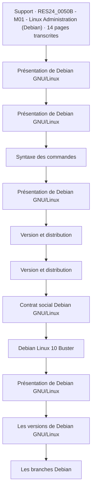
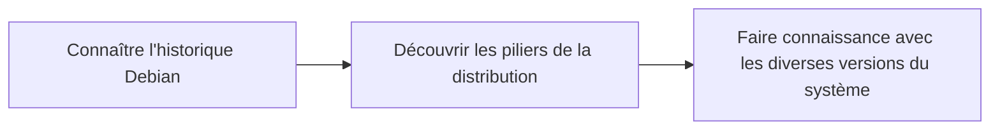
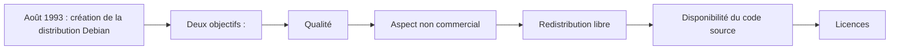
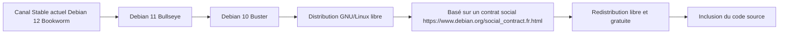
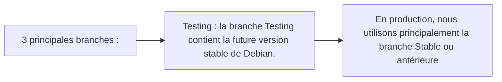

# Module 01 — Présentation de Debian GNU/Linux

Les parties ci-dessous reprennent le cours original, dans le même ordre. Les encadrés et les schémas répètent ses formulations.

## Parcours de lecture

1. Support · RES24_0050B - M01 - Linux Administration (Debian) · 14 pages transcrites
2. Présentation de Debian GNU/Linux
3. Présentation de Debian GNU/Linux
4. Syntaxe des commandes
5. Présentation de Debian GNU/Linux
6. Version et distribution
7. Version et distribution
8. Contrat social Debian GNU/Linux
9. Debian Linux 10 Buster
10. Présentation de Debian GNU/Linux
11. Les versions de Debian GNU/Linux
12. Les branches Debian
13. Les branches Debian
14. Conclusion

**Visuel externe**



SOURCE DRIVE · TRANSCRIPTION DU SUPPORT

Le contenu des documents du dossier TSSR est transcrit ci-dessous, page par page. Les textes et tableaux sont intégrés à la page Web. Aucun fichier PDF, aucune diapositive entière ni aucune reproduction de page n’est affiché. Seuls des croquis ou visuels isolés et vérifiés peuvent accompagner la transcription. Les versions et les consignes restent celles des supports de formation. Les compléments IA sont conservés dans leur onglet distinct.

## Support · RES24_0050B - M01 - Linux Administration (Debian) · 14 pages transcrites

### Administration Debian

### GNU/Linux

!!! note "À retenir"
    Module 01 – Présentation de Debian GNU/Linux

Module 01 – Présentation de Debian GNU/Linux

## Présentation de Debian GNU/Linux

### Objectifs

!!! note "À retenir"
    Connaître l'historique Debian Découvrir les piliers de la distribution Faire connaissance avec les diverses versions du système Découvrir Debian, son histoire et sa philosophie

**Visuel externe**



- Connaître l'historique Debian
- Découvrir les piliers de la distribution
- Faire connaissance avec les diverses versions du système

Découvrir Debian, son histoire et sa philosophie

## Présentation de Debian GNU/Linux

### Conventions typographiques

## Syntaxe des commandes

!!! note "À retenir"
    La syntaxe des commandes est représentée ainsi : Commande [options] <Argument> Rappel: L’espace est un séparateur d’expressions entre la commande, les options et les arguments.

- La syntaxe des commandes est représentée ainsi : Commande [options] <Argument>

Rappel: L’espace est un séparateur d’expressions entre la commande, les options et les arguments.

- Les exemples de commande et leur résultat sont représentés ainsi :

```
user30@deb:~$ ls -l /home/user30
total 8
-rw-r--r-- 1 user30 user30  36 juin  26 12:08 aFaire.txt
-rw------- 1 user30 user30 586 avril 16 17:26 Edition
user30@deb:~$
```

## Présentation de Debian GNU/Linux

### Historique de Debian

## Version et distribution

!!! note "À retenir"
    Depuis 1993, une quinzaine de versions majeures de Debian ont vu le jour.

- Depuis 1993, une quinzaine de versions majeures de Debian ont vu le jour.
- Chaque version porte en plus de son numéro le nom d'un personnage de la série de films d'animation Toy Story.
- La distribution Debian a été conçue dès son origine pour les systèmes serveur. Elle est parfaitement adaptée à cette fonction. Cette volonté implique des calendriers de sorties assez longues, et un développement de l'ergonomie peu propice aux utilisateurs finaux.
- Des distributions dérivées de Debian et axées sur l'utilisateur final ont vu le jour, comme Ubuntu ou Linux Mint, permettant de pallier ce manque.

## Version et distribution

!!! note "À retenir"
    Août 1993 : création de la distribution Debian Deux objectifs : Qualité Aspect non commercial Le projet Debian a défini des principes du logiciel libre, qui doivent être respectés par la communauté Debian : Redistribution libre Disponibilité du code source Licences

**Visuel externe**



- Août 1993 : création de la distribution Debian
- Deux objectifs :
- Qualité
- Aspect non commercial
- Le projet Debian a défini des principes du logiciel libre, qui doivent être respectés par la communauté Debian :
- Redistribution libre
- Disponibilité du code source
- Licences

## Contrat social Debian GNU/Linux

!!! note "À retenir"
    Le projet Debian a établi un contrat social dont les points principaux sont : Debian demeurera totalement libre.

Le projet Debian a établi un contrat social dont les points principaux sont :

1. Debian demeurera totalement libre. 2. Nous donnerons nos travaux à la communauté des logiciels libres. 3. Nous ne dissimulerons pas les problèmes. 4. Nos priorités sont nos utilisateurs et les logiciels libres.

5. Les travaux non conformes aux principes du logiciel libre pourront être disponibles dans des sections différenciées ne faisant pas partie du système Debian.

## Debian Linux 10 Buster

!!! note "À retenir"
    Canal Stable actuel Debian 12 Bookworm Debian 11 Bullseye Debian 10 Buster Distribution GNU/Linux libre Basé sur un contrat social https://www.debian.org/social_contract.fr.html Redistribution libre et gratuite Inclusion du code source

**Visuel externe**



- Canal Stable actuel Debian 12 Bookworm
- Debian 11 Bullseye
- Debian 10 Buster
- Distribution GNU/Linux libre
- Basé sur un contrat social https://www.debian.org/social_contract.fr.html
- Redistribution libre et gratuite
- Inclusion du code source

## Présentation de Debian GNU/Linux

### Branches et versions

de Debian

## Les versions de Debian GNU/Linux

!!! note "À retenir"
    Source indiquée par le support : https://www.debian.org/releases/index.fr.html

| Version | Nom de code et personnage |
| --- | --- |
| 1.1 | Buzz, le ranger de l’espace |
| 1.2 | Rex, le tyrannosaure |
| 1.3 | Bo, la bergère |
| 2.0 | Hamm, le cochon tirelire |
| 2.1 | Slink, le chien à ressort |
| 2.2 | Potato, M. Patate |
| 3.0 | Woody, le cowboy |
| 3.1 | Sarge, le chef des soldats |
| 4.0 | Etch, l’écran magique |
| 5.0 | Lenny, la paire de jumelles |
| 6.0 | Squeeze, l’extraterrestre |
| 7.0 | Wheezy, le manchot au nœud papillon rouge |
| 8.0 | Jessie, la cowgirl |
| 9.0 | Stretch, la pieuvre |
| 10 | Buster, le chien |
| 11 | Bullseye, le cheval |

Source indiquée par le support : https://www.debian.org/releases/index.fr.html

## Les branches Debian

**Visuel externe**



- 3 principales branches :
- Stable : c'est la version de production de Debian, celle qu'il est recommandé d'utiliser.
- Testing : la branche Testing contient la future version stable de Debian.
- Unstable : version en constante évolution (on parle de Rolling release). La distribution Unstable est toujours appelée Sid.
- En production, nous utilisons principalement la branche Stable ou antérieure
- Release (en anglais) : version numérotée spécifique stable et prête à être utilisée, qui a été publiée pour le public.

## Les branches Debian

- Des sous-branches OLD-STABLE et OLD-OLD-STABLE existent également.
- Elles désignent les branches N-1 et N-2.
- La version stable est actuellement la version 11 Bullseye
- old-stable est la version 10 Buster
- old-old-stable est la version 9 Stretch

## Conclusion

- Vous connaissez :
- les origines du système Debian,
- les valeurs qui sous-tendent son évolution.
- Vous avez des notions sur les versions de Debian et les branches.

Référence du document : 1bzxMulmq5p4kuBASOKCeF8U4YjtcD9oR · SHA-256 8d8ff677775b9cff…

## Fiche de synthèse

Les lignes reprennent les titres du cours et la première phrase de chaque partie.

| Partie | Repère du cours |
| --- | --- |
| Syntaxe des commandes | La syntaxe des commandes est représentée ainsi : Commande [options] <Argument> Rappel: L’espace est un séparateur d’expressions entre la commande, les options et les arguments. |
| Version et distribution | Depuis 1993, une quinzaine de versions majeures de Debian ont vu le jour. |
| Version et distribution | Août 1993 : création de la distribution Debian Deux objectifs : Qualité Aspect non commercial Le projet Debian a défini des principes du logiciel libre, qui doivent être respect… |
| Contrat social Debian GNU/Linux | Le projet Debian a établi un contrat social dont les points principaux sont : Debian demeurera totalement libre. |
| Debian Linux 10 Buster | Canal Stable actuel Debian 12 Bookworm Debian 11 Bullseye Debian 10 Buster Distribution GNU/Linux libre Basé sur un contrat social https://www.debian.org/social_contract.fr.html… |
| Les versions de Debian GNU/Linux | Source indiquée par le support : https://www.debian.org/releases/index.fr.html |
| Les branches Debian | 3 principales branches : Stable : c'est la version de production de Debian, celle qu'il est recommandé d'utiliser. |
| Les branches Debian | Des sous-branches OLD-STABLE et OLD-OLD-STABLE existent également. |
| Conclusion | Vous connaissez : les origines du système Debian, les valeurs qui sous-tendent son évolution. |
