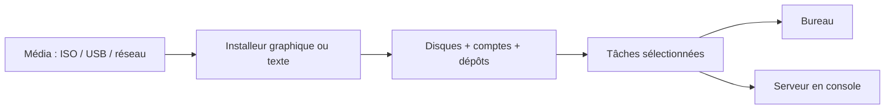

# Module 02 — Installation d’une distribution Debian

**Cours optimisé — reformulation pédagogique du support et des TP associés.** Les exemples du parcours conservent leur contexte Debian 11 ; les corrections et actualisations sont identifiées comme compléments externes. Les transcriptions intégrales se consultent dans l’onglet Original.
## Objectifs

- Préparer les deux VM et choisir le média adapté à chacune.
- Comparer les deux choix LVM, les tâches installées et la méthode d’amorçage.
- Vérifier au premier démarrage les comptes, les montages, le bureau ou l’accès SSH.

## Choisir une méthode d’installation

Le support distingue le média qui lance l’installeur, la provenance des paquets et le système que l’on souhaite obtenir. Une interface graphique d’installation peut parfaitement produire un serveur sans bureau.

| Méthode du support | Principe | Point à vérifier |
|---|---|---|
| Live | Tester un environnement avant installation | Le test ne remplace pas l’installation sur disque |
| DVD complet | Beaucoup de paquets disponibles hors ligne | Mises à jour postérieures au média |
| Netinstall | Petit média puis récupération sur un dépôt | Accès réseau et miroir accessibles |
| USB | Porter une image d’installation sur une clé | Méthode d’écriture adaptée à l’image |
| PXE / réseau | Obtenir une configuration réseau puis un chargeur | Services réseau et fichier d’amorçage |
| Installation automatisée | FAI ou préconfiguration | Réponses, cible et reproductibilité |
| Clonage | Déployer une image préparée avec FOG, Ghost, Acronis ou Clonezilla | État et identité des systèmes clonés |

Ventoy, Etcher, Rufus et Unetbootin sont les exemples d’outils USB cités, pas des étapes obligatoires. Pour un grand parc, une installation automatisée reconstruit un système à partir de paramètres, tandis que le clonage réutilise une image préparée.

## Préparer les deux machines du TP

| Paramètre source | Machine avec bureau | Serveur sans bureau |
|---|---|---|
| Version du scénario | Debian 11 | Debian 11 |
| Média | Netinstall | DVD |
| Disque dynamique | 40 Go | 10 Go |
| Mémoire | 4 096 Mo | 2 048 Mo |
| Réseau | Bridged donnant accès à Internet | Bridged donnant accès au réseau du laboratoire |
| Logiciels | Bureau Debian et utilitaires usuels | Serveur SSH et utilitaires usuels |

Le pont réseau du scénario suppose un environnement de formation adapté. Le nom de domaine de formation est affiché avec un repère neutralisé dans les transcriptions. Le nom d’hôte, les comptes et la connectivité se choisissent avant la copie des paquets.

## Parcours de l’installeur

1. Démarrer sur le média connecté à la VM, puis choisir l’installeur graphique ou texte.
2. Choisir français, France et clavier français pour reproduire le TP. Une installation en anglais avec clavier français reste un choix distinct.
3. Définir le nom d’hôte et, si nécessaire, le domaine DNS. Un domaine DNS n’inscrit pas automatiquement le poste dans un annuaire.
4. Choisir la politique des comptes : mot de passe root puis utilisateur ordinaire dans les TP fournis.
5. Définir le partitionnement et les points de montage. Vérifier le disque sélectionné avant validation.
6. Configurer le miroir et un proxy uniquement s’il existe. Le TP serveur demande de ne pas utiliser de miroir à cette étape.
7. Sélectionner les tâches logicielles, puis installer le chargeur de démarrage correspondant au mode d’amorçage.
8. Redémarrer sur le disque installé et contrôler comptes, réseau et stockage.

## Root, su et sudo

Dans le parcours Debian de la source, donner un mot de passe à root ne donne pas automatiquement les droits sudo au premier utilisateur. Laisser ce mot de passe vide dans l’installeur conduit à un parcours différent, avec administration via le premier utilisateur et sudo. **Ce sont des paramètres d’installation, pas une propriété immuable des comptes.**

```bash
su -
sudo -i
```

`su -` ouvre un environnement de connexion de l’identité cible, root par défaut. `sudo -i` dépend des autorisations sudo et demande généralement le mot de passe de l’utilisateur qui l’invoque. Le support montre aussi `sudo passwd root` pour attribuer ensuite un mot de passe à root ; cette modification doit correspondre à la politique choisie.

## Partitionnement du scénario

Sur la machine graphique, le TP impose un partitionnement manuel avec LVM : swap de 2 048 MB, racine ext4 de 20 GB, FAT32 de 5 GB montée sur `/windows`, et reste en ext4 pour `/home`. Sur le serveur, le mode assisté utilise tout le disque avec LVM et sépare `/home`, `/var` et `/tmp`. Les noms de VG/LV visibles dans une correction ne remplacent pas les noms réellement créés sur votre VM.

Le support propose une règle historique pour le swap : 1,5 fois la RAM sous 1 Go, même taille jusqu’à 2 Go, puis 2 Go ou davantage selon le besoin. Cette règle décrit le support ; elle ne dimensionne pas automatiquement une machine moderne.

!!! info "Clarification externe — racine, swap et amorçage"
    Une partition swap séparée n’est pas une obligation universelle : le besoin et le dimensionnement dépendent notamment de la charge et de l’hibernation. La disposition du disque dépend aussi du firmware ; un système UEFI nécessite une disposition adaptée avec partition système EFI. Ne recopiez pas aveuglément l’étape BIOS `/dev/sda` sur une installation UEFI. Référence : [guide d’installation Debian, partitionnement](https://www.debian.org/releases/trixie/amd64/ch06s03.fr.html).

## TP 01 — Installer le poste avec interface graphique

1. Créer une VM avec 4 096 Mo de mémoire, un disque dynamique de 40 Go et une interface en pont sur le réseau du laboratoire. Brancher l’ISO Debian 11 `netinst` en lecteur de CD virtuel. Vérifier le nom du fichier `amd64` avant de démarrer.
2. Dans l’installeur graphique, choisir le français, la France et le clavier français. Saisir le nom d’hôte, le domaine du laboratoire, le mot de passe root et les informations du compte ordinaire.
3. Choisir le partitionnement manuel. Créer le groupe LVM et ses volumes dans l’ordre du tableau précédent. Réserver le reste à `/home`. Contrôler la racine, le système de fichiers de chaque volume et le swap avant d’écrire les changements. La partition d’amorçage éventuelle dépend du mode de démarrage de la VM.
4. Refuser le scan d’un autre média, choisir le miroir Debian de France indiqué dans le TP et laisser le champ proxy vide. Refuser l’enquête de popularité. Sélectionner les tâches demandées pour le poste, dont l’environnement de bureau, et noter celles réellement installées.
5. Installer GRUB sur le disque de la VM suivant le mode d’amorçage. Éjecter l’ISO, redémarrer et ouvrir une session avec le compte ordinaire. Montrer que le bureau démarre et que les volumes attendus sont montés.

## TP 02 — Installer le serveur sans environnement de bureau

1. Créer une VM avec 2 048 Mo de mémoire, un disque dynamique de 10 Go et une interface en pont sur le réseau de la salle. Utiliser l’ISO DVD Debian 11 du TP. Les paquets du DVD permettent de poursuivre sans miroir.
2. Utiliser l’installeur graphique si souhaité. Reprendre le choix de la langue, du clavier et des comptes. Le mode de l’installeur ne détermine pas la présence d’un bureau sur le système final.
3. Choisir **Assisté — utiliser tout un disque avec LVM** sur le disque virtuel SCSI. Sélectionner le schéma avec `/home`, `/var` et `/tmp` séparés. Examiner le récapitulatif avant de confirmer.
4. Refuser le scan d’un autre média, l’utilisation d’un miroir et l’enquête de popularité. Cocher **serveur SSH** et **utilitaires usuels du système**. Laisser les tâches d’environnement de bureau décochées.
5. Confirmer l’installation de GRUB. Le TP illustre `/dev/sda` dans sa VM. Identifier le disque et le mode d’amorçage de la VM utilisée avant de valider. Éjecter l’ISO, redémarrer, ouvrir la session et vérifier le service SSH.

```bash
cat /etc/os-release
hostnamectl
id
ip -br address
lsblk -f
findmnt
swapon --show
systemctl status ssh --no-pager
```

Sur le poste, vérifier les quatre affectations du tableau LVM. Sur le serveur, relever les montages séparés et tester SSH depuis un poste autorisé du laboratoire. Un service actif dans la VM et une connexion réussie depuis le client établissent deux contrôles différents.

## Contrôles et erreurs fréquentes

Après installation, vérifier la présence des montages demandés, ouvrir une session ordinaire et tester le mécanisme d’élévation choisi. Si le serveur affiche un bureau, revoir la sélection des logiciels ; si l’installeur était graphique, cela ne prouve rien sur le système installé. Une absence de paquets récents sur un DVD s’explique par la date du média ; une netinstall dépend du dépôt effectivement utilisé.

## Schéma explicatif — complément pédagogique



## À retenir

Le poste utilise un partitionnement LVM manuel et un bureau. Le serveur utilise le LVM assisté et installe SSH et les utilitaires sans bureau. Le contrôle se fait après le démarrage depuis le disque installé.

## Autoévaluation

1. L’installeur graphique oblige-t-il à installer GNOME ?
2. Quel volume reçoit le reste du disque du TP graphique ?
3. Pourquoi relever BIOS/UEFI avant de choisir la disposition du disque ?
4. Pourquoi choisir le DVD pour le serveur si l’énoncé exclut un miroir ?
5. Quel résultat démontre que le service SSH fonctionne depuis le poste client ?

??? success "Réponses commentées"
    1. Non ; le bureau est choisi dans les tâches logicielles.
    2. Le volume destiné à `/home`.
    3. Les exigences d’amorçage et le placement du chargeur diffèrent.
    4. Le média fournit les paquets du scénario sans dépendre d’un miroir lors de l’installation.
    5. Une connexion aboutie vers la bonne VM avec le compte prévu. Vérifier aussi l’état de `ssh.service` côté serveur.

## Pour travailler ce module

- [Fiche de révision](../../revision/administration-linux/module-02-installation-d-une-distribution-debian.md)
- [Travaux pratiques](../../tp/administration-linux/module-02/index.md)
- [Progression du cours](index.md)
