# Module 02 — Installation d’une distribution Debian

[Travaux pratiques](../../tp/administration-linux/module-02/index.md)

Les parties ci-dessous reprennent le cours original, dans le même ordre. Les encadrés et les schémas répètent ses formulations.

## Parcours de lecture

1. Support · RES24_0050B - M02 - Linux Administration (Debian) · 25 pages transcrites
2. Installation d’une distribution Debian
3. Installation d’une distribution Debian
4. Depuis un CD-ROM ou DVD-ROM
5. Depuis un CD-ROM ou DVD-ROM
6. Depuis une clé ou un disque USB
7. Depuis le réseau local
8. Et tout le reste
9. Installation d’une distribution Debian
10. Partitionnement et Swap
11. Étapes d’installation de Debian
12. Étapes d’installation de Debian
13. Étapes d’installation de Debian
14. Étapes d’installation de Debian
15. Étapes d’installation de Debian
16. Étapes d’installation de Debian
17. Étapes d’installation de Debian
18. Étapes d’installation de Debian
19. Étapes d’installation de Debian
20. Étapes d’installation de Debian
21. Étapes d’installation de Debian
22. Étapes d’installation de Debian
23. Installation d’une distribution Debian
24. Installation d’une distribution Debian
25. Conclusion

**Visuel externe**

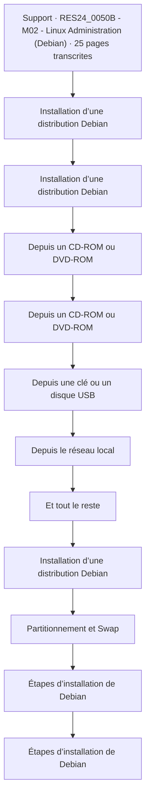

SOURCE DRIVE · TRANSCRIPTION DU SUPPORT

Le contenu des documents du dossier TSSR est transcrit ci-dessous, page par page. Les textes et tableaux sont intégrés à la page Web. Aucun fichier PDF, aucune diapositive entière ni aucune reproduction de page n’est affiché. Seuls des croquis ou visuels isolés et vérifiés peuvent accompagner la transcription. Les versions et les consignes restent celles des supports de formation. Les compléments IA sont conservés dans leur onglet distinct.

## Support · RES24_0050B - M02 - Linux Administration (Debian) · 25 pages transcrites

!!! note "À retenir"
    Noms de domaine de formation neutralisés explicitement ; paramètres numériques et procédures conservés.

Noms de domaine de formation neutralisés explicitement ; paramètres numériques et procédures conservés.

### Administration Debian

### GNU/Linux

!!! note "À retenir"
    Module 02 – Installation d’une distribution Debian

Module 02 – Installation d’une distribution Debian

## Installation d’une distribution Debian

### Objectifs

!!! note "À retenir"
    Découvrir les différents modes d’installation possibles Apprendre à effectuer des installations de Debian GNU/Linux Installer Debian Linux sur PC et sur serveurs

- Découvrir les différents modes d’installation possibles
- Apprendre à effectuer des installations de Debian GNU/Linux

Installer Debian Linux sur PC et sur serveurs

## Installation d’une distribution Debian

### Les modes d’installation

## Depuis un CD-ROM ou DVD-ROM

!!! note "À retenir"
    L’installation à partir d’un CD ou DVD est historiquement la plus courante Live-CD Debian Un système directement fonctionnel depuis le DVD.

**Visuel externe**

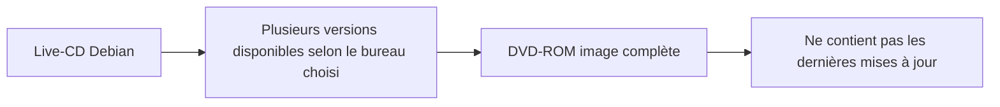

L’installation à partir d’un CD ou DVD est historiquement la plus courante

- Live-CD Debian
- Un système directement fonctionnel depuis le DVD. Permet de tester sans apporter la moindre modification. Propose l’installation
- Plusieurs versions disponibles selon le bureau choisi
- DVD-ROM image complète
- Permet l’installation du système complet sans accès à internet ou à un dépôt local
- Ne contient pas les dernières mises à jour

## Depuis un CD-ROM ou DVD-ROM

!!! note "À retenir"
    CD-ROM Netinstall Contient le minimum pour lancer l’installation et récupérer les fichiers depuis un dépôt internet ou local Peut nécessiter une connexion à internet Permet la récupération des paquets à jour Adresse de téléchargement des images ISO des DVD et CD-ROM https://www.debian.org/CD/http-ftp/#stable

**Visuel externe**

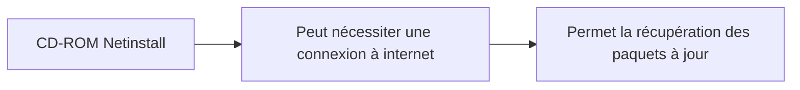

- CD-ROM Netinstall
- Contient le minimum pour lancer l’installation et récupérer les fichiers depuis un dépôt internet ou local
- Peut nécessiter une connexion à internet
- Permet la récupération des paquets à jour

Adresse de téléchargement des images ISO des DVD et CD-ROM https://www.debian.org/CD/http-ftp/#stable

## Depuis une clé ou un disque USB

!!! note "À retenir"
    De plus en plus, les lecteurs optiques laissent place aux périphériques USB En pratique, ce sont les mêmes images qu’aux étapes précédentes, mais le média CD ou DVD est remplacé par une clé De nombreux logiciels permettent de préparer des périphériques USB.

**Visuel externe**

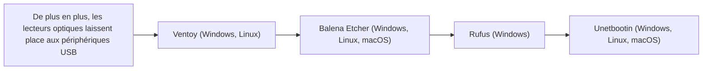

- De plus en plus, les lecteurs optiques laissent place aux périphériques USB
- En pratique, ce sont les mêmes images qu’aux étapes précédentes, mais le média CD ou DVD est remplacé par une clé
- De nombreux logiciels permettent de préparer des périphériques USB. On peut citer :
- Ventoy (Windows, Linux)
- Balena Etcher (Windows, Linux, macOS)
- Rufus (Windows)
- Unetbootin (Windows, Linux, macOS)

Écran de démarrage Ventoy https://www.ventoy.net/


Capture ou visuel isolé du document de formation.

## Depuis le réseau local

!!! note "À retenir"
    La plupart des BIOS actuels permettent l'amorçage à partir du réseau grâce au boot PXE Au démarrage, la machine reçoit d’un serveur dédié une adresse IP et le nom du fichier d’installation à télécharger Exemple de démarrage par PXE.

- La plupart des BIOS actuels permettent l'amorçage à partir du réseau grâce au boot PXE
- Au démarrage, la machine reçoit d’un serveur dédié une adresse IP et le nom du fichier d’installation à télécharger

Exemple de démarrage par PXE.

iPXE project http://ipxe.org


Capture ou visuel isolé du document de formation.

## Et tout le reste

**Visuel externe**

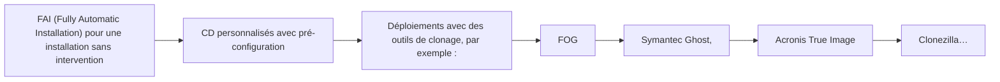

- Lorsqu'il s'agit de déployer un grand nombre de machines, plusieurs méthodes plus ou moins automatisées existent :
- FAI (Fully Automatic Installation) pour une installation sans intervention
- CD personnalisés avec pré-configuration
- Déploiements avec des outils de clonage, par exemple :
- FOG
- Symantec Ghost,
- Acronis True Image
- Clonezilla…

## Installation d’une distribution Debian

### Installer Debian

## Partitionnement et Swap

- Un système Linux doit contenir au minimum deux partitions à l’installation :
- 1 Partition racine : /
- 1 Partition d’échange : SWAP
- La quantité d’espace disque recommandée pour la partition de SWAP varie suivant la quantité de RAM installée ou allouée :
- RAM < 1Go SWAP = RAM x 1.5
- RAM <= 2Go SWAP = RAM
- RAM > 2Go SWAP = 2Go ou + selon le besoin

## Étapes d’installation de Debian

- Au démarrage du média d’installation, le choix est donné entre une installation graphique ou installation simple qui utilisera un mode texte amélioré dit « semi-graphique »
- Ce choix ne désigne pas le mode cible de l’installation de Debian
- On peut installer un serveur Linux en passant par l’installation graphique comme un PC de bureau avec interface graphique via l’installeur texte
- Mode de l’installeur ≠Mode de fonctionnement du Linux installé

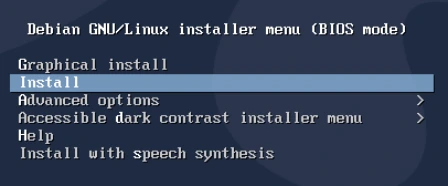

Capture ou visuel isolé du document de formation.

## Étapes d’installation de Debian

!!! note "À retenir"
    Choix de la langue Nous utiliserons dans ce cours des systèmes en français Toutefois, il est courant en production de posséder des systèmes installés en anglais avec un clavier français Capture ou visuel isolé du document de formation.

Choix de la langue

- Nous utiliserons dans ce cours des systèmes en français
- Toutefois, il est courant en production de posséder des systèmes installés en anglais avec un clavier français

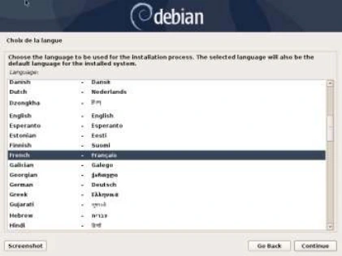

Capture ou visuel isolé du document de formation.

## Étapes d’installation de Debian

Nom de machine Ici l’on donne le nom d’hôte du système.

Domaine Ici l’on spécifie le domaine DNS auquel appartient la machine. Peut être laissé vide.

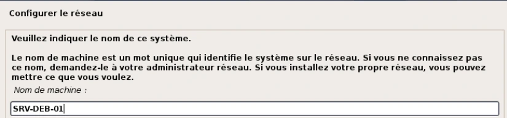

Capture ou visuel isolé du document de formation.

Transcription de la capture : noms du réseau de formation neutralisés, paramètres numériques et suite conservés.

```
Configurer le réseau — Domaine : laboratoire.example (nom du domaine de formation neutralisé)
```

## Étapes d’installation de Debian

Mot de passe du superutilisateur root L’installeur demande la saisie du mot de passe qui sera affecté à root.

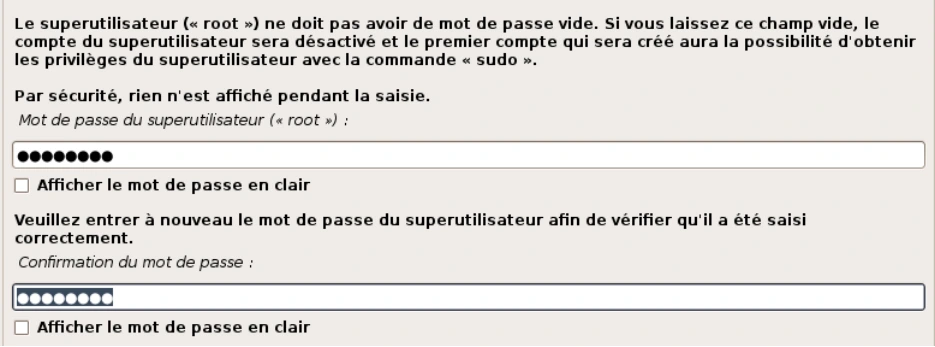

Capture ou visuel isolé du document de formation.

## Étapes d’installation de Debian

École du « su »

- Le simple fait d’affecter un mot de passe à l’utilisateur root réserve les pouvoirs d’administration du système qu’à lui et lui seul
- Le premier utilisateur créé ne possédera quant à lui que des privilèges limités

```
user30@deb:~$ su -
Mot de passe :
root@deb:~#
```

## Étapes d’installation de Debian

École du « sudo » Si durant cette phase d’installation, aucun mot de passe n’est configuré pour root, alors le premier utilisateur aura la possibilité d’effectuer une élévation de privilège via son propre mot de passe avec la commande sudo.

```
user30@deb:~$ sudo -i
[sudo] Mot de passe de user30 :
root@deb:~#
```

## Étapes d’installation de Debian

Il est fortement déconseillé de créer un seul utilisateur avec le privilège sudo. Il est possible après installation d’affecter un mot de passe au compte root via la commande :

```
user30@deb:~$ sudo passwd root
[sudo] Mot de passe de user30 :
root@deb:~# passwd
Nouveau mot de passe : 
Retapez le nouveau mot de passe : 
passwd : le mot de passe a été mis à jour avec succès
```

## Étapes d’installation de Debian

Partitionner les disques

- Cette phase d’installation permet de choisir comment subdiviser son disque pour créer les différents points de montage du système
- On peut choisir le mode assisté ou le mode manuel plus complet

N.B. : En choisissant la technologie LVM, il faut au préalable configurer un partitionnement Intel MBR (BIOS) ou GPT (UEFI).

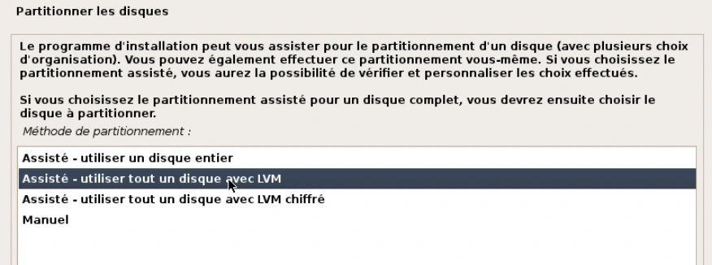

Capture ou visuel isolé du document de formation.

## Étapes d’installation de Debian

Sélection des logiciels

- En cas d’installation Netinstall, on pourra ici choisir le dépôt voulu (ici ftp.fr.debian.org)
- Il est aussi possible de préciser un éventuel serveur miroir


Capture ou visuel isolé du document de formation.

## Étapes d’installation de Debian

Sélection des logiciels Il est aussi possible ici de préciser une adresse de serveur proxy (serveur mandataire en français).

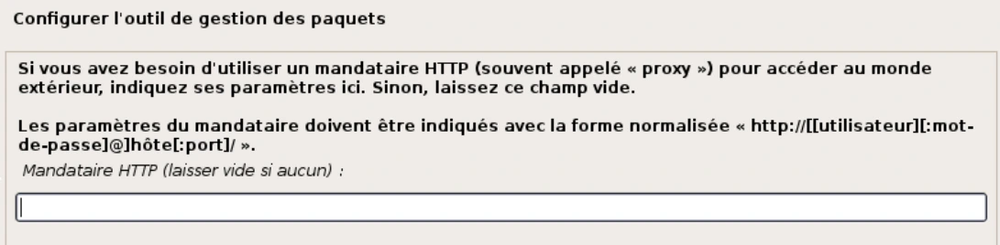

Capture ou visuel isolé du document de formation.

## Étapes d’installation de Debian

Sélection des logiciels

- Ici on peut choisir les packs logiciels à installer
- Premier exemple : un environnement de bureau classique (gnome) Debian
- Et second exemple : un environnement non graphique pour un serveur


Capture ou visuel isolé du document de formation.

## Étapes d’installation de Debian

Sélection des logiciels Dernière étape, valider l’installation du programme de démarrage


Capture ou visuel isolé du document de formation.

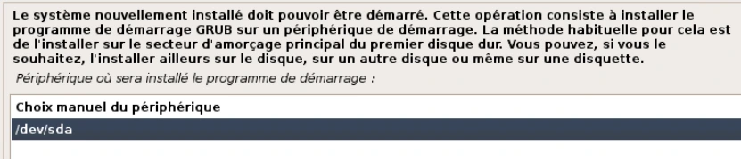

Capture ou visuel isolé du document de formation.

## Installation d’une distribution Debian

Démo

Installation Debian sur VMware Workstation

## Installation d’une distribution Debian

### TP Installation d’un système Debian graphique

Démo

Installation d’un système Debian serveur

## Conclusion

- Vous savez nommer les divers modes d’installation d’un système Linux
- Vous savez installer une machine client Debian
- Vous savez installer un serveur Debian

Référence du document : 1TNT50blqza62bKw7tbrBUGIz_KIP5gnq · SHA-256 0fe2d7803fbfc989…

| Support · RES24_0050B - M02 - Linux Administration (Debian) · 25 pages transcrites | Noms de domaine de formation neutralisés explicitement ; paramètres numériques et procédures conservés. |
| Depuis un CD-ROM ou DVD-ROM | L’installation à partir d’un CD ou DVD est historiquement la plus courante Live-CD Debian Un système directement fonctionnel depuis le DVD. |
| Depuis un CD-ROM ou DVD-ROM | CD-ROM Netinstall Contient le minimum pour lancer l’installation et récupérer les fichiers depuis un dépôt internet ou local Peut nécessiter une connexion à internet Permet la r… |
| Depuis une clé ou un disque USB | De plus en plus, les lecteurs optiques laissent place aux périphériques USB En pratique, ce sont les mêmes images qu’aux étapes précédentes, mais le média CD ou DVD est remplacé… |
| Depuis le réseau local | La plupart des BIOS actuels permettent l'amorçage à partir du réseau grâce au boot PXE Au démarrage, la machine reçoit d’un serveur dédié une adresse IP et le nom du fichier d’i… |
| Et tout le reste | Lorsqu'il s'agit de déployer un grand nombre de machines, plusieurs méthodes plus ou moins automatisées existent : FAI (Fully Automatic Installation) pour une installation sans… |
| Partitionnement et Swap | Un système Linux doit contenir au minimum deux partitions à l’installation : 1 Partition racine : / 1 Partition d’échange : SWAP La quantité d’espace disque recommandée pour la… |
| Étapes d’installation de Debian | Au démarrage du média d’installation, le choix est donné entre une installation graphique ou installation simple qui utilisera un mode texte amélioré dit « semi-graphique » Ce c… |
| Étapes d’installation de Debian | Choix de la langue Nous utiliserons dans ce cours des systèmes en français Toutefois, il est courant en production de posséder des systèmes installés en anglais avec un clavier… |
| Étapes d’installation de Debian | Nom de machine Ici l’on donne le nom d’hôte du système. |
| Étapes d’installation de Debian | Mot de passe du superutilisateur root L’installeur demande la saisie du mot de passe qui sera affecté à root. |
| Étapes d’installation de Debian | École du « su » Le simple fait d’affecter un mot de passe à l’utilisateur root réserve les pouvoirs d’administration du système qu’à lui et lui seul Le premier utilisateur créé… |
| Étapes d’installation de Debian | École du « sudo » Si durant cette phase d’installation, aucun mot de passe n’est configuré pour root, alors le premier utilisateur aura la possibilité d’effectuer une élévation… |
| Étapes d’installation de Debian | Il est fortement déconseillé de créer un seul utilisateur avec le privilège sudo. |
| Étapes d’installation de Debian | Partitionner les disques Cette phase d’installation permet de choisir comment subdiviser son disque pour créer les différents points de montage du système On peut choisir le mod… |
| Étapes d’installation de Debian | Sélection des logiciels En cas d’installation Netinstall, on pourra ici choisir le dépôt voulu (ici ftp.fr.debian.org) Il est aussi possible de préciser un éventuel serveur miro… |
| Étapes d’installation de Debian | Sélection des logiciels Il est aussi possible ici de préciser une adresse de serveur proxy (serveur mandataire en français). |
| Étapes d’installation de Debian | Sélection des logiciels Ici on peut choisir les packs logiciels à installer Premier exemple : un environnement de bureau classique (gnome) Debian Et second exemple : un environn… |
| Étapes d’installation de Debian | Sélection des logiciels Dernière étape, valider l’installation du programme de démarrage Capture ou visuel isolé du document de formation. |
| Installation d’une distribution Debian | Démo Installation Debian sur VMware Workstation |
| Conclusion | Vous savez nommer les divers modes d’installation d’un système Linux Vous savez installer une machine client Debian Vous savez installer un serveur Debian Référence du document… |
