# Module 02 — Installation d’une distribution Debian

Les parties ci-dessous reprennent le cours original, dans le même ordre. Les encadrés et les schémas répètent ses formulations.

## Parcours de lecture

1. Support · RES24_0050B - M02 - Linux Administration (Debian) · 25 pages transcrites
2. Installation d’une distribution Debian
3. Installation d’une distribution Debian
4. Depuis un CD-ROM ou DVD-ROM
5. Depuis un CD-ROM ou DVD-ROM
6. Depuis une clé ou un disque USB
7. Depuis le réseau local
8. Et tout le reste
9. Installation d’une distribution Debian
10. Partitionnement et Swap
11. Étapes d’installation de Debian
12. Étapes d’installation de Debian
13. Étapes d’installation de Debian
14. Étapes d’installation de Debian
15. Étapes d’installation de Debian
16. Étapes d’installation de Debian
17. Étapes d’installation de Debian
18. Étapes d’installation de Debian
19. Étapes d’installation de Debian
20. Étapes d’installation de Debian
21. Étapes d’installation de Debian
22. Étapes d’installation de Debian
23. Installation d’une distribution Debian
24. Installation d’une distribution Debian
25. Conclusion
26. Énoncé · M02TP01 - Enoncé - Installation de Debian AVEC interface graphique · 2 pages transcrites
27. Énoncé · M02TP01 - Enoncé - Installation de Debian AVEC interface graphique · 2 pages transcrites
28. Énoncé · M02TP02 - Enoncé - Installation de Debian SANS interface graphique · 2 pages transcrites
29. Énoncé · M02TP02 - Enoncé - Installation de Debian SANS interface graphique · 2 pages transcrites
30. Correction · M02TP01 - Solution - Installation de Debian AVEC interface graphique · 8 pages transcrites
31. Correction · M02TP02 - Solution - Installation de Debian SANS interface graphique · 6 pages transcrites

**Visuel externe**

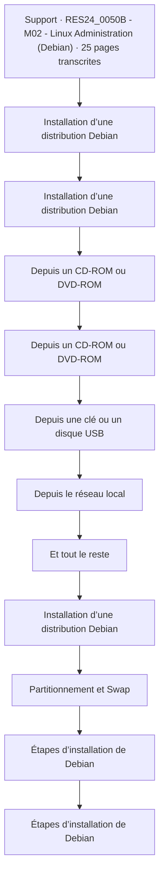

SOURCE DRIVE · TRANSCRIPTION DU SUPPORT

Le contenu des documents du dossier TSSR est transcrit ci-dessous, page par page. Les textes et tableaux sont intégrés à la page Web. Aucun fichier PDF, aucune diapositive entière ni aucune reproduction de page n’est affiché. Seuls des croquis ou visuels isolés et vérifiés peuvent accompagner la transcription. Les versions et les consignes restent celles des supports de formation. Les compléments IA sont conservés dans leur onglet distinct.

## Support · RES24_0050B - M02 - Linux Administration (Debian) · 25 pages transcrites

!!! note "À retenir"
    Noms de domaine de formation neutralisés explicitement ; paramètres numériques et procédures conservés.

Noms de domaine de formation neutralisés explicitement ; paramètres numériques et procédures conservés.

### Administration Debian

### GNU/Linux

!!! note "À retenir"
    Module 02 – Installation d’une distribution Debian

Module 02 – Installation d’une distribution Debian

## Installation d’une distribution Debian

### Objectifs

!!! note "À retenir"
    Découvrir les différents modes d’installation possibles Apprendre à effectuer des installations de Debian GNU/Linux Installer Debian Linux sur PC et sur serveurs

- Découvrir les différents modes d’installation possibles
- Apprendre à effectuer des installations de Debian GNU/Linux

Installer Debian Linux sur PC et sur serveurs

## Installation d’une distribution Debian

### Les modes d’installation

## Depuis un CD-ROM ou DVD-ROM

!!! note "À retenir"
    L’installation à partir d’un CD ou DVD est historiquement la plus courante Live-CD Debian Un système directement fonctionnel depuis le DVD.

**Visuel externe**

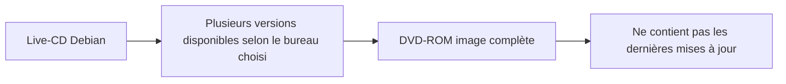

L’installation à partir d’un CD ou DVD est historiquement la plus courante

- Live-CD Debian
- Un système directement fonctionnel depuis le DVD. Permet de tester sans apporter la moindre modification. Propose l’installation
- Plusieurs versions disponibles selon le bureau choisi
- DVD-ROM image complète
- Permet l’installation du système complet sans accès à internet ou à un dépôt local
- Ne contient pas les dernières mises à jour

## Depuis un CD-ROM ou DVD-ROM

!!! note "À retenir"
    CD-ROM Netinstall Contient le minimum pour lancer l’installation et récupérer les fichiers depuis un dépôt internet ou local Peut nécessiter une connexion à internet Permet la récupération des paquets à jour Adresse de téléchargement des images ISO des DVD et CD-ROM https://www.debian.org/CD/http-ftp/#stable

**Visuel externe**

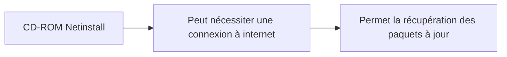

- CD-ROM Netinstall
- Contient le minimum pour lancer l’installation et récupérer les fichiers depuis un dépôt internet ou local
- Peut nécessiter une connexion à internet
- Permet la récupération des paquets à jour

Adresse de téléchargement des images ISO des DVD et CD-ROM https://www.debian.org/CD/http-ftp/#stable

## Depuis une clé ou un disque USB

!!! note "À retenir"
    De plus en plus, les lecteurs optiques laissent place aux périphériques USB En pratique, ce sont les mêmes images qu’aux étapes précédentes, mais le média CD ou DVD est remplacé par une clé De nombreux logiciels permettent de préparer des périphériques USB.

**Visuel externe**

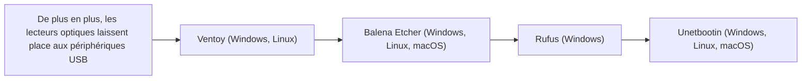

- De plus en plus, les lecteurs optiques laissent place aux périphériques USB
- En pratique, ce sont les mêmes images qu’aux étapes précédentes, mais le média CD ou DVD est remplacé par une clé
- De nombreux logiciels permettent de préparer des périphériques USB. On peut citer :
- Ventoy (Windows, Linux)
- Balena Etcher (Windows, Linux, macOS)
- Rufus (Windows)
- Unetbootin (Windows, Linux, macOS)

Écran de démarrage Ventoy https://www.ventoy.net/

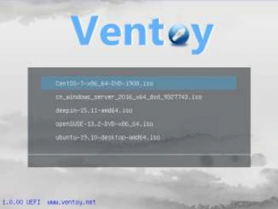

Capture ou visuel isolé du document de formation.

## Depuis le réseau local

!!! note "À retenir"
    La plupart des BIOS actuels permettent l'amorçage à partir du réseau grâce au boot PXE Au démarrage, la machine reçoit d’un serveur dédié une adresse IP et le nom du fichier d’installation à télécharger Exemple de démarrage par PXE.

- La plupart des BIOS actuels permettent l'amorçage à partir du réseau grâce au boot PXE
- Au démarrage, la machine reçoit d’un serveur dédié une adresse IP et le nom du fichier d’installation à télécharger

Exemple de démarrage par PXE.

iPXE project http://ipxe.org

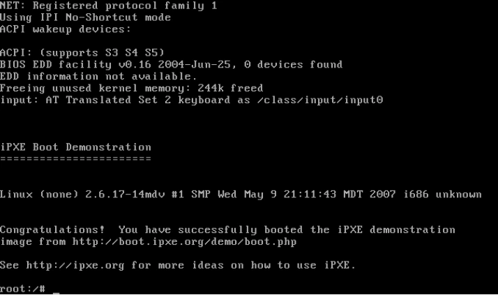

Capture ou visuel isolé du document de formation.

## Et tout le reste

**Visuel externe**

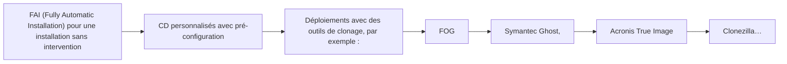

- Lorsqu'il s'agit de déployer un grand nombre de machines, plusieurs méthodes plus ou moins automatisées existent :
- FAI (Fully Automatic Installation) pour une installation sans intervention
- CD personnalisés avec pré-configuration
- Déploiements avec des outils de clonage, par exemple :
- FOG
- Symantec Ghost,
- Acronis True Image
- Clonezilla…

## Installation d’une distribution Debian

### Installer Debian

## Partitionnement et Swap

- Un système Linux doit contenir au minimum deux partitions à l’installation :
- 1 Partition racine : /
- 1 Partition d’échange : SWAP
- La quantité d’espace disque recommandée pour la partition de SWAP varie suivant la quantité de RAM installée ou allouée :
- RAM < 1Go SWAP = RAM x 1.5
- RAM <= 2Go SWAP = RAM
- RAM > 2Go SWAP = 2Go ou + selon le besoin

## Étapes d’installation de Debian

- Au démarrage du média d’installation, le choix est donné entre une installation graphique ou installation simple qui utilisera un mode texte amélioré dit « semi-graphique »
- Ce choix ne désigne pas le mode cible de l’installation de Debian
- On peut installer un serveur Linux en passant par l’installation graphique comme un PC de bureau avec interface graphique via l’installeur texte
- Mode de l’installeur ≠Mode de fonctionnement du Linux installé


Capture ou visuel isolé du document de formation.

## Étapes d’installation de Debian

!!! note "À retenir"
    Choix de la langue Nous utiliserons dans ce cours des systèmes en français Toutefois, il est courant en production de posséder des systèmes installés en anglais avec un clavier français Capture ou visuel isolé du document de formation.

Choix de la langue

- Nous utiliserons dans ce cours des systèmes en français
- Toutefois, il est courant en production de posséder des systèmes installés en anglais avec un clavier français


Capture ou visuel isolé du document de formation.

## Étapes d’installation de Debian

Nom de machine Ici l’on donne le nom d’hôte du système.

Domaine Ici l’on spécifie le domaine DNS auquel appartient la machine. Peut être laissé vide.


Capture ou visuel isolé du document de formation.

Transcription de la capture : noms du réseau de formation neutralisés, paramètres numériques et suite conservés.

```
Configurer le réseau — Domaine : laboratoire.example (nom du domaine de formation neutralisé)
```

## Étapes d’installation de Debian

Mot de passe du superutilisateur root L’installeur demande la saisie du mot de passe qui sera affecté à root.


Capture ou visuel isolé du document de formation.

## Étapes d’installation de Debian

École du « su »

- Le simple fait d’affecter un mot de passe à l’utilisateur root réserve les pouvoirs d’administration du système qu’à lui et lui seul
- Le premier utilisateur créé ne possédera quant à lui que des privilèges limités

```
user30@deb:~$ su -
Mot de passe :
root@deb:~#
```

## Étapes d’installation de Debian

École du « sudo » Si durant cette phase d’installation, aucun mot de passe n’est configuré pour root, alors le premier utilisateur aura la possibilité d’effectuer une élévation de privilège via son propre mot de passe avec la commande sudo.

```
user30@deb:~$ sudo -i
[sudo] Mot de passe de user30 :
root@deb:~#
```

## Étapes d’installation de Debian

Il est fortement déconseillé de créer un seul utilisateur avec le privilège sudo. Il est possible après installation d’affecter un mot de passe au compte root via la commande :

```
user30@deb:~$ sudo passwd root
[sudo] Mot de passe de user30 :
root@deb:~# passwd
Nouveau mot de passe : 
Retapez le nouveau mot de passe : 
passwd : le mot de passe a été mis à jour avec succès
```

## Étapes d’installation de Debian

Partitionner les disques

- Cette phase d’installation permet de choisir comment subdiviser son disque pour créer les différents points de montage du système
- On peut choisir le mode assisté ou le mode manuel plus complet

N.B. : En choisissant la technologie LVM, il faut au préalable configurer un partitionnement Intel MBR (BIOS) ou GPT (UEFI).


Capture ou visuel isolé du document de formation.

## Étapes d’installation de Debian

Sélection des logiciels

- En cas d’installation Netinstall, on pourra ici choisir le dépôt voulu (ici ftp.fr.debian.org)
- Il est aussi possible de préciser un éventuel serveur miroir

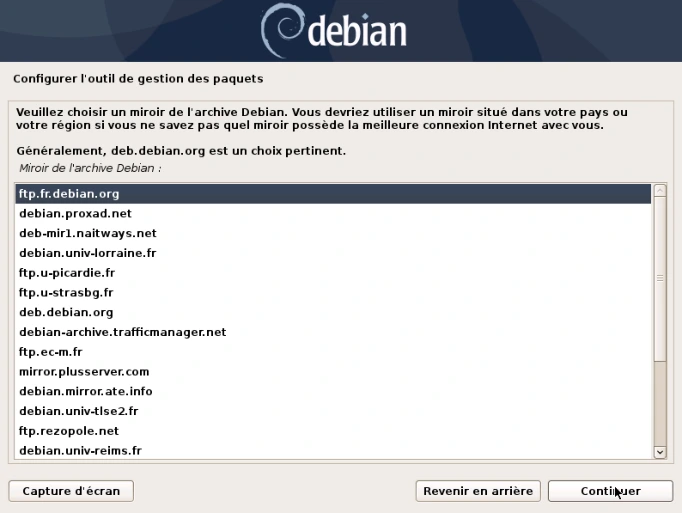

Capture ou visuel isolé du document de formation.

## Étapes d’installation de Debian

Sélection des logiciels Il est aussi possible ici de préciser une adresse de serveur proxy (serveur mandataire en français).


Capture ou visuel isolé du document de formation.

## Étapes d’installation de Debian

Sélection des logiciels

- Ici on peut choisir les packs logiciels à installer
- Premier exemple : un environnement de bureau classique (gnome) Debian
- Et second exemple : un environnement non graphique pour un serveur

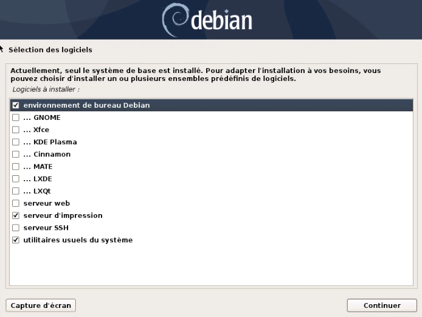

Capture ou visuel isolé du document de formation.

## Étapes d’installation de Debian

Sélection des logiciels Dernière étape, valider l’installation du programme de démarrage

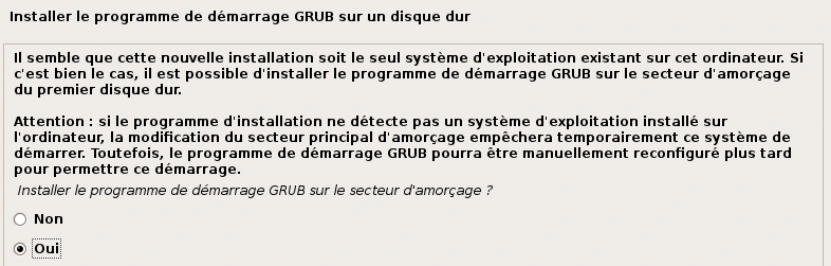

Capture ou visuel isolé du document de formation.


Capture ou visuel isolé du document de formation.

## Installation d’une distribution Debian

Démo

Installation Debian sur VMware Workstation

## Installation d’une distribution Debian

### TP Installation d’un système Debian graphique

Démo

Installation d’un système Debian serveur

## Conclusion

- Vous savez nommer les divers modes d’installation d’un système Linux
- Vous savez installer une machine client Debian
- Vous savez installer un serveur Debian

Référence du document : 1TNT50blqza62bKw7tbrBUGIz_KIP5gnq · SHA-256 0fe2d7803fbfc989…

## Énoncé · M02TP01 - Enoncé - Installation de Debian AVEC interface graphique · 2 pages transcrites

Doublon conservé : ce document est identique au document 1IzfXXbFqXsHYz8iNsdGV27CwJ3-92bg8 (même empreinte). Les deux emplacements du Drive sont maintenus.

### Installation de Debian 11 AVEC interface graphique

TP du Module 02 – Installation d’une distribution Debian

Avant de démarrer ce TP, il convient d’avoir suivi les vidéos des modules 1 et 2

Une solution de virtualisation doit être installée sur votre machine

Durée estimée

30 à 45 minutes

### Correction

### I. Récupérer l’image source d’installation

Copier localement le fichier debian-11.x.x-adm64-netinst.iso depuis le serveur de l’[organisme de formation]. (avec 11.x.x = la version disponible sur le serveur)

### II. Création de la machine virtuelle

Créer une nouvelle machine virtuelle avec les paramètres suivant :

- Interface réseau permettant l'accès au réseau internet (Bridged)
- Disque dur de 40 Go de taille dynamique
- 4096 Mo de mémoire vive
- Démarrer la machine virtuelle en mappant le fichier ISO comme CDROM.

### III. Installation de Debian

#### 1) Choisir les options suivantes :

- Installer Debian en mode graphique
- Choix de la langue : French - Français
- Emplacement géographique : France
- Clavier : France
- Nom de la machine : définir un nom
- Nom de domaine : laboratoire.example
- Utilisateurs :
  - Indiquer un mot de passe pour le compte root
  - Créer un utilisateur à votre nom

#### 2) Partitionnement des disques :

- Méthode de partitionnement : choisir Manuel
- Sélectionner le disque détecté puis « continuer »
- Configurer le gestionnaire de volume logique LVM
- Créer un groupe de volumes puis les volumes logiques indiqués ci-dessous :

| Type | Taille | Système de fichiers | Point de montage |
| --- | --- | --- | --- |
| LVM | 2048 MB | SWAP |  |
| LVM | 20 GB | ext4 | / |
| LVM | 5 GB | FAT32 | /windows |
| LVM | L’espace restant | ext4 | /home |

#### 3) Configurer l'outil de gestion des paquets :

- Analyser un autre CD ou DVD : Non
- Pays du miroir de l’archive Debian : France
- Miroir de l’archive Debian : ftp.fr.debian.org
- Ne pas utiliser de mandataire (proxy)
- Popularity contest : Non

#### 4) Choisir et installer des logiciels :

- Logiciels à installer : sélectionner
  - environnement de bureau Debian
  - utilitaires usuels du système

#### 5) Installer le programme de démarrage GRUB :

- Installer le programme : Oui
- Périphérique où sera installé le programme : /dev/sda

Terminer l'installation

Redémarrer

### Solution

Une solution est proposée pour ce TP sous la forme d'un PDF commenté, disponible dans les ressources à télécharger.

Référence du document : 11EQ5DumzryAnshIXxkFG1UD5rb2c-IgP · SHA-256 39d303359a5f97f7…

## Énoncé · M02TP01 - Enoncé - Installation de Debian AVEC interface graphique · 2 pages transcrites

Doublon conservé : ce document est identique au document 11EQ5DumzryAnshIXxkFG1UD5rb2c-IgP (même empreinte). Les deux emplacements du Drive sont maintenus.

### Installation de Debian 11 AVEC interface graphique

TP du Module 02 – Installation d’une distribution Debian

Avant de démarrer ce TP, il convient d’avoir suivi les vidéos des modules 1 et 2

Une solution de virtualisation doit être installée sur votre machine

Durée estimée

30 à 45 minutes

### Correction

### I. Récupérer l’image source d’installation

Copier localement le fichier debian-11.x.x-adm64-netinst.iso depuis le serveur de l’[organisme de formation]. (avec 11.x.x = la version disponible sur le serveur)

### II. Création de la machine virtuelle

Créer une nouvelle machine virtuelle avec les paramètres suivant :

- Interface réseau permettant l'accès au réseau internet (Bridged)
- Disque dur de 40 Go de taille dynamique
- 4096 Mo de mémoire vive
- Démarrer la machine virtuelle en mappant le fichier ISO comme CDROM.

### III. Installation de Debian

#### 1) Choisir les options suivantes :

- Installer Debian en mode graphique
- Choix de la langue : French - Français
- Emplacement géographique : France
- Clavier : France
- Nom de la machine : définir un nom
- Nom de domaine : laboratoire.example
- Utilisateurs :
  - Indiquer un mot de passe pour le compte root
  - Créer un utilisateur à votre nom

#### 2) Partitionnement des disques :

- Méthode de partitionnement : choisir Manuel
- Sélectionner le disque détecté puis « continuer »
- Configurer le gestionnaire de volume logique LVM
- Créer un groupe de volumes puis les volumes logiques indiqués ci-dessous :

| Type | Taille | Système de fichiers | Point de montage |
| --- | --- | --- | --- |
| LVM | 2048 MB | SWAP |  |
| LVM | 20 GB | ext4 | / |
| LVM | 5 GB | FAT32 | /windows |
| LVM | L’espace restant | ext4 | /home |

#### 3) Configurer l'outil de gestion des paquets :

- Analyser un autre CD ou DVD : Non
- Pays du miroir de l’archive Debian : France
- Miroir de l’archive Debian : ftp.fr.debian.org
- Ne pas utiliser de mandataire (proxy)
- Popularity contest : Non

#### 4) Choisir et installer des logiciels :

- Logiciels à installer : sélectionner
  - environnement de bureau Debian
  - utilitaires usuels du système

#### 5) Installer le programme de démarrage GRUB :

- Installer le programme : Oui
- Périphérique où sera installé le programme : /dev/sda

Terminer l'installation

Redémarrer

### Solution

Une solution est proposée pour ce TP sous la forme d'un PDF commenté, disponible dans les ressources à télécharger.

Référence du document : 1IzfXXbFqXsHYz8iNsdGV27CwJ3-92bg8 · SHA-256 39d303359a5f97f7…

## Énoncé · M02TP02 - Enoncé - Installation de Debian SANS interface graphique · 2 pages transcrites

Doublon conservé : ce document est identique au document 1dbc-S71EnOhWxKfkGTxp6nWU8ygyan2P (même empreinte). Les deux emplacements du Drive sont maintenus.

### Installation de Debian 11 SANS interface graphique

TP du Module 02 – Installation d’une distribution Linux

Avant de démarrer ce TP, il convient d’avoir suivi les vidéos des modules 1 et 2

Une solution de virtualisation doit être installée sur votre machine

Ce TP et les suivants seront à faire sur la machine mise à votre disposition par l’[organisme de formation].

Durée estimée

45mn à 1 heure

### Énoncé

### I. Récupérer l’image source d’installation

Copier localement le fichier debian-11.x.x-amd64-dvd.iso depuis le serveur de l’[organisme de formation]. (avec 11.x.x = la version disponible sur le serveur)

### II. Création de la machine virtuelle

Créer une nouvelle machine virtuelle avec les paramètres suivant :

- Interface réseau permettant l'accès au réseau de la salle (Bridged)
- Disque dur de 10 Go de taille dynamique
- 2048 Mo de mémoire vive
- Démarrer la machine virtuelle en mappant le fichier ISO comme CDROM.

### III. Installation de Debian

#### 1) Choisir les options suivantes :

- Installer Debian en mode graphique (mode par défaut)
- Choix de la langue : French - Français
- Emplacement géographique : France
- Disposition du clavier : Français
- Nom de la machine : définir un nom
- Nom de domaine : laboratoire.example
- Utilisateurs :
  - Indiquer un mot de passe pour le compte root
  - Créer un utilisateur

#### 2) Partitionner les disques :

- Méthode de partitionnement : Assisté - utiliser tout un disque avec LVM
- Disque à partitionner : sélectionner le disque SCSI
- Schéma de partitionnement : Partitions /home, /var et /tmp séparées

#### 3) Configurer l'outil de gestion des paquets :

- Analyser un autre CD ou DVD : Non
- PAS D’UTILISATION DES MIROIRS
- Popularity contest : Non

#### 4) Choisir et installer des logiciels :

- Logiciels à installer : sélectionner
  - serveur SSH
  - utilitaires usuels du système

#### 5) Installer le programme de démarrage GRUB :

- Installer le programme : Oui
- Périphérique où sera installé le programme : /dev/sda

Terminer l'installation

Redémarrer

### Solution

Une solution est proposée pour ce TP sous la forme d'un PDF commenté, disponible dans les ressources à télécharger.

Référence du document : 1la5XXtYUGY8KlSyaM99C7H_t0KbBsvCO · SHA-256 01b8f7b1b64e2f62…

## Énoncé · M02TP02 - Enoncé - Installation de Debian SANS interface graphique · 2 pages transcrites

Doublon conservé : ce document est identique au document 1la5XXtYUGY8KlSyaM99C7H_t0KbBsvCO (même empreinte). Les deux emplacements du Drive sont maintenus.

### Installation de Debian 11 SANS interface graphique

TP du Module 02 – Installation d’une distribution Linux

Avant de démarrer ce TP, il convient d’avoir suivi les vidéos des modules 1 et 2

Une solution de virtualisation doit être installée sur votre machine

Ce TP et les suivants seront à faire sur la machine mise à votre disposition par l’[organisme de formation].

Durée estimée

45mn à 1 heure

### Énoncé

### I. Récupérer l’image source d’installation

Copier localement le fichier debian-11.x.x-amd64-dvd.iso depuis le serveur de l’[organisme de formation]. (avec 11.x.x = la version disponible sur le serveur)

### II. Création de la machine virtuelle

Créer une nouvelle machine virtuelle avec les paramètres suivant :

- Interface réseau permettant l'accès au réseau de la salle (Bridged)
- Disque dur de 10 Go de taille dynamique
- 2048 Mo de mémoire vive
- Démarrer la machine virtuelle en mappant le fichier ISO comme CDROM.

### III. Installation de Debian

#### 1) Choisir les options suivantes :

- Installer Debian en mode graphique (mode par défaut)
- Choix de la langue : French - Français
- Emplacement géographique : France
- Disposition du clavier : Français
- Nom de la machine : définir un nom
- Nom de domaine : laboratoire.example
- Utilisateurs :
  - Indiquer un mot de passe pour le compte root
  - Créer un utilisateur

#### 2) Partitionner les disques :

- Méthode de partitionnement : Assisté - utiliser tout un disque avec LVM
- Disque à partitionner : sélectionner le disque SCSI
- Schéma de partitionnement : Partitions /home, /var et /tmp séparées

#### 3) Configurer l'outil de gestion des paquets :

- Analyser un autre CD ou DVD : Non
- PAS D’UTILISATION DES MIROIRS
- Popularity contest : Non

#### 4) Choisir et installer des logiciels :

- Logiciels à installer : sélectionner
  - serveur SSH
  - utilitaires usuels du système

#### 5) Installer le programme de démarrage GRUB :

- Installer le programme : Oui
- Périphérique où sera installé le programme : /dev/sda

Terminer l'installation

Redémarrer

### Solution

Une solution est proposée pour ce TP sous la forme d'un PDF commenté, disponible dans les ressources à télécharger.

Référence du document : 1dbc-S71EnOhWxKfkGTxp6nWU8ygyan2P · SHA-256 01b8f7b1b64e2f62…

## Correction · M02TP01 - Solution - Installation de Debian AVEC interface graphique · 8 pages transcrites

Les noms de domaine de formation sont neutralisés explicitement. Certaines captures sont transcrites en tableaux ; les paramètres numériques et les procédures sont conservés.

Correction originale : à consulter après avoir tenté l’exercice.

### Installation de Debian 11 AVEC interface graphique

TP du Module 02 – Installation d’une distribution Debian

Avant de démarrer ce TP, il convient d’avoir suivi les vidéos des modules 1 et 2

Une solution de virtualisation doit être installée sur votre machine

Durée estimée

30 à 45 minutes

### Correction

### I. Récupérer l’image source d’installation

Copier localement le fichier debian-11.x.x-adm64-netinst.iso depuis le serveur de l’[organisme de formation]. (avec 11.x.x = la version disponible sur le serveur)

### II. Création de la machine virtuelle

Créer une nouvelle machine virtuelle avec les paramètres suivant :

Installer le système plus tard

- Interface réseau permettant l'accès au réseau internet (Bridged)
- Disque dur de 40 Go de taille dynamique

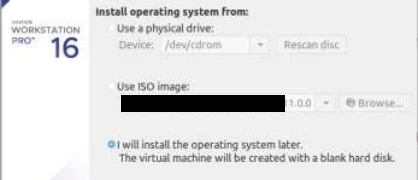

Capture ou visuel isolé du document de formation.

- 4096 Mo de mémoire vive

HDD 40 + 4096M de RAM + interface réseau bridge

- Démarrer la machine virtuelle en mappant le fichier ISO comme CDROM.

Sélectionner l'iso d'installation Debian

### III. Installation de Debian

#### 1) Choisir les options suivantes :

- Installer Debian en mode graphique
- Choix de la langue : French - Français
- Emplacement géographique : France
- Clavier : France
- Nom de la machine : définir un nom
- Nom de domaine : laboratoire.example
- Utilisateurs :
  - Indiquer un mot de passe pour le compte root
  - Créer un utilisateur à votre noml

Installation en mode graphique

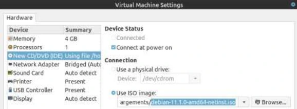

Capture ou visuel isolé du document de formation.

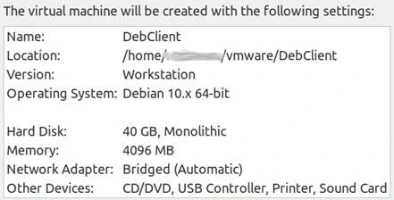

Capture ou visuel isolé du document de formation.


Capture ou visuel isolé du document de formation.

Nommer la machine

Préciser le nom de domaine

Saisie du mot de passe root

Saisie du nom complet du nouvel utilisateur

Saisie du login

Puis le mot de passe de l'utilisateur

Transcription textuelle de la capture : les noms de domaine de formation sont neutralisés ; adresses IP, commandes et résultats sont conservés.

| Écran de l’installeur | Valeur |
| --- | --- |
| Configurer le réseau — Domaine | laboratoire.example (nom de domaine de formation neutralisé) |

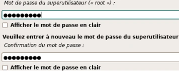

Capture ou visuel isolé du document de formation.


Capture ou visuel isolé du document de formation.

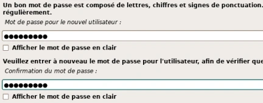

Capture ou visuel isolé du document de formation.

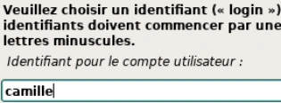

Commande ou détail d’interface isolé du document de formation.

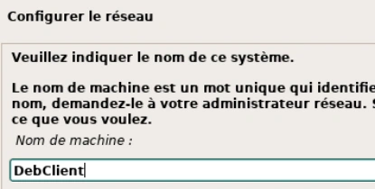

Détail de la procédure du laboratoire, isolé et vérifié.

#### 2) Partitionnement des disques :

- Méthode de partitionnement : choisir Manuel
- Sélectionner le disque détecté puis « continuer »
- Configurer le gestionnaire de volume logique LVM
- Créer un groupe de volumes puis les volumes logiques indiqués ci-dessous :

| Type | Taille | Système de fichiers | Point de montage |
| --- | --- | --- | --- |
| LVM | 2048 MB | SWAP |  |
| LVM | 20 GB | ext4 | / |
| LVM | 5 GB | FAT32 | /windows |
| LVM | L’espace restant | ext4 | /home |

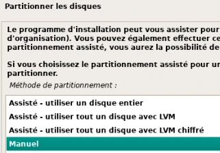

Mode manuel

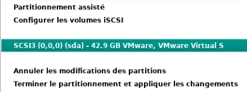

Sélection du disque

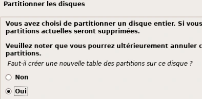

Valider le partionnement du disque

Se rendre dans le gestionnaire LVM

Valider les modifications

Commencer par créer un Groupe de Volumes

Donner un nom explicite au Groupe de Volumes

Sélectionner le disque à utiliser

Créer ensuite un volume logique

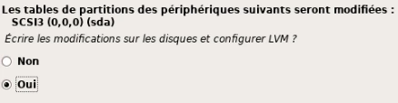

Capture ou visuel isolé du document de formation.

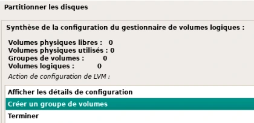

Capture ou visuel isolé du document de formation.

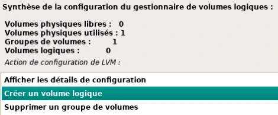

Capture ou visuel isolé du document de formation.

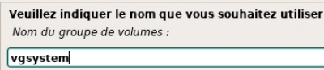

Commande ou détail d’interface isolé du document de formation.

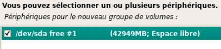

Commande ou détail d’interface isolé du document de formation.

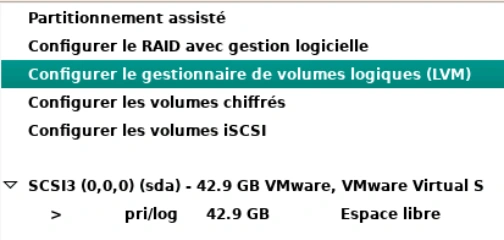

Détail de la procédure du laboratoire, isolé et vérifié.

→ Saisir nom et taille du volume

Répéter les étapes de creation des volumes en respectant les tailles demandées. Terminer par la partition home de manière à lui affecter l’espace restant.

"Afficher les détails de configuration” pour vérifier.

Terminer la mise en place des Volumes Définir les points de montage et systèmes de fichiers.

Sélectionner le volume lvroot

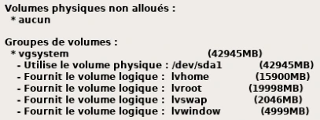

Capture ou visuel isolé du document de formation.

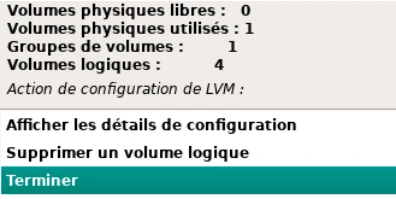

Capture ou visuel isolé du document de formation.

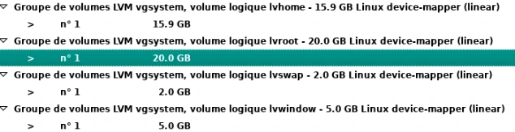

Capture ou visuel isolé du document de formation.

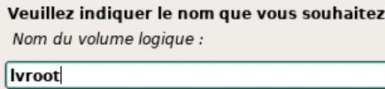

Commande ou détail d’interface isolé du document de formation.

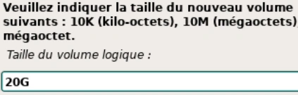

Détail de la procédure du laboratoire, isolé et vérifié.

Sélectionner "Utiliser comme"

Choisir le type ext4

→ Définir le point de montage comme “/système de fichiers racine”

Terminer le paramètrage de ce volume

Répéter ces étapes pour les autres volumes logiques en respectant les indications . NB : la partition Swap n’a pas de point de montage.

Terminer la définition des partitions et volumes

Appliquer les modifications après avoir vérifier les informations

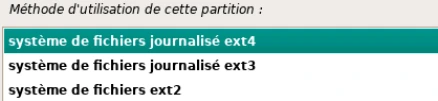

Capture ou visuel isolé du document de formation.

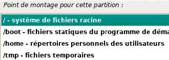

Capture ou visuel isolé du document de formation.

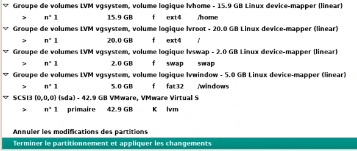

Capture ou visuel isolé du document de formation.

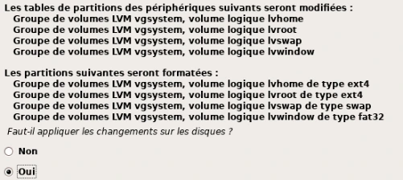

Capture ou visuel isolé du document de formation.

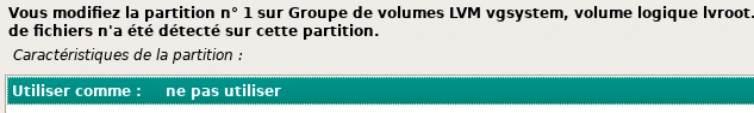

Commande ou détail d’interface isolé du document de formation.

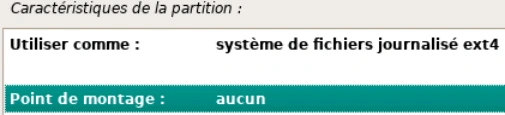

Commande ou détail d’interface isolé du document de formation.

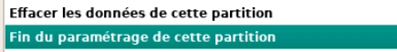

Commande ou détail d’interface isolé du document de formation.

#### 3) Configurer l'outil de gestion des paquets :

- Analyser un autre CD ou DVD : Non
- Pays du miroir de l’archive Debian : France
- Miroir de l’archive Debian : ftp.fr.debian.org
- Ne pas utiliser de mandataire (proxy)
- Popularity contest : Non

→ Attention à bien choisir le dépot ftp.fr.debian.org

#### 4) Choisir et installer des logiciels :

- Logiciels à installer : sélectionner
  - environnement de bureau Debian
  - utilitaires usuels du système

La sélection des tâches logicielles à installer

#### 5) Installer le programme de démarrage GRUB :

- Installer le programme : Oui
- Périphérique où sera installé le programme : /dev/sda

→ Terminer l'installation Redémarrer

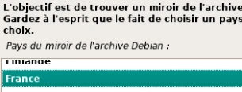

Capture ou visuel isolé du document de formation.

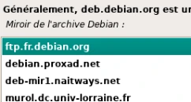

Capture ou visuel isolé du document de formation.

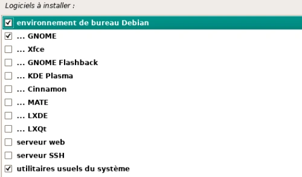

Capture ou visuel isolé du document de formation.

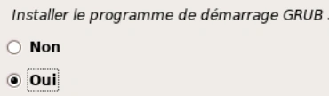

Commande ou détail d’interface isolé du document de formation.

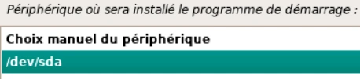

Commande ou détail d’interface isolé du document de formation.

Référence du document : 1AfZ3HoKGgwtvLN9yZ4N49jQfsXb5lGZd · SHA-256 84deb13b4f31ad60…

## Correction · M02TP02 - Solution - Installation de Debian SANS interface graphique · 6 pages transcrites

Noms de domaine de formation neutralisés explicitement ; paramètres numériques et procédures conservés.

Correction originale : à consulter après avoir tenté l’exercice.

### Installation de Debian 11 SANS interface graphique

TP du Module 02 – Installation d’une distribution Linux

Avant de démarrer ce TP, il convient d’avoir suivi les vidéos des modules 1 et 2

Une solution de virtualisation doit être installée sur votre machine

Durée estimée

45mn à 1 heure

### Correction

### I. Récupérer l’image source d’installation

Copier localement le fichier debian-11.x.x-amd64-dvd.iso depuis le serveur de l’[organisme de formation]. (avec 11.x.x = la version disponible sur le serveur)

### II. Création de la machine virtuelle

Créer une nouvelle machine virtuelle avec les paramètres suivant :

- Interface réseau permettant l'accès au réseau de la salle (Bridged)
- Disque dur de 10 Go de taille dynamique
- 2048 Mo de mémoire vive

Les paramètres de la VM

- Démarrer la machine virtuelle en mappant le fichier ISO comme CDROM.

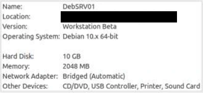

Capture ou visuel isolé du document de formation.

Choisir l'image d'installation DVD

### III. Installation de Debian

#### 1) Choisir les options suivantes :

- Installer Debian en mode graphique (mode par défaut)
- Choix de la langue : French - Français
- Emplacement géographique : France
- Disposition du clavier : Français
- Nom de la machine : définir un nom
- Nom de domaine : laboratoire.example
- Utilisateurs :
  - Indiquer un mot de passe pour le compte root
  - Créer un utilisateur

Installation en mode graphique

Nommer la machine

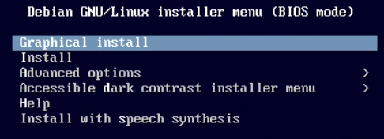

Capture ou visuel isolé du document de formation.

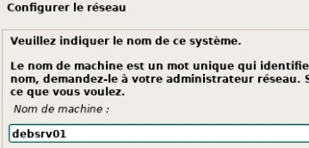

Capture ou visuel isolé du document de formation.

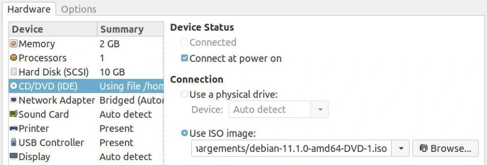

Détail de la procédure du laboratoire, isolé et vérifié.

Préciser le nom de domaine

Saisie du mot de passe root

Saisie du nom complet du nouvel utilisateur

Saisie du login

Puis le mot de passe de l'utilisateur

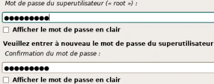

Capture ou visuel isolé du document de formation.

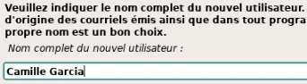

Capture ou visuel isolé du document de formation.


Capture ou visuel isolé du document de formation.

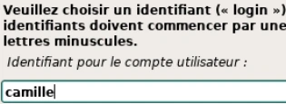

Commande ou détail d’interface isolé du document de formation.

Transcription de la capture avec neutralisation explicite des noms de domaine de formation.

```
Configurer le réseau — Domaine : laboratoire.example (domaine de formation neutralisé)
```

#### 2) Partitionner les disques :

- Méthode de partitionnement : Assisté - utiliser tout un disque avec LVM
- Disque à partitionner : sélectionner le disque SCSI
- Schéma de partitionnement : Partitions /home, /var et /tmp séparées


Assisté LVM sur disque entier


Sélection du disque


Choix du schéma de partitiionnement


Valider la création de ce partitionnement


Accepter la taille par défaut (totalité du disque)

Accepter la configuration automatique

#### 3) Configurer l'outil de gestion des paquets :

- Analyser un autre CD ou DVD : Non
- PAS D’UTILISATION DES MIROIRS
- Popularity contest : Non

Répondre non à ces trois questions

#### 4) Choisir et installer des logiciels :

- Logiciels à installer : sélectionner
  - serveur SSH
  - utilitaires usuels du système

Sélection des deux seuls groupes demandés


Capture ou visuel isolé du document de formation.


Commande ou détail d’interface isolé du document de formation.


Commande ou détail d’interface isolé du document de formation.


Détail de la procédure du laboratoire, isolé et vérifié.


Détail de la procédure du laboratoire, isolé et vérifié.

#### 5) Installer le programme de démarrage GRUB :

- Installer le programme : Oui
- Périphérique où sera installé le programme : /dev/sda

Terminer l'installation Redémarrer


Commande ou détail d’interface isolé du document de formation.


Commande ou détail d’interface isolé du document de formation.

Référence du document : 1uiQOk1ycmba-mL9IRr-hmErYoKgLB68C · SHA-256 8448afd9585de604…

## Fiche de synthèse

Les lignes reprennent les titres du cours et la première phrase de chaque partie.

| Partie | Repère du cours |
| --- | --- |
| Support · RES24_0050B - M02 - Linux Administration (Debian) · 25 pages transcrites | Noms de domaine de formation neutralisés explicitement ; paramètres numériques et procédures conservés. |
| Depuis un CD-ROM ou DVD-ROM | L’installation à partir d’un CD ou DVD est historiquement la plus courante Live-CD Debian Un système directement fonctionnel depuis le DVD. |
| Depuis un CD-ROM ou DVD-ROM | CD-ROM Netinstall Contient le minimum pour lancer l’installation et récupérer les fichiers depuis un dépôt internet ou local Peut nécessiter une connexion à internet Permet la r… |
| Depuis une clé ou un disque USB | De plus en plus, les lecteurs optiques laissent place aux périphériques USB En pratique, ce sont les mêmes images qu’aux étapes précédentes, mais le média CD ou DVD est remplacé… |
| Depuis le réseau local | La plupart des BIOS actuels permettent l'amorçage à partir du réseau grâce au boot PXE Au démarrage, la machine reçoit d’un serveur dédié une adresse IP et le nom du fichier d’i… |
| Et tout le reste | Lorsqu'il s'agit de déployer un grand nombre de machines, plusieurs méthodes plus ou moins automatisées existent : FAI (Fully Automatic Installation) pour une installation sans… |
| Partitionnement et Swap | Un système Linux doit contenir au minimum deux partitions à l’installation : 1 Partition racine : / 1 Partition d’échange : SWAP La quantité d’espace disque recommandée pour la… |
| Étapes d’installation de Debian | Au démarrage du média d’installation, le choix est donné entre une installation graphique ou installation simple qui utilisera un mode texte amélioré dit « semi-graphique » Ce c… |
| Étapes d’installation de Debian | Choix de la langue Nous utiliserons dans ce cours des systèmes en français Toutefois, il est courant en production de posséder des systèmes installés en anglais avec un clavier… |
| Étapes d’installation de Debian | Nom de machine Ici l’on donne le nom d’hôte du système. |
| Étapes d’installation de Debian | Mot de passe du superutilisateur root L’installeur demande la saisie du mot de passe qui sera affecté à root. |
| Étapes d’installation de Debian | École du « su » Le simple fait d’affecter un mot de passe à l’utilisateur root réserve les pouvoirs d’administration du système qu’à lui et lui seul Le premier utilisateur créé… |
| Étapes d’installation de Debian | École du « sudo » Si durant cette phase d’installation, aucun mot de passe n’est configuré pour root, alors le premier utilisateur aura la possibilité d’effectuer une élévation… |
| Étapes d’installation de Debian | Il est fortement déconseillé de créer un seul utilisateur avec le privilège sudo. |
| Étapes d’installation de Debian | Partitionner les disques Cette phase d’installation permet de choisir comment subdiviser son disque pour créer les différents points de montage du système On peut choisir le mod… |
| Étapes d’installation de Debian | Sélection des logiciels En cas d’installation Netinstall, on pourra ici choisir le dépôt voulu (ici ftp.fr.debian.org) Il est aussi possible de préciser un éventuel serveur miro… |
| Étapes d’installation de Debian | Sélection des logiciels Il est aussi possible ici de préciser une adresse de serveur proxy (serveur mandataire en français). |
| Étapes d’installation de Debian | Sélection des logiciels Ici on peut choisir les packs logiciels à installer Premier exemple : un environnement de bureau classique (gnome) Debian Et second exemple : un environn… |
| Étapes d’installation de Debian | Sélection des logiciels Dernière étape, valider l’installation du programme de démarrage Capture ou visuel isolé du document de formation. |
| Installation d’une distribution Debian | Démo Installation Debian sur VMware Workstation |
| Conclusion | Vous savez nommer les divers modes d’installation d’un système Linux Vous savez installer une machine client Debian Vous savez installer un serveur Debian Référence du document… |
| Énoncé · M02TP01 - Enoncé - Installation de Debian AVEC interface graphique · 2 pages transcrites | Doublon conservé : ce document est identique au document 1IzfXXbFqXsHYz8iNsdGV27CwJ3-92bg8 (même empreinte). |
| Énoncé · M02TP01 - Enoncé - Installation de Debian AVEC interface graphique · 2 pages transcrites | Doublon conservé : ce document est identique au document 11EQ5DumzryAnshIXxkFG1UD5rb2c-IgP (même empreinte). |
| Énoncé · M02TP02 - Enoncé - Installation de Debian SANS interface graphique · 2 pages transcrites | Doublon conservé : ce document est identique au document 1dbc-S71EnOhWxKfkGTxp6nWU8ygyan2P (même empreinte). |
| Énoncé · M02TP02 - Enoncé - Installation de Debian SANS interface graphique · 2 pages transcrites | Doublon conservé : ce document est identique au document 1la5XXtYUGY8KlSyaM99C7H_t0KbBsvCO (même empreinte). |
| Correction · M02TP01 - Solution - Installation de Debian AVEC interface graphique · 8 pages transcrites | Les noms de domaine de formation sont neutralisés explicitement. |
| Correction · M02TP02 - Solution - Installation de Debian SANS interface graphique · 6 pages transcrites | Noms de domaine de formation neutralisés explicitement ; paramètres numériques et procédures conservés. |
