# Module 03 — Démarrage d’une distribution Debian

Les parties ci-dessous reprennent le cours original, dans le même ordre. Les encadrés et les schémas répètent ses formulations.

## Parcours de lecture

1. Support · RES24_0050B - M03 - Linux Administration (Debian) · 29 pages transcrites
2. Démarrage d’une distribution Debian
3. Démarrage d’une distribution Debian
4. Chargeur d’amorçage (Boot Loader – BL)
5. Configuration de GRUB
6. Configuration de GRUB
7. GRUB au démarrage
8. Le noyau Linux
9. Fichiers du moyau
10. Relation GRUB / Noyau
11. Relation GRUB / Noyau
12. Démarrage de Linux, services et niveaux
13. Démarrage d’une distribution Debian
14. Le gestionnaire système : SystemD
15. Les cibles : SystemD
16. La commande systemctl
17. Gérer les cibles
18. Lister les unités SystemD
19. Gérer les services avec systemctl
20. Gérer les services avec systemctl
21. Gérer les services avec systemctl
22. Gérer les services avec systemctl
23. Gestion du système avec SystemD
24. Démarrage d’une distribution Debian
25. La commande shutdown
26. La commande shutdown
27. La commande shutdown
28. Arrêter / redémarrer le système
29. Conclusion
30. Énoncé · M03TP01 - Enoncé - Démarrer et arrêter Debian · 1 pages transcrites
31. Énoncé · M03TP02 - Enoncé - Gérer les services · 1 pages transcrites
32. Correction · M03TP01 - Solution - Démarrer et arrêter Debian · 2 pages transcrites
33. Transcription des commandes et informations utiles visibles
34. Transcription des commandes et informations utiles visibles
35. Transcription des commandes et informations utiles visibles
36. Correction · M03TP02 - Solution - Gérer les services · 2 pages transcrites
37. Transcription des commandes et informations utiles visibles
38. Transcription des commandes et informations utiles visibles
39. Transcription des commandes et informations utiles visibles
40. Transcription des commandes et informations utiles visibles
41. Transcription des commandes et informations utiles visibles
42. Transcription des commandes et informations utiles visibles
43. Transcription des commandes et informations utiles visibles
44. Transcription des commandes visibles

**Visuel externe**

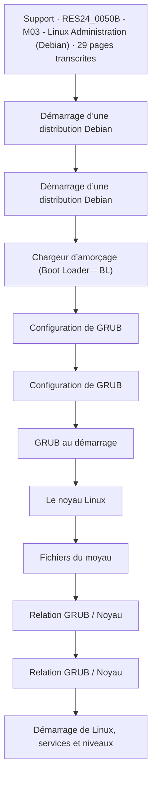

SOURCE DRIVE · TRANSCRIPTION DU SUPPORT

Le contenu des documents du dossier TSSR est transcrit ci-dessous, page par page. Les textes et tableaux sont intégrés à la page Web. Aucun fichier PDF, aucune diapositive entière ni aucune reproduction de page n’est affiché. Seuls des croquis ou visuels isolés et vérifiés peuvent accompagner la transcription. Les versions et les consignes restent celles des supports de formation. Les compléments IA sont conservés dans leur onglet distinct.

## Support · RES24_0050B - M03 - Linux Administration (Debian) · 29 pages transcrites

### Administration Debian

### GNU/Linux

!!! note "À retenir"
    Module 03 – Démarrage d’une distribution Debian

Module 03 – Démarrage d’une distribution Debian

## Démarrage d’une distribution Debian

### Objectifs

!!! note "À retenir"
    Comprendre les diverses étapes de démarrage Apprendre à gérer le système et les services avec SystemD Arrêter ou redémarrer une machine Linux Démarrer Debian Linux

**Visuel externe**

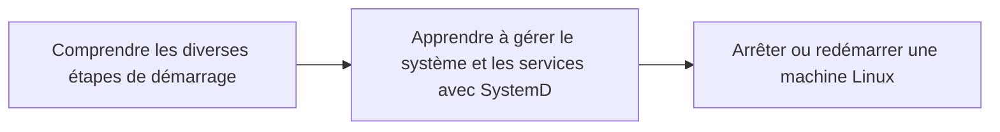

- Comprendre les diverses étapes de démarrage
- Apprendre à gérer le système et les services avec SystemD
- Arrêter ou redémarrer une machine Linux

Démarrer Debian Linux

## Démarrage d’une distribution Debian

### Démarrage de Linux,

### services et niveaux

## Chargeur d’amorçage (Boot Loader – BL)

!!! note "À retenir"
    1| BIOS 2| MBR 3| GRUB 4| Noyau 5| SystemD 5.1| Cible 2| MBR 3| GRUB 1| BIOS Sous Debian, le chargeur est le programme GRUB2.

1| BIOS 2| MBR 3| GRUB 4| Noyau 5| SystemD 5.1| Cible 2| MBR 3| GRUB 1| BIOS

Sous Debian, le chargeur est le programme GRUB2. Il se divise en plusieurs parties nommées stage. Après démarrage, le BIOS de la machine lance le chargeur d’amorçage. Stage 1 : dans le Master Boot Record (MBR), situé sur les 512 premiers octets du disque dur. Ce stage se contente de charger le suivant. Stage 1.5 : également localisé au début du disque dur contenant le Boot Loader, avant les données de la première partition Stage 2 : d’un point de vue Linux, la fin de GRUB est placée dans le répertoire /boot/grub/

## Configuration de GRUB

!!! note "À retenir"
    1| BIOS 2| MBR 3| GRUB 4| Noyau 5| SystemD 5.1| Cible 2| MBR 3| GRUB 1| BIOS Le fichier de configuration de grub se trouve dans /boot/grub/grub.cfg Il ne faut pas éditer ce fichier.

**Visuel externe**


1| BIOS 2| MBR 3| GRUB 4| Noyau 5| SystemD 5.1| Cible 2| MBR 3| GRUB 1| BIOS

- Le fichier de configuration de grub se trouve dans /boot/grub/grub.cfg

Il ne faut pas éditer ce fichier.

- Il est ainsi conseillé de procéder aux modifications de la configuration de GRUB à partir de :
- /etc/default/grub, contenant les paramètres et options globales
- scripts présents dans le dossier /etc/grub.d/

## Configuration de GRUB

!!! note "À retenir"
    1| BIOS 2| MBR 3| GRUB 4| Noyau 5| SystemD 5.1| Cible 2| MBR 3| GRUB 1| BIOS Pour la prise en compte de ces modifications, deux commandes permettent de regénérer le fichier /boot/grub/grub.cfg : grub-mkconfig et update-grub.

1| BIOS 2| MBR 3| GRUB 4| Noyau 5| SystemD 5.1| Cible 2| MBR 3| GRUB 1| BIOS

Pour la prise en compte de ces modifications, deux commandes permettent de regénérer le fichier /boot/grub/grub.cfg : grub-mkconfig et update-grub.

```
root@deb:~# update-grub
Création du fichier de configuration GRUB…
Image Linux trouvée : /boot/vmlinuz-4.19.0-12-amd64
Image mémoire initiale trouvée : /boot/initrd.img-4.19.0-12-amd64
Image Linux trouvée : /boot/vmlinuz-4.19.0-11-amd64
Image mémoire initiale trouvée : /boot/initrd.img-4.19.0-11-amd64
fait
```

```
root@deb:~# grub-mkconfig -o /boot/grub/grub.cfg
Création du fichier de configuration GRUB…
Image Linux trouvée : /boot/vmlinuz-4.19.0-12-amd64
Image mémoire initiale trouvée : /boot/initrd.img-4.19.0-12-amd64
Image Linux trouvée : /boot/vmlinuz-4.19.0-11-amd64
Image mémoire initiale trouvée : /boot/initrd.img-4.19.0-11-amd64
fait
```

## GRUB au démarrage

!!! note "À retenir"
    Selon la configuration de GRUB, il est possible de paramétrer l’affichage du menu au démarrage.

Selon la configuration de GRUB, il est possible de paramétrer l’affichage du menu au démarrage. Sera alors offerte la possibilité de sélectionner l’une des entrées qui y figurent afin de choisir un noyau ou un mode de démarrage particulier.

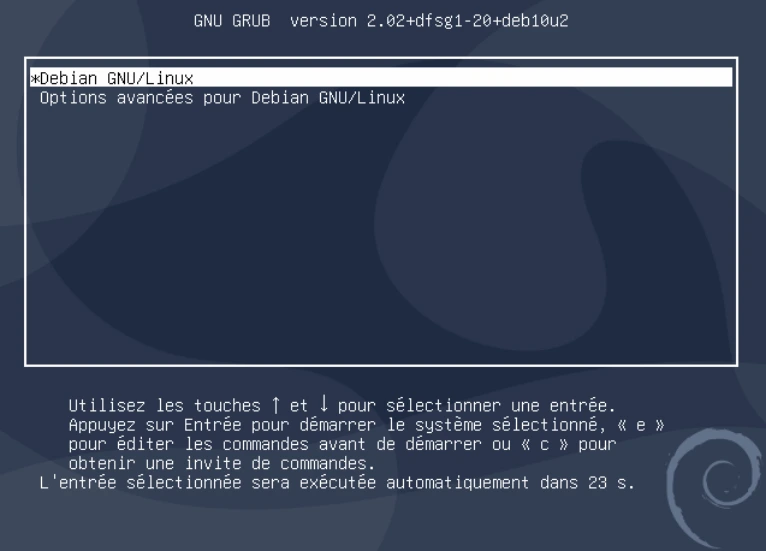

Capture ou visuel isolé du document de formation.

## Le noyau Linux

!!! note "À retenir"
    1| BIOS 2| MBR 3| GRUB 4| Noyau 5| SystemD 5.1| Cible 2| MBR 3| GRUB 1| BIOS Le noyau (kernel) d’un système d’exploitation a pour but principal de mettre en relation le matériel (via le BIOS) et les interfaces utilisateurs et applications.

1| BIOS 2| MBR 3| GRUB 4| Noyau 5| SystemD 5.1| Cible 2| MBR 3| GRUB 1| BIOS

- Le noyau (kernel) d’un système d’exploitation a pour but principal de mettre en relation le matériel (via le BIOS) et les interfaces utilisateurs et applications.
- Le kernel est dit modulaire, car il est constitué de plusieurs fichiers.

Application(s)

Shell

Noyau

Matériel

## Fichiers du moyau

!!! note "À retenir"
    Deux fichiers sont indispensables pour le démarrage minimum du système d’exploitation Debian : vmlinuz-4.19.0-12-amd64 : fichier principal du noyau avec sa version dans le nom.

- Deux fichiers sont indispensables pour le démarrage minimum du système d’exploitation Debian :
- vmlinuz-4.19.0-12-amd64 : fichier principal du noyau avec sa version dans le nom.
- initrd.img-4.19.0-12-amd64:fichier secondaire généré à chaque mise à jour. Il contient la configuration spécifique au matériel et les options importantes du système d’exploitation (ex : gestion du raid, chiffrement, pilote des systèmes de fichiers, etc.)

```
root@deb:~# ls -l /boot/
total 72280
-rw-r--r-- 1 root root   206143 oct.  18 10:43 config-4.19.0-12-amd64
drwxr-xr-x 5 root root     4096 nov.  19 12:00 grub
-rw-r--r-- 1 root root 28097458 nov.  18 12:04 initrd.img-4.19.0-12-amd64
-rw-r--r-- 1 root root  3415048 oct.  18 10:43 System.map-4.19.0-12-amd64
-rw-r--r-- 1 root root  5278960 oct.  18 10:43 vmlinuz-4.19.0-12-amd64
```

## Relation GRUB / Noyau

- Lors du démarrage, on peut passer des paramètres au lancement du noyau par Grub.
- Pour cela, il faudra appuyer sur la touche « e » pour passer en mode édition.


Capture ou visuel isolé du document de formation.

## Relation GRUB / Noyau

La ligne dans laquelle il est possible d’apporter des modifications est :

```
linux /vmlinuz-4.9.0-8-amd64 root=/dev/mapper/debian--vg-root ro 
quiet
```

- /vmlinuz-4.9.0-8-amd64 : nom de l’image noyau à charger.
- root=/dev/mapper/debian--vg-root : déclaration du système de fichier contenant la racine du système d’exploitation (/).
- ro : indique que la racine du système d’exploitation sera montée en lecture seule. Il est important de ne pas changer ce paramètre (si l’intégrité du système de fichier doit être vérifiée, celui-ci doit être en lecture seule).
- quiet : indique que le noyau se lancera de façon non verbeuse.

## Démarrage de Linux, services et niveaux

Démo

BIOS, Grub et grub.cfg

## Démarrage d’une distribution Debian

### Gestion du système

### avec SystemD

## Le gestionnaire système : SystemD

1| BIOS 2| MBR 3| GRUB 4| Noyau 5| SystemD 5.1| Cible 2| MBR 1| BIOS

- System D est le gestionnaire système, le premier programme lancé par le noyau (PID 1).
- Il est en charge de lancer tous les programmes suivants afin d’obtenir un système opérationnel pour l’utilisateur.
- Le démarrage des programmes (services) est parallèle avec des dépendances entres services.
- La gestion des services est matérialisée dans des fichiers spécifiques au sein du dossier /lib/systemd/system.

## Les cibles : SystemD

SystemD utilise des cibles (target) pour savoir quels sont les programmes à exécuter ou arrêter suivant l’objet de la cible.

| Nom de la cible | Objet de la cible | Equiv. SysV |
| --- | --- | --- |
| poweroff.target | Arrêt du système | 0 |
| rescue.target | Passer en mode maintenance | 1 |
| multi-user.target | Système d’exploitation en mode console (CLI) avec session multi-utilisateur | 3 |
| graphical.target | Système d’exploitation en mode graphique (GUI) si installé | 5 |
| reboot.target | Redémarrage du système | 6 |

Repères du schéma de démarrage : 1 | BIOS → 2 | MBR → 3 | GRUB → 4 | Noyau → 5 | SystemD → 5.1 | Cible.

## La commande systemctl

**Visuel externe**

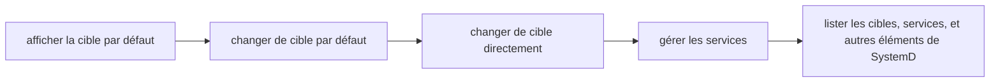

Une commande pour les gouverner tous : systemctl <action> [cible/service/unit] systemctl est LA commande par laquelle nous pourrons, entre autres :

- afficher la cible par défaut
- changer de cible par défaut
- changer de cible directement
- gérer les services
- lister les cibles, services, et autres éléments de SystemD

## Gérer les cibles

Connaître la cible par défaut

```
root@deb:~# systemctl get-default
graphical.target
```

Changer la cible par défaut

```
root@deb:~# systemctl set-default multi-user.target
Removed /etc/systemd/system/default.target.
Created symlink /etc/systemd/system/default.target /lib/systemd/system/multi-
user.target
```

Changer de cible

```
root@deb:~# systemctl isolate rescue.target
```

## Lister les unités SystemD

Lister les divers éléments (units) de SystemD

```
root@deb:~# systemctl list-units
…
networking.service 
 
loaded active exited    Raise network interfaces
rsyslog.service 
 
loaded active running   System Logging Service
…
multi-user.target 
 
loaded active active    Multi-User System
network.target 
 
loaded active active    Network
…
```

Lister tous les units

```
root@deb:~# systemctl list-units --all
getty-pre.target 
 
loaded    inactive dead      Login Prompts (Pre)
getty.target  
 
loaded    active   active    Login Prompts
graphical.target 
 
loaded    inactive dead      Graphical Interface
local-fs-pre.target 
 
loaded    active   active    Local File Systems (Pre)
```

## Gérer les services avec systemctl

Voir le statut d’un service

```
root@deb:~# systemctl status cron.service
● cron.service - Regular background program processing daemon
   Loaded: loaded (/lib/systemd/system/cron.service; enabled; vendor preset: enabled)
   Active: active (running) since Fri 2020-11-20 11:18:33 CET; 3h 29min ago
     Docs: man:cron(8)
 Main PID: 403 (cron)
    Tasks: 1 (limit: 2327)
   Memory: 1.1M
   CGroup: /system.slice/cron.service
           └─403 /usr/sbin/cron -f
```

```
nov. 20 11:18:33 SRV-DEB-01 cron[403]: (CRON) INFO (Running @reboot jobs)
nov. 20 12:17:01 SRV-DEB-01 CRON[760]: pam_unix(cron:session): session opened for user root by 
(uid=0)
nov. 20 12:17:01 SRV-DEB-01 CRON[761]: (root) CMD (   cd / && run-parts --report 
/etc/cron.hourly)
nov. 20 12:17:01 SRV-DEB-01 CRON[760]: pam_unix(cron:session): session closed for user root
```

## Gérer les services avec systemctl

Démarrer un service

```
root@deb:~# systemctl start cron.service
root@deb:~# systemctl status cron.service
● cron.service - Regular background program processing daemon
   Loaded: loaded (/lib/systemd/system/cron.service; enabled; vendor preset: enabled)
   Active: active (running) since Fri 2020-11-20 16:58:53 CET; 2s ago
     Docs: man:cron(8)
 Main PID: 885 (cron)
    Tasks: 1 (limit: 2327)
   Memory: 488.0K
   CGroup: /system.slice/cron.service
           └─885 /usr/sbin/cron -f
```

```
nov. 20 16:58:53 SRV-DEB-01 systemd[1]: Started Regular background program processing 
daemon.
nov. 20 16:58:53 SRV-DEB-01 cron[885]: (CRON) INFO (pidfile fd = 3)
nov. 20 16:58:53 SRV-DEB-01 cron[885]: (CRON) INFO (Skipping @reboot jobs -- not system 
startup)
```

## Gérer les services avec systemctl

Arrêter un service

```
root@deb:~# systemctl stop cron.service
root@deb:~# systemctl status cron.service
● cron.service - Regular background program processing daemon
   Loaded: loaded (/lib/systemd/system/cron.service; enabled; vendor preset: enabled)
   Active: inactive (dead) since Fri 2020-11-20 16:47:53 CET; 58s ago
     Docs: man:cron(8)
  Process: 403 ExecStart=/usr/sbin/cron -f $EXTRA_OPTS (code=killed, signal=TERM)
 Main PID: 403 (code=killed, signal=TERM)
```

Redémarrer un service

```
root@deb:~# systemctl restart cron.service
root@deb:~#
```

## Gérer les services avec systemctl

Activer un service

```
root@deb:~# systemctl enable networking
Synchronizing state of networking.service with SysV service script with 
/lib/systemd/systemd-sysv-install.
Executing: /lib/systemd/systemd-sysv-install enable networking
Created symlink /etc/systemd/system/multi-user.target.wants/networking.service → 
/lib/systemd/system/networking.service.
Created symlink /etc/systemd/system/network-online.target.wants/networking.service → 
/lib/systemd/system/networking.service.
```

Désactiver un service

```
root@deb:~# systemctl disable networking
Synchronizing state of networking.service with SysV service script with 
/lib/systemd/systemd-sysv-install.
Executing: /lib/systemd/systemd-sysv-install disable networking
Removed /etc/systemd/system/network-online.target.wants/networking.service.
Removed /etc/systemd/system/multi-user.target.wants/networking.service.
```

## Gestion du système avec SystemD

Démo

La commande systemctl

## Démarrage d’une distribution Debian

### Arrêter / redémarrer le

### système

## La commande shutdown

```
root@deb:~# shutdown [-rhc] <heure> <message>
```

Arrêter le système maintenant

```
root@deb:~# shutdown -h now
```

Arrêter le système dans 10 minutes avec un avertissement

```
root@deb:~# shutdown -h +10 "Arrêt du serveur dans 10mn !"
```

## La commande shutdown

Redémarrer immédiatement

```
root@deb:~# reboot
```

ou

```
root@deb:~# shutdown -r now
```

Redémarrer le système à 16h30

```
root@deb:~# shutdown -r 16:30 "reboot à 16h30"
```

## La commande shutdown

- Annuler une commande shutdown en attente.
- Ne fonctionne pas avec l’option now ou une fois l’heure programmée atteinte.

```
root@deb:~# shutdown -c
```

## Arrêter / redémarrer le système

### TP Démarrer et arrêter Debian

Démo

Gérer les services

## Conclusion

**Visuel externe**

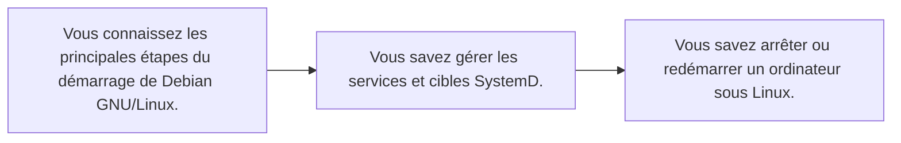

- Vous connaissez les principales étapes du démarrage de Debian GNU/Linux.
- Vous savez gérer les services et cibles SystemD.
- Vous savez arrêter ou redémarrer un ordinateur sous Linux.

Référence du document : 1yR1NXZJTL3Fb3MnLdA7XjOUn5nH97LhO · SHA-256 42936137889d5576…

## Énoncé · M03TP01 - Enoncé - Démarrer et arrêter Debian · 1 pages transcrites

Administration Debian GNU/Linux

### Démarrer et arrêter Debian

TP du Module 03 – Démarrage d’une distribution Debian

Avant de démarrer ce TP, il convient d’avoir suivi les vidéos des modules 1 à 3 et d’avoir réalisé les TP proposés.

Durée estimée

15 à 30 minutes

### Énoncé : Identification & modification de la cible par défaut sur la station avec environnement graphique

- Démarrer le système, ouvrez une session avec votre utilisateur
- Quelle est la cible systemd qui sera atteinte par défaut au démarrage de la machine ?
- Dans le manuel de la commande systemd, rechercher le nom de la cible identifiée au point précédent. Lire le paragraphe correspondant et en déduire le nom de la cible permettant un démarrage normal SANS ENVIRONNEMENT GRAPHIQUE
- Définir comme cible par défaut la cible trouvée au point précédent.
- Redémarrer le poste avec environnement graphique. A l’issue du redémarrage, l’environnement graphique a-t-il été chargé ? Est-ce normal ?
- Exécuter la commande systemctl appropriée afin de charger l’environnement graphique.

### Solution

Une solution est proposée pour ce TP sous la forme d'un PDF commenté, disponible dans les ressources à télécharger.

Référence du document : 13gVLkqE-ZMvWUjKgen3ABExTJx-4Gtpq · SHA-256 05cb0cd4aeb9ffa6…

## Énoncé · M03TP02 - Enoncé - Gérer les services · 1 pages transcrites

Administration Debian GNU/Linux

### Gérer les services

TP du Module 03 – Démarrage d’une distribution Debian

Avant de démarrer ce TP, il convient d’avoir suivi les vidéos des modules 1 à 3 et d’avoir réalisé les TP proposés.

Durée estimée

25 à 45 minutes

### Enoncé : Gestion des services : sur le serveur sans environnement graphique

### I. Gestion du service SSHD (connexions SSH)

Trouver les fichiers relatifs au fonctionnement du service (nom et emplacement) :

- Fichier de configuration systemd du service
- Démon ou fichier binaire du serveur ssh
- Fichier de configuration du serveur sshd

### II. Gestion du service CRON (planification de tâches)

- Le service sera-t-il lancé automatiquement au démarrage de la machine ?
- Arrêter le service cron
- Redémarrer le serveur. Le service cron est-il actif après redémarrage
- Arrêter à nouveau le service manuellement
- Désactiver totalement le démarrage automatique du démon cron au démarrage du système.

Restaurer les paramètres par défaut de démarrage du démon cron

### Solution

Une solution est proposée pour ce TP sous la forme d'un PDF commenté, disponible dans les ressources à télécharger.

Référence du document : 152MWaIvVdpo6ZRkcoJFJVv9_qVRhBWU9 · SHA-256 91a044e687a9ec63…

## Correction · M03TP01 - Solution - Démarrer et arrêter Debian · 2 pages transcrites

Correction originale : à consulter après avoir tenté l’exercice.

Administration Debian GNU/Linux

### Démarrer et arrêter Debian

TP du Module 03 – Démarrage d’une distribution Debian

Avant de démarrer ce TP, il convient d’avoir suivi les vidéos des modules 1 à 9 et d’avoir réalisé les TP proposés.

Durée estimée

15 à 30 minutes

### Solution : Identification & modification de la cible par défaut : sur la station avec environnement graphique

- Démarrer le système, ouvrez une session avec votre utilisateur

Cliquez sur votre nom puis saisissez votre mot de passe

- Quelle est la cible systemd qui sera atteinte par défaut au démarrage de la machine ?

→ Ouvrir une fenêtre de terminal puis saisir la commande attendue

- Dans le manuel de la commande systemd, rechercher le nom de la cible identifiée au point précédent. Lire le paragraphe correspondant et en déduire le nom de la cible permettant un démarrage normal SANS ENVIRONNEMENT GRAPHIQUE


Capture ou visuel isolé du document de formation.

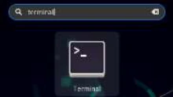

Capture ou visuel isolé du document de formation.

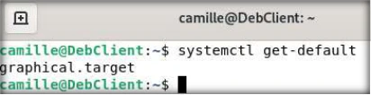

Capture ou visuel isolé du document de formation.

## Transcription des commandes et informations utiles visibles

```
systemctl get-default
graphical.target
```

Administration Debian GNU/Linux

→ man systemd puis recherche /graphical.target . Le résultat de cette recherche nous permet de remarquer le choix entre graphical.target et multi-user.target

- Définir comme cible par défaut la cible trouvée au point précédent.

Faire une élévation de droit puis saisir la commande systemctl avec ces paramètres

- Redémarrer le poste avec environnement graphique. A l’issue du redémarrage, l’environnement graphique a-t-il été chargé ? Est-ce normal ?

Après redémarrage, le mode multi-user par défaut nous offre un mode console

- Exécuter la commande systemctl appropriée afin de charger l’environnement graphique.

→ Ouvrir une session avec l'utilisateur root, saisir la commande systemctl isolate graphical.target

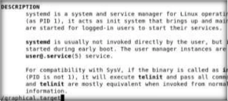

Capture ou visuel isolé du document de formation.

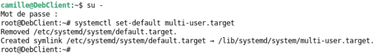

Capture ou visuel isolé du document de formation.

## Transcription des commandes et informations utiles visibles

```
su -
systemctl set-default multi-user.target
```

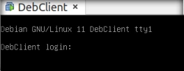

Capture ou visuel isolé du document de formation.

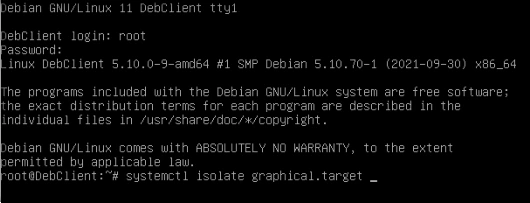

Capture ou visuel isolé du document de formation.

## Transcription des commandes et informations utiles visibles

```
systemctl isolate graphical.target
```


Capture ou visuel isolé du document de formation.

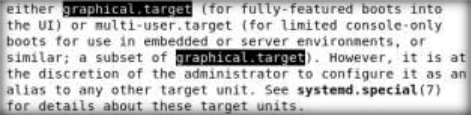

Commande ou détail d’interface isolé du document de formation.

Référence du document : 1GaBj6qd0GXpphUYErc_GEcLltx6nHkM0 · SHA-256 ac79903da5e2dbe8…

## Correction · M03TP02 - Solution - Gérer les services · 2 pages transcrites

Correction originale : à consulter après avoir tenté l’exercice.

Administration Debian GNU/Linux

### Gérer les services

TP du Module 03 – Démarrage d’une distribution Debian

Avant de démarrer ce TP, il convient d’avoir suivi les vidéos des modules 1 à 3 et d’avoir réalisé les TP proposés.

Durée estimée

25 à 45 minutes

### Solution : Gestion des services : sur le serveur sans environnement graphique

### I. Gestion du service SSHD (connexions SSH)

Trouver les fichiers relatifs au fonctionnement du service (nom et emplacement) :

Ouvrir une session avec votre utilisateur standard

- Fichier de configuration systemd du service
- Démon ou fichier binaire du serveur ssh

Conf systemd ligne 'Loaded'

Binaire en ligne Process

- Fichier de configuration du serveur sshd find dans le dossier /etc qui contient les paramètres du système et de ses services

type f car nous cherchons un fichier, pas un dossier *sshd*conf* cherche un fichier dont le nom contient à la fois le nom du service et le mot conf, habituel dans des fichiers de ce type.

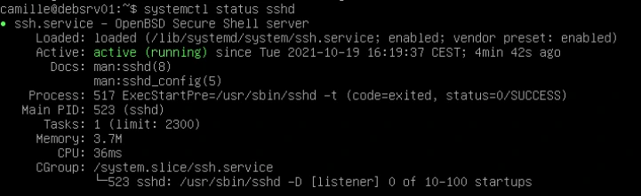

Capture ou visuel isolé du document de formation.

## Transcription des commandes et informations utiles visibles

```
systemctl status sshd
# Unité : /lib/systemd/system/ssh.service
# Binaire : /usr/sbin/sshd
```

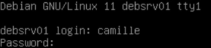

Commande ou détail d’interface isolé du document de formation.

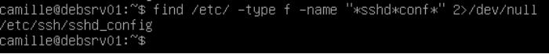

Commande ou détail d’interface isolé du document de formation.

## Transcription des commandes et informations utiles visibles

```
find /etc/ -type f -name "*sshd*conf*" 2>/dev/null
/etc/ssh/sshd_config
```

Administration Debian GNU/Linux

### II. Gestion du service CRON (planification de tâches)

- Le service sera-t-il lancé automatiquement au démarrage de la machine ?

Lister les services avec systemctl puis filtrer sur le mot cron.

Le résultat montre un service activé

- Arrêter le service cron

Arrêt du service avec la commande systemctl stop.

Vérification du résultat avec systemctl status .

- Redémarrer le serveur. Le service cron est-il actif après redémarrage systemctl stop ne fait qu'arrêter un service temporairement. Le service est de nouveau actif après redémarrage du système
- Arrêter à nouveau le service manuellement
- Désactiver totalement le démarrage automatique du démon cron au démarrage du système

Désactivation d'un service au prochain démarrage avec l'option disable de systemctl

Restaurer les paramètres par défaut de démarrage du démon cron systemctl enable pour activer au démarrage, systemctl start pour démarrer manuellement le service sans devoir redémarrer le serveur.

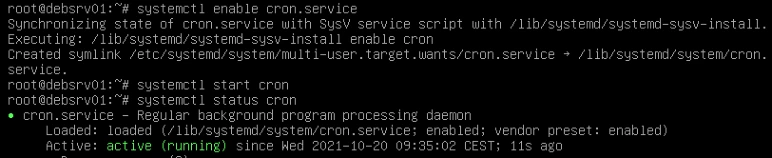

Capture ou visuel isolé du document de formation.

## Transcription des commandes et informations utiles visibles

```
systemctl enable cron.service
systemctl start cron
systemctl status cron
```

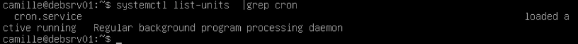

Commande ou détail d’interface isolé du document de formation.

## Transcription des commandes et informations utiles visibles

```
systemctl list-units | grep cron
```

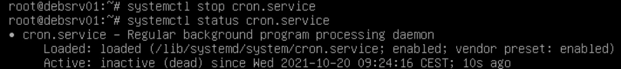

Commande ou détail d’interface isolé du document de formation.

## Transcription des commandes et informations utiles visibles

```
systemctl stop cron.service
systemctl status cron.service
```

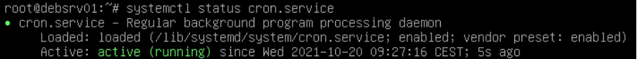

Commande ou détail d’interface isolé du document de formation.

## Transcription des commandes et informations utiles visibles

```
systemctl status cron.service
```

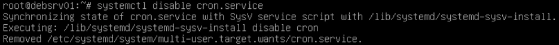

Commande ou détail d’interface isolé du document de formation.

## Transcription des commandes et informations utiles visibles

```
systemctl disable cron.service
```


Détail de la procédure du laboratoire, isolé et vérifié.

## Transcription des commandes visibles

```
systemctl stop cron.service
```

Référence du document : 1BqZRCFRK5I4Uo1i1LA6SNEZ9eveMWvVR · SHA-256 057a0c0c0b2745e7…

## Fiche de synthèse

Les lignes reprennent les titres du cours et la première phrase de chaque partie.

| Partie | Repère du cours |
| --- | --- |
| Chargeur d’amorçage (Boot Loader – BL) | 1/ BIOS 2/ MBR 3/ GRUB 4/ Noyau 5/ SystemD 5.1/ Cible 2/ MBR 3/ GRUB 1/ BIOS Sous Debian, le chargeur est le programme GRUB2. |
| Configuration de GRUB | 1/ BIOS 2/ MBR 3/ GRUB 4/ Noyau 5/ SystemD 5.1/ Cible 2/ MBR 3/ GRUB 1/ BIOS Le fichier de configuration de grub se trouve dans /boot/grub/grub.cfg Il ne faut pas éditer ce fich… |
| Configuration de GRUB | 1/ BIOS 2/ MBR 3/ GRUB 4/ Noyau 5/ SystemD 5.1/ Cible 2/ MBR 3/ GRUB 1/ BIOS Pour la prise en compte de ces modifications, deux commandes permettent de regénérer le fichier /boo… |
| GRUB au démarrage | Selon la configuration de GRUB, il est possible de paramétrer l’affichage du menu au démarrage. |
| Le noyau Linux | 1/ BIOS 2/ MBR 3/ GRUB 4/ Noyau 5/ SystemD 5.1/ Cible 2/ MBR 3/ GRUB 1/ BIOS Le noyau (kernel) d’un système d’exploitation a pour but principal de mettre en relation le matériel… |
| Fichiers du moyau | Deux fichiers sont indispensables pour le démarrage minimum du système d’exploitation Debian : vmlinuz-4.19.0-12-amd64 : fichier principal du noyau avec sa version dans le nom. |
| Relation GRUB / Noyau | Lors du démarrage, on peut passer des paramètres au lancement du noyau par Grub. |
| Relation GRUB / Noyau | La ligne dans laquelle il est possible d’apporter des modifications est : /vmlinuz-4.9.0-8-amd64 : nom de l’image noyau à charger. |
| Le gestionnaire système : SystemD | 1/ BIOS 2/ MBR 3/ GRUB 4/ Noyau 5/ SystemD 5.1/ Cible 2/ MBR 1/ BIOS System D est le gestionnaire système, le premier programme lancé par le noyau (PID 1). |
| Les cibles : SystemD | SystemD utilise des cibles (target) pour savoir quels sont les programmes à exécuter ou arrêter suivant l’objet de la cible. |
| La commande systemctl | Une commande pour les gouverner tous : systemctl <action> [cible/service/unit] systemctl est LA commande par laquelle nous pourrons, entre autres : afficher la cible par défaut… |
| Gérer les cibles | Connaître la cible par défaut Changer la cible par défaut Changer de cible |
| Lister les unités SystemD | Lister les divers éléments (units) de SystemD Lister tous les units |
| Gérer les services avec systemctl | Arrêter un service Redémarrer un service |
| Gérer les services avec systemctl | Activer un service Désactiver un service |
| La commande shutdown | Arrêter le système maintenant Arrêter le système dans 10 minutes avec un avertissement |
| La commande shutdown | Redémarrer immédiatement ou Redémarrer le système à 16h30 |
| La commande shutdown | Annuler une commande shutdown en attente. |
| Conclusion | Vous connaissez les principales étapes du démarrage de Debian GNU/Linux. |
| Correction · M03TP01 - Solution - Démarrer et arrêter Debian · 2 pages transcrites | Correction originale : à consulter après avoir tenté l’exercice. |
| Transcription des commandes et informations utiles visibles | Administration Debian GNU/Linux → man systemd puis recherche /graphical.target . |
| Transcription des commandes et informations utiles visibles | Capture ou visuel isolé du document de formation. |
| Transcription des commandes et informations utiles visibles | Capture ou visuel isolé du document de formation. |
| Correction · M03TP02 - Solution - Gérer les services · 2 pages transcrites | Correction originale : à consulter après avoir tenté l’exercice. |
| Transcription des commandes et informations utiles visibles | Commande ou détail d’interface isolé du document de formation. |
| Transcription des commandes et informations utiles visibles | Commande ou détail d’interface isolé du document de formation. |
| Transcription des commandes et informations utiles visibles | Commande ou détail d’interface isolé du document de formation. |
| Transcription des commandes et informations utiles visibles | Commande ou détail d’interface isolé du document de formation. |
| Transcription des commandes et informations utiles visibles | Commande ou détail d’interface isolé du document de formation. |
| Transcription des commandes et informations utiles visibles | Détail de la procédure du laboratoire, isolé et vérifié. |
| Transcription des commandes visibles | Référence du document : 1BqZRCFRK5I4Uo1i1LA6SNEZ9eveMWvVR · SHA-256 057a0c0c0b2745e7… |
