# Module 04 — Debian en mode maintenance

Les parties ci-dessous reprennent le cours original, dans le même ordre. Les encadrés et les schémas répètent ses formulations.

## Parcours de lecture

1. Support · RES24_0050B - M04 - Linux Administration (Debian) · 18 pages transcrites
2. Debian en mode maintenance
3. Debian en mode maintenance
4. Passer en mode maintenance
5. Debian en mode maintenance
6. Méthode 1
7. Méthode 1
8. Méthode 1
9. Debian en mode maintenance
10. Méthode 2
11. Méthode 2
12. Méthode 2
13. Méthode 2
14. Debian en mode maintenance
15. Mode maintenance via le CD d’installation
16. Mode maintenance via le CD-ROM
17. Debian en mode maintenance
18. Conclusion
19. Énoncé · M04TP01 - Enoncé - Debian en mode maintenance · 2 pages transcrites
20. Correction · M04TP01 - Solution - Debian en mode maintenance · 6 pages transcrites
21. Transcription des commandes et informations utiles visibles
22. Transcription des commandes et informations utiles visibles
23. Transcription des commandes et informations utiles visibles
24. Transcription des commandes et informations utiles visibles
25. Transcription des commandes et informations utiles visibles
26. Transcription des commandes et informations utiles visibles
27. Transcription des commandes et informations utiles visibles

**Visuel externe**

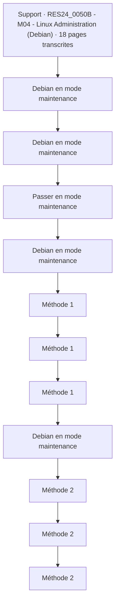

SOURCE DRIVE · TRANSCRIPTION DU SUPPORT

Le contenu des documents du dossier TSSR est transcrit ci-dessous, page par page. Les textes et tableaux sont intégrés à la page Web. Aucun fichier PDF, aucune diapositive entière ni aucune reproduction de page n’est affiché. Seuls des croquis ou visuels isolés et vérifiés peuvent accompagner la transcription. Les versions et les consignes restent celles des supports de formation. Les compléments IA sont conservés dans leur onglet distinct.

## Support · RES24_0050B - M04 - Linux Administration (Debian) · 18 pages transcrites

### Administration Debian

### GNU/Linux

Module 04 – Debian en mode maintenance

## Debian en mode maintenance

### Objectifs

!!! note "À retenir"
    Savoir démarrer en mode maintenance depuis GRUB ou depuis le CD d’installation Réparer Linux

- Savoir démarrer en mode maintenance depuis GRUB ou depuis le CD d’installation

Réparer Linux

## Debian en mode maintenance

### Démarrer un système en

### mode maintenance

## Passer en mode maintenance

!!! note "À retenir"
    Il est parfois nécessaire de passer en mode maintenance sur un ordinateur ou un serveur pour diverses raisons En voici quelques-unes : Le système ne démarre plus à la suite d'une mise à jour ou d’une installation Le mot de passe de l’utilisateur root est perdu Récupération de données …

**Visuel externe**


- Il est parfois nécessaire de passer en mode maintenance sur un ordinateur ou un serveur pour diverses raisons
- En voici quelques-unes :
- Le système ne démarre plus à la suite d'une mise à jour ou d’une installation
- Le mot de passe de l’utilisateur root est perdu
- Récupération de données
- …

## Debian en mode maintenance

### Mode maintenance via

### GRUB

## Méthode 1

!!! note "À retenir"
    Passer par le boot manager GRUB pour passer en mode maintenance Utiliser les flèches pour choisir la ligne du noyau voulu puis appuyez sur la touche [e] Ce mode n’est pas fonctionnel en mode « sudo sans mot de passe » pour l’utilisateur.

- Passer par le boot manager GRUB pour passer en mode maintenance
- Utiliser les flèches pour choisir la ligne du noyau voulu puis appuyez sur la touche [e]

Ce mode n’est pas fonctionnel en mode « sudo sans mot de passe » pour l’utilisateur.


Capture ou visuel isolé du document de formation.


Capture ou visuel isolé du document de formation.

## Méthode 1

!!! note "À retenir"
    Modifier la fin de la ligne suivante De cette manière Valider avec [ctrl] + [x] ou [F10].

!!! warning "Attention"
    Attention le clavier est au format QWERTY en_US par défaut Après vos actions en mode maintenance, la séquence de touches [ctrl] + [d] vous permettra de poursuivre vers le chargement vers la cible « rescue.target »

- Modifier la fin de la ligne suivante

```
linux 
/vmlinuz-4.19.0-8-amd64 root=/dev/mapper/debian--vg-sys ro quiet
```

- De cette manière

```
linux 
/vmlinuz-4.19.0-8-amd64 root=/dev/mapper/debian--vg-sys ro single
```

- Valider avec [ctrl] + [x] ou [F10]. Saisissez le mot de passe root. Attention le clavier est au format QWERTY en_US par défaut
- Après vos actions en mode maintenance, la séquence de touches [ctrl] + [d] vous permettra de poursuivre vers le chargement vers la cible « rescue.target »

## Méthode 1

!!! note "À retenir"
    Démo Maintenance via GRUB avec mot de passe root

Démo

Maintenance via GRUB avec mot de passe root

## Debian en mode maintenance

### Maintenance via GRUB sans mot de passe root

## Méthode 2

!!! note "À retenir"
    Passer par le boot manager GRUB pour passer en mode maintenance Utiliser les flèches pour choisir la ligne du noyau voulu puis appuyez sur la touche [e] Capture ou visuel isolé du document de formation.

- Passer par le boot manager GRUB pour passer en mode maintenance
- Utiliser les flèches pour choisir la ligne du noyau voulu puis appuyez sur la touche [e]

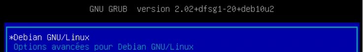

Capture ou visuel isolé du document de formation.

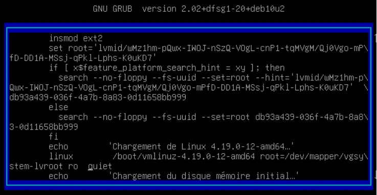

Capture ou visuel isolé du document de formation.

## Méthode 2

!!! note "À retenir"
    Modifier la fin de la ligne de cette manière Valider avec [ctrl] + [x] ou [F10].

- Modifier la fin de la ligne de cette manière

```
linux 
/vmlinuz-4.19.0-8 root=/dev/mapper/debian--vg-sys ro init=/bin/bash
```

- Valider avec [ctrl] + [x] ou [F10]. Attention le clavier est au format QWERTY en-US

## Méthode 2

- Le système est démarré mais le système de fichier racine est en lecture seule. Il faut lancer la commande suivante pour obtenir l’accès en lecture-écriture :

```
root@(none):/# mount –o remount,rw /
[   88.5124578] EXT4-fs (dm-0): re-mounted. Opts: errors=remount-ro
root@(none):/#
```

- Après vos actions, synchronisez l’écriture des données en RAM vers le disque avec la commande sync
- Rappel : il n’est pas possible d’éteindre proprement l’ordinateur dans ce mode
- Il faudra forcer l’extinction par un poweroff matériel

## Méthode 2

Démo

Maintenance via GRUB sans mot de passe root

## Debian en mode maintenance

### Mode maintenance

### via le CD-ROM

## Mode maintenance via le CD d’installation

Une autre solution : passer par le mode maintenance inclus dans chaque CD d’installation.

| Avantages | Inconvénients |
| --- | --- |
| Langue française disponible | Nécessité d’avoir un CD-ROM disponible ou une image |
| Pas besoin du mot de passe root | Complexité possible en virtualisation |
| Extinction |  |

## Mode maintenance via le CD-ROM

Démo

Maintenance via le CD-ROM

## Debian en mode maintenance

### Démo TP

## Conclusion

- Vous savez passer en mode maintenance au démarrage depuis GRUB
- Vous savez démarrer sur le CD d’installation Debian en mode maintenance

Référence du document : 11zEIM3oEyioi-kQtk3b43VC_RnlD9zjq · SHA-256 f8cc5ca64839f70b…

## Énoncé · M04TP01 - Enoncé - Debian en mode maintenance · 2 pages transcrites

### Debian en mode maintenance

TP du Module 04 – Debian en mode maintenance

Avant de démarrer ce TP, il convient d’avoir suivi les vidéos des modules 1 à 4 et d’avoir réalisé les TP proposés.

Durée estimée

30 minutes à 1 heure

### Énoncé

### I. Sur le serveur Debian sans environnement graphique

**Visuel externe**


Utiliser le menu GRUB pour démarrer le serveur en mode maintenance et sans avoir besoin de s’authentifier avec le mot de passe de root (voir support de cours)

- Activer l’écriture sur la partition racine.
- Pouvez-vous créer un fichier dans l’espace personnel du compte root ?
- Pouvez-vous accéder au répertoire personnel de l’utilisateur créé à l’installation ?
- Est-ce normal ?

### II. Sur le serveur Debian avec environnement graphique

**Visuel externe**


Démarrer dans le "Rescue mode" (dans "Advanced options") à partir de l'ISO d'installation Debian* :

- Sélectionner la langue, le nom (comme lors d'une installation)
- Sélectionner le système de fichiers racine à monter

Accéder au fichier /etc/passwd sur votre disque dur.

- Pouvez-vous le modifier ? (attention à ne rien casser !!)
- Avec quel utilisateur êtes-vous connecté ?
- Avez-vous indiqué un mot de passe ?

### * Menu de démarrage dans VMware Workstation:

Pour démarrer depuis le CD, appuyez sur la touche "Echap" lors de l'affichage du logo VMware au démarrage du système.

Attention, pensez à faire le "focus" sur votre VM en cliquant dans la fenêtre console afin que la touche "Echap" soit bien prise en compte par votre VM (et non par votre poste physique.)

En cas de redémarrage, pensez à connecter votre CDROM

### Solution

Une solution est proposée pour ce TP sous la forme d'un PDF commenté, disponible dans les ressources à télécharger.

Référence du document : 18o5SM7zMGtoh6DTtEEn7kjx7oSU2MloO · SHA-256 8584547906922a41…

## Correction · M04TP01 - Solution - Debian en mode maintenance · 6 pages transcrites

Correction originale : à consulter après avoir tenté l’exercice.

Administration Debian GNU-Linux

### Debian en mode maintenance

**Visuel externe**


TP du Module 04 – Debian en mode maintenance

Avant de démarrer ce TP, il convient d’avoir suivi les vidéos des modules 1 à 4 et d’avoir réalisé les TP proposés.

Durée estimée

30 minutes à 1 heure

Solution

I. Sur le serveur Debian sans environnement graphique

Utiliser le menu GRUB pour démarrer le serveur en mode maintenance et sans avoir besoin de s’authentifier avec le mot de passe de root (voir support de cours)

Sur le menu de démarrage Grub, appuyer sur la touche ‘e’

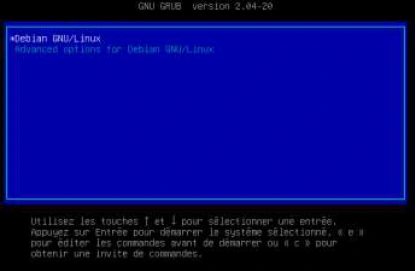

Capture ou visuel isolé du document de formation.

Administration Debian GNU-Linux

Chercher la ligne commencant par "linux" , à la fin de celle-ci remplacer 'quiet' par 'init=/bin/bash'

Attention : clavier en qwerty US Appuyer sur F10 pour lancer le système

Commenté [MC1]: Image dans le domaine public. Source : https://freesvg.org/golden-qwerty-keyboard-vector-image

Mappage de touche au format qwerty US

Une session root est ouverte sans besoin d'authentification

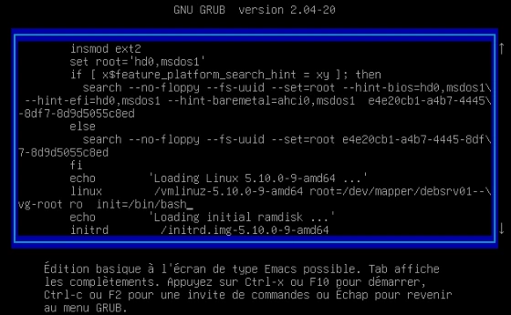

Capture ou visuel isolé du document de formation.

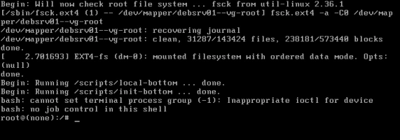

Capture ou visuel isolé du document de formation.

Administration Debian GNU-Linux

- Activer l’écriture sur la partition racine.

Saisir la commande " mount -o remount,rw / " Le message qui suit est une information, pas une erreur.

- Pouvez-vous créer un fichier dans l’espace personnel du compte root ?

Une commande touch dans /root ne renvoi pas de message d'erreur, le ficher a bien été créée

- Pouvez-vous accéder au répertoire personnel de l’utilisateur créé à l’installation ?

Impossible de se déplacer dans le dossier de l'utilisateur standard

- Est-ce normal ?

Le dossier /home est vide. Le dossier /home a été place sur un autre Volume Logique que la partition racine.

Seule cette dernière est directement accessible dans ce cas.

→ Utiliser la commande sync pour s’assurer que toute modification apportée est effectivement écrite ;

puis forcer l'extinction du serveur par les options de VMware Workstation

II. Sur le serveur Debian avec environnement graphique

Démarrer dans le "Rescue mode" (dans "Advanced options") à partir de l'ISO d'installation Debian* :

Vérifiez dans les paramètres de la VM que l'image CD est bien sélectionnée et que la case "Connect at power on" est bien cochée

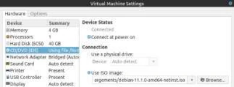

Capture ou visuel isolé du document de formation.

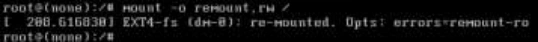

Commande ou détail d’interface isolé du document de formation.

## Transcription des commandes et informations utiles visibles

```
mount -o remount,rw /
```

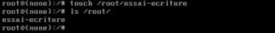

Commande ou détail d’interface isolé du document de formation.

## Transcription des commandes et informations utiles visibles

```
touch /root/essai-ecriture
ls /root/
essai-ecriture
```

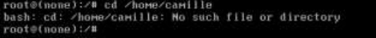

Commande ou détail d’interface isolé du document de formation.

## Transcription des commandes et informations utiles visibles

```
cd /home/camille
bash: cd: /home/camille: No such file or directory
```

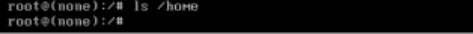

Commande ou détail d’interface isolé du document de formation.

## Transcription des commandes et informations utiles visibles

```
ls /home
```


Commande ou détail d’interface isolé du document de formation.

## Transcription des commandes et informations utiles visibles

```
sync
```

Administration Debian GNU-Linux

Mettre le focus dans la VM est cliquer sur "echap" au logo vmware. Si le menu grub s’affiche, saisir la sequence ‘ctrl+alt+ins’ avant de réappuyer sur ‘echap’

Enfin valider le démarrage sur le CD-Rom

→ Choisir 'Advanced options' puis Rescue mode''

- Sélectionner la langue, le nom (comme lors d'une installation)

→ → Saisir la langue et la disposition du clavier

Saisie du nom d'hôte. Remarquez la mention 'mode de récupération' en haut de l'écran

- Sélectionner le système de fichiers racine à monter

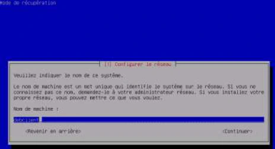

Capture ou visuel isolé du document de formation.


Commande ou détail d’interface isolé du document de formation.

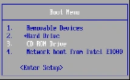

Détail de la procédure du laboratoire, isolé et vérifié.

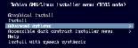

Détail de la procédure du laboratoire, isolé et vérifié.

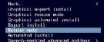

Détail de la procédure du laboratoire, isolé et vérifié.

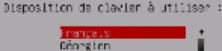

Détail de la procédure du laboratoire, isolé et vérifié.

Administration Debian GNU-Linux

Ici il faut bien choisir le Volume Logique contenant le système de fichier racine. Remarquons l’importance des noms explicites pour les Groupes de Volumes & Volumes Logiques.

Choisir la première option pour avoir accès à notre système Debian installé Noter l’option “Reinstallation de Grub”, utile pour dépanner un système qui ne démarre pas

Après validation d'un message informatif, un shell root s'ouvre sans authentification Accédez au fichier /etc/passwd sur votre disque dur.

Ouvrir le ficher avec VI

- Pouvez-vous le modifier ? (attention à ne rien casser !!)

Se déplacer en fin de fichier [G], Passer en mode insertion avec une nouvelle ligne [o], Saisir du texte puis revenir en mode commande [echap],

Enregistrer sans quitter (:w)

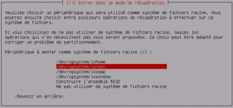

Capture ou visuel isolé du document de formation.

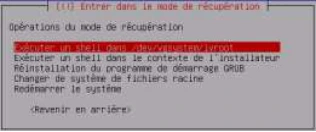

Capture ou visuel isolé du document de formation.

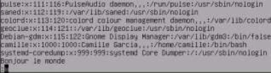

Capture ou visuel isolé du document de formation.


Commande ou détail d’interface isolé du document de formation.

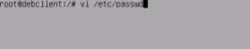

Commande ou détail d’interface isolé du document de formation.

## Transcription des commandes et informations utiles visibles

```
vi /etc/passwd
```

Administration Debian GNU-Linux

Un message nous informe de la bonne écriture dans le fichier

Supprimer la ligne que vous venez d'écrire (et seulement celle-ci) (dd)

Enregistrer et quitter (:wq)

- Avec quel utilisateur êtes-vous connecté ?

La variable d'environnement USER nous renvoie la valeur 'root' également lisible simplement dans le prompt bash. NB : la commande ‘logname’ ne renvoie rien dans ce cas particulier

- Avez-vous indiqué un mot de passe ?

Non, comme vue précédemment, un shell root s'ouvre sans authentication dans ce type de cas

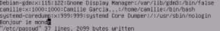

Commande ou détail d’interface isolé du document de formation.

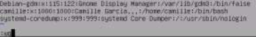

Commande ou détail d’interface isolé du document de formation.


Commande ou détail d’interface isolé du document de formation.

## Transcription des commandes et informations utiles visibles

```
echo $USER
root
```

Référence du document : 19REgdUNZGMio0n3mfymkL4GCslcvqFjc · SHA-256 6d3aef0054997f69…

## Fiche de synthèse

Les lignes reprennent les titres du cours et la première phrase de chaque partie.

| Partie | Repère du cours |
| --- | --- |
| Passer en mode maintenance | Il est parfois nécessaire de passer en mode maintenance sur un ordinateur ou un serveur pour diverses raisons En voici quelques-unes : Le système ne démarre plus à la suite d'un… |
| Méthode 1 | Passer par le boot manager GRUB pour passer en mode maintenance Utiliser les flèches pour choisir la ligne du noyau voulu puis appuyez sur la touche [e] Ce mode n’est pas foncti… |
| Méthode 1 | Modifier la fin de la ligne suivante De cette manière Valider avec [ctrl] + [x] ou [F10]. |
| Méthode 1 | Démo Maintenance via GRUB avec mot de passe root |
| Méthode 2 | Passer par le boot manager GRUB pour passer en mode maintenance Utiliser les flèches pour choisir la ligne du noyau voulu puis appuyez sur la touche [e] Capture ou visuel isolé… |
| Méthode 2 | Modifier la fin de la ligne de cette manière Valider avec [ctrl] + [x] ou [F10]. |
| Méthode 2 | Le système est démarré mais le système de fichier racine est en lecture seule. |
| Méthode 2 | Démo Maintenance via GRUB sans mot de passe root |
| Mode maintenance via le CD d’installation | Une autre solution : passer par le mode maintenance inclus dans chaque CD d’installation. |
| Conclusion | Vous savez passer en mode maintenance au démarrage depuis GRUB Vous savez démarrer sur le CD d’installation Debian en mode maintenance Référence du document : 11zEIM3oEyioi-kQtk… |
| Correction · M04TP01 - Solution - Debian en mode maintenance · 6 pages transcrites | Correction originale : à consulter après avoir tenté l’exercice. |
| Transcription des commandes et informations utiles visibles | Commande ou détail d’interface isolé du document de formation. |
| Transcription des commandes et informations utiles visibles | Commande ou détail d’interface isolé du document de formation. |
| Transcription des commandes et informations utiles visibles | Commande ou détail d’interface isolé du document de formation. |
| Transcription des commandes et informations utiles visibles | Commande ou détail d’interface isolé du document de formation. |
| Transcription des commandes et informations utiles visibles | Administration Debian GNU-Linux Mettre le focus dans la VM est cliquer sur "echap" au logo vmware. |
| Transcription des commandes et informations utiles visibles | Administration Debian GNU-Linux Un message nous informe de la bonne écriture dans le fichier Supprimer la ligne que vous venez d'écrire (et seulement celle-ci) (dd) Enregistrer… |
| Transcription des commandes et informations utiles visibles | Référence du document : 19REgdUNZGMio0n3mfymkL4GCslcvqFjc · SHA-256 6d3aef0054997f69… |
