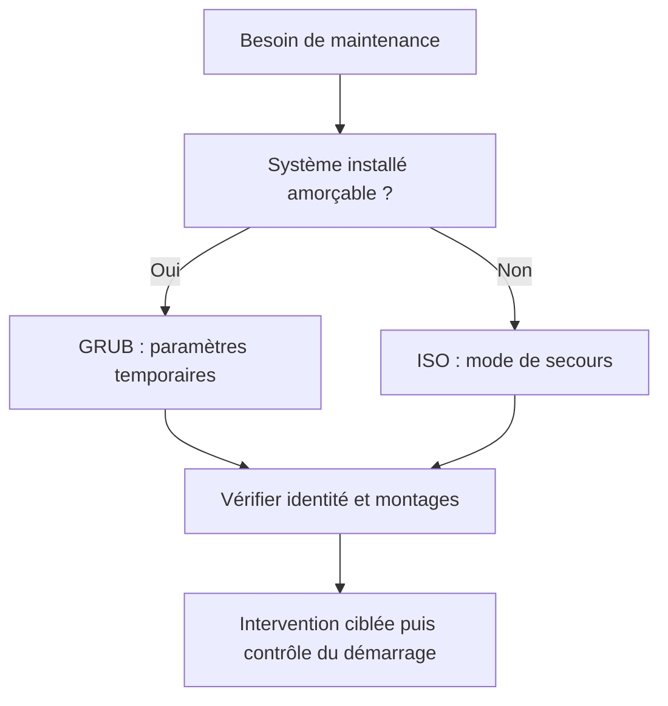

# Module 04 — Debian en mode maintenance

**Cours optimisé — reformulation pédagogique du support et des TP associés.** Les exemples du parcours conservent leur contexte Debian 11 ; les corrections et actualisations sont identifiées comme compléments externes. Les transcriptions intégrales se consultent dans l’onglet Original.
## Choisir le moyen de maintenance

Le support traite trois situations : démarrage impossible après une modification, récupération de données et perte du mot de passe root. Le TP se déroule sur les VM du laboratoire avec accès à leur console. Il compare le secours fourni par le système installé et celui du média d’installation.

| Méthode | Origine de l’environnement | Point déterminant |
|---|---|---|
| Paramètre `single` dans GRUB | Système installé | Authentification root généralement demandée dans ce scénario |
| `init=/bin/bash` | Noyau installé, shell à la place de l’initialisation normale | Services et arrêt ordinaires absents |
| Rescue mode de l’ISO | Environnement externe au système installé | Sélection du système racine à monter |

Avant d’intervenir, relever la VM, son disque et sa disposition de volumes. Un snapshot de laboratoire fournit un retour à un état connu ; il ne remplace pas une sauvegarde durable.

## Méthode 1 — secours via GRUB

1. Afficher GRUB et sélectionner le noyau voulu.
2. Appuyer sur `e`, repérer la ligne commençant par `linux` et conserver les chemins et le paramètre `root=` propres à la machine.
3. Remplacer l’option de fin `quiet` par `single`, conformément au scénario.
4. Démarrer l’entrée modifiée avec `Ctrl` + `X` ou `F10`.
5. S’authentifier si demandé, puis effectuer l’intervention minimale.

Le clavier peut être en QWERTY à ce stade. Le fait de ne pas réussir à saisir un mot de passe ne prouve donc pas qu’il a été perdu. La présence d’un compte root verrouillé, le firmware et une éventuelle protection GRUB peuvent aussi changer le déroulement.

## Méthode 2 — shell initial

Pour le TP sur le serveur en console, la source demande d’ajouter `init=/bin/bash` à la ligne du noyau, en conservant son périphérique racine. Le système de fichiers peut être initialement monté en lecture seule.

```bash
mount -o remount,rw /
```

Cette commande remonte **le montage racine courant** en lecture-écriture. Elle ne monte pas automatiquement tous les volumes qui figuraient dans `/etc/fstab`. Contrôler donc les montages avant de conclure que le contenu de `/home` ou `/var` a disparu. Le TP demande de créer un fichier dans `/root`, puis de vérifier l’accès au répertoire personnel de l’utilisateur.

```bash
id
findmnt /
sync
```

Ces commandes de contrôle et de synchronisation complètent la démarche : `id` établit l’identité effective, `findmnt` décrit le montage, `sync` demande la synchronisation des écritures. Le support indique une extinction forcée dans ce mode très limité ; ne transposez pas cette méthode à un système normalement initialisé.

## Méthode 3 — média d’installation

1. Connecter l’ISO à la VM et faire démarrer celle-ci sur le lecteur virtuel. Dans l’exemple VMware, la touche Échap doit parvenir à la console de la VM.
2. Ouvrir **Advanced options**, puis **Rescue mode**.
3. Choisir langue, clavier et paramètres demandés.
4. Sélectionner le système de fichiers racine de l’installation à réparer.
5. Ouvrir le shell proposé et vérifier où se trouve l’installation montée.

Le TP demande d’accéder au fichier `passwd` de l’installation, de déterminer si sa modification est possible et de relever l’utilisateur utilisé ainsi que l’absence ou la présence d’une demande de mot de passe. Il s’agit d’une observation ; **aucune modification arbitraire de `/etc/passwd` n’est nécessaire** pour réussir ce contrôle.

Le support souligne les avantages du média : langue française, accès de secours indépendant du mot de passe root installé et extinction gérée par cet environnement. Les contraintes sont la disponibilité du média et le choix correct du démarrage en virtualisation.

!!! info "Clarifications externes — fin du secours"
    Le tiret de `mount -o` doit être un tiret ASCII, contrairement au tiret typographique visible dans la source. En secours systemd, quitter le shell peut poursuivre le démarrage normal ; cela ne signifie pas entrer pour la première fois dans `rescue.target`, déjà associé au secours. Le shell lancé par `init=/bin/bash` n’est pas une session de secours systemd ordinaire. Références : [systemd.special(7)](https://www.freedesktop.org/software/systemd/man/latest/systemd.special.html) et [mode de secours Debian](https://www.debian.org/releases/trixie/amd64/ch08s06.fr.html).

## Schéma explicatif — complément pédagogique



## Autoévaluation

1. Pourquoi `/home` peut-il sembler vide dans le shell initial ?
2. Quelle commande rend la racine montée accessible en écriture ?
3. Pourquoi identifier la racine choisie depuis l’ISO ?

??? success "Réponses"
    1. Son volume séparé n’est peut-être pas monté.
    2. `mount -o remount,rw /`.
    3. Le shell de secours et le système à réparer ne sont pas nécessairement la même arborescence.

## Pour travailler ce module

- [Fiche de révision](../../revision/administration-linux/module-04-debian-en-mode-maintenance.md)
- [Travaux pratiques](../../tp/administration-linux/module-04/index.md)
- [Progression du cours](index.md)
