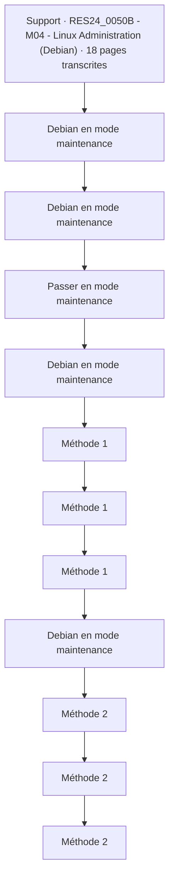

# Module 04 — Debian en mode maintenance

[Travaux pratiques](../../tp/administration-linux/module-04/index.md)

Les parties ci-dessous reprennent le cours original, dans le même ordre. Les encadrés et les schémas répètent ses formulations.

## Parcours de lecture

1. Support · RES24_0050B - M04 - Linux Administration (Debian) · 18 pages transcrites
2. Debian en mode maintenance
3. Debian en mode maintenance
4. Passer en mode maintenance
5. Debian en mode maintenance
6. Méthode 1
7. Méthode 1
8. Méthode 1
9. Debian en mode maintenance
10. Méthode 2
11. Méthode 2
12. Méthode 2
13. Méthode 2
14. Debian en mode maintenance
15. Mode maintenance via le CD d’installation
16. Mode maintenance via le CD-ROM
17. Debian en mode maintenance
18. Conclusion
19. Transcription des commandes et informations utiles visibles
20. Transcription des commandes et informations utiles visibles
21. Transcription des commandes et informations utiles visibles
22. Transcription des commandes et informations utiles visibles
23. Transcription des commandes et informations utiles visibles
24. Transcription des commandes et informations utiles visibles
25. Transcription des commandes et informations utiles visibles

**Visuel externe**



SOURCE DRIVE · TRANSCRIPTION DU SUPPORT

Le contenu des documents du dossier TSSR est transcrit ci-dessous, page par page. Les textes et tableaux sont intégrés à la page Web. Aucun fichier PDF, aucune diapositive entière ni aucune reproduction de page n’est affiché. Seuls des croquis ou visuels isolés et vérifiés peuvent accompagner la transcription. Les versions et les consignes restent celles des supports de formation. Les compléments IA sont conservés dans leur onglet distinct.

## Support · RES24_0050B - M04 - Linux Administration (Debian) · 18 pages transcrites

### Administration Debian

### GNU/Linux

Module 04 – Debian en mode maintenance

## Debian en mode maintenance

### Objectifs

!!! note "À retenir"
    Savoir démarrer en mode maintenance depuis GRUB ou depuis le CD d’installation Réparer Linux

- Savoir démarrer en mode maintenance depuis GRUB ou depuis le CD d’installation

Réparer Linux

## Debian en mode maintenance

Démarrer un système en

mode maintenance

## Passer en mode maintenance

!!! note "À retenir"
    Il est parfois nécessaire de passer en mode maintenance sur un ordinateur ou un serveur pour diverses raisons En voici quelques-unes : Le système ne démarre plus à la suite d'une mise à jour ou d’une installation Le mot de passe de l’utilisateur root est perdu Récupération de données …

**Visuel externe**


- Il est parfois nécessaire de passer en mode maintenance sur un ordinateur ou un serveur pour diverses raisons
- En voici quelques-unes :
- Le système ne démarre plus à la suite d'une mise à jour ou d’une installation
- Le mot de passe de l’utilisateur root est perdu
- Récupération de données
- …

## Debian en mode maintenance

### Mode maintenance via

### GRUB

## Méthode 1

!!! note "À retenir"
    Passer par le boot manager GRUB pour passer en mode maintenance Utiliser les flèches pour choisir la ligne du noyau voulu puis appuyez sur la touche [e] Ce mode n’est pas fonctionnel en mode « sudo sans mot de passe » pour l’utilisateur.

- Passer par le boot manager GRUB pour passer en mode maintenance
- Utiliser les flèches pour choisir la ligne du noyau voulu puis appuyez sur la touche [e]

Ce mode n’est pas fonctionnel en mode « sudo sans mot de passe » pour l’utilisateur.


Capture ou visuel isolé du document de formation.


Capture ou visuel isolé du document de formation.

## Méthode 1

!!! note "À retenir"
    Modifier la fin de la ligne suivante De cette manière Valider avec [ctrl] + [x] ou [F10].

!!! warning "Attention"
    Attention le clavier est au format QWERTY en_US par défaut Après vos actions en mode maintenance, la séquence de touches [ctrl] + [d] vous permettra de poursuivre vers le chargement vers la cible « rescue.target »

- Modifier la fin de la ligne suivante

```
linux 
/vmlinuz-4.19.0-8-amd64 root=/dev/mapper/debian--vg-sys ro quiet
```

- De cette manière

```
linux 
/vmlinuz-4.19.0-8-amd64 root=/dev/mapper/debian--vg-sys ro single
```

- Valider avec [ctrl] + [x] ou [F10]. Saisissez le mot de passe root. Attention le clavier est au format QWERTY en_US par défaut
- Après vos actions en mode maintenance, la séquence de touches [ctrl] + [d] vous permettra de poursuivre vers le chargement vers la cible « rescue.target »

## Méthode 1

!!! note "À retenir"
    Démo Maintenance via GRUB avec mot de passe root

Démo

Maintenance via GRUB avec mot de passe root

## Debian en mode maintenance

### Maintenance via GRUB sans mot de passe root

## Méthode 2

!!! note "À retenir"
    Passer par le boot manager GRUB pour passer en mode maintenance Utiliser les flèches pour choisir la ligne du noyau voulu puis appuyez sur la touche [e] Capture ou visuel isolé du document de formation.

- Passer par le boot manager GRUB pour passer en mode maintenance
- Utiliser les flèches pour choisir la ligne du noyau voulu puis appuyez sur la touche [e]


Capture ou visuel isolé du document de formation.


Capture ou visuel isolé du document de formation.

## Méthode 2

!!! note "À retenir"
    Modifier la fin de la ligne de cette manière Valider avec [ctrl] + [x] ou [F10].

- Modifier la fin de la ligne de cette manière

```
linux 
/vmlinuz-4.19.0-8 root=/dev/mapper/debian--vg-sys ro init=/bin/bash
```

- Valider avec [ctrl] + [x] ou [F10]. Attention le clavier est au format QWERTY en-US

## Méthode 2

- Le système est démarré mais le système de fichier racine est en lecture seule. Il faut lancer la commande suivante pour obtenir l’accès en lecture-écriture :

```
root@(none):/# mount –o remount,rw /
[   88.5124578] EXT4-fs (dm-0): re-mounted. Opts: errors=remount-ro
root@(none):/#
```

- Après vos actions, synchronisez l’écriture des données en RAM vers le disque avec la commande sync
- Rappel : il n’est pas possible d’éteindre proprement l’ordinateur dans ce mode
- Il faudra forcer l’extinction par un poweroff matériel

## Méthode 2

Démo

Maintenance via GRUB sans mot de passe root

## Debian en mode maintenance

### Mode maintenance

via le CD-ROM

## Mode maintenance via le CD d’installation

Une autre solution : passer par le mode maintenance inclus dans chaque CD d’installation.

| Avantages | Inconvénients |
| --- | --- |
| Langue française disponible | Nécessité d’avoir un CD-ROM disponible ou une image |
| Pas besoin du mot de passe root | Complexité possible en virtualisation |
| Extinction |  |

## Mode maintenance via le CD-ROM

Démo

Maintenance via le CD-ROM

## Debian en mode maintenance

### Démo TP

## Conclusion

- Vous savez passer en mode maintenance au démarrage depuis GRUB
- Vous savez démarrer sur le CD d’installation Debian en mode maintenance

Référence du document : 11zEIM3oEyioi-kQtk3b43VC_RnlD9zjq · SHA-256 f8cc5ca64839f70b…

| Passer en mode maintenance | Il est parfois nécessaire de passer en mode maintenance sur un ordinateur ou un serveur pour diverses raisons En voici quelques-unes : Le système ne démarre plus à la suite d'un… |
| Méthode 1 | Passer par le boot manager GRUB pour passer en mode maintenance Utiliser les flèches pour choisir la ligne du noyau voulu puis appuyez sur la touche [e] Ce mode n’est pas foncti… |
| Méthode 1 | Modifier la fin de la ligne suivante De cette manière Valider avec [ctrl] + [x] ou [F10]. |
| Méthode 1 | Démo Maintenance via GRUB avec mot de passe root |
| Méthode 2 | Passer par le boot manager GRUB pour passer en mode maintenance Utiliser les flèches pour choisir la ligne du noyau voulu puis appuyez sur la touche [e] Capture ou visuel isolé… |
| Méthode 2 | Modifier la fin de la ligne de cette manière Valider avec [ctrl] + [x] ou [F10]. |
| Méthode 2 | Le système est démarré mais le système de fichier racine est en lecture seule. |
| Méthode 2 | Démo Maintenance via GRUB sans mot de passe root |
| Mode maintenance via le CD d’installation | Une autre solution : passer par le mode maintenance inclus dans chaque CD d’installation. |
| Conclusion | Vous savez passer en mode maintenance au démarrage depuis GRUB Vous savez démarrer sur le CD d’installation Debian en mode maintenance Référence du document : 11zEIM3oEyioi-kQtk… |
| Transcription des commandes et informations utiles visibles | Commande ou détail d’interface isolé du document de formation. |
| Transcription des commandes et informations utiles visibles | Commande ou détail d’interface isolé du document de formation. |
| Transcription des commandes et informations utiles visibles | Commande ou détail d’interface isolé du document de formation. |
| Transcription des commandes et informations utiles visibles | Commande ou détail d’interface isolé du document de formation. |
| Transcription des commandes et informations utiles visibles | Administration Debian GNU-Linux Mettre le focus dans la VM est cliquer sur "echap" au logo vmware. |
| Transcription des commandes et informations utiles visibles | Administration Debian GNU-Linux Un message nous informe de la bonne écriture dans le fichier Supprimer la ligne que vous venez d'écrire (et seulement celle-ci) (dd) Enregistrer… |
