# Module 05 — Gestion du réseau

Les parties ci-dessous reprennent le cours original, dans le même ordre. Les encadrés et les schémas répètent ses formulations.

## Parcours de lecture

1. Support · RES24_0050B - M05 - Linux Administration (Debian) · 19 pages transcrites
2. Gestion du réseau
3. Gestion du réseau
4. Prise d’information réseau
5. Connaître l’adresse réseau
6. Connaître passerelle et serveur DNS
7. Les prérequis
8. Gestion du réseau
9. Configuration IP en DHCP
10. Configuration IP statique
11. Configuration serveur DNS statique
12. Prise en compte des modifications
13. Système sans interface graphique
14. Gestion du réseau
15. Gestion du réseau avec Network Manager
16. Prise en compte des modifications
17. Gestion du réseau
18. Gestion du réseau
19. Conclusion
20. Énoncé · M05TP01 - Enoncé - Gestion de la configuration réseau dun poste · 2 pages transcrites
21. Transcription des commandes et informations utiles visibles
22. Correction · M05TP01 - Solution - Gestion de la configuration réseau dun poste · 6 pages transcrites
23. Transcription des commandes et informations utiles visibles
24. Transcription des commandes et informations utiles visibles
25. Transcription des commandes et informations utiles visibles
26. Transcription des commandes et informations utiles visibles
27. Transcription des commandes et informations utiles visibles
28. Transcription des commandes visibles
29. Transcription des commandes et informations utiles visibles
30. Transcription des commandes et informations utiles visibles
31. Transcription des commandes et informations utiles visibles
32. Transcription des commandes et informations utiles visibles
33. Transcription des commandes visibles
34. Transcription des commandes visibles
35. Transcription des commandes visibles
36. Transcription des commandes et informations utiles visibles

**Visuel externe**

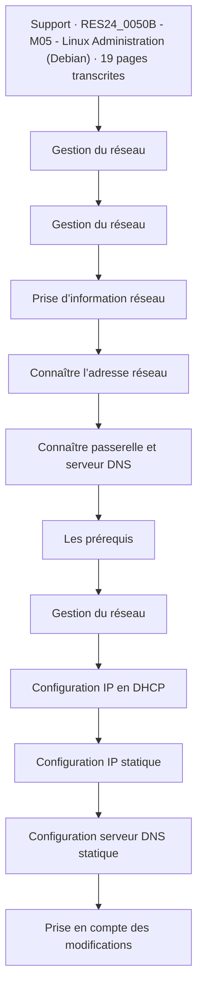

SOURCE DRIVE · TRANSCRIPTION DU SUPPORT

Le contenu des documents du dossier TSSR est transcrit ci-dessous, page par page. Les textes et tableaux sont intégrés à la page Web. Aucun fichier PDF, aucune diapositive entière ni aucune reproduction de page n’est affiché. Seuls des croquis ou visuels isolés et vérifiés peuvent accompagner la transcription. Les versions et les consignes restent celles des supports de formation. Les compléments IA sont conservés dans leur onglet distinct.

## Support · RES24_0050B - M05 - Linux Administration (Debian) · 19 pages transcrites

### Administration Debian

### GNU/Linux

Module 05 – Gestion du réseau

## Gestion du réseau

### Objectifs

!!! note "À retenir"
    Prendre des informations sur le réseau Configuration réseau d’un système sans interface graphique Configuration réseau d’un système avec interface graphique Interroger et configurer le réseau sous Linux.

**Visuel externe**


- Prendre des informations sur le réseau
- Configuration réseau d’un système sans interface graphique
- Configuration réseau d’un système avec interface graphique

Interroger et configurer le réseau sous Linux.

## Gestion du réseau

### Prendre des informations

## Prise d’information réseau

**Visuel externe**


- Pour une mise en réseau des postes client et serveur, il faut que la couche IP soit correctement réalisée
- La configuration IP a généralement besoin :
- D’une adresse IP
- D’un masque réseau
- Potentiellement d’une passerelle par défaut
- Afin de pouvoir résoudre les noms d’hôtes, il faudra aussi renseigner un ou des serveurs DNS

## Connaître l’adresse réseau

!!! note "À retenir"
    Dans un shell, commande ip avec l’argument address ou son raccourci a

- Dans un shell, commande ip avec l’argument address ou son raccourci a

```
root@deb:~# ip a 
1: lo: <LOOPBACK,UP,LOWER_UP> mtu 65536 qdisc noqueue state UNKNOWN group default 
qlen 1000
    link/loopback 00:00:00:00:00:00 brd 00:00:00:00:00:00
    inet 127.0.0.1/8 scope host lo
       valid_lft forever preferred_lft forever
    inet6 ::1/128 scope host 
       valid_lft forever preferred_lft forever
2: ens33: <BROADCAST,MULTICAST,UP,LOWER_UP> mtu 1500 qdisc pfifo_fast state UP 
group default qlen 1000
    link/ether 00:0c:29:7c:ff:ba brd ff:ff:ff:ff:ff:ff
    inet 192.168.1.50/24 brd 192.168.1.255 scope global dynamic ens33
       valid_lft 85457sec preferred_lft 85457sec
    inet6 fe80::20c:29ff:fe7c:ffba/64 scope link 
       valid_lft forever preferred_lft forever
```

## Connaître passerelle et serveur DNS

!!! note "À retenir"
    Dans un shell, commande ip avec l’option route ou son raccourci r Les informations de DNS se trouvent dans le fichier /etc/resolv.conf

- Dans un shell, commande ip avec l’option route ou son raccourci r

```
root@deb:~# ip r 
default via 192.168.1.1 dev ens33 
192.168.1.0/24 dev ens33 proto kernel scope link src 
192.168.1.50
```

- Les informations de DNS se trouvent dans le fichier /etc/resolv.conf

```
root@deb:~# cat /etc/resolv.conf 
search mondomaine.fr
nameserver 10.1.2.20
nameserver 10.1.2.21
```

## Les prérequis

Démo

Informations réseau

## Gestion du réseau

### Système sans interface

### graphique

## Configuration IP en DHCP

!!! note "À retenir"
    La configuration IP et DNS sur un système sans interface graphique se fait dans deux fichiers de configuration Le fichier /etc/network/interfaces permet de gérer la partie IP Il est possible d’avoir une configuration simplifiée via un serveur DHCP ou une configuration statique

- La configuration IP et DNS sur un système sans interface graphique se fait dans deux fichiers de configuration
- Le fichier /etc/network/interfaces permet de gérer la partie IP
- Il est possible d’avoir une configuration simplifiée via un serveur DHCP ou une configuration statique

```
root@deb:~# vim /etc/network/interfaces
# The loopback network interface
auto lo
iface lo inet loopback
# Carte réseau - Ethernet ens33
auto ens33
allow-hotplug ens33
iface ens33 inet dhcp 
```

## Configuration IP statique

!!! note "À retenir"
    Mettre en place une configuration statique dans le fichier /etc/network/interfaces

- Mettre en place une configuration statique dans le fichier /etc/network/interfaces

```
root@deb:~# vim /etc/network/interfaces
# The loopback network interface
auto lo
iface lo inet loopback
# Carte réseau - Ethernet ens33
auto ens33
iface ens33 inet static
```

```
address 10.1.1.10
netmask 255.255.0.0
gateway 10.1.255.254
```

## Configuration serveur DNS statique

!!! note "À retenir"
    Mettre en place une configuration statique dans le fichier /etc/resolv.conf via la directive nameserver

- Mettre en place une configuration statique dans le fichier /etc/resolv.conf via la directive nameserver

```
root@deb:~# vim /etc/resolv.conf
search mondomaine.fr
nameserver 10.1.2.20
nameserver 10.1.2.21
```

## Prise en compte des modifications

!!! note "À retenir"
    On utilise la commande systemctl pour gérer le service networking Arrêter le service réseau Démarrer le service réseau Redémarrer le service réseau

**Visuel externe**

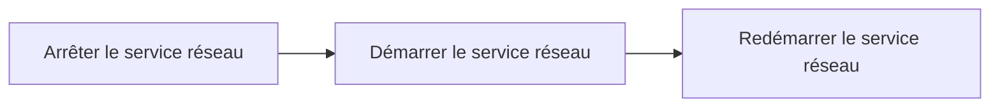

On utilise la commande systemctl pour gérer le service networking

- Arrêter le service réseau

```
root@deb:~# systemctl stop networking.service
```

- Démarrer le service réseau

```
root@deb:~# systemctl start networking.service
```

- Redémarrer le service réseau

```
root@deb:~# systemctl restart networking.service
```

## Système sans interface graphique

!!! note "À retenir"
    Démo Mise en place d’une adresse IP fixe sur serveur Debian

Démo

Mise en place d’une adresse IP fixe sur serveur

Debian

## Gestion du réseau

### Configuration réseau d’un système graphique

## Gestion du réseau avec Network Manager

Network Manager est utilisé dans le cas d’un système Linux avec interface graphique (Desktop)

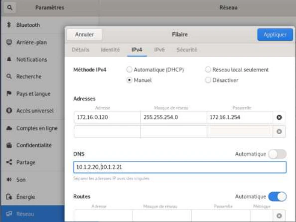

Capture ou visuel isolé du document de formation.


Capture ou visuel isolé du document de formation.

## Prise en compte des modifications

On utilise la commande systemctl pour gérer le service NetworkManager

Redémarrer le service réseau

```
root@deb:~# systemctl restart NetworkManager
```

Ou simplement l’interface graphique (Off, On)


Capture ou visuel isolé du document de formation.

## Gestion du réseau

Démo

Gestion du réseau au sein d’un bureau Gnome

## Gestion du réseau

### TP

Démo

Gestion de la configuration réseau d’un poste

## Conclusion

**Visuel externe**


- Vous savez consulter les informations réseau sur un système Linux
- Vous pouvez configurer l’adressage IP sur un serveur
- Vous pouvez configurer l’adressage IP sur un poste avec interface graphique

Référence du document : 1FKHUR6aoVOxjBVWtiPOjCKtnnxF8GatF · SHA-256 69edc58f1bc1f995…

## Énoncé · M05TP01 - Enoncé - Gestion de la configuration réseau dun poste · 2 pages transcrites

Les noms de domaine de formation sont neutralisés explicitement. Certaines captures sont transcrites en tableaux ; les paramètres numériques et les procédures sont conservés.

### Gérer la configuration réseau d’un poste

TP du Module 05 – Gestion du réseau

Avant de démarrer ce TP, il convient d’avoir suivi les vidéos des modules 1 à 5 et d’avoir réalisé les TP proposés.

Durée estimée

45mn à 1 heure

### Énoncé

### I. Configurer une adresse IP statique sur le serveur sans environnement graphique

Configurer la 1ere carte réseau détectée (ens33) avec l'adressage suivant :

- Adresse IP : 10.X.Y.1/16
- Avec le second octet X=n° de réseau.
- Pour récupérer votre réseau de salle, depuis le poste Windows hôte, ouvrir une fenêtre cmd et lancer la commande ipconfig

Dans cet exemple, le numéro de salle est 49

- avec le troisième octet Y=votre n° de stagiaire (donné par votre coach en début de semaine)
- Passerelle : 10.X.255.254

Transcription textuelle de la capture : les noms de domaine de formation sont neutralisés ; adresses IP, commandes et résultats sont conservés.

| Paramètre observé sur le poste Windows | Valeur |
| --- | --- |
| Commande | ipconfig |
| Interface | Carte Ethernet Ethernet |
| Suffixe DNS (nom de formation neutralisé) | laboratoire.example |
| Adresse IPv4 | 10.49.0.254 |
| Masque de sous-réseau | 255.255.0.0 |
| Passerelle par défaut | 10.49.255.254 |

Vérifier et adapter si nécessaire les paramètres de résolution de nom :

- Serveurs DNS : serveurs DNS de l’[organisme de formation] (à récupérer depuis votre poste avec ipconfig /all)
- Domaines résolus par défaut : laboratoire.example et [référence de l’organisme de formation neutralisée]
- Pour valider la bonne prise en compte du point précédent, vous pourrez essayer un ping vers les hôtes suivants :
- dc44-far
- dc35-cdb1
- repos

Modifier le nom de la machine :

- Indiquer le nom : deb-<prénom>-01 avec <prénom> = votre prénom

Attention, il y a 2 fichiers à modifier ! (/etc/hosts et /etc/hostname)

Ajouter une 2e carte réseau en Host-only à votre VM et utiliser les paramètres suivants :

- IP : 192.168.100.1/24
- Pas de passerelle par défaut

### II. Configurer une adresse IP statique sur la machine avec environnement graphique

Configurer un adressage IP statique compatible avec la 1ere carte réseau de la VM Debian sans environnement graphique

- Pouvez-vous pinguer l'autre VM Debian ?
- Pouvez-vous pinguer les serveurs [organisme de formation] ?

### Astuce

Précaution préalable : créer le fichier .vimrc avec l'activation du mode nocompatible

Pour le moment notre système est nativement en mode compatible Unix

### Solution

Une solution est proposée pour ce TP sous la forme d'un PDF commenté, disponible dans les ressources à télécharger.


Commande ou détail d’interface isolé du document de formation.

## Transcription des commandes et informations utiles visibles

```
echo "set nocompatible" >> ~/.vimrc
```

Référence du document : 1ACf03zGCvDpm38SKRrP5DNIBKZyzLGL- · SHA-256 115dc7cb2a0e9401…

## Correction · M05TP01 - Solution - Gestion de la configuration réseau dun poste · 6 pages transcrites

Noms de domaine de formation neutralisés explicitement ; paramètres numériques et procédures conservés.

Correction originale : à consulter après avoir tenté l’exercice.

### Gérer la configuration réseau d’un poste

TP du Module 05 – Gestion du réseau

Avant de démarrer ce TP, il convient d’avoir suivi les vidéos des modules 1 à 5 et d’avoir réalisé les TP proposés.

Durée estimée

2 à 3 heures

### Solution

### I. Configurer une adresse IP statique sur le serveur sans environnement graphique

Configurer la 1ere carte réseau détectée (ens33) avec l'adressage suivant :

- Adresse IP : 10.X.Y.1/16
- Avec le second octet X=n° de réseau.
- Pour récupérer votre réseau de salle, depuis le poste Windows hôte, ouvrir une fenêtre cmd et lancer la commande ipconfig

Dans cet exemple, le numéro de salle est 49

- avec le troisième octet Y=votre n° de stagiaire (donné par votre coach en début de semaine)
- Passerelle : 10.X.255.254

Pour cette solution, je vais utiliser la salle 49 et le numéro de stagiaire 222

Donc le reseau 10.49.222.0/16

Transcription textuelle de la capture : les noms de domaine de formation sont neutralisés ; adresses IP, commandes et résultats sont conservés.

| Paramètre observé sur le poste Windows | Valeur |
| --- | --- |
| Commande | ipconfig |
| Interface | Carte Ethernet Ethernet |
| Suffixe DNS (nom de formation neutralisé) | laboratoire.example |
| Adresse IPv4 | 10.49.0.254 |
| Masque de sous-réseau | 255.255.0.0 |
| Passerelle par défaut | 10.49.255.254 |

Ouvrir une session avec l'utilisateur root

Précaution préalable : créer le fichier .vimrc avec l'activation du mode nocompatible

Pour le moment notre système est nativement en mode compatible Unix

Le fichier interfaces dans sa configuration d'origine

Modifier la mention allow-hotplug en auto passer de dhcp à static ajouter l’adresse (attention à l’orthographe anglaise),

le masque de sous reseau et la passerelle.

Redémarrer le service networking, optionnel : verifier le statut du service.

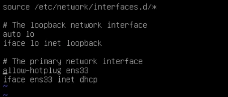

Capture ou visuel isolé du document de formation.

## Transcription des commandes et informations utiles visibles

```
source /etc/network/interfaces.d/*
# The loopback network interface
auto lo
iface lo inet loopback
# The primary network interface
allow-hotplug ens33
iface ens33 inet dhcp
```

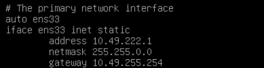

Capture ou visuel isolé du document de formation.

## Transcription des commandes et informations utiles visibles

```
# The primary network interface
auto ens33
iface ens33 inet static
    address 10.49.222.1
    netmask 255.255.0.0
    gateway 10.49.255.254
```

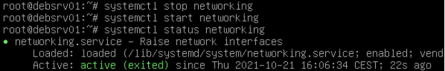

Capture ou visuel isolé du document de formation.

## Transcription des commandes et informations utiles visibles

```
systemctl stop networking
systemctl start networking
systemctl status networking
```

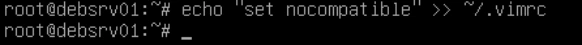

Commande ou détail d’interface isolé du document de formation.

## Transcription des commandes et informations utiles visibles

```
echo "set nocompatible" >> ~/.vimrc
```

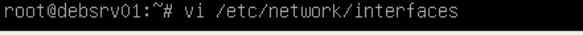

Commande ou détail d’interface isolé du document de formation.

## Transcription des commandes et informations utiles visibles

```
vi /etc/network/interfaces
```

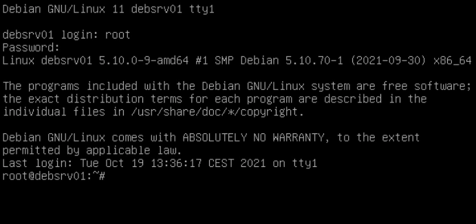

Détail de la procédure du laboratoire, isolé et vérifié.

Vérifier et adapter si nécessaire les paramètres de résolution de nom :

Modifier le fichier /etc/resolv.conf

- Serveurs DNS : serveurs DNS de l’[organisme de formation]
- Domaines résolus par défaut : laboratoire.example et [référence de l’organisme de formation neutralisée] hostname Une seule directive search pour plusieurs domaines de recherches

mais une directive nameserver par serveur DNS

- Pour valider la bonne prise en compte du point précédent, vous pourrez essayer un ping vers les hôtes suivants :
- dc44-far
- dc35-cdb1
- repos

Les deux adresses “DC” sont résolues avec le domaine laboratoire.example

L’adresse repos elle appartient par contre au domaine [référence de l’organisme de formation neutralisée] Astuce avec ping, l’option “-c” permet de préciser le nombre de ping avant de quitter la commande

Transcription textuelle de la capture : les noms de domaine de formation sont neutralisés ; adresses IP, commandes et résultats sont conservés.

| Commande / cible | Adresse résolue | Résultats visibles |
| --- | --- | --- |
| ping -c 2 dc44-far | 10.100.0.3 | 2 transmis, 2 reçus, 0 % de perte ; TTL 126 ; temps 5.00 et 4.74 ms ; min/moy/max/mdev 4.741/4.871/5.002/0.147 ms |
| ping -c 2 dc35-cdb1 | 10.35.0.3 | 2 transmis, 2 reçus, 0 % de perte ; TTL 127 ; temps 0.737 et 0.789 ms ; min/moy/max/mdev 0.737/0.763/0.789/0.026 ms |
| ping -c 2 repos | 10.0.0.21 | 2 transmis, 2 reçus, 0 % de perte ; TTL 62 ; temps 2.97 et 2.78 ms ; min/moy/max/mdev 2.783/2.875/2.967/0.092 ms |

Transcription de la capture : noms du réseau de formation neutralisés, paramètres numériques et suite conservés.

```
search laboratoire.example formation.example
nameserver 10.0.0.3
nameserver 10.100.0.3
```


Détail de la procédure du laboratoire, isolé et vérifié.

## Transcription des commandes visibles

```
vi /etc/resolv.conf
```

Modifier le nom de la machine :

- Indiquer le nom : deb-<prénom>-01 avec <prénom> = votre prénom

Attention, il y a 2 fichiers à modifier ! (/etc/hosts et /etc/hostname)

→ Le fichier hostname contient uniquement le nom d'hôte.

→ Sur la seconde ligne du fichier hosts il faut modifier nom long et nom court de l'hôte.

La commande hostname rpermet la modification du nom d'hôte sans redémarrage Il faut ouvrir un nouveau shell ou une nouvelle session pour verifier cette prise en compte.

Ajouter une 2e carte réseau en Host-only à votre VM et utiliser les paramètres suivants :

Dans les paramètres de la machine virtuelle, ajout de la seconde carte

La commande ip a permet de montrer la nouvelle carte, ici ens35.

- IP : 192.168.100.1/24
- Pas de passerelle par défaut

→ Ajouter ces lignes dans le fichier /etc/network/interfaces Après redémarrage du service networking, la carte ens35 a récupérée son adresse IP

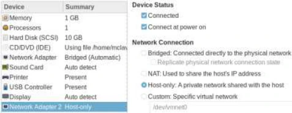

Capture ou visuel isolé du document de formation.

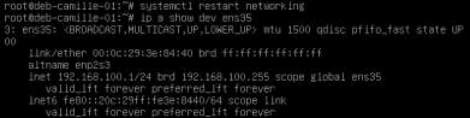

Capture ou visuel isolé du document de formation.

## Transcription des commandes et informations utiles visibles

```
systemctl restart networking
ip a show ens35
inet 192.168.100.1/24 brd 192.168.100.255 scope global ens35
```


Commande ou détail d’interface isolé du document de formation.

## Transcription des commandes et informations utiles visibles

```
deb-camille-01
```

Transcription de la capture : noms du réseau de formation neutralisés, paramètres numériques et suite conservés.

```
127.0.0.1 localhost
127.0.1.1 deb-camille-01.laboratoire.example deb-camille-01
```

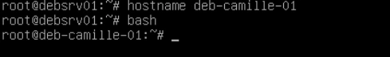

Commande ou détail d’interface isolé du document de formation.

## Transcription des commandes et informations utiles visibles

```
hostname deb-camille-01
bash
```

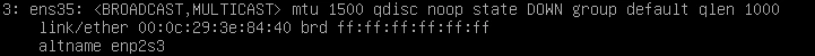

Commande ou détail d’interface isolé du document de formation.

## Transcription des commandes et informations utiles visibles

```
ip a
3: ens35: <BROADCAST,MULTICAST> mtu 1500 qdisc noop state DOWN group default qlen 1000
link/ether 00:0c:29:3e:84:4b brd ff:ff:ff:ff:ff:ff
altname enp2s3
```

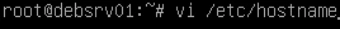

Détail de la procédure du laboratoire, isolé et vérifié.

## Transcription des commandes visibles

```
vi /etc/hostname
```

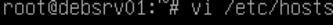

Détail de la procédure du laboratoire, isolé et vérifié.

## Transcription des commandes visibles

```
vi /etc/hosts
```

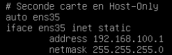

Détail de la procédure du laboratoire, isolé et vérifié.

## Transcription des commandes visibles

```
# Seconde carte en Host-Only
auto ens35
iface ens35 inet static
    address 192.168.100.1
    netmask 255.255.255.0
```

### II. Configurer une adresse IP statique sur la machine avec environnement graphique

Au démarrage saisir systemctl isolate graphical pour lancer la couche graphique

Ouvrir une session avec l'utilisateur standard Se rendre dans les paramètres de la carte ethernet.

Configurer un adressage IP statique compatible avec la 1ere carte réseau de la VM Debian sans environnement graphique

Cliquer sur l'icone en forme de roue dentelée

Dans l’onglet IPv4 passer en mode manuel et saisir une adresse valide. Pas de passerelle.

NB : l’interface graphique ne permet pas de saisir de nom de domaine DNS.

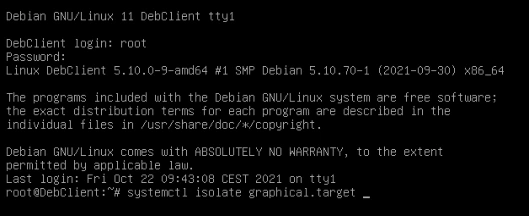

Capture ou visuel isolé du document de formation.

## Transcription des commandes et informations utiles visibles

```
systemctl isolate graphical.target
```

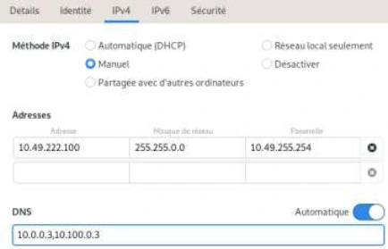

Capture ou visuel isolé du document de formation.


Commande ou détail d’interface isolé du document de formation.


Détail de la procédure du laboratoire, isolé et vérifié.

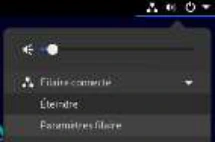

Détail de la procédure du laboratoire, isolé et vérifié.

Au besoin les renseigner via la commande nmtui

Désactiver/réactiver la carte afin que ces modifications soient prises en compte

- Pouvez-vous pinguer l'autre VM Debian ?
- Pouvez-vous pinguer les serveurs [organisme de formation] ?

Si la configuration est correcte, il est possible de pinguer l'autre VM Debian comme les serveurs [organisme de formation]

Transcription textuelle de la capture : les noms de domaine de formation sont neutralisés ; adresses IP, commandes et résultats sont conservés.

| Commande depuis le client | Résultat visible |
| --- | --- |
| ping -c 2 10.49.222.1 | 2 transmis, 2 reçus, 0 % de perte ; TTL 64 ; temps 0.651 et 0.696 ms ; min/moy/max/mdev 0.651/0.673/0.696/0.022 ms |
| ping -c 2 dc44-far | Résolution 10.100.0.3 ; 2 transmis, 2 reçus, 0 % de perte ; min/moy/max/mdev 3.922/4.201/4.480/0.285 ms |
| ping -c 2 repos | Résolution 10.0.0.21 ; 2 réponses visibles ; TTL 62 ; temps 2.92 et 2.35 ms. La capture source ne montre pas le bilan final. |

Transcription de la capture avec neutralisation explicite des noms de domaine de formation.

```
Modifier la connexion — Wired connection 1
Configuration IPv4 : Manuel
Adresse : 10.49.222.100/16
Passerelle : 10.49.255.254
Serveurs DNS : 10.0.0.3, 10.100.0.3
Domaines de recherche (noms de formation neutralisés) : laboratoire.example, formation.example
```

Référence du document : 1OL_ukPXTnJ0uYLwwOkj_NZM4PQtkdVZ5 · SHA-256 d74f1cbf6f7b4042…

## Fiche de synthèse

Les lignes reprennent les titres du cours et la première phrase de chaque partie.

| Partie | Repère du cours |
| --- | --- |
| Prise d’information réseau | Pour une mise en réseau des postes client et serveur, il faut que la couche IP soit correctement réalisée La configuration IP a généralement besoin : D’une adresse IP D’un masqu… |
| Connaître l’adresse réseau | Dans un shell, commande ip avec l’argument address ou son raccourci a |
| Connaître passerelle et serveur DNS | Dans un shell, commande ip avec l’option route ou son raccourci r Les informations de DNS se trouvent dans le fichier /etc/resolv.conf |
| Configuration IP en DHCP | La configuration IP et DNS sur un système sans interface graphique se fait dans deux fichiers de configuration Le fichier /etc/network/interfaces permet de gérer la partie IP Il… |
| Configuration IP statique | Mettre en place une configuration statique dans le fichier /etc/network/interfaces |
| Configuration serveur DNS statique | Mettre en place une configuration statique dans le fichier /etc/resolv.conf via la directive nameserver |
| Prise en compte des modifications | On utilise la commande systemctl pour gérer le service networking Arrêter le service réseau Démarrer le service réseau Redémarrer le service réseau |
| Système sans interface graphique | Démo Mise en place d’une adresse IP fixe sur serveur Debian |
| Gestion du réseau avec Network Manager | Network Manager est utilisé dans le cas d’un système Linux avec interface graphique (Desktop) Capture ou visuel isolé du document de formation. |
| Prise en compte des modifications | On utilise la commande systemctl pour gérer le service NetworkManager Redémarrer le service réseau Ou simplement l’interface graphique (Off, On) Capture ou visuel isolé du docum… |
| Gestion du réseau | Démo Gestion du réseau au sein d’un bureau Gnome |
| Conclusion | Vous savez consulter les informations réseau sur un système Linux Vous pouvez configurer l’adressage IP sur un serveur Vous pouvez configurer l’adressage IP sur un poste avec in… |
| Énoncé · M05TP01 - Enoncé - Gestion de la configuration réseau dun poste · 2 pages transcrites | Les noms de domaine de formation sont neutralisés explicitement. |
| Transcription des commandes et informations utiles visibles | Référence du document : 1ACf03zGCvDpm38SKRrP5DNIBKZyzLGL- · SHA-256 115dc7cb2a0e9401… |
| Correction · M05TP01 - Solution - Gestion de la configuration réseau dun poste · 6 pages transcrites | Noms de domaine de formation neutralisés explicitement ; paramètres numériques et procédures conservés. |
| Transcription des commandes et informations utiles visibles | Capture ou visuel isolé du document de formation. |
| Transcription des commandes et informations utiles visibles | Capture ou visuel isolé du document de formation. |
| Transcription des commandes et informations utiles visibles | Commande ou détail d’interface isolé du document de formation. |
| Transcription des commandes et informations utiles visibles | Commande ou détail d’interface isolé du document de formation. |
| Transcription des commandes et informations utiles visibles | Détail de la procédure du laboratoire, isolé et vérifié. |
| Transcription des commandes visibles | Modifier le nom de la machine : Indiquer le nom : deb-<prénom>-01 avec <prénom> = votre prénom Attention, il y a 2 fichiers à modifier ! |
| Transcription des commandes et informations utiles visibles | Commande ou détail d’interface isolé du document de formation. |
| Transcription des commandes et informations utiles visibles | Transcription de la capture : noms du réseau de formation neutralisés, paramètres numériques et suite conservés. |
| Transcription des commandes et informations utiles visibles | Commande ou détail d’interface isolé du document de formation. |
| Transcription des commandes et informations utiles visibles | Détail de la procédure du laboratoire, isolé et vérifié. |
| Transcription des commandes visibles | Détail de la procédure du laboratoire, isolé et vérifié. |
| Transcription des commandes visibles | Détail de la procédure du laboratoire, isolé et vérifié. |
| Transcription des commandes et informations utiles visibles | Capture ou visuel isolé du document de formation. |
