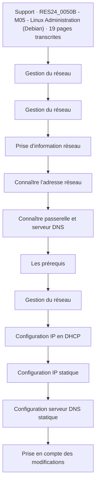
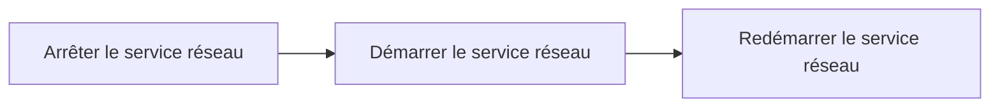
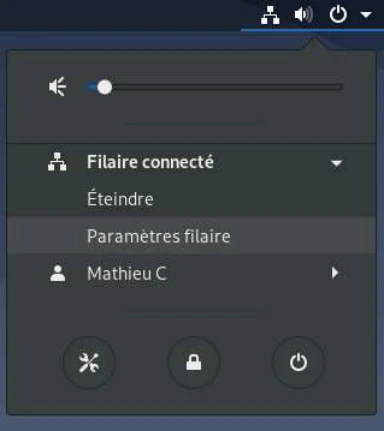
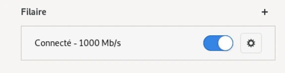

# Module 05 — Gestion du réseau

[Travaux pratiques](../../tp/administration-linux/module-05/index.md)

Les parties ci-dessous reprennent le cours original, dans le même ordre. Les encadrés et les schémas répètent ses formulations.

## Parcours de lecture

1. Support · RES24_0050B - M05 - Linux Administration (Debian) · 19 pages transcrites
2. Gestion du réseau
3. Gestion du réseau
4. Prise d’information réseau
5. Connaître l’adresse réseau
6. Connaître passerelle et serveur DNS
7. Les prérequis
8. Gestion du réseau
9. Configuration IP en DHCP
10. Configuration IP statique
11. Configuration serveur DNS statique
12. Prise en compte des modifications
13. Système sans interface graphique
14. Gestion du réseau
15. Gestion du réseau avec Network Manager
16. Prise en compte des modifications
17. Gestion du réseau
18. Gestion du réseau
19. Conclusion
20. Transcription des commandes et informations utiles visibles
21. Transcription des commandes et informations utiles visibles
22. Transcription des commandes et informations utiles visibles
23. Transcription des commandes et informations utiles visibles
24. Transcription des commandes et informations utiles visibles
25. Transcription des commandes et informations utiles visibles
26. Transcription des commandes visibles
27. Transcription des commandes et informations utiles visibles
28. Transcription des commandes et informations utiles visibles
29. Transcription des commandes et informations utiles visibles
30. Transcription des commandes et informations utiles visibles
31. Transcription des commandes visibles
32. Transcription des commandes visibles
33. Transcription des commandes visibles
34. Transcription des commandes et informations utiles visibles

**Visuel externe**



SOURCE DRIVE · TRANSCRIPTION DU SUPPORT

Le contenu des documents du dossier TSSR est transcrit ci-dessous, page par page. Les textes et tableaux sont intégrés à la page Web. Aucun fichier PDF, aucune diapositive entière ni aucune reproduction de page n’est affiché. Seuls des croquis ou visuels isolés et vérifiés peuvent accompagner la transcription. Les versions et les consignes restent celles des supports de formation. Les compléments IA sont conservés dans leur onglet distinct.

## Support · RES24_0050B - M05 - Linux Administration (Debian) · 19 pages transcrites

### Administration Debian

### GNU/Linux

Module 05 – Gestion du réseau

## Gestion du réseau

### Objectifs

!!! note "À retenir"
    Prendre des informations sur le réseau Configuration réseau d’un système sans interface graphique Configuration réseau d’un système avec interface graphique Interroger et configurer le réseau sous Linux.

**Visuel externe**


- Prendre des informations sur le réseau
- Configuration réseau d’un système sans interface graphique
- Configuration réseau d’un système avec interface graphique

Interroger et configurer le réseau sous Linux.

## Gestion du réseau

### Prendre des informations

## Prise d’information réseau

**Visuel externe**


- Pour une mise en réseau des postes client et serveur, il faut que la couche IP soit correctement réalisée
- La configuration IP a généralement besoin :
- D’une adresse IP
- D’un masque réseau
- Potentiellement d’une passerelle par défaut
- Afin de pouvoir résoudre les noms d’hôtes, il faudra aussi renseigner un ou des serveurs DNS

## Connaître l’adresse réseau

!!! note "À retenir"
    Dans un shell, commande ip avec l’argument address ou son raccourci a

- Dans un shell, commande ip avec l’argument address ou son raccourci a

```
root@deb:~# ip a 
1: lo: <LOOPBACK,UP,LOWER_UP> mtu 65536 qdisc noqueue state UNKNOWN group default 
qlen 1000
    link/loopback 00:00:00:00:00:00 brd 00:00:00:00:00:00
    inet 127.0.0.1/8 scope host lo
       valid_lft forever preferred_lft forever
    inet6 ::1/128 scope host 
       valid_lft forever preferred_lft forever
2: ens33: <BROADCAST,MULTICAST,UP,LOWER_UP> mtu 1500 qdisc pfifo_fast state UP 
group default qlen 1000
    link/ether 00:0c:29:7c:ff:ba brd ff:ff:ff:ff:ff:ff
    inet 192.168.1.50/24 brd 192.168.1.255 scope global dynamic ens33
       valid_lft 85457sec preferred_lft 85457sec
    inet6 fe80::20c:29ff:fe7c:ffba/64 scope link 
       valid_lft forever preferred_lft forever
```

## Connaître passerelle et serveur DNS

!!! note "À retenir"
    Dans un shell, commande ip avec l’option route ou son raccourci r Les informations de DNS se trouvent dans le fichier /etc/resolv.conf

- Dans un shell, commande ip avec l’option route ou son raccourci r

```
root@deb:~# ip r 
default via 192.168.1.1 dev ens33 
192.168.1.0/24 dev ens33 proto kernel scope link src 
192.168.1.50
```

- Les informations de DNS se trouvent dans le fichier /etc/resolv.conf

```
root@deb:~# cat /etc/resolv.conf 
search mondomaine.fr
nameserver 10.1.2.20
nameserver 10.1.2.21
```

## Les prérequis

Démo

Informations réseau

## Gestion du réseau

### Système sans interface

### graphique

## Configuration IP en DHCP

!!! note "À retenir"
    La configuration IP et DNS sur un système sans interface graphique se fait dans deux fichiers de configuration Le fichier /etc/network/interfaces permet de gérer la partie IP Il est possible d’avoir une configuration simplifiée via un serveur DHCP ou une configuration statique

- La configuration IP et DNS sur un système sans interface graphique se fait dans deux fichiers de configuration
- Le fichier /etc/network/interfaces permet de gérer la partie IP
- Il est possible d’avoir une configuration simplifiée via un serveur DHCP ou une configuration statique

```
root@deb:~# vim /etc/network/interfaces
# The loopback network interface
auto lo
iface lo inet loopback
# Carte réseau - Ethernet ens33
auto ens33
allow-hotplug ens33
iface ens33 inet dhcp 
```

## Configuration IP statique

!!! note "À retenir"
    Mettre en place une configuration statique dans le fichier /etc/network/interfaces

- Mettre en place une configuration statique dans le fichier /etc/network/interfaces

```
root@deb:~# vim /etc/network/interfaces
# The loopback network interface
auto lo
iface lo inet loopback
# Carte réseau - Ethernet ens33
auto ens33
iface ens33 inet static
```

```
address 10.1.1.10
netmask 255.255.0.0
gateway 10.1.255.254
```

## Configuration serveur DNS statique

!!! note "À retenir"
    Mettre en place une configuration statique dans le fichier /etc/resolv.conf via la directive nameserver

- Mettre en place une configuration statique dans le fichier /etc/resolv.conf via la directive nameserver

```
root@deb:~# vim /etc/resolv.conf
search mondomaine.fr
nameserver 10.1.2.20
nameserver 10.1.2.21
```

## Prise en compte des modifications

!!! note "À retenir"
    On utilise la commande systemctl pour gérer le service networking Arrêter le service réseau Démarrer le service réseau Redémarrer le service réseau

**Visuel externe**



On utilise la commande systemctl pour gérer le service networking

- Arrêter le service réseau

```
root@deb:~# systemctl stop networking.service
```

- Démarrer le service réseau

```
root@deb:~# systemctl start networking.service
```

- Redémarrer le service réseau

```
root@deb:~# systemctl restart networking.service
```

## Système sans interface graphique

!!! note "À retenir"
    Démo Mise en place d’une adresse IP fixe sur serveur Debian

Démo

Mise en place d’une adresse IP fixe sur serveur

Debian

## Gestion du réseau

### Configuration réseau d’un système graphique

## Gestion du réseau avec Network Manager

Network Manager est utilisé dans le cas d’un système Linux avec interface graphique (Desktop)


Capture ou visuel isolé du document de formation.



Capture ou visuel isolé du document de formation.

## Prise en compte des modifications

On utilise la commande systemctl pour gérer le service NetworkManager

Redémarrer le service réseau

```
root@deb:~# systemctl restart NetworkManager
```

Ou simplement l’interface graphique (Off, On)



Capture ou visuel isolé du document de formation.

## Gestion du réseau

Démo

Gestion du réseau au sein d’un bureau Gnome

## Gestion du réseau

### TP

Démo

Gestion de la configuration réseau d’un poste

## Conclusion

**Visuel externe**


- Vous savez consulter les informations réseau sur un système Linux
- Vous pouvez configurer l’adressage IP sur un serveur
- Vous pouvez configurer l’adressage IP sur un poste avec interface graphique

Référence du document : 1FKHUR6aoVOxjBVWtiPOjCKtnnxF8GatF · SHA-256 69edc58f1bc1f995…

| Prise d’information réseau | Pour une mise en réseau des postes client et serveur, il faut que la couche IP soit correctement réalisée La configuration IP a généralement besoin : D’une adresse IP D’un masqu… |
| Connaître l’adresse réseau | Dans un shell, commande ip avec l’argument address ou son raccourci a |
| Connaître passerelle et serveur DNS | Dans un shell, commande ip avec l’option route ou son raccourci r Les informations de DNS se trouvent dans le fichier /etc/resolv.conf |
| Configuration IP en DHCP | La configuration IP et DNS sur un système sans interface graphique se fait dans deux fichiers de configuration Le fichier /etc/network/interfaces permet de gérer la partie IP Il… |
| Configuration IP statique | Mettre en place une configuration statique dans le fichier /etc/network/interfaces |
| Configuration serveur DNS statique | Mettre en place une configuration statique dans le fichier /etc/resolv.conf via la directive nameserver |
| Prise en compte des modifications | On utilise la commande systemctl pour gérer le service networking Arrêter le service réseau Démarrer le service réseau Redémarrer le service réseau |
| Système sans interface graphique | Démo Mise en place d’une adresse IP fixe sur serveur Debian |
| Gestion du réseau avec Network Manager | Network Manager est utilisé dans le cas d’un système Linux avec interface graphique (Desktop) Capture ou visuel isolé du document de formation. |
| Prise en compte des modifications | On utilise la commande systemctl pour gérer le service NetworkManager Redémarrer le service réseau Ou simplement l’interface graphique (Off, On) Capture ou visuel isolé du docum… |
| Gestion du réseau | Démo Gestion du réseau au sein d’un bureau Gnome |
| Conclusion | Vous savez consulter les informations réseau sur un système Linux Vous pouvez configurer l’adressage IP sur un serveur Vous pouvez configurer l’adressage IP sur un poste avec in… |
| Transcription des commandes et informations utiles visibles | Capture ou visuel isolé du document de formation. |
| Transcription des commandes et informations utiles visibles | Capture ou visuel isolé du document de formation. |
| Transcription des commandes et informations utiles visibles | Commande ou détail d’interface isolé du document de formation. |
| Transcription des commandes et informations utiles visibles | Commande ou détail d’interface isolé du document de formation. |
| Transcription des commandes et informations utiles visibles | Détail de la procédure du laboratoire, isolé et vérifié. |
| Transcription des commandes visibles | Modifier le nom de la machine : Indiquer le nom : deb-<prénom>-01 avec <prénom> = votre prénom Attention, il y a 2 fichiers à modifier ! |
| Transcription des commandes et informations utiles visibles | Commande ou détail d’interface isolé du document de formation. |
| Transcription des commandes et informations utiles visibles | Transcription de la capture : noms du réseau de formation neutralisés, paramètres numériques et suite conservés. |
| Transcription des commandes et informations utiles visibles | Commande ou détail d’interface isolé du document de formation. |
| Transcription des commandes et informations utiles visibles | Détail de la procédure du laboratoire, isolé et vérifié. |
| Transcription des commandes visibles | Détail de la procédure du laboratoire, isolé et vérifié. |
| Transcription des commandes visibles | Détail de la procédure du laboratoire, isolé et vérifié. |
| Transcription des commandes et informations utiles visibles | Capture ou visuel isolé du document de formation. |
