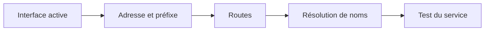

# Module 05 — Gestion du réseau

**Cours optimisé — reformulation pédagogique du support et des TP associés.** Les exemples du parcours conservent leur contexte Debian 11 ; les corrections et actualisations sont identifiées comme compléments externes. Les transcriptions intégrales se consultent dans l’onglet Original.
## Décomposer une configuration réseau

Une interface, une adresse avec préfixe, une route par défaut et un résolveur DNS remplissent des fonctions différentes. Lire ces éléments avant toute modification évite d’attribuer à DNS un défaut de liaison ou de routage.

```bash
ip address
ip route
cat /etc/resolv.conf
```

`ip a` et `ip r` sont les formes courtes présentées dans le support. Relever le nom réel de l’interface : `ens33` ou `ens35` sont des exemples de VM, pas des noms universels. Un service actif ne suffit pas à prouver que l’adresse ou la route voulue est appliquée.

## Configuration ifupdown du serveur

Le support utilise `/etc/network/interfaces`. Conserver la configuration de boucle locale, puis choisir DHCP ou statique pour l’interface concernée. Exemple statique de la leçon :

```text
auto lo
iface lo inet loopback

auto ens33
iface ens33 inet static
    address 10.1.1.10
    netmask 255.255.0.0
    gateway 10.1.255.254
```

Dans le cas DHCP, la déclaration devient `iface ens33 inet dhcp`. Le support montre l’arrêt, le démarrage et le redémarrage de `networking.service`. Ces actions peuvent couper une connexion SSH ; le TP se réalise avec la console de la VM disponible.

```bash
systemctl restart networking.service
systemctl status networking.service
ip address show ens33
ip route
```

## DNS et noms locaux

Le support présente une directive `nameserver` par serveur DNS et une directive `search` pouvant contenir plusieurs domaines. Le suffixe de recherche permet de compléter un nom court ; il ne crée pas un enregistrement DNS.

```text
nameserver 10.1.2.20
nameserver 10.1.2.21
search mondomaine.fr
```

Dans les transcriptions du TP, les domaines de l’organisme de formation sont remplacés explicitement par des domaines d’exemple. Les adresses IP et les noms courts utiles aux manipulations sont conservés. Les tests de `ping -c 2 dc44-far`, `dc35-cdb1` et `repos` supposent l’existence des hôtes du laboratoire ; ils ne fonctionneront pas tels quels sur un réseau personnel.

## Plan d’adressage du TP

| Interface / rôle | Adressage demandé | Route par défaut |
|---|---|---|
| Serveur, première carte | `10.X.Y.1/16` : X = réseau de salle, Y = numéro de stagiaire | `10.X.255.254` |
| Serveur, deuxième carte Host-only | `192.168.100.1/24` | Aucune sur cette carte |
| Client graphique | Adresse distincte compatible avec la première carte du serveur | Selon le segment et la connectivité attendue |

Dans la correction, X vaut 49 et Y vaut 222 : l’hôte est `10.49.222.1/16`, avec passerelle `10.49.255.254`. **Son réseau /16 est `10.49.0.0/16`**, même si la correction emploie `10.49.222.0/16` comme désignation du réseau. Cette rectification de calcul est un complément pédagogique, pas une modification silencieuse de l’original.

Récupérer les DNS du laboratoire sur le poste Windows avec `ipconfig /all`, sans inventer leurs adresses. Ajouter la seconde interface dans l’hyperviseur, confirmer sa détection avec `ip a`, puis la configurer sans créer une deuxième passerelle par défaut involontaire.

## Nom d’hôte

Le TP demande `deb-<prénom>-01`. La démarche source adapte `/etc/hostname` et l’entrée locale correspondante dans `/etc/hosts`, puis applique le nom courant. Vérifier à la fois le nom court et, s’il existe dans l’entrée locale, le nom complet. L’apparence de l’invite n’est pas une preuve suffisante : elle peut n’être rafraîchie qu’à l’ouverture d’un nouveau shell.

## Client graphique et NetworkManager

Dans les paramètres réseau, choisir IPv4 manuel, puis renseigner adresse, masque, route et DNS correspondant au plan. La correction utilise aussi `nmtui` pour des options non exposées dans son écran graphique. Désactiver/réactiver la connexion concernée et vérifier les valeurs réellement appliquées. Ne recopiez pas une absence de passerelle d’un écran hors de son contexte : elle empêche de joindre un réseau extérieur si aucune autre route ne convient.

!!! info "Précision externe — qui gère l’interface ?"
    ifupdown et NetworkManager sont des mécanismes différents. Identifier celui qui gère réellement l’interface avant d’éditer ses fichiers. `/etc/resolv.conf` peut être généré par un gestionnaire ; une édition manuelle peut être écrasée. Configurer alors les DNS dans le gestionnaire utilisé. Références : [configuration réseau Debian](https://www.debian.org/doc/manuals/debian-reference/ch05.fr.html) et [NetworkManager](https://networkmanager.dev/docs/api/latest/NetworkManager.html).

## Vérifier par couches

Contrôler successivement la présence de l’interface, l’adresse et le préfixe, une adresse voisine, la passerelle si nécessaire, puis la résolution d’un nom. Le complément `getent hosts nom` interroge la résolution du système ; il complète utilement `ping`, dont l’échec peut aussi venir du filtrage ICMP.

## Schéma explicatif — complément pédagogique



## Autoévaluation

1. Quel est le réseau de `10.49.222.1/16` ?
2. Pourquoi éviter une passerelle sur la carte Host-only du TP ?
3. Une édition de resolv.conf est-elle toujours durable ?

??? success "Réponses"
    1. `10.49.0.0/16`.
    2. Cette carte relie un segment local ; le TP ne lui donne pas le rôle de sortie par défaut.
    3. Non ; le fichier peut être généré par le gestionnaire réseau.

## Pour travailler ce module

- [Fiche de révision](../../revision/administration-linux/module-05-gestion-du-reseau.md)
- [Travaux pratiques](../../tp/administration-linux/module-05/index.md)
- [Progression du cours](index.md)
