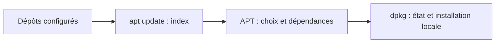

# Module 06 — Gestion des paquets logiciels

**Cours optimisé — reformulation pédagogique du support et des TP associés.** Les exemples du parcours conservent leur contexte Debian 11 ; les corrections et actualisations sont identifiées comme compléments externes. Les transcriptions intégrales se consultent dans l’onglet Original.
## Dépôts, branches et paquets

Les dépôts fournissent les paquets et leurs métadonnées. APT recherche et résout les dépendances ; dpkg gère l’installation et l’état local des paquets Debian. Les recherches peuvent généralement se faire avec un compte ordinaire ; les modifications système exigent les privilèges appropriés.

Le support reprend stable, testing, unstable/Sid, oldstable et oldoldstable. Experimental est un ensemble de paquets expérimentaux, pas un système complet autonome. Un serveur de production se rattache à une version choisie et à sa politique de maintenance.

## Lire une source APT

```text
deb http://ftp.fr.debian.org/debian/ bookworm main contrib
```

| Élément | Sens |
|---|---|
| `deb` | Paquets binaires ; `deb-src` concerne leurs sources |
| URI | Emplacement du dépôt : HTTP, fichier local, média… |
| `bookworm` | Suite ou nom de code ciblé |
| `main contrib` | Composants à consulter |

Le support décrit `main` comme libre, `contrib` comme libre avec des dépendances extérieures au cœur libre, et `non-free` comme non libre. Les fichiers se trouvent dans `/etc/apt/sources.list` et dans `/etc/apt/sources.list.d`. Les exemples Buster, Bullseye et Bookworm appartiennent à des contextes différents : les juxtaposer n’est pas une procédure de mise à niveau.

!!! info "Actualisation externe — formats et version cible"
    Les versions récentes acceptent notamment le format deb822 dans des fichiers `.sources` et le composant `non-free-firmware`. Garder la suite correspondant à l’OS ; remplacer Bullseye par Bookworm transforme le contexte en migration de version majeure, qui exige les notes de publication. Références : [sources.list(5)](https://manpages.debian.org/trixie/apt/sources.list.5.en.html) et [notes de publication Debian](https://www.debian.org/releases/).

## Opérations courantes

| Besoin | Commande |
|---|---|
| Rafraîchir l’index des paquets | `apt update` |
| Mettre à jour sans retirer de paquet existant | `apt upgrade` |
| Résoudre une mise à jour pouvant retirer des paquets | `apt full-upgrade` |
| Installer | `apt install vim openssh-server terminator` |
| Désinstaller en conservant les configurations gérées | `apt remove paquet` |
| Supprimer aussi ces fichiers de configuration | `apt purge paquet` |
| Vider le cache d’archives téléchargées | `apt clean` |
| Rechercher | `apt search motif` ou `apt-cache search motif` |
| Lire les métadonnées | `apt show paquet` ou `apt-cache show paquet` |

`update` n’installe pas les nouvelles versions. Lire le récapitulatif d’APT avant de confirmer une opération, particulièrement avec `full-upgrade`. `purge` ne signifie pas suppression automatique des documents présents dans le dossier personnel d’un utilisateur.

!!! info "Correction externe — commandes APT"
    Le support écrit `apt-get search` : cette sous-commande n’existe pas ; utiliser `apt-cache search` ou `apt search`. `apt upgrade` peut ajouter des dépendances sans supprimer de paquet, tandis que `apt-get upgrade` ne possède pas exactement la même politique par défaut. Références : [apt(8)](https://manpages.debian.org/trixie/apt/apt.8.en.html) et [apt-get(8)](https://manpages.debian.org/trixie/apt/apt-get.8.en.html).

## Interroger l’état local avec dpkg

```bash
dpkg -l '*ftp*'
dpkg -L openssh-server
dpkg -S /usr/bin/scp
```

`-l` examine les enregistrements de la base locale, avec des états tels que installé, supprimé avec configuration restante ou connu mais non installé. **Il ne liste pas le catalogue complet des dépôts**, contrairement à la formulation du support. `-L` indique les chemins enregistrés pour un paquet ; `-S` cherche le paquet auquel un chemin enregistré appartient. Référence externe : [dpkg-query(1)](https://manpages.debian.org/trixie/dpkg/dpkg-query.1.en.html).

L’historique APT se consulte dans `/var/log/apt/history.log`, celui de dpkg dans `/var/log/dpkg.log`, avec les éventuelles archives de rotation. Une opération APT appelle dpkg pour réaliser les actions sur les paquets : les deux journaux apportent des niveaux de détail différents.

## Atelier graphique et serveur

Dans la machine graphique, le TP demande d’examiner **Software & Updates**, de désactiver le CD-ROM si nécessaire, de repérer binaires, mises à jour et sources, puis de désactiver les entrées de sources. Installer GParted via l’outil graphique, l’ouvrir pour vérifier sa présence, puis le quitter sans modifier les partitions. Installer ensuite Vim, le serveur SSH et Terminator, examiner `apt show` et `dpkg -L`, puis se connecter depuis PuTTY.

Sur le serveur, vérifier les dépôts puis installer Vim et `cifs-utils`. Le nombre de paquets à mettre à jour dépend de la date du média, des dépôts et de l’état réel. Le « très peu » de la correction est une observation historique, pas une réponse attendue universelle.

Les réglages Vim de la source incluent la coloration et un fichier `vimrc.local`. Le chemin `vim90/defaults.vim` est lié à une version : vérifier ce qui existe dans `/usr/share/vim`. `set paste` modifie le comportement de l’éditeur ; le conserver seulement si l’usage prévu le justifie.

## Installer depuis les sources

La démarche du support est **lire README/INSTALL → préparer les dépendances → configurer → compiler → installer**. Pour un projet fondé sur Autotools :

```bash
./configure
make
```

La compilation se réalise avec un utilisateur ordinaire dans un espace prévu. L’installation système par `make install` exige les droits nécessaires ; ne l’exécuter qu’après lecture du projet. Ce cheminement ne s’applique pas à tous les logiciels et n’enregistre pas automatiquement un paquet Debian maintenable par APT.

## Schéma explicatif — complément pédagogique



## Autoévaluation

1. Quelle commande remplace `apt-get search` ?
2. `dpkg -l` interroge-t-il tout le dépôt distant ?
3. Pourquoi ne pas copier les lignes Bookworm sur un serveur Bullseye sans préparation ?

??? success "Réponses"
    1. `apt-cache search` ou `apt search`.
    2. Non, la base locale.
    3. Cela change la version visée et engage une migration majeure.

## Pour travailler ce module

- [Fiche de révision](../../revision/administration-linux/module-06-gestion-des-paquets-logiciels.md)
- [Travaux pratiques](../../tp/administration-linux/module-06/index.md)
- [Progression du cours](index.md)
