# Module 06 — Gestion des paquets logiciels

Les parties ci-dessous reprennent le cours original, dans le même ordre. Les encadrés et les schémas répètent ses formulations.

## Parcours de lecture

1. Support · RES24_0050B - M06 - Linux Administration (Debian) · 29 pages transcrites
2. Gestion des paquets logiciels
3. Gestion des paquets logiciels
4. Les Branches, ou releases, Debian
5. Les Branches, ou releases, Debian
6. Gestion des paquets logiciels
7. Les dépôts
8. Le fichier sources.list
9. Le fichier sources.list
10. Le fichier sources.list
11. Le fichier sources.list
12. Gestion des dépôts
13. Gestion des paquets logiciels
14. Gestion courante des paquets
15. Les commandes courantes de gestion
16. Les commandes courantes de gestion
17. Les commandes courantes de gestion
18. La commande dpkg
19. La commande dpkg
20. La commande dpkg
21. Les fichiers journaux
22. Gestion des dépôts
23. Gestion des paquets logiciels
24. La méthode d’installation
25. La méthode d’installation
26. La méthode d’installation
27. La méthode d’installation
28. Gestion des paquets logiciels
29. Conclusion
30. Énoncé · M06TP01 - Enoncé - Gestion des paquets logiciels · 2 pages transcrites
31. Correction · M06TP01 - Solution - Gestion des paquets logiciels · 6 pages transcrites
32. Transcription des commandes et informations utiles visibles
33. Transcription des commandes et informations utiles visibles
34. Transcription des commandes et informations utiles visibles
35. Transcription des commandes et informations utiles visibles
36. Transcription des commandes et informations utiles visibles
37. Transcription des commandes et informations utiles visibles
38. Transcription des commandes et informations utiles visibles
39. Transcription des commandes visibles
40. Transcription des commandes et informations utiles visibles

**Visuel externe**

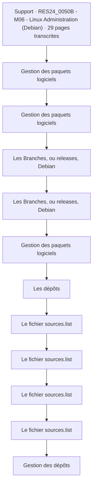

SOURCE DRIVE · TRANSCRIPTION DU SUPPORT

Le contenu des documents du dossier TSSR est transcrit ci-dessous, page par page. Les textes et tableaux sont intégrés à la page Web. Aucun fichier PDF, aucune diapositive entière ni aucune reproduction de page n’est affiché. Seuls des croquis ou visuels isolés et vérifiés peuvent accompagner la transcription. Les versions et les consignes restent celles des supports de formation. Les compléments IA sont conservés dans leur onglet distinct.

## Support · RES24_0050B - M06 - Linux Administration (Debian) · 29 pages transcrites

### Administration Debian

### GNU/Linux

!!! note "À retenir"
    Module 06 – Gestion des paquets logiciels

Module 06 – Gestion des paquets logiciels

## Gestion des paquets logiciels

### Objectifs

!!! note "À retenir"
    Comprendre les Releases du projet Debian Savoir gérer les fichiers des dépôts Mettre à jour la distribution Installer des paquets logiciels Installer des nouveaux programmes sous Debian Linux

**Visuel externe**

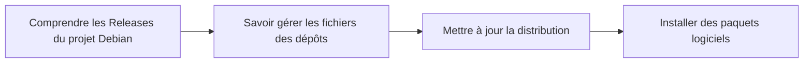

- Comprendre les Releases du projet Debian
- Savoir gérer les fichiers des dépôts
- Mettre à jour la distribution
- Installer des paquets logiciels

Installer des nouveaux programmes sous Debian Linux

## Gestion des paquets logiciels

### Les Branches Debian

## Les Branches, ou releases, Debian

!!! note "À retenir"
    3 principales Branches, "release" en anglais.

- 3 principales Branches, "release" en anglais. Stable, Testing, Unstable.
- Stable : C'est la version de production de Debian, celle qu'il est recommandé d'utiliser.
- Testing : La branche Testing contient la future version stable de Debian.
- Unstable : Version en constante évolution, (on parle de Rolling release). La distribution Unstable est toujours appelée Sid

En production, nous utilisons principalement la branche Stable ou antérieure

## Les Branches, ou releases, Debian

!!! note "À retenir"
    On peut également noter les branches suivantes : Old-Stable : C'est la version de production de Debian antérieure (R -1) Old-Old-Stable : C'est la version de production encore antérieure (R-2) Experimental : cas particulier, car elle ne contient pas tous les paquets constituant une distribution complète.

**Visuel externe**

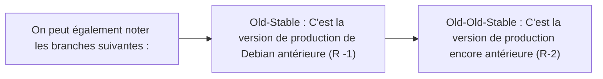

- On peut également noter les branches suivantes :
- Old-Stable : C'est la version de production de Debian antérieure (R -1)
- Old-Old-Stable : C'est la version de production encore antérieure (R-2)
- Experimental : cas particulier, car elle ne contient pas tous les paquets constituant une distribution complète. Elle contient des paquets de logiciels en cours de développement.

## Gestion des paquets logiciels

### Gestion des dépôts

## Les dépôts

!!! note "À retenir"
    Les paquets logiciels, ainsi que leurs sources, sont disponibles sur Internet dans des dépôts (repository).

- Les paquets logiciels, ainsi que leurs sources, sont disponibles sur Internet dans des dépôts (repository).
- Lorsqu'une machine est installée, les dépôts officiels Debian sont automatiquement configurés, en fonction de la version installée, facilitant :
- La mise à jour de toute la distribution : la mise à jour pourra être une mise à jour de sécurité ou une mise à jour complète du système et de la totalité des paquets la composant ;
- L'installation de nouveaux paquets : il n'est pas nécessaire de chercher sur Internet un site de téléchargement pour l’installation des paquets, le gestionnaire de paquet s'en charge tout seul.

## Le fichier sources.list

!!! note "À retenir"
    Le fichier /etc/apt/sources.list contient la configuration des dépôts.

Le fichier /etc/apt/sources.list contient la configuration des dépôts.

```
root@deb:~# vim /etc/apt/sources.list 
#deb cdrom:[Debian GNU/Linux 10.0 Buster Official amd64 NETINST ]/ 
buster main
# dépot de base de la distribution
deb http://ftp.fr.debian.org/debian/ buster main
deb-src http://ftp.fr.debian.org/debian/ buster main
# security updates – mise à jours de sécurité
deb http://security.debian.org/ buster/updates main
deb-src http://security.debian.org/ buster/updates main
# buster-updates, previously known as 'volatile'
deb http://ftp.fr.debian.org/debian/ buster-updates main
deb-src http://ftp.fr.debian.org/debian/ buster-updates main 
```

https://wiki.debian.org/fr/SourcesList

## Le fichier sources.list

!!! note "À retenir"
    Le premier champ indique le type de paquet : deb : paquet binaire deb-src : paquet source Le deuxième champ indique le type et le chemin de la source.

**Visuel externe**

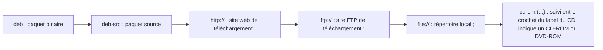

```
deb http://ftp.fr.debian.org/debian/ bookworm main contrib
```

Le premier champ indique le type de paquet :

- deb : paquet binaire
- deb-src : paquet source

Le deuxième champ indique le type et le chemin de la source. Il peut commencer par :

- http:// : site web de téléchargement ;
- ftp:// : site FTP de téléchargement ;
- file:// : répertoire local ;
- cdrom:[...] : suivi entre crochet du label du CD, indique un CD-ROM ou DVD-ROM

## Le fichier sources.list

**Visuel externe**

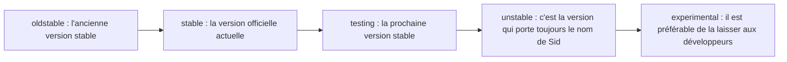

```
deb http://ftp.fr.debian.org/debian/ bookworm main contrib
```

Le troisième champ spécifie la branche disponible :

- oldstable : l'ancienne version stable
- stable : la version officielle actuelle
- bookworm, buster, … : une version spécifique, cela peut être la version officielle
- testing : la prochaine version stable
- unstable : c'est la version qui porte toujours le nom de Sid
- experimental : il est préférable de la laisser aux développeurs

## Le fichier sources.list

```
deb http://ftp.fr.debian.org/debian/ bookworm main contrib
```

Le quatrième champ et les suivants indiquent la section, dont l'objectif est de filtrer les paquets à installer :

- main : les paquets Debian standards, ils sont tous libres ;
- contrib : ces paquets sont libres mais dépendants de paquets qui ne le sont pas, ils présentent donc une dépendance vers non-free ;
- non-free : des paquets sous licence non libre

Il est également possible d’utiliser des fichiers sources indépendants déposés dans le dossier /etc/apt/sources.list.d

## Gestion des dépôts

Démo

Gestion du fichier sources.list

## Gestion des paquets logiciels

### Gestion courante des

### paquets

## Gestion courante des paquets

!!! note "À retenir"
    Les opérations de gestion de base des paquets sur les systèmes Debian sont réalisées en ligne de commande à l'aide de deux outils différents : apt-get / apt-cache et apt Les opérations de recherche et de consultation pourront être réalisées avec un compte d'utilisateur standard.

- Les opérations de gestion de base des paquets sur les systèmes Debian sont réalisées en ligne de commande à l'aide de deux outils différents : apt-get / apt-cache et apt
- Les opérations de recherche et de consultation pourront être réalisées avec un compte d'utilisateur standard. Les opérations altérant le système seront réalisées avec les privilèges du compte root.

## Les commandes courantes de gestion

- Mettre à jour la base de données des paquets disponibles

```
root@deb:~# apt update
root@deb:~# apt-get update 
```

- Mettre à jour la distribution sans supprimer de paquets

```
root@deb:~# apt upgrade
root@deb:~# apt-get upgrade 
```

- Mettre à jour la distribution avec éventuelle suppression de paquets obsolètes

```
root@deb:~# apt full-upgrade
root@deb:~# apt-get dist-upgrade
```

## Les commandes courantes de gestion

- Installer des paquets

```
root@deb:~# apt install paquet1 <paquet2>
root@deb:~# apt-get install paquet1 <paquet2>
```

- Désinstaller des paquets

```
root@deb:~# apt remove paquet1 <paquet2>
root@deb:~# apt-get remove paquet1 <paquet2>
```

- Désinstaller un paquet en supprimant les fichiers de configuration

```
root@deb:~# apt purge paquet1 
root@deb:~# apt-get purge paquet1 
```

## Les commandes courantes de gestion

- Nettoyer le dépot local des fichiers téléchargés suite à mise à jour et autres

```
root@deb:~# apt clean 
root@deb:~# apt-get clean
```

- Chercher un paquet correspondant à une expression rationnelle

```
root@deb:~# apt search regex 
root@deb:~# apt-get search regex
```

- Obtenir des informations détaillées sur un paquet

```
root@deb:~# apt show paquet 
root@deb:~# apt-cache show paquet 
```

## La commande dpkg

dpkg est la base du système de gestion des paquets Debian. Il est l'équivalent de la commande rpm pour les distributions de la branche RedHat. Il a été conçu pour :

- Installer / mettre à jour des paquets Debian
- Supprimer des paquets
- Fournir des informations

## La commande dpkg

En revanche, dpkg permet d'obtenir des informations précieuses sur les paquets ou les fichiers installés à partir de paquets.

Lister les paquets disponibles dans les dépôts et contenant la chaîne "ftp"

```
root@deb:~# dpkg –l "*ftp*"
Souhait=inconnU/Installé/suppRimé/Purgé/H=à garder
| État=Non/Installé/fichier-Config/dépaqUeté/échec-conFig/H=semi-installé/W=attend 
Err?=(aucune)/besoin Réinstallation (État,Err: majuscule=mauvais)
||/ Nom                 Version            Architecture Description
+++-===================-==================-============-=====================================
ii  openssh-sftp-server 1:7.9p1-10+deb10u2 amd64        secure shell (SSH) sftp server module
un  pure-ftpd           <aucune>           <aucune>     (aucune description n'est disponible)
un  sftp                <aucune>           <aucune>     (aucune description n'est disponible)
```

## La commande dpkg

- Lister les fichiers installés pour un paquet présent sur le système

```
root@deb:~# dpkg -L telnet
[...]
/usr/bin/telnet.netkit
/usr/share
/usr/share/doc
/usr/share/doc/telnet
/usr/share/doc/telnet/README
/usr/share/doc/telnet/changelog.Debian.gz
[...]
```

- Chercher le paquet à l’origine d’un fichier

```
root@deb:~# dpkg -S /usr/bin/scp
openssh-client: /usr/bin/scp
```

## Les fichiers journaux

- Les fichiers journaux permettent de consulter l'historique des installations et mises à jour. Chaque utilitaire dispose de son propre fichier de logs :
- apt-get & apt : fichier /var/log/apt/history.log
- dpkg : fichier /var/log/dpkg.log
- Les commandes apt-get et apt s'appuient sur dpkg pour l'installation proprement dite. On doit donc retrouver dans les logs de dpkg toutes les interventions réalisées sur les paquets.

## Gestion des dépôts

Démo

Gestion des dépôts et paquets

## Gestion des paquets logiciels

### Installation à partir des

### sources

## La méthode d’installation

- L’installation à partir des sources est la méthode native d’installation sur des systèmes Unix/Linux.
- Cette technique n’est pas la plus simple, et varie énormément suivant le type de source récupéré. Il y a tout de même un cheminement qui reste le plus répandu.
- L’environnement de compilation
- Il est important de faire un espace de compilation spécifique à un utilisateur qui n’est pas root afin d’éviter des problématiques systèmes et sa sécurisation.

## La méthode d’installation

- Lecture la documentation
- La documentation est généralement disponible sous un fichier README ou INSTALL. Celui-ci contient généralement les autres étapes de la construction de l’application, avec la liste des dépendances de construction de fonctionnement.
- Préparation de la compilation
- Cette étape va vérifier s’il y a toutes les dépendances de compilation sur le système puis générer un fichier Makefile contenant toutes les informations de compilation et d’installation.

```
user@deb:/opt/sources/application$ ./configure 
```

## La méthode d’installation

- Compilation
- Cette étape va permettre de créer l’application compilée à partir de ses sources en se basant sur le fichier Makefile contenant toutes les informations de compilation.

```
user@deb:/opt/sources/application$ make
```

- À l’issue de cette étape, l’application n’est toujours pas installée dans le système, mais elle est totalement fonctionnelle.

## La méthode d’installation

- Installation
- C’est la seule étape à réaliser avec les privilèges root car cette étape est une simple copie de l’application dans les répertoires système comme /opt/bin par exemple.

```
root@deb:/opt/sources/application# make install
```

## Gestion des paquets logiciels

### TP

Démo

Gestion des installations logicielles

## Conclusion

- Vous savez gérer les dépôts d’une distribution Debian.
- Vous savez effectuer la mise à jour du système.
- Vous savez installer et supprimer de nouveaux logiciels.

Référence du document : 1EYEScurZSKteXvfT1QURC7Cbso_sNY7s · SHA-256 d9e846c9d913a534…

## Énoncé · M06TP01 - Enoncé - Gestion des paquets logiciels · 2 pages transcrites

### Gestion des paquets

TP du Module 06 – Gestion des paquets logiciels

Avant de démarrer ce TP, il convient d’avoir suivi les vidéos des modules 1 à 6 et d’avoir réalisé les TP proposés.

Durée estimée

30 à 45 mn

### Énoncé :

### I. Gérer les installations logicielles avec interface graphique

Afficher le composant les "Software & Updates"

- Vérifier les paramétrages dans les différents onglets
- Rechercher les informations relatives aux dépôts configurés
- Désactiver le dépôt CDROM si nécessaire

Vérifier la configuration du fichier sources.list dans /etc/apt :

- Quelles lignes définissent l'emplacement des sources d'installation des paquets binaires ?
- Quelles lignes définissent l'emplacement des mises à jour ?
- Pouvez-vous récupérer les paquets sous la forme du code source ?
- Désactiver l'accès aux dépôts concernant le code source.

Effectuer une mise à jour des paquets installés avec apt :

- Combien de paquets seront mis à jour ? ( pourquoi ? )

Installer le logiciel suivant avec l'outil "Logiciels"

- Gparted (outil de partitionnement)
- Lancer cette application depuis les menus Gnome

Installer les paquets suivants avec la commande apt :

- vim (Editeur VI amélioré)
- Serveur SSH (rechercher d’abord le nom du paquet adapté)
- terminator

Afficher les informations sur ces 3 paquets avec les commandes :

- $ apt show <paquet>
- $ dpkg -L <paquet>

Connectez-vous via Putty sur votre VM Debian graphique.

### II. Gérer les installations logicielles sans interface graphique

Configurer manuellement les dépôts Internet dans le fichier /etc/apt/sources.list

- Ajouter les directives :
- deb http://ftp.fr.debian.org/debian/ bookworm main
- deb http://ftp.fr.debian.org/debian/ bookworm-updates main
- Garder la directive :
- deb http://security.debian.org/debian-security bookworm-security main

Vérifier les mises à jour disponibles

- Combien de paquets seront mis à jour ?
- Effectuer les mises à jour et redémarrer si nécessaire

Installer les paquets suivants avec la commande apt :

- vim (éditeur VIM)
- cifs-utils (outils pour la connexion aux partages SMB)

Configurer le fonctionnement de VIM pour les deux Postes:

- Lancer l'édition : # vi /etc/vim/vimrc
- Décommenter la ligne contenant la mention : syntax on (active la coloration syntaxique)
- Ajouter les modifications suivantes pour retrouver un comportement normal de vim en créant le fichier : /etc/vim/vimrc.local source /usr/share/vim/vim90/defaults.vim let skip_defaults_vim = 1 if has('mouse') set mouse=r endif set paste Solution

Une solution est proposée pour ce TP sous la forme d'un PDF commenté, disponible dans les ressources à télécharger.

Référence du document : 1auVMBPuOU76_Te6QnKoGLH68xGwrYs7r · SHA-256 11b749504155d107…

## Correction · M06TP01 - Solution - Gestion des paquets logiciels · 6 pages transcrites

Noms de domaine de formation neutralisés explicitement ; paramètres numériques et procédures conservés.

Correction originale : à consulter après avoir tenté l’exercice.

### Gestion des paquets

TP du Module 06 – Gestion des paquets logiciels

Avant de démarrer ce TP, il convient d’avoir suivi les vidéos des modules 1 à 6 et d’avoir réalisé les TP proposés.

Durée estimée

30 à 45 mn

### Énoncé :

### I. Gérer les installations logicielles avec interface graphique

Afficher le composant les "Software & Updates"

Rechercher le composant dans le menu Gnome

- Vérifier les paramétrages dans les différents onglets
- Rechercher les informations relatives aux dépôts configurés

Onglet Debian Software, configuration du dépot principal Main. Possibilité de cocher contrib et non-free

Onglet Updates, presence de bullseye-security et bullseye-updates

- Désactiver le dépôt CDROM si nécessaire

Décocher les cases au besoin pour désactiver les dépots cdrom.

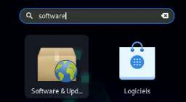

Capture ou visuel isolé du document de formation.

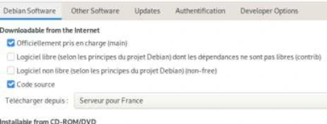

Capture ou visuel isolé du document de formation.

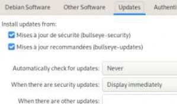

Capture ou visuel isolé du document de formation.

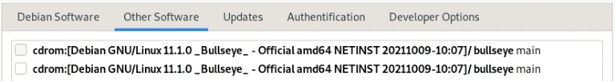

Capture ou visuel isolé du document de formation.

Vérifier la configuration du fichier sources.list dans /etc/apt :

- Quelles lignes définissent l'emplacement des sources d'installation des paquets binaires ?
- Quelles lignes définissent l'emplacement des mises à jour ?
- Pouvez-vous récupérer les paquets sous la forme du code source ?

Les lignes commençant par "deb " indiquent les dépôts de binaires Les lignes contenant “bookworm-updates” indiquent les dépôts de mises à jour Les lignes commençant par “deb-src ” indiquent la disponibilité des paquets sources

- Désactiver l'accès aux dépôts concernant le code source.

Faire une élévation de droit en tant que root et lancer l'édition du fichier

→ Pour modifier toutes les lignes visées en une fois, les options de substitution de VI sont à privilégier

:g/^deb-src/s/^/# Recherche des lignes commençant par deb-src, puis substitution du caractère début de ligne ^ par #

Effectuer une mise à jour des paquets installés avec apt :

Lancer la mise à jour de la base données locales des paquets avec

- Combien de paquets seront mis à jour ? ( pourquoi ? )

Très peu de paquets, voire aucun. Cela est du au mode d’installation net install qui a directement récupéré des paquets à jours

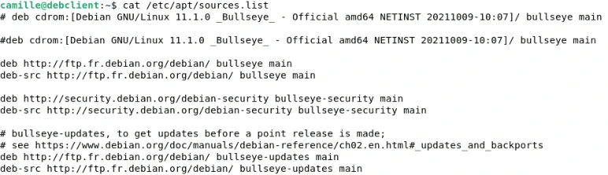

Capture ou visuel isolé du document de formation.

## Transcription des commandes et informations utiles visibles

```
deb http://ftp.fr.debian.org/debian/ bullseye main
deb-src http://ftp.fr.debian.org/debian/ bullseye main
deb http://security.debian.org/debian-security bullseye-security main
deb-src http://security.debian.org/debian-security bullseye-security main
deb http://ftp.fr.debian.org/debian/ bullseye-updates main
deb-src http://ftp.fr.debian.org/debian/ bullseye-updates main
```

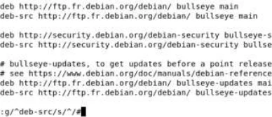

Capture ou visuel isolé du document de formation.

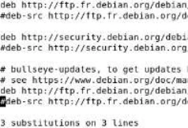

Capture ou visuel isolé du document de formation.

Transcription de la capture : noms du réseau de formation neutralisés, paramètres numériques et suite conservés.

```
Atteint :1 http://depot.formation.example:8081/repository/debian bullseye InRelease
Atteint :2 http://depot.formation.example:8081/repository/debian bullseye-updates InRelease
Atteint :3 http://depot.formation.example:8081/repository/debian-security/debian-security bullseye-security InRelease
Lecture des listes de paquets... Fait
Construction de l'arbre des dépendances... Fait
Lecture des informations d'état... Fait
Tous les paquets sont à jour.
```

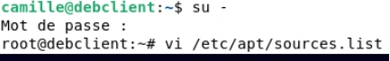

Commande ou détail d’interface isolé du document de formation.

## Transcription des commandes et informations utiles visibles

```
su -
vi /etc/apt/sources.list
```

Installer le logiciel suivant avec l'outil "Logiciels"

- Gparted (outil de partitionnement)

→ → Rechercher Gparted et lancer son installation. Le mot de passe root est demandé pour valider l’élévation de droits

- Lancer cette application depuis les menus Gnome

→ Gparted est bien présent dans les applications. Le logiciels se lance après demande d’une nouvelle élévation de privilèges.

Ne rien modifier et quitter le logiciel.

Installer les paquets suivants avec la commande apt :

- vim (Editeur VI amélioré)

Valider l'installation du paquet et de ses dépendances.

- Serveur SSH (rechercher d’abord le nom du paquet adapté)

La recherche apt search ssh renvoie de très nombreux résultats.

On peut limiter les résultats en cherchant ssh-server A noter que le paquet nommé simplement ssh est un “métapaquet” qui installe openssh-server + openssh-client (si pas déjà present).

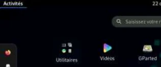

Capture ou visuel isolé du document de formation.

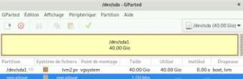

Capture ou visuel isolé du document de formation.

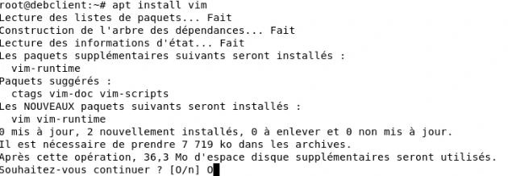

Capture ou visuel isolé du document de formation.

## Transcription des commandes et informations utiles visibles

```
apt install vim
```

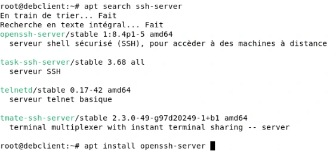

Capture ou visuel isolé du document de formation.

## Transcription des commandes et informations utiles visibles

```
apt search ssh-server
apt install openssh-server
```

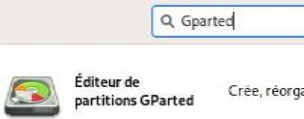

Commande ou détail d’interface isolé du document de formation.

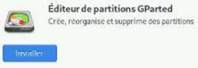

Commande ou détail d’interface isolé du document de formation.

- Terminator

Terminator est un logiciel terminal pour client graphique Linux hautement configurable.

Afficher les informations sur ces 3 paquets avec les commandes :

- $ apt show <paquet>
- $ dpkg -L <paquet>

→ apt show récupère de nombreuses informations : version, taille, dépendances… dpkg -L va lister les fichiers liés à ce paquet présents sur le système.

Connectez-vous via Putty sur votre VM Debian graphique.

Récupérer un client Putty sur Distrib ou bien à l’adresse https://the.earth.li/~sgtatham/putty/latest/w64/putty.exe

→ Lancer le logiciel, saisir l'adresse IP de la VM, et saisir login/password.

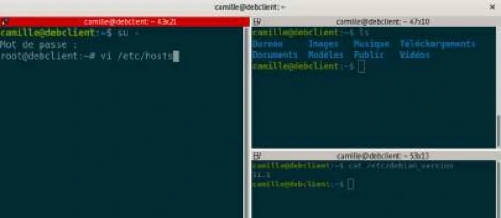

Capture ou visuel isolé du document de formation.

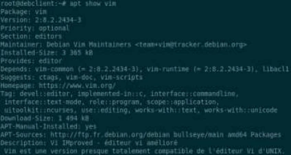

Capture ou visuel isolé du document de formation.

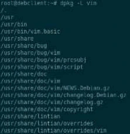

Capture ou visuel isolé du document de formation.

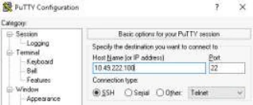

Capture ou visuel isolé du document de formation.

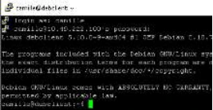

Capture ou visuel isolé du document de formation.

### II. Gérer les installations logicielles sans interface graphique

Configurer manuellement les dépôts Internet dans le fichier /etc/apt/sources.list

- Ajouter les directives :
- deb http://ftp.fr.debian.org/debian/ bookworm main
- deb http://ftp.fr.debian.org/debian/ bookworm-updates main
- Garder la directive :
- deb http://security.debian.org/debian-security bookworm-security main

Les dépots Debian nécessaires Bulseye → Bookworm

Vérifier les mises à jour disponibles

- Combien de paquets seront mis à jour ?
- Effectuer les mises à jour et redémarrer si nécessaire

Le nombre de mises à jour dépend de l'écart entre la date de génération du DVD utilisé pour l'installation du système et la date de lancement de la demande de mise à jour

Installer les paquets suivants avec la commande apt :

- vim (éditeur VIM)
- cifs-utils (outils pour la connexion aux partages SMB)

Il est possible de lancer l'installation des deux paquets en même temps avec apt

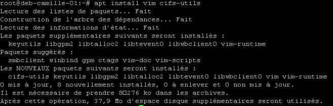

Capture ou visuel isolé du document de formation.

## Transcription des commandes et informations utiles visibles

```
apt install vim cifs-utils
```

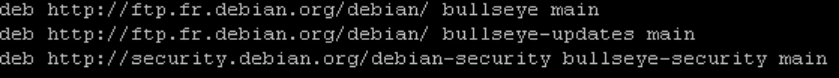

Commande ou détail d’interface isolé du document de formation.

## Transcription des commandes et informations utiles visibles

```
deb http://ftp.fr.debian.org/debian/ bullseye main
deb http://ftp.fr.debian.org/debian/ bullseye-updates main
deb http://security.debian.org/debian-security bullseye-security main
```

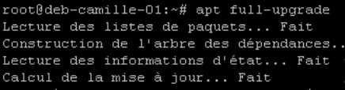

Commande ou détail d’interface isolé du document de formation.

## Transcription des commandes et informations utiles visibles

```
apt full-upgrade
```

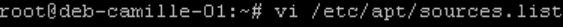

Détail de la procédure du laboratoire, isolé et vérifié.

## Transcription des commandes visibles

```
vi /etc/apt/sources.list
```

Configurer le fonctionnement de VIM pour les deux Postes:

- Lancer l'édition : # vi /etc/vim/vimrc
- Décommenter la ligne contenant la mention : syntax on (active la coloration syntaxique)
- Ajouter les modifications suivantes pour retrouver un comportement normal de vim en créant le fichier : /etc/vim/vimrc.local source /usr/share/vim/vim90/defaults.vim let skip_defaults_vim = 1 if has('mouse') set mouse=r endif set paste

Vérifier dans /usr/share/vim le nom du dossier suivant, il change selon les versions de Debian

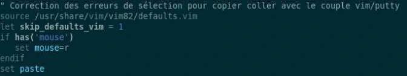

Capture ou visuel isolé du document de formation.

## Transcription des commandes et informations utiles visibles

```
source /usr/share/vim/vim82/defaults.vim
let skip_defaults_vim = 1
if has('mouse')
  set mouse=r
endif
set paste
```

Référence du document : 1UZdi6vw4OqXlWZs6-XhgL9S1xPxZU6vV · SHA-256 a3bbb59f5d40fab1…

## Fiche de synthèse

Les lignes reprennent les titres du cours et la première phrase de chaque partie.

| Partie | Repère du cours |
| --- | --- |
| Les Branches, ou releases, Debian | 3 principales Branches, "release" en anglais. |
| Les Branches, ou releases, Debian | On peut également noter les branches suivantes : Old-Stable : C'est la version de production de Debian antérieure (R -1) Old-Old-Stable : C'est la version de production encore a… |
| Les dépôts | Les paquets logiciels, ainsi que leurs sources, sont disponibles sur Internet dans des dépôts (repository). |
| Le fichier sources.list | Le fichier /etc/apt/sources.list contient la configuration des dépôts. |
| Le fichier sources.list | Le premier champ indique le type de paquet : deb : paquet binaire deb-src : paquet source Le deuxième champ indique le type et le chemin de la source. |
| Le fichier sources.list | Le troisième champ spécifie la branche disponible : oldstable : l'ancienne version stable stable : la version officielle actuelle bookworm, buster, … : une version spécifique, c… |
| Le fichier sources.list | Le quatrième champ et les suivants indiquent la section, dont l'objectif est de filtrer les paquets à installer : main : les paquets Debian standards, ils sont tous libres ; con… |
| Gestion courante des paquets | Les opérations de gestion de base des paquets sur les systèmes Debian sont réalisées en ligne de commande à l'aide de deux outils différents : apt-get / apt-cache et apt Les opé… |
| Les commandes courantes de gestion | Mettre à jour la base de données des paquets disponibles Mettre à jour la distribution sans supprimer de paquets Mettre à jour la distribution avec éventuelle suppression de paq… |
| Les commandes courantes de gestion | Installer des paquets Désinstaller des paquets Désinstaller un paquet en supprimant les fichiers de configuration |
| Les commandes courantes de gestion | Nettoyer le dépot local des fichiers téléchargés suite à mise à jour et autres Chercher un paquet correspondant à une expression rationnelle Obtenir des informations détaillées… |
| La commande dpkg | dpkg est la base du système de gestion des paquets Debian. |
| La commande dpkg | En revanche, dpkg permet d'obtenir des informations précieuses sur les paquets ou les fichiers installés à partir de paquets. |
| La commande dpkg | Lister les fichiers installés pour un paquet présent sur le système Chercher le paquet à l’origine d’un fichier |
| Les fichiers journaux | Les fichiers journaux permettent de consulter l'historique des installations et mises à jour. |
| La méthode d’installation | L’installation à partir des sources est la méthode native d’installation sur des systèmes Unix/Linux. |
| La méthode d’installation | Lecture la documentation La documentation est généralement disponible sous un fichier README ou INSTALL. |
| La méthode d’installation | Compilation Cette étape va permettre de créer l’application compilée à partir de ses sources en se basant sur le fichier Makefile contenant toutes les informations de compilation. |
| La méthode d’installation | Installation C’est la seule étape à réaliser avec les privilèges root car cette étape est une simple copie de l’application dans les répertoires système comme /opt/bin par exemple. |
| Conclusion | Vous savez gérer les dépôts d’une distribution Debian. |
| Correction · M06TP01 - Solution - Gestion des paquets logiciels · 6 pages transcrites | Noms de domaine de formation neutralisés explicitement ; paramètres numériques et procédures conservés. |
| Transcription des commandes et informations utiles visibles | Capture ou visuel isolé du document de formation. |
| Transcription des commandes et informations utiles visibles | Installer le logiciel suivant avec l'outil "Logiciels" Gparted (outil de partitionnement) → → Rechercher Gparted et lancer son installation. |
| Transcription des commandes et informations utiles visibles | Capture ou visuel isolé du document de formation. |
| Transcription des commandes et informations utiles visibles | Commande ou détail d’interface isolé du document de formation. |
| Transcription des commandes et informations utiles visibles | Commande ou détail d’interface isolé du document de formation. |
| Transcription des commandes et informations utiles visibles | Commande ou détail d’interface isolé du document de formation. |
| Transcription des commandes et informations utiles visibles | Détail de la procédure du laboratoire, isolé et vérifié. |
| Transcription des commandes visibles | Configurer le fonctionnement de VIM pour les deux Postes: Lancer l'édition : # vi /etc/vim/vimrc Décommenter la ligne contenant la mention : syntax on (active la coloration synt… |
| Transcription des commandes et informations utiles visibles | Référence du document : 1UZdi6vw4OqXlWZs6-XhgL9S1xPxZU6vV · SHA-256 a3bbb59f5d40fab1… |
