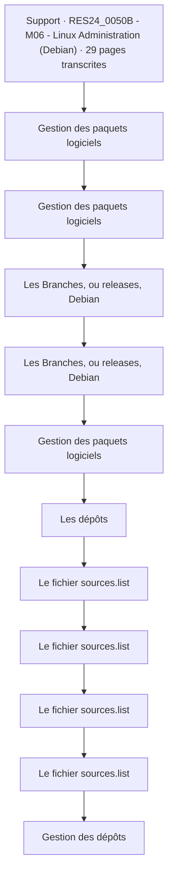
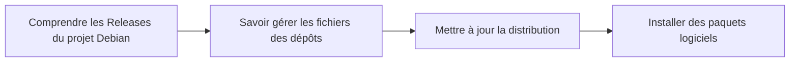
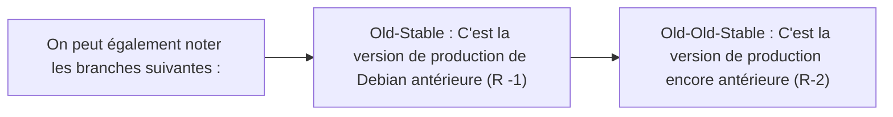
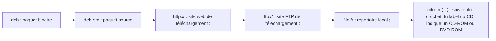
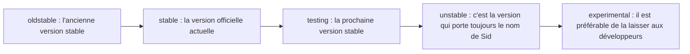

# Module 06 — Gestion des paquets logiciels

[Travaux pratiques](../../tp/administration-linux/module-06/index.md)

Les parties ci-dessous reprennent le cours original, dans le même ordre. Les encadrés et les schémas répètent ses formulations.

## Parcours de lecture

1. Support · RES24_0050B - M06 - Linux Administration (Debian) · 29 pages transcrites
2. Gestion des paquets logiciels
3. Gestion des paquets logiciels
4. Les Branches, ou releases, Debian
5. Les Branches, ou releases, Debian
6. Gestion des paquets logiciels
7. Les dépôts
8. Le fichier sources.list
9. Le fichier sources.list
10. Le fichier sources.list
11. Le fichier sources.list
12. Gestion des dépôts
13. Gestion des paquets logiciels
14. Gestion courante des paquets
15. Les commandes courantes de gestion
16. Les commandes courantes de gestion
17. Les commandes courantes de gestion
18. La commande dpkg
19. La commande dpkg
20. La commande dpkg
21. Les fichiers journaux
22. Gestion des dépôts
23. Gestion des paquets logiciels
24. La méthode d’installation
25. La méthode d’installation
26. La méthode d’installation
27. La méthode d’installation
28. Gestion des paquets logiciels
29. Conclusion
30. Transcription des commandes et informations utiles visibles
31. Transcription des commandes et informations utiles visibles
32. Transcription des commandes et informations utiles visibles
33. Transcription des commandes et informations utiles visibles
34. Transcription des commandes et informations utiles visibles
35. Transcription des commandes et informations utiles visibles
36. Transcription des commandes et informations utiles visibles
37. Transcription des commandes visibles
38. Transcription des commandes et informations utiles visibles

**Visuel externe**



SOURCE DRIVE · TRANSCRIPTION DU SUPPORT

Le contenu des documents du dossier TSSR est transcrit ci-dessous, page par page. Les textes et tableaux sont intégrés à la page Web. Aucun fichier PDF, aucune diapositive entière ni aucune reproduction de page n’est affiché. Seuls des croquis ou visuels isolés et vérifiés peuvent accompagner la transcription. Les versions et les consignes restent celles des supports de formation. Les compléments IA sont conservés dans leur onglet distinct.

## Support · RES24_0050B - M06 - Linux Administration (Debian) · 29 pages transcrites

### Administration Debian

### GNU/Linux

!!! note "À retenir"
    Module 06 – Gestion des paquets logiciels

Module 06 – Gestion des paquets logiciels

## Gestion des paquets logiciels

### Objectifs

!!! note "À retenir"
    Comprendre les Releases du projet Debian Savoir gérer les fichiers des dépôts Mettre à jour la distribution Installer des paquets logiciels Installer des nouveaux programmes sous Debian Linux

**Visuel externe**



- Comprendre les Releases du projet Debian
- Savoir gérer les fichiers des dépôts
- Mettre à jour la distribution
- Installer des paquets logiciels

Installer des nouveaux programmes sous Debian Linux

## Gestion des paquets logiciels

### Les Branches Debian

## Les Branches, ou releases, Debian

!!! note "À retenir"
    3 principales Branches, "release" en anglais.

- 3 principales Branches, "release" en anglais. Stable, Testing, Unstable.
- Stable : C'est la version de production de Debian, celle qu'il est recommandé d'utiliser.
- Testing : La branche Testing contient la future version stable de Debian.
- Unstable : Version en constante évolution, (on parle de Rolling release). La distribution Unstable est toujours appelée Sid

En production, nous utilisons principalement la branche Stable ou antérieure

## Les Branches, ou releases, Debian

!!! note "À retenir"
    On peut également noter les branches suivantes : Old-Stable : C'est la version de production de Debian antérieure (R -1) Old-Old-Stable : C'est la version de production encore antérieure (R-2) Experimental : cas particulier, car elle ne contient pas tous les paquets constituant une distribution complète.

**Visuel externe**



- On peut également noter les branches suivantes :
- Old-Stable : C'est la version de production de Debian antérieure (R -1)
- Old-Old-Stable : C'est la version de production encore antérieure (R-2)
- Experimental : cas particulier, car elle ne contient pas tous les paquets constituant une distribution complète. Elle contient des paquets de logiciels en cours de développement.

## Gestion des paquets logiciels

### Gestion des dépôts

## Les dépôts

!!! note "À retenir"
    Les paquets logiciels, ainsi que leurs sources, sont disponibles sur Internet dans des dépôts (repository).

- Les paquets logiciels, ainsi que leurs sources, sont disponibles sur Internet dans des dépôts (repository).
- Lorsqu'une machine est installée, les dépôts officiels Debian sont automatiquement configurés, en fonction de la version installée, facilitant :
- La mise à jour de toute la distribution : la mise à jour pourra être une mise à jour de sécurité ou une mise à jour complète du système et de la totalité des paquets la composant ;
- L'installation de nouveaux paquets : il n'est pas nécessaire de chercher sur Internet un site de téléchargement pour l’installation des paquets, le gestionnaire de paquet s'en charge tout seul.

## Le fichier sources.list

!!! note "À retenir"
    Le fichier /etc/apt/sources.list contient la configuration des dépôts.

Le fichier /etc/apt/sources.list contient la configuration des dépôts.

```
root@deb:~# vim /etc/apt/sources.list 
#deb cdrom:[Debian GNU/Linux 10.0 Buster Official amd64 NETINST ]/ 
buster main
# dépot de base de la distribution
deb http://ftp.fr.debian.org/debian/ buster main
deb-src http://ftp.fr.debian.org/debian/ buster main
# security updates – mise à jours de sécurité
deb http://security.debian.org/ buster/updates main
deb-src http://security.debian.org/ buster/updates main
# buster-updates, previously known as 'volatile'
deb http://ftp.fr.debian.org/debian/ buster-updates main
deb-src http://ftp.fr.debian.org/debian/ buster-updates main 
```

https://wiki.debian.org/fr/SourcesList

## Le fichier sources.list

!!! note "À retenir"
    Le premier champ indique le type de paquet : deb : paquet binaire deb-src : paquet source Le deuxième champ indique le type et le chemin de la source.

**Visuel externe**



```
deb http://ftp.fr.debian.org/debian/ bookworm main contrib
```

Le premier champ indique le type de paquet :

- deb : paquet binaire
- deb-src : paquet source

Le deuxième champ indique le type et le chemin de la source. Il peut commencer par :

- http:// : site web de téléchargement ;
- ftp:// : site FTP de téléchargement ;
- file:// : répertoire local ;
- cdrom:[...] : suivi entre crochet du label du CD, indique un CD-ROM ou DVD-ROM

## Le fichier sources.list

**Visuel externe**



```
deb http://ftp.fr.debian.org/debian/ bookworm main contrib
```

Le troisième champ spécifie la branche disponible :

- oldstable : l'ancienne version stable
- stable : la version officielle actuelle
- bookworm, buster, … : une version spécifique, cela peut être la version officielle
- testing : la prochaine version stable
- unstable : c'est la version qui porte toujours le nom de Sid
- experimental : il est préférable de la laisser aux développeurs

## Le fichier sources.list

```
deb http://ftp.fr.debian.org/debian/ bookworm main contrib
```

Le quatrième champ et les suivants indiquent la section, dont l'objectif est de filtrer les paquets à installer :

- main : les paquets Debian standards, ils sont tous libres ;
- contrib : ces paquets sont libres mais dépendants de paquets qui ne le sont pas, ils présentent donc une dépendance vers non-free ;
- non-free : des paquets sous licence non libre

Il est également possible d’utiliser des fichiers sources indépendants déposés dans le dossier /etc/apt/sources.list.d

## Gestion des dépôts

Démo

Gestion du fichier sources.list

## Gestion des paquets logiciels

### Gestion courante des

### paquets

## Gestion courante des paquets

!!! note "À retenir"
    Les opérations de gestion de base des paquets sur les systèmes Debian sont réalisées en ligne de commande à l'aide de deux outils différents : apt-get / apt-cache et apt Les opérations de recherche et de consultation pourront être réalisées avec un compte d'utilisateur standard.

- Les opérations de gestion de base des paquets sur les systèmes Debian sont réalisées en ligne de commande à l'aide de deux outils différents : apt-get / apt-cache et apt
- Les opérations de recherche et de consultation pourront être réalisées avec un compte d'utilisateur standard. Les opérations altérant le système seront réalisées avec les privilèges du compte root.

## Les commandes courantes de gestion

- Mettre à jour la base de données des paquets disponibles

```
root@deb:~# apt update
root@deb:~# apt-get update 
```

- Mettre à jour la distribution sans supprimer de paquets

```
root@deb:~# apt upgrade
root@deb:~# apt-get upgrade 
```

- Mettre à jour la distribution avec éventuelle suppression de paquets obsolètes

```
root@deb:~# apt full-upgrade
root@deb:~# apt-get dist-upgrade
```

## Les commandes courantes de gestion

- Installer des paquets

```
root@deb:~# apt install paquet1 <paquet2>
root@deb:~# apt-get install paquet1 <paquet2>
```

- Désinstaller des paquets

```
root@deb:~# apt remove paquet1 <paquet2>
root@deb:~# apt-get remove paquet1 <paquet2>
```

- Désinstaller un paquet en supprimant les fichiers de configuration

```
root@deb:~# apt purge paquet1 
root@deb:~# apt-get purge paquet1 
```

## Les commandes courantes de gestion

- Nettoyer le dépot local des fichiers téléchargés suite à mise à jour et autres

```
root@deb:~# apt clean 
root@deb:~# apt-get clean
```

- Chercher un paquet correspondant à une expression rationnelle

```
root@deb:~# apt search regex 
root@deb:~# apt-get search regex
```

- Obtenir des informations détaillées sur un paquet

```
root@deb:~# apt show paquet 
root@deb:~# apt-cache show paquet 
```

## La commande dpkg

dpkg est la base du système de gestion des paquets Debian. Il est l'équivalent de la commande rpm pour les distributions de la branche RedHat. Il a été conçu pour :

- Installer / mettre à jour des paquets Debian
- Supprimer des paquets
- Fournir des informations

## La commande dpkg

En revanche, dpkg permet d'obtenir des informations précieuses sur les paquets ou les fichiers installés à partir de paquets.

Lister les paquets disponibles dans les dépôts et contenant la chaîne "ftp"

```
root@deb:~# dpkg –l "*ftp*"
Souhait=inconnU/Installé/suppRimé/Purgé/H=à garder
| État=Non/Installé/fichier-Config/dépaqUeté/échec-conFig/H=semi-installé/W=attend 
Err?=(aucune)/besoin Réinstallation (État,Err: majuscule=mauvais)
||/ Nom                 Version            Architecture Description
+++-===================-==================-============-=====================================
ii  openssh-sftp-server 1:7.9p1-10+deb10u2 amd64        secure shell (SSH) sftp server module
un  pure-ftpd           <aucune>           <aucune>     (aucune description n'est disponible)
un  sftp                <aucune>           <aucune>     (aucune description n'est disponible)
```

## La commande dpkg

- Lister les fichiers installés pour un paquet présent sur le système

```
root@deb:~# dpkg -L telnet
[...]
/usr/bin/telnet.netkit
/usr/share
/usr/share/doc
/usr/share/doc/telnet
/usr/share/doc/telnet/README
/usr/share/doc/telnet/changelog.Debian.gz
[...]
```

- Chercher le paquet à l’origine d’un fichier

```
root@deb:~# dpkg -S /usr/bin/scp
openssh-client: /usr/bin/scp
```

## Les fichiers journaux

- Les fichiers journaux permettent de consulter l'historique des installations et mises à jour. Chaque utilitaire dispose de son propre fichier de logs :
- apt-get & apt : fichier /var/log/apt/history.log
- dpkg : fichier /var/log/dpkg.log
- Les commandes apt-get et apt s'appuient sur dpkg pour l'installation proprement dite. On doit donc retrouver dans les logs de dpkg toutes les interventions réalisées sur les paquets.

## Gestion des dépôts

Démo

Gestion des dépôts et paquets

## Gestion des paquets logiciels

### Installation à partir des

### sources

## La méthode d’installation

- L’installation à partir des sources est la méthode native d’installation sur des systèmes Unix/Linux.
- Cette technique n’est pas la plus simple, et varie énormément suivant le type de source récupéré. Il y a tout de même un cheminement qui reste le plus répandu.
- L’environnement de compilation
- Il est important de faire un espace de compilation spécifique à un utilisateur qui n’est pas root afin d’éviter des problématiques systèmes et sa sécurisation.

## La méthode d’installation

- Lecture la documentation
- La documentation est généralement disponible sous un fichier README ou INSTALL. Celui-ci contient généralement les autres étapes de la construction de l’application, avec la liste des dépendances de construction de fonctionnement.
- Préparation de la compilation
- Cette étape va vérifier s’il y a toutes les dépendances de compilation sur le système puis générer un fichier Makefile contenant toutes les informations de compilation et d’installation.

```
user@deb:/opt/sources/application$ ./configure 
```

## La méthode d’installation

- Compilation
- Cette étape va permettre de créer l’application compilée à partir de ses sources en se basant sur le fichier Makefile contenant toutes les informations de compilation.

```
user@deb:/opt/sources/application$ make
```

- À l’issue de cette étape, l’application n’est toujours pas installée dans le système, mais elle est totalement fonctionnelle.

## La méthode d’installation

- Installation
- C’est la seule étape à réaliser avec les privilèges root car cette étape est une simple copie de l’application dans les répertoires système comme /opt/bin par exemple.

```
root@deb:/opt/sources/application# make install
```

## Gestion des paquets logiciels

### TP

Démo

Gestion des installations logicielles

## Conclusion

- Vous savez gérer les dépôts d’une distribution Debian.
- Vous savez effectuer la mise à jour du système.
- Vous savez installer et supprimer de nouveaux logiciels.

Référence du document : 1EYEScurZSKteXvfT1QURC7Cbso_sNY7s · SHA-256 d9e846c9d913a534…

| Les Branches, ou releases, Debian | 3 principales Branches, "release" en anglais. |
| Les Branches, ou releases, Debian | On peut également noter les branches suivantes : Old-Stable : C'est la version de production de Debian antérieure (R -1) Old-Old-Stable : C'est la version de production encore a… |
| Les dépôts | Les paquets logiciels, ainsi que leurs sources, sont disponibles sur Internet dans des dépôts (repository). |
| Le fichier sources.list | Le fichier /etc/apt/sources.list contient la configuration des dépôts. |
| Le fichier sources.list | Le premier champ indique le type de paquet : deb : paquet binaire deb-src : paquet source Le deuxième champ indique le type et le chemin de la source. |
| Le fichier sources.list | Le troisième champ spécifie la branche disponible : oldstable : l'ancienne version stable stable : la version officielle actuelle bookworm, buster, … : une version spécifique, c… |
| Le fichier sources.list | Le quatrième champ et les suivants indiquent la section, dont l'objectif est de filtrer les paquets à installer : main : les paquets Debian standards, ils sont tous libres ; con… |
| Gestion courante des paquets | Les opérations de gestion de base des paquets sur les systèmes Debian sont réalisées en ligne de commande à l'aide de deux outils différents : apt-get / apt-cache et apt Les opé… |
| Les commandes courantes de gestion | Mettre à jour la base de données des paquets disponibles Mettre à jour la distribution sans supprimer de paquets Mettre à jour la distribution avec éventuelle suppression de paq… |
| Les commandes courantes de gestion | Installer des paquets Désinstaller des paquets Désinstaller un paquet en supprimant les fichiers de configuration |
| Les commandes courantes de gestion | Nettoyer le dépot local des fichiers téléchargés suite à mise à jour et autres Chercher un paquet correspondant à une expression rationnelle Obtenir des informations détaillées… |
| La commande dpkg | dpkg est la base du système de gestion des paquets Debian. |
| La commande dpkg | En revanche, dpkg permet d'obtenir des informations précieuses sur les paquets ou les fichiers installés à partir de paquets. |
| La commande dpkg | Lister les fichiers installés pour un paquet présent sur le système Chercher le paquet à l’origine d’un fichier |
| Les fichiers journaux | Les fichiers journaux permettent de consulter l'historique des installations et mises à jour. |
| La méthode d’installation | L’installation à partir des sources est la méthode native d’installation sur des systèmes Unix/Linux. |
| La méthode d’installation | Lecture la documentation La documentation est généralement disponible sous un fichier README ou INSTALL. |
| La méthode d’installation | Compilation Cette étape va permettre de créer l’application compilée à partir de ses sources en se basant sur le fichier Makefile contenant toutes les informations de compilation. |
| La méthode d’installation | Installation C’est la seule étape à réaliser avec les privilèges root car cette étape est une simple copie de l’application dans les répertoires système comme /opt/bin par exemple. |
| Conclusion | Vous savez gérer les dépôts d’une distribution Debian. |
| Transcription des commandes et informations utiles visibles | Capture ou visuel isolé du document de formation. |
| Transcription des commandes et informations utiles visibles | Installer le logiciel suivant avec l'outil "Logiciels" Gparted (outil de partitionnement) → → Rechercher Gparted et lancer son installation. |
| Transcription des commandes et informations utiles visibles | Capture ou visuel isolé du document de formation. |
| Transcription des commandes et informations utiles visibles | Commande ou détail d’interface isolé du document de formation. |
| Transcription des commandes et informations utiles visibles | Commande ou détail d’interface isolé du document de formation. |
| Transcription des commandes et informations utiles visibles | Commande ou détail d’interface isolé du document de formation. |
| Transcription des commandes et informations utiles visibles | Détail de la procédure du laboratoire, isolé et vérifié. |
| Transcription des commandes visibles | Configurer le fonctionnement de VIM pour les deux Postes: Lancer l'édition : # vi /etc/vim/vimrc Décommenter la ligne contenant la mention : syntax on (active la coloration synt… |
