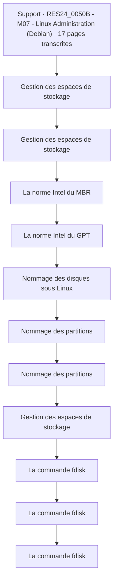
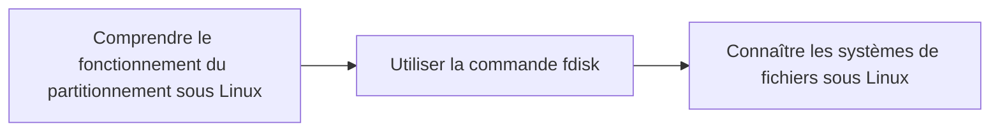
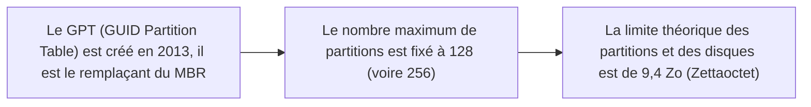
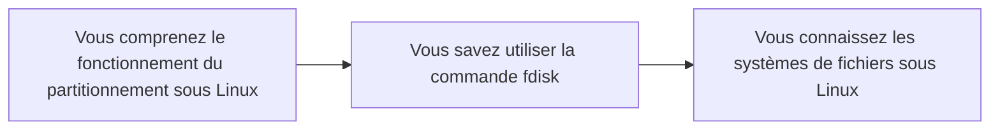

# Module 07 — Gestion des espaces de stockage

Les parties ci-dessous reprennent le cours original, dans le même ordre. Les encadrés et les schémas répètent ses formulations.

## Parcours de lecture

1. Support · RES24_0050B - M07 - Linux Administration (Debian) · 17 pages transcrites
2. Gestion des espaces de stockage
3. Gestion des espaces de stockage
4. La norme Intel du MBR
5. La norme Intel du GPT
6. Nommage des disques sous Linux
7. Nommage des partitions
8. Nommage des partitions
9. Gestion des espaces de stockage
10. La commande fdisk
11. La commande fdisk
12. La commande fdisk
13. La commande fdisk
14. La commande fdisk
15. La commande fdisk
16. Outil de partitionnement
17. Conclusion

**Visuel externe**



SOURCE DRIVE · TRANSCRIPTION DU SUPPORT

Le contenu des documents du dossier TSSR est transcrit ci-dessous, page par page. Les textes et tableaux sont intégrés à la page Web. Aucun fichier PDF, aucune diapositive entière ni aucune reproduction de page n’est affiché. Seuls des croquis ou visuels isolés et vérifiés peuvent accompagner la transcription. Les versions et les consignes restent celles des supports de formation. Les compléments IA sont conservés dans leur onglet distinct.

## Support · RES24_0050B - M07 - Linux Administration (Debian) · 17 pages transcrites

### Administration Debian

### GNU/Linux

!!! note "À retenir"
    Module 07 – Gestion des espaces de stockage

Module 07 – Gestion des espaces de stockage

## Gestion des espaces de stockage

### Objectifs

!!! note "À retenir"
    Comprendre le fonctionnement du partitionnement sous Linux Utiliser la commande fdisk Connaître les systèmes de fichiers sous Linux Créer des partitions en mode « legacy »

**Visuel externe**



- Comprendre le fonctionnement du partitionnement sous Linux
- Utiliser la commande fdisk
- Connaître les systèmes de fichiers sous Linux

Créer des partitions en mode « legacy »

## Gestion des espaces de stockage

### Partitionner un disque

## La norme Intel du MBR

- Le MBR (Master Boot Record) est constitué de 2 principaux éléments :
- Le boot loader : 446 premiers octets - Sous Linux il contient le stage 1 de GRUB
- La table de partition : 64 octets, contient la position des 4 partitions primaires
- La partition étendue pourra quant à elle stocker les informations au maximum de 56 partitions logiques
- La plus grosse problématique du MBR est la taille limite des partitions fixée au maximum à 2,2To (espace d'adressage de 32 bits)

## La norme Intel du GPT

!!! note "À retenir"
    Le GPT (GUID Partition Table) est créé en 2013, il est le remplaçant du MBR Le nombre maximum de partitions est fixé à 128 (voire 256) La limite théorique des partitions et des disques est de 9,4 Zo (Zettaoctet)

**Visuel externe**



- Le GPT (GUID Partition Table) est créé en 2013, il est le remplaçant du MBR
- Le nombre maximum de partitions est fixé à 128 (voire 256)
- La limite théorique des partitions et des disques est de 9,4 Zo (Zettaoctet)

## Nommage des disques sous Linux

!!! note "À retenir"
    Sous Linux, les disques de type SCSI/SATA sont matérialisés dans le répertoire /dev suivi de sd puis la lettre correspondant au disque Par exemple, s’il y a deux disques dans le système : /dev/sda correspond au premier disque détecté /dev/sdb correspond au deuxième disque

**Visuel externe**


- Sous Linux, les disques de type SCSI/SATA sont matérialisés dans le répertoire /dev suivi de sd puis la lettre correspondant au disque
- Par exemple, s’il y a deux disques dans le système :
- /dev/sda correspond au premier disque détecté
- /dev/sdb correspond au deuxième disque

## Nommage des partitions

!!! note "À retenir"
    Linux ne nomme pas les partitions à la suite Linux va réserver les chiffres de 1 à 4 pour les partitions principales (principale et étendue) Quel que soit le nombre de partitions principales, s’il y a une partition étendue alors les partitions logiques commenceront quoiqu’il arrive à 5

- Linux ne nomme pas les partitions à la suite
- Linux va réserver les chiffres de 1 à 4 pour les partitions principales (principale et étendue)
- Quel que soit le nombre de partitions principales, s’il y a une partition étendue alors les partitions logiques commenceront quoiqu’il arrive à 5

## Nommage des partitions

!!! note "À retenir"
    Exemple : le deuxième disque du système est partitionné avec 2 partitions principales et une partition étendue contenant 3 partitions logiques.

- Exemple : le deuxième disque du système est partitionné avec 2 partitions principales et une partition étendue contenant 3 partitions logiques. Linux présentera tout cela de cette façon :

/dev/sdb disque entier /dev/sdb1 1re partition principale /dev/sdb2 2e partition principale

/dev/sdb3 partition étendue /dev/sdb5 1re partition logique /dev/sdb6 2e partition logique /dev/sdb7 3e partition logique

## Gestion des espaces de stockage

### Outil de partitionnement

## La commande fdisk

!!! note "À retenir"
    -l affiche la table de partition du périphérique

```
• fdisk [option] <peripherique de stockage>
```

- -l affiche la table de partition du périphérique

```
root@deb:~# fdisk -l /dev/sda
```

```
Disque /dev/sda : 20 GiB, 21474836480 octets, 41943040 secteurs
Unités : secteur de 1 × 512 = 512 octets
Taille de secteur (logique / physique) : 512 octets / 512 octets
taille d'E/S (minimale / optimale) : 512 octets / 512 octets
Type d'étiquette de disque : dos
Identifiant de disque : 0x732e6aa1
Périphérique Amorçage Début Fin Secteurs Taille Id Type
/dev/sda1 * 2048 499711 497664 243M 83 Linux
/dev/sda2 501758 41940991 41439234 19,8G 5 Étendue 
```

## La commande fdisk

```
root@deb:~# fdisk /dev/sdb
```

```
Bienvenue dans fdisk (util-linux 2.29.2).
Les modifications resteront en mémoire jusqu'à écriture.
Soyez prudent avant d'utiliser la commande d'écriture.
```

```
Commande (m pour l'aide) : m
[...]
n ajouter une nouvelle partition
p afficher la table de partitions
t modifier le type d'une partition
[...]
w écrire la table sur le disque et quitter
q quitter sans enregistrer les modifications
```

## La commande fdisk

```
root@deb:~# fdisk /dev/sdb
```

```
Commande (m pour l'aide) : n
Type de partition
p primaire (0 primaire, 0 étendue, 4 libre)
e étendue (conteneur pour partitions logiques)
Sélectionnez (p par défaut) : p
Numéro de partition (1-4, 1 par défaut) :
Premier secteur (2048-62914559, 2048 par défaut) :
Dernier secteur, +secteurs ou +taille{K,M,G,T,P} (2048-62914559, 
62914559 par défaut) : +20G
```

## La commande fdisk

!!! note "À retenir"
    Une nouvelle partition 1 de type Linux et de taille 20 GiB a été créée.

Une nouvelle partition 1 de type Linux et de taille 20 GiB a été créée.

```
Commande (m pour l'aide) : p
Disque /dev/sdb : 30 GiB, 32212254720 octets, 62914560 secteurs
Unités : secteur de 1 × 512 = 512 octets
Taille de secteur (logique / physique) : 512 octets / 512 octets
taille d'E/S (minimale / optimale) : 512 octets / 512 octets
Type d'étiquette de disque : dos
Identifiant de disque : 0x0ab85bf5
Périphérique Amorçage Début Fin Secteurs Taille Id Type
/dev/sdb1 2048 41945087 41943040 20G 83 Linux
```

## La commande fdisk

Une fois les partitions créées, il ne faut pas oublier de définir le type de partition via la commande t.

```
Commande (m pour l'aide) : t
Partition 1 sélectionnée
Code Hexa (taper L pour afficher tous les codes) :L
 0  Vide            24  NEC DOS         81  Minix / Linux a
 1  FAT12           27  TFS WinRE masqu 82  partition d'éch 
 2  root XENIX      39  Plan 9          83  Linux
 3  usr XENIX       3c  récupération Pa 84  OS/2 cachée
 4  FAT16 <32M      40  Venix 80286     85  Linux
 5  Étendue         41  PPC PReP Boot   86  NTFS volume set
 6  FAT16           42  SFS             87  NTFS volume set
 7  HPFS/NTFS/exFAT 4d  QNX4.x          88  Linux plaintext
 8  AIX             4e  2e partie QNX4. 8e  Linux LVM
```

## La commande fdisk

L’enregistrement des modifications se fait via la commande w.

```
Commande (m pour l'aide) : w
La table de partitions a été altérée.
Appel d'ioctl() pour relire la table de partitions.
Synchronisation des disques.
root@deb:~#
```

## Outil de partitionnement

Démo

Les partitions avec fdisk

## Conclusion

**Visuel externe**



- Vous comprenez le fonctionnement du partitionnement sous Linux
- Vous savez utiliser la commande fdisk
- Vous connaissez les systèmes de fichiers sous Linux

Référence du document : 1ewlQdlA9cnQTk6SQexzyBqyAoO7wgvqC · SHA-256 41c2481ebc0b5e38…

## Fiche de synthèse

Les lignes reprennent les titres du cours et la première phrase de chaque partie.

| Partie | Repère du cours |
| --- | --- |
| La norme Intel du MBR | Le MBR (Master Boot Record) est constitué de 2 principaux éléments : Le boot loader : 446 premiers octets - Sous Linux il contient le stage 1 de GRUB La table de partition : 64… |
| La norme Intel du GPT | Le GPT (GUID Partition Table) est créé en 2013, il est le remplaçant du MBR Le nombre maximum de partitions est fixé à 128 (voire 256) La limite théorique des partitions et des… |
| Nommage des disques sous Linux | Sous Linux, les disques de type SCSI/SATA sont matérialisés dans le répertoire /dev suivi de sd puis la lettre correspondant au disque Par exemple, s’il y a deux disques dans le… |
| Nommage des partitions | Linux ne nomme pas les partitions à la suite Linux va réserver les chiffres de 1 à 4 pour les partitions principales (principale et étendue) Quel que soit le nombre de partition… |
| Nommage des partitions | Exemple : le deuxième disque du système est partitionné avec 2 partitions principales et une partition étendue contenant 3 partitions logiques. |
| La commande fdisk | -l affiche la table de partition du périphérique |
| La commande fdisk | Une nouvelle partition 1 de type Linux et de taille 20 GiB a été créée. |
| La commande fdisk | Une fois les partitions créées, il ne faut pas oublier de définir le type de partition via la commande t. |
| La commande fdisk | L’enregistrement des modifications se fait via la commande w. |
| Conclusion | Vous comprenez le fonctionnement du partitionnement sous Linux Vous savez utiliser la commande fdisk Vous connaissez les systèmes de fichiers sous Linux Référence du document :… |
