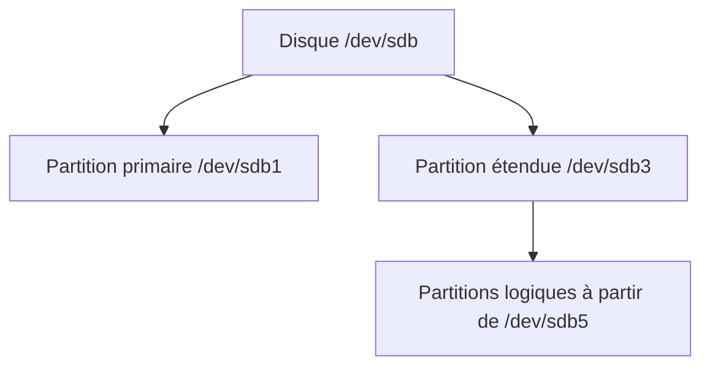

# Module 07 — Gestion des espaces de stockage

**Cours optimisé — reformulation pédagogique du support et des TP associés.** Les exemples du parcours conservent leur contexte Debian 11 ; les corrections et actualisations sont identifiées comme compléments externes. Les transcriptions intégrales se consultent dans l’onglet Original.
## Disque, table et partitions

Un disque est un périphérique bloc ; sa table de partitions décrit des régions utilisables. Une partition n’est pas encore un système de fichiers et un point de montage n’est pas une partition. Le support prépare les niveaux étudiés ensuite : partitionnement, LVM, puis systèmes de fichiers.

## Lire MBR et GPT

| Sujet | MBR, scénario « legacy » | GPT |
|---|---|---|
| Structure | Secteur initial avec code d’amorçage, quatre entrées et signature | En-têtes et tableaux de partitions avec identifiants GUID |
| Organisation | Partitions primaires, éventuelle partition étendue contenant les logiques | Entrées de partitions sans structure primaire/étendue équivalente |
| Limites | Dépendent notamment de l’adressage et de la taille des secteurs | Capacités et nombre d’entrées bien plus importants |

Le support détaille 446 octets pour le code initial et 64 octets pour les quatre entrées MBR. Avec la signature de deux octets, on retrouve le secteur classique de 512 octets. L’ordre d’amorçage firmware et le partitionnement sont liés au scénario mais ne doivent pas être confondus : GPT est une table, UEFI est un firmware.

!!! info "Clarification externe — limites et histoire"
    « GPT créé en 2013 » et « 56 partitions logiques au maximum » ne sont pas des règles générales à apprendre. Les limites pratiques dépendent de la table, du noyau, des outils et des secteurs ; le repère MBR d’environ 2 Tio suppose des secteurs logiques de 512 octets. GPT peut être utilisé dans différents scénarios de firmware. Référence : [fdisk(8), formats de tables](https://manpages.debian.org/trixie/fdisk/fdisk.8.en.html).

## Nommage dans /dev

Le support utilise des disques SCSI/SATA tels que `/dev/sda` et `/dev/sdb`. La lettre représente l’ordre de détection de ces périphériques, pas une identité durable du disque. Dans le scénario MBR, les numéros 1 à 4 sont réservés aux partitions primaires ou à la partition étendue ; les partitions logiques commencent à 5.

| Objet du schéma source | Nom |
|---|---|
| Deuxième disque | `/dev/sdb` |
| Deux partitions primaires | `/dev/sdb1`, `/dev/sdb2` |
| Conteneur étendu | `/dev/sdb3` |
| Trois partitions logiques | `/dev/sdb5`, `/dev/sdb6`, `/dev/sdb7` |

Cette numérotation historique ne se transpose pas aux partitions GPT. D’autres familles de périphériques, comme NVMe, ont aussi d’autres conventions de noms. Toujours lire la machine réelle avant d’écrire sur un disque.

## Examiner avec fdisk

```bash
fdisk -l /dev/sda
fdisk /dev/sdb
```

La première commande affiche les informations. La seconde ouvre un éditeur interactif. Dans les sorties du support, contrôler la capacité, la taille de secteur, le type d’étiquette `dos`, puis les débuts, fins, tailles et types des partitions.

| Lettre interactive | Action |
|---|---|
| `m` | Afficher l’aide |
| `p` | Relire le projet de table |
| `n` | Créer une partition |
| `t` | Changer son type |
| `w` | Écrire la table puis quitter |
| `q` | Quitter sans enregistrer les modifications en attente |

## Reproduire la démonstration

Le support ouvre un disque de **30 Gio** et prépare une partition primaire de **20 Gio**. Après `n`, il choisit primaire, laisse le numéro et le premier secteur proposés, puis saisit `+20G` au dernier secteur. `p` permet de vérifier la proposition avant écriture. Le type MBR `83` désigne Linux ; `8e` Linux LVM. Choisir le type adapté à l’étape suivante ne crée ni PV LVM ni système de fichiers.

Les modifications de cette session restent en mémoire jusqu’à `w`. Avant ce point, vérifier le disque, les partitions conservées et l’espace restant. Après écriture, examiner à nouveau le disque ; si le noyau ne peut pas relire une table utilisée, traiter ce message avant de poursuivre. Un simple changement d’étiquette ou un formatage ultérieur peut rendre des données inaccessibles : l’exercice doit viser le disque ajouté au laboratoire.

## Application au parcours

Aucun énoncé ni corrigé séparé n’est présent pour le module 7 dans les sources de ce cours : **TP source : Inexistant**. La démonstration fdisk et le TP LVM du module 8 constituent les manipulations disponibles. Un exercice pédagogique supplémentaire consiste à expliquer oralement la différence entre disque, partition étendue et partition logique avant toute écriture.

## Schéma explicatif — complément pédagogique



## Autoévaluation

1. Que fait `q` avant l’écriture ?
2. Le type `8e` formate-t-il une partition ?
3. Pourquoi vérifier taille et identité du disque, en plus du nom `/dev/sdb` ?

??? success "Réponses"
    1. Il abandonne les modifications en attente.
    2. Non : c’est un type de partition MBR.
    3. L’ordre de détection peut changer et le nom seul ne prouve pas que c’est le bon disque.

## Pour travailler ce module

- [Fiche de révision](../../revision/administration-linux/module-07-gestion-des-espaces-de-stockage.md)
- [Travaux pratiques](../../tp/administration-linux/index.md)
- [Progression du cours](index.md)
