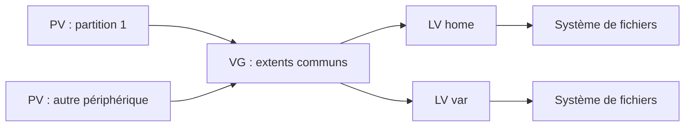

# Module 08 — Gestion des espaces de stockage avancée — LVM

**Cours optimisé — reformulation pédagogique du support et des TP associés.** Les exemples du parcours conservent leur contexte Debian 11 ; les corrections et actualisations sont identifiées comme compléments externes. Les transcriptions intégrales se consultent dans l’onglet Original.
## Les trois objets LVM

LVM ajoute une couche d’allocation entre les périphériques et les volumes utilisés. Un **PV** (*physical volume*) est un périphérique préparé pour LVM. Plusieurs PV alimentent un **VG** (*volume group*). Dans cet espace, des **LV** (*logical volumes*) reçoivent une capacité allouée. Le système de fichiers du module 9 vient au-dessus d’un LV.

| Niveau | Observer rapidement | Observer en détail | Modifier dans le support |
|---|---|---|---|
| PV | `pvs` | `pvdisplay` | `pvcreate` |
| VG | `vgs` | `vgdisplay` | `vgcreate`, `vgextend` |
| LV | `lvs` | `lvdisplay` | `lvcreate`, `lvextend`, `lvreduce` |

Les capacités sont réparties en unités d’allocation, les extents. L’espace libre du VG et l’espace libre dans un système de fichiers sont deux mesures différentes : `vgs` ne remplace pas `df`.

## Créer et étendre les niveaux

Les commandes suivantes reprennent les noms pédagogiques du support ; elles supposent des partitions de laboratoire identifiées et libres de données à conserver.

```bash
pvcreate /dev/sdb1 /dev/sdb2 /dev/sdc1
vgcreate vggroup1 /dev/sdb1 /dev/sdb2 /dev/sdc1
lvcreate -n lv1 -L 2G vggroup1
lvcreate -n lv2 -L 512M vggroup1
```

`pvcreate` écrit les métadonnées LVM sur les cibles. `vgcreate` crée le groupe ; `lvcreate` consomme une partie de ses extents libres. L’affichage `/dev/vggroup1/lv1` et le chemin sous `/dev/mapper` permettent d’atteindre le LV ; les doubles tirets observés dans certains noms mapper correspondent à l’échappement des tirets du VG/LV.

Pour ajouter le nouveau périphérique de l’exemple :

```bash
pvcreate /dev/sdd
vgextend vggroup1 /dev/sdd
pvs
vgs
```

Un périphérique n’est pas utilisable par le VG simplement parce qu’il apparaît dans `/dev`. La préparation PV puis l’appartenance au VG doivent être vérifiées.

## Agrandir un LV et son système de fichiers

```bash
lvextend -r -L +512M /dev/vggroup1/lv1
lvextend -r -L 1G /dev/vggroup1/lv2
```

Dans le premier cas, `+512M` ajoute une capacité. Dans le second, `1G` fixe la taille cible totale. `-r` demande aussi l’adaptation du système de fichiers, lorsque le type, les outils et l’état le permettent. Examiner le résultat de chaque étape : un LV agrandi avec un système de fichiers inchangé ne fournit pas encore cet espace à ses fichiers.

!!! info "Clarification externe — redimensionnement"
    `-r` ne signifie pas « toujours resize2fs » : l’outil et les contraintes dépendent du système de fichiers. La réduction exige que le système de fichiers soit réduit avant de retirer l’espace du LV ; certaines familles, notamment XFS, ne se réduisent pas. L’agrandissement et la réduction ne sont donc pas des opérations symétriques. Références : [lvextend(8)](https://manpages.debian.org/trixie/lvm2/lvextend.8.en.html), [lvreduce(8)](https://manpages.debian.org/trixie/lvm2/lvreduce.8.en.html).

Le support mentionne `lvreduce` ; ne pas traiter sa syntaxe comme une recette universelle. Les sorties d’exemple comportent aussi des capacités et nombres d’extents qui ne forment pas tous un état mathématique cohérent. Utiliser les sorties actuelles de la VM pour calculer l’espace disponible.

## TP — nouveau disque de 40 Go

Sur la station avec bureau, le TP demande d’ajouter un disque de 40 Go, de créer une partition occupant le disque pour LVM, de l’intégrer au VG existant, puis de créer **lvvar de 20 Go**. Tout le reste de l’espace libre du VG sert à agrandir **lvhome**. Les noms historiques du corrigé doivent être rapprochés de ceux réellement présents.

Démarche : relever `lsblk` et `pvs/vgs/lvs`, ajouter le disque, confirmer sa présence, préparer la partition et son type, créer le PV, étendre le VG existant, créer lvvar, puis étendre lvhome avec l’espace libre voulu. Le TP suivant formate lvvar et adapte le système de fichiers de home. Si `-r` a déjà été employé avec succès, le système de fichiers peut être déjà agrandi.

Le support donne une astuce de détection SCSI :

```bash
udevadm info --query=path --name=sda
```

Le chemin permet de repérer `host0` dans son exemple. La commande source `echo "- - -" > /sys/class/scsi_host/host0/scan` suppose ce contrôleur précis et une redirection privilégiée ; ne pas recopier `host0` sans l’identifier. Une redirection faite dans un shell ordinaire n’acquiert pas les droits root simplement en préfixant `echo` par sudo.

## Schéma explicatif — complément pédagogique



## Autoévaluation

1. Quelle commande renseigne l’espace non alloué du groupe ?
2. Que signifie le signe `+` dans `-L +512M` ?
3. Quelle couche faut-il contrôler après l’extension du LV ?

??? success "Réponses"
    1. `vgs` ou `vgdisplay`.
    2. Une augmentation, plutôt qu’une taille finale absolue.
    3. Le système de fichiers, puis le montage et la capacité réellement visible.

## Pour travailler ce module

- [Fiche de révision](../../revision/administration-linux/module-08-gestion-des-espaces-de-stockage-avancee-lvm.md)
- [Travaux pratiques](../../tp/administration-linux/module-08/index.md)
- [Progression du cours](index.md)
