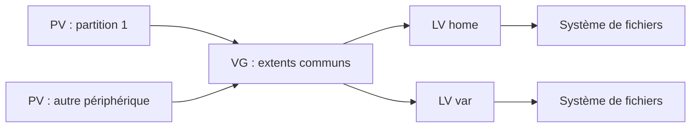

# Module 08 — Gestion des espaces de stockage avancée — LVM

**Cours optimisé — reformulation pédagogique du support et des TP associés.** Les exemples du parcours conservent leur contexte Debian 11 ; les corrections et actualisations sont identifiées comme compléments externes. Les transcriptions intégrales se consultent dans l’onglet Original.
## Objectifs

- Relier volume physique, groupe de volumes et volume logique.
- Ajouter un disque au VG existant et allouer les tailles demandées dans le TP.
- Comparer la capacité du volume logique à celle du système de fichiers.

## Les trois objets LVM

LVM ajoute une couche d’allocation entre les périphériques et les volumes utilisés. Un **PV** (*physical volume*) est un périphérique préparé pour LVM. Plusieurs PV alimentent un **VG** (*volume group*). Dans cet espace, des **LV** (*logical volumes*) reçoivent une capacité allouée. Le système de fichiers du module 9 vient au-dessus d’un LV.

| Niveau | Observer rapidement | Observer en détail | Modifier dans le support |
|---|---|---|---|
| PV | `pvs` | `pvdisplay` | `pvcreate` |
| VG | `vgs` | `vgdisplay` | `vgcreate`, `vgextend` |
| LV | `lvs` | `lvdisplay` | `lvcreate`, `lvextend`, `lvreduce` |

Les capacités sont réparties en unités d’allocation, les extents. L’espace libre du VG et l’espace libre dans un système de fichiers sont deux mesures différentes : `vgs` ne remplace pas `df`.

## Créer et étendre les niveaux

Les commandes suivantes reprennent les noms pédagogiques du support ; elles supposent des partitions de laboratoire identifiées et libres de données à conserver.

```bash
pvcreate /dev/sdb1 /dev/sdb2 /dev/sdc1
vgcreate vggroup1 /dev/sdb1 /dev/sdb2 /dev/sdc1
lvcreate -n lv1 -L 2G vggroup1
lvcreate -n lv2 -L 512M vggroup1
```

`pvcreate` écrit les métadonnées LVM sur les cibles. `vgcreate` crée le groupe ; `lvcreate` consomme une partie de ses extents libres. L’affichage `/dev/vggroup1/lv1` et le chemin sous `/dev/mapper` permettent d’atteindre le LV ; les doubles tirets observés dans certains noms mapper correspondent à l’échappement des tirets du VG/LV.

Pour ajouter le nouveau périphérique de l’exemple :

```bash
pvcreate /dev/sdd
vgextend vggroup1 /dev/sdd
pvs
vgs
```

Un périphérique n’est pas utilisable par le VG simplement parce qu’il apparaît dans `/dev`. La préparation PV puis l’appartenance au VG doivent être vérifiées.

## Agrandir un LV et son système de fichiers

```bash
lvextend -r -L +512M /dev/vggroup1/lv1
lvextend -r -L 1G /dev/vggroup1/lv2
```

Dans le premier cas, `+512M` ajoute une capacité. Dans le second, `1G` fixe la taille cible totale. `-r` demande aussi l’adaptation du système de fichiers, lorsque le type, les outils et l’état le permettent. Examiner le résultat de chaque étape : un LV agrandi avec un système de fichiers inchangé ne fournit pas encore cet espace à ses fichiers.

!!! info "Clarification externe — redimensionnement"
    `-r` ne signifie pas « toujours resize2fs » : l’outil et les contraintes dépendent du système de fichiers. La réduction exige que le système de fichiers soit réduit avant de retirer l’espace du LV ; certaines familles, notamment XFS, ne se réduisent pas. L’agrandissement et la réduction ne sont donc pas des opérations symétriques. Références : [lvextend(8)](https://manpages.debian.org/trixie/lvm2/lvextend.8.en.html), [lvreduce(8)](https://manpages.debian.org/trixie/lvm2/lvreduce.8.en.html).

Le support mentionne `lvreduce` ; ne pas traiter sa syntaxe comme une recette universelle. Les sorties d’exemple comportent aussi des capacités et nombres d’extents qui ne forment pas tous un état mathématique cohérent. Utiliser les sorties actuelles de la VM pour calculer l’espace disponible.

## TP — Ajouter un disque de 40 Go au groupe existant

### Identifier le disque et le groupe

Relever les disques et le VG avant d’ajouter le disque dans l’hyperviseur. Comparer après ajout. Le TP montre `/dev/sdb` et un groupe `vgsystem`. Les noms ci-dessous sont ceux de l’exemple et doivent correspondre à ce que la VM affiche.

```bash
lsblk -o NAME,SIZE,TYPE,FSTYPE,MOUNTPOINT
pvs
vgs
lvs -o vg_name,lv_name,lv_size,devices
```

Si le disque n’apparaît pas, le corrigé relève le contrôleur SCSI avec `udevadm info --query=path --name=sda`, puis rescane le contrôleur identifié. Le numéro `host2` provient de sa capture. Utiliser le numéro relevé dans la VM ou redémarrer la VM du laboratoire.

### Créer la partition et les volumes

1. Sur le **nouveau disque vide seulement**, lancer `sudo fdisk /dev/sdb`. Créer une partition couvrant le disque avec `n`. Choisir le type **Linux LVM** avec `t`. Le code `8e` du support correspond au type LVM d’une table DOS. Avec GPT, choisir par libellé dans la liste. Afficher la table avec `p` avant de l’écrire avec `w`.
2. Vérifier dans `lsblk` que la nouvelle partition est bien celle visée. Ajouter cette partition au VG existant, puis créer `lvvar` avec 20 Go. Contrôler l’espace restant avant de l’allouer à `lvhome`.

```bash
lsblk -o NAME,SIZE,TYPE,FSTYPE,MOUNTPOINT /dev/sdb
sudo pvcreate /dev/sdb1
sudo vgextend vgsystem /dev/sdb1
sudo pvs
sudo vgs
sudo lvcreate -L 20G -n lvvar vgsystem
sudo lvs
sudo vgs
sudo lvextend -l +100%FREE /dev/vgsystem/lvhome
sudo lvs -o vg_name,lv_name,lv_size,devices
sudo vgs
```

`+100%FREE` ajoute l’espace libre du groupe au volume existant. L’état attendu est un nouveau `lvvar`, un `lvhome` agrandi et un VG sans extents libres après l’allocation demandée. La taille affichée par `df -h /home` dépend encore du système de fichiers. Le TP suivant s’en occupe. [Manuel Debian de lvextend](https://manpages.debian.org/bookworm/lvm2/lvextend.8.en.html)

## Schéma explicatif — complément pédagogique



## À retenir

Un PV apporte sa capacité au VG. Les extents du VG sont alloués aux LV. Contrôler le PV, le VG et les LV après chaque étape, puis vérifier séparément le système de fichiers.

## Autoévaluation

1. Quelle commande renseigne l’espace non alloué du groupe ?
2. Que signifie le signe `+` dans `-L +512M` ?
3. Quelle couche faut-il contrôler après l’extension du LV ?
4. Dans quel ordre réaliser l’ajout demandé après le partitionnement ?
5. Pourquoi comparer `lvs` et `df -h /home` ?

??? success "Réponses commentées"
    1. `vgs` ou `vgdisplay`.
    2. Une augmentation, plutôt qu’une taille finale absolue.
    3. Le système de fichiers, puis le montage et la capacité réellement visible.
    4. Créer le PV, ajouter le PV au VG, créer `lvvar`, puis attribuer à `lvhome` les extents restants.
    5. Le premier mesure le volume logique. Le second mesure le système de fichiers monté, dont la taille peut rester inchangée.

## Pour travailler ce module

- [Fiche de révision](../../revision/administration-linux/module-08-gestion-des-espaces-de-stockage-avancee-lvm.md)
- [Travaux pratiques](../../tp/administration-linux/module-08/index.md)
- [Progression du cours](index.md)
