# Module 08 — Gestion des espaces de stockage avancée — LVM

Les parties ci-dessous reprennent le cours original, dans le même ordre. Les encadrés et les schémas répètent ses formulations.

## Parcours de lecture

1. Support · RES24_0050B - M08 - Linux Administration (Debian) · 27 pages transcrites
2. Gestion des espaces de stockage avancée - LVM
3. Gestion des espaces de stockage avancée - LVM
4. LVM : Logical Volume Manager
5. LVM : Logical Volume Manager
6. LVM : Logical Volume Manager
7. Gestion des espaces de stockage avancée - LVM
8. LVM : prérequis
9. Créer des partitions LVM
10. Créer des partitions LVM
11. Créer des partitions LVM
12. Créer des partitions LVM
13. Créer des LVM
14. Gestion des espaces de stockage avancée - LVM
15. Agrandir un Volume Group
16. Créer des partitions LVM
17. Agrandir des LV
18. Modifier des LVM
19. Gestion des espaces de stockage avancée - LVM
20. Afficher les informations LVM
21. Afficher les informations LVM
22. Afficher les informations LVM
23. Afficher les informations LVM
24. Afficher les informations LVM
25. Afficher les informations
26. Gestion des espaces de stockage avancée - LVM
27. Conclusion
28. Énoncé · M08TP01 - Enoncé - Manipuler les disques et LVM · 2 pages transcrites
29. Correction · M08TP01 - Solution - Manipuler les disques et LVM · 2 pages transcrites
30. Transcription des commandes et informations utiles visibles
31. Transcription des commandes et informations utiles visibles
32. Transcription des commandes et informations utiles visibles
33. Transcription des commandes et informations utiles visibles
34. Transcription des commandes et informations utiles visibles
35. Transcription des commandes et informations utiles visibles

**Visuel externe**

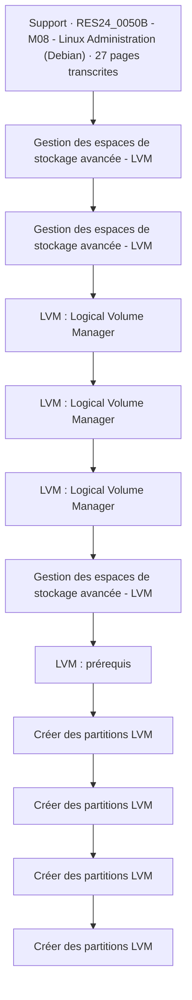

SOURCE DRIVE · TRANSCRIPTION DU SUPPORT

Le contenu des documents du dossier TSSR est transcrit ci-dessous, page par page. Les textes et tableaux sont intégrés à la page Web. Aucun fichier PDF, aucune diapositive entière ni aucune reproduction de page n’est affiché. Seuls des croquis ou visuels isolés et vérifiés peuvent accompagner la transcription. Les versions et les consignes restent celles des supports de formation. Les compléments IA sont conservés dans leur onglet distinct.

## Support · RES24_0050B - M08 - Linux Administration (Debian) · 27 pages transcrites

### Administration Debian

### GNU/Linux

!!! note "À retenir"
    Module 08 – Gestion des espaces de stockage avancée - LVM

Module 08 – Gestion des espaces de stockage avancée - LVM

## Gestion des espaces de stockage avancée - LVM

### Objectifs

!!! note "À retenir"
    Comprendre le fonctionnement de LVM Préparer le stockage pour LVM Créer et modifier des groupes de volumes et volumes logiques Créer des partitions en mode « moderne »

**Visuel externe**

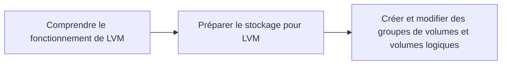

- Comprendre le fonctionnement de LVM
- Préparer le stockage pour LVM
- Créer et modifier des groupes de volumes et volumes logiques

Créer des partitions en mode « moderne »

## Gestion des espaces de stockage avancée - LVM

### Présentation de LVM

## LVM : Logical Volume Manager

!!! note "À retenir"
    Le LVM permet de s’affranchir des limites physiques des périphériques.

**Visuel externe**

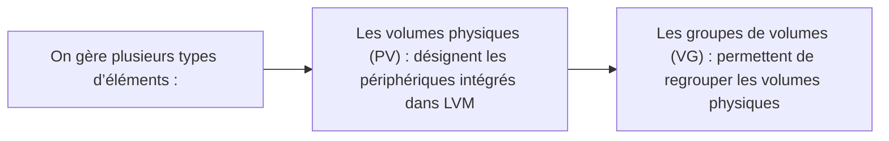

- Le LVM permet de s’affranchir des limites physiques des périphériques. LVM implémente une couche logique pour une gestion plus souple et plus évolutive des volumes de stockage
- On gère plusieurs types d’éléments :
- Les volumes physiques (PV) : désignent les périphériques intégrés dans LVM
- Les groupes de volumes (VG) : permettent de regrouper les volumes physiques
- Les volumes logiques (LV) : désignent les unités définies au sein des groupes de volumes

## LVM : Logical Volume Manager

!!! note "À retenir"
    La création d’un ou plusieurs groupes de volumes sera faite à partir des volumes physiques (partitions) disponibles.

- La création d’un ou plusieurs groupes de volumes sera faite à partir des volumes physiques (partitions) disponibles. Les groupes de volumes seront ensuite découpés en volumes logiques
- Ces volumes logiques pourront alors être utilisés comme n'importe quel volume de stockage ext4 ext4 xfs

/dev/sdb1 /dev/sdc1 PV PV

### VG-System LV-root LV-home LV-var

!!! note "À retenir"
    Transcription du croquis : les PV /dev/sdb1 et /dev/sdc1 alimentent VG-System.

Transcription du croquis : les PV /dev/sdb1 et /dev/sdc1 alimentent VG-System. Ce groupe contient LV-root (ext4), LV-home (ext4) et LV-var (xfs).

## LVM : Logical Volume Manager

!!! note "À retenir"
    Les commandes de gestion s'organisent autour de ces dénominations et respectent toujours la même logique.

!!! example "Exemple"
    Pour la création, on aura par exemple : pvcreate : création des volumes physiques vgcreate : création des groupes de volumes lvcreate : création des volumes logiques Il en sera de même pour toutes les autres directives : display, extend, reduce, remove...

**Visuel externe**

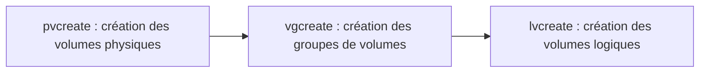

- Les commandes de gestion s'organisent autour de ces dénominations et respectent toujours la même logique. Pour la création, on aura par exemple :
- pvcreate : création des volumes physiques
- vgcreate : création des groupes de volumes
- lvcreate : création des volumes logiques
- Il en sera de même pour toutes les autres directives : display, extend, reduce, remove...

## Gestion des espaces de stockage avancée - LVM

### Créer des LVM

## LVM : prérequis

!!! note "À retenir"
    Définir l'identifiant des partitions à utiliser avec fdisk, utiliser l'ID 8e – Linux LVM :

Définir l'identifiant des partitions à utiliser avec fdisk, utiliser l'ID 8e – Linux LVM :

```
Device 
Boot 
Start End 
blocks Id System
/dev/sdb1 1 
486 
 3903763+ 
 
8e Linux LVM
```

## Créer des partitions LVM

Créer des volumes physiques : pvcreate

```
root@deb:~# pvcreate /dev/sdb1 /dev/sdb2 /dev/sdc1 /dev/sdd
```

/dev/sdb1 /dev/sdb2 PV PV

/dev/sdc1 /dev/sdd PV PV

Transcription du croquis : /dev/sdb1, /dev/sdb2, /dev/sdc1 et /dev/sdd sont préparés comme volumes physiques PV.

## Créer des partitions LVM

Créer des volumes groups : vgcreate

```
root@deb:~# vgcreate vggroup1 /dev/sdb1 /dev/sdb2 /dev/sdc1
```

/dev/sdb1 /dev/sdb2 PV PV

### /dev/sdc1 /dev/sdd PV PV vggroup1

Transcription du croquis : les PV /dev/sdb1, /dev/sdb2 et /dev/sdc1 appartiennent à vggroup1 ; /dev/sdd est encore hors de ce groupe.

## Créer des partitions LVM

Créer des volumes logiques : lvcreate

```
root@deb:~# lvcreate -n lv1 -L 2G vggroup1
root@deb:~# lvcreate -n lv2 -L 512M vggroup1
```

-n : nom du Volume Logique -L : <taille>K|M|G|T|E (Ko, Mo, Go...) vggroup1 lv1 lv2

## Créer des partitions LVM

Il y aura deux chemins possibles pour manipuler le Volume Logiques

```
/dev/vgsystem/lvhome
```

Ou

```
/dev/mapper/vgsystem-lvhome
```

## Créer des LVM

Démo

Créer des LVM

## Gestion des espaces de stockage avancée - LVM

### Modifier des LVM

## Agrandir un Volume Group

Ajouter des volumes physiques au VG : vgextend

```
root@deb:~# vgextend vggroup1 /dev/sdd
```

/dev/sdb1 /dev/sdb2 PV PV

/dev/sdc1 /dev/sdd PV PV

### vggroup1 vggroup1

Transcription du croquis : vgextend ajoute le PV /dev/sdd au groupe vggroup1 déjà constitué.

## Créer des partitions LVM

Agrandir des volumes logiques : lvextend

```
root@deb:~# lvextend -r -L +512M /dev/vggroup1/lv1
root@deb:~# lvextend –r -L 1G /dev/vggroup1/lv2
```

### -r : invoque automatiquement resize2fs -L : [+]<taille>K|M|G|T|E

vggroup1 lv1 lv2 lv1 lv2

Transcription du croquis : les volumes logiques lv1 et lv2 du groupe vggroup1 sont agrandis ; les deux états du dessin représentent avant et après.

## Agrandir des LV

- De la même façon, lvreduce permet de réduire la taille d'un volume logique
- Attention, le système de fichier ne prendra pas en compte automatiquement ces changements. Il faudra forcer un redimensionnement pour pouvoir utiliser tout l'espace
- La commande resize2fs qui permet de redimensionner un système de fichier sera étudiée dans le module suivant

## Modifier des LVM

Démo

Modifier des LVM

## Gestion des espaces de stockage avancée - LVM

### Afficher les informations

## Afficher les informations LVM

**Visuel externe**

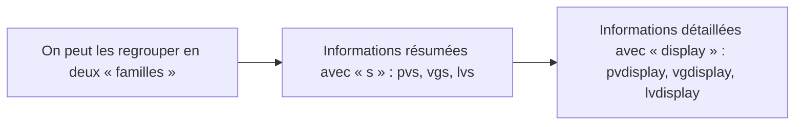

- Plusieurs commandes sont disponibles pour obtenir des informations sur les volumes LVM configurés
- On peut les regrouper en deux « familles »
- Informations résumées avec « s » : pvs, vgs, lvs
- Informations détaillées avec « display » : pvdisplay, vgdisplay, lvdisplay

## Afficher les informations LVM

- Afficher les informations résumées sur tous les groupes de volumes :

```
root@deb:~# vgs
VG  
#PV 
#LV 
#SN 
Attr 
 
VSize  
VFree
vggroup1 
4 
5 
0 
wz--n- 25,76g 22,26g
vggroup2 
1 
1 
0 
wz--n-  
5g 
 
4g
```

- Afficher les informations détaillées sur tous les groupes de volumes :

```
root@deb:~# vgdisplay
```

## Afficher les informations LVM

Afficher les informations détaillées sur un groupe de volumes :

```
root@deb:~# vgdisplay vggroup2
 --- Volume group ---
  VG Name               vggroup2
  System ID             
  Format                lvm2
  [...]
  Cur LV                1
  Cur PV                1
  [...]
  VG Size               5 GiB
  PE Size               4,00 MiB
  Total PE              20480
  Alloc PE / Size       256 / 1 GiB
  Free  PE / Size       20224 / 5056,00 MiB
  VG UUID               sJd23F-75eY-fdsJ-Gp2w-ezfQ-PLy1-jmQjVb
```

## Afficher les informations LVM

- Afficher les informations résumées sur tous les Volumes Logiques :

```
root@deb:~# lvs 
LV   
VG     
Attr
LSize
Pool Origin
lv1  
vggroup1 
-wi-ao---- 
3,50g
lv2  
vggroup1 
-wi-ao---- 
1,00g
```

- Afficher les informations détaillées sur tous les Volumes Logiques :

```
root@deb:~# lvdisplay
```

## Afficher les informations LVM

- Afficher les informations détaillées sur un Volume Logique :

```
root@deb:~# lvdisplay /dev/vggroup1/lv2
--- Logical volume ---
  LV Path                /dev/vggoup1/lv2
  LV Name                lv2
  VG Name                vggroup1
  LV UUID                V2HdqC-zM80-juKd-51QA-A8mp-pYhX-z35OQJ
  LV Write Access        read/write
  [...]
  LV Size                1 GiB
  [...]
```

- Toutes les commandes LVM sont également disponibles dans un shell dédié, accessible avec la commande lvm

## Afficher les informations

Démo

Afficher les informations LVM

## Gestion des espaces de stockage avancée - LVM

### TP

Démo

Manipuler LVM

## Conclusion

- Vous savez préparer des disques et partitions pour LVM
- Vous savez créer et modifier des Volumes Groups
- Vous savez créer et modifier des Logical Volumes

Référence du document : 1fwrqhgRYGwwS8E_s9YPqVx5UNiacC4QZ · SHA-256 8211ee68dbf0cf3b…

## Énoncé · M08TP01 - Enoncé - Manipuler les disques et LVM · 2 pages transcrites

### Manipuler les disques et LVM

TP du Module 08 – Gestion des espaces de stockage avancée - LVM

Avant de démarrer ce TP, il convient d’avoir suivi les vidéos des modules 1 à 8 et d’avoir réalisé les TP proposés.

Durée estimée

15 à 20 minutes

### Énoncé

### I. Gestion des disques sur la station avec environnement graphique

- Ajouter un nouveau disque de 40 Go.
- Vérifier que le disque est bien présent dans /dev
- Créer 1 partition sur le nouveau disque avec fdisk :
- Partition principale de la totalité du disque pour du LVM
- Intégrer la partition au groupe de volume présent dans votre système.
- Créer un volume logique de 20 Go nommé lvvar.
- Agrandir le volume logique lvhome avec le reste de l’espace disponible du groupe de volume.

### II. Astuce

Pour détecter les disques SCSI sans redémarrer :

- Trouver la chaine SCSI qui gère les disques avec la commande :
- # udevadm info --query=path --name=sda
- Ex. résultat : /devices/pci0000:00/0000:00:10.0/host0/target0:0:0/0:0:0:0/block/sda
- Cela veut dire que host0 gère les disques SCSI

- Lancer un scan de la chaine SCSI
- # echo "- - -" > /sys/class/scsi_host/host0/scan
- Solution

Une solution est proposée pour ce TP sous la forme d'un PDF commenté, disponible dans les ressources à télécharger.

Référence du document : 1ANweNsWf8fS0XcMhIuJqw4L6LDzutcmF · SHA-256 d8b1e878a20fb2b3…

## Correction · M08TP01 - Solution - Manipuler les disques et LVM · 2 pages transcrites

Correction originale : à consulter après avoir tenté l’exercice.

### Manipuler les disques et LVM

TP du Module 08 – Gestion des espaces de stockage avancée - LVM

Avant de démarrer ce TP, il convient d’avoir suivi les vidéos des modules 1 à 8 et d’avoir réalisé les TP proposés.

Durée estimée

15 à 20 minutes

### Énoncé

### I. Gestion des disques sur la station avec environnement graphique

- Ajouter un nouveau disque de 40 Go.

→ 1Depuis les paramètres de la VM, créer un nouveau disque, avec les options pas défaut.

- Vérifier que le disque est bien présent dans /dev

Après l'ajout du disque, seul le disque d'origine est listé

En utilisant la commande indiquée en Astuce apparait le host qui gère les disques. Ici host2.

On force ensuite le scan en précisant le host2 indiqué à l’étape précédente

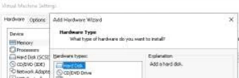

Capture ou visuel isolé du document de formation.

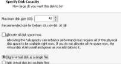

Capture ou visuel isolé du document de formation.

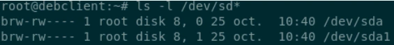

Commande ou détail d’interface isolé du document de formation.

## Transcription des commandes et informations utiles visibles

```
ls -l /dev/sd*
```

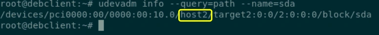

Commande ou détail d’interface isolé du document de formation.

## Transcription des commandes et informations utiles visibles

```
udevadm info --query=path --name=sda
/devices/pci0000:00/0000:00:10.0/host2/target2:0:0/2:0:0:0/block/sda
```

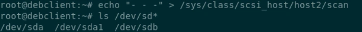

Commande ou détail d’interface isolé du document de formation.

## Transcription des commandes et informations utiles visibles

```
echo "- - -" > /sys/class/scsi_host/host2/scan
ls /dev/sd*
```

- Créer 1 partition sur le nouveau disque avec fdisk :
- Partition principale de la totalité du disque pour du LVM

Lancer fdisk sur /dev/sdb, n pour créer une nouvelle partition. Tous les choix par défaut

L’option t permet de modifier le type de partition en 8e pour “Linux LVM”.

- Intégrer la partition au groupe de volume présent dans votre système.

pvcreate pour declarer la nouvelle partition comme Volume Physique utilisable pour LVM vgextend ajoute ce nouveau Volume Physique au Groupe de Volumes existant.

- Créer un volume logique de 20 Go nommé lvvar.

lvcreate avec l’option -n pour préciser le nom du volume logique

-L permet de préciser la taille du volume Ne pas oublier de préciser le nom du Groupe de Volume cible.

- Agrandir le volume logique lvhome avec le reste de l’espace disponible du groupe de volume.

lvextend avec l’option -l suivi de l’argument “100%FREE” permet d’affecter l’espace libre au volume logique

Avec un LV existant, saisir le chemin complet /dev/<nomduVG>/<nomduLV> d

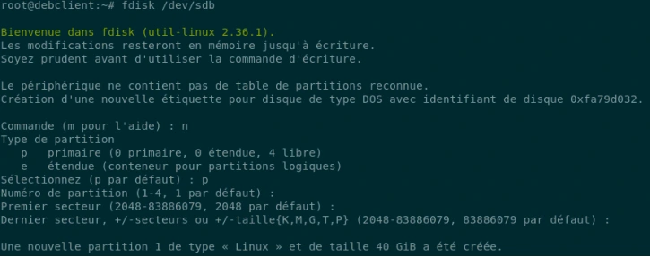

Capture ou visuel isolé du document de formation.

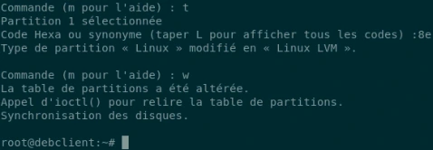

Capture ou visuel isolé du document de formation.

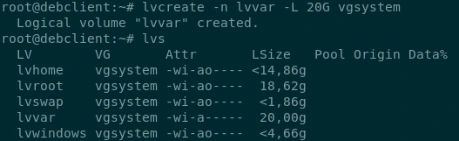

Capture ou visuel isolé du document de formation.

## Transcription des commandes et informations utiles visibles

```
lvcreate -n lvvar -L 20G vgsystem
lvs
```

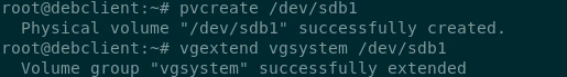

Commande ou détail d’interface isolé du document de formation.

## Transcription des commandes et informations utiles visibles

```
pvcreate /dev/sdb1
vgextend vgsystem /dev/sdb1
```

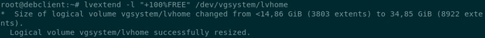

Commande ou détail d’interface isolé du document de formation.

## Transcription des commandes et informations utiles visibles

```
lvextend -l +100%FREE /dev/vgsystem/lvhome
```

Référence du document : 17vtmbV7KvIdKkDDVpPIkV6KiF4Xtzxlr · SHA-256 b9b591720725e783…

## Fiche de synthèse

Les lignes reprennent les titres du cours et la première phrase de chaque partie.

| Partie | Repère du cours |
| --- | --- |
| LVM : Logical Volume Manager | Le LVM permet de s’affranchir des limites physiques des périphériques. |
| LVM : Logical Volume Manager | La création d’un ou plusieurs groupes de volumes sera faite à partir des volumes physiques (partitions) disponibles. |
| LVM : Logical Volume Manager | Les commandes de gestion s'organisent autour de ces dénominations et respectent toujours la même logique. |
| LVM : prérequis | Définir l'identifiant des partitions à utiliser avec fdisk, utiliser l'ID 8e – Linux LVM : |
| Créer des partitions LVM | Créer des volumes physiques : pvcreate /dev/sdb1 /dev/sdb2 PV PV /dev/sdc1 /dev/sdd PV PV Transcription du croquis : /dev/sdb1, /dev/sdb2, /dev/sdc1 et /dev/sdd sont préparés co… |
| Créer des partitions LVM | Créer des volumes groups : vgcreate /dev/sdb1 /dev/sdb2 PV PV |
| Créer des partitions LVM | Créer des volumes logiques : lvcreate -n : nom du Volume Logique -L : <taille>K/M/G/T/E (Ko, Mo, Go...) vggroup1 lv1 lv2 |
| Créer des partitions LVM | Il y aura deux chemins possibles pour manipuler le Volume Logiques Ou |
| Agrandir un Volume Group | Ajouter des volumes physiques au VG : vgextend /dev/sdb1 /dev/sdb2 PV PV /dev/sdc1 /dev/sdd PV PV |
| Créer des partitions LVM | Agrandir des volumes logiques : lvextend |
| Agrandir des LV | De la même façon, lvreduce permet de réduire la taille d'un volume logique Attention, le système de fichier ne prendra pas en compte automatiquement ces changements. |
| Afficher les informations LVM | Plusieurs commandes sont disponibles pour obtenir des informations sur les volumes LVM configurés On peut les regrouper en deux « familles » Informations résumées avec « s » : p… |
| Afficher les informations LVM | Afficher les informations résumées sur tous les groupes de volumes : Afficher les informations détaillées sur tous les groupes de volumes : |
| Afficher les informations LVM | Afficher les informations détaillées sur un groupe de volumes : |
| Afficher les informations LVM | Afficher les informations résumées sur tous les Volumes Logiques : Afficher les informations détaillées sur tous les Volumes Logiques : |
| Afficher les informations LVM | Afficher les informations détaillées sur un Volume Logique : Toutes les commandes LVM sont également disponibles dans un shell dédié, accessible avec la commande lvm |
| Conclusion | Vous savez préparer des disques et partitions pour LVM Vous savez créer et modifier des Volumes Groups Vous savez créer et modifier des Logical Volumes Référence du document : 1… |
| Correction · M08TP01 - Solution - Manipuler les disques et LVM · 2 pages transcrites | Correction originale : à consulter après avoir tenté l’exercice. |
| Transcription des commandes et informations utiles visibles | Commande ou détail d’interface isolé du document de formation. |
| Transcription des commandes et informations utiles visibles | Commande ou détail d’interface isolé du document de formation. |
| Transcription des commandes et informations utiles visibles | Créer 1 partition sur le nouveau disque avec fdisk : Partition principale de la totalité du disque pour du LVM Lancer fdisk sur /dev/sdb, n pour créer une nouvelle partition. |
| Transcription des commandes et informations utiles visibles | Commande ou détail d’interface isolé du document de formation. |
| Transcription des commandes et informations utiles visibles | Commande ou détail d’interface isolé du document de formation. |
| Transcription des commandes et informations utiles visibles | Référence du document : 17vtmbV7KvIdKkDDVpPIkV6KiF4Xtzxlr · SHA-256 b9b591720725e783… |
