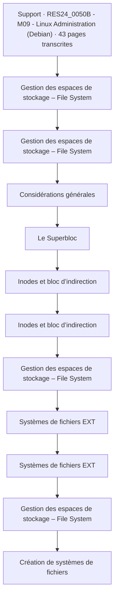
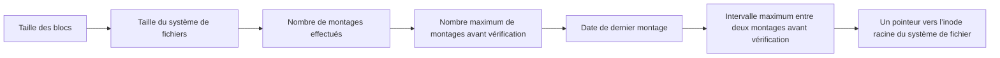

# Module 09 — Gestion des espaces de stockage — File System

[Travaux pratiques](../../tp/administration-linux/module-09/index.md)

Les parties ci-dessous reprennent le cours original, dans le même ordre. Les encadrés et les schémas répètent ses formulations.

## Parcours de lecture

1. Support · RES24_0050B - M09 - Linux Administration (Debian) · 43 pages transcrites
2. Gestion des espaces de stockage – File System
3. Gestion des espaces de stockage – File System
4. Considérations générales
5. Le Superbloc
6. Inodes et bloc d’indirection
7. Inodes et bloc d’indirection
8. Gestion des espaces de stockage – File System
9. Systèmes de fichiers EXT
10. Systèmes de fichiers EXT
11. Gestion des espaces de stockage – File System
12. Création de systèmes de fichiers
13. Création de systèmes de fichiers
14. Création de systèmes de fichiers
15. Modification de systèmes de fichiers
16. Vérification d’un système de fichiers
17. Prise d’information
18. Prise d’information
19. Prise d’information
20. Outils de gestion des systèmes de fichiers
21. Gestion des espaces de stockage – File System
22. Montage d’un système de fichiers
23. Montage manuel avec mount
24. Montage manuel avec mount
25. Montage manuel avec mount
26. Informations sur les montages
27. Informations sur les montages
28. Informations sur les montages
29. Démonter un volume
30. Monter des systèmes de fichiers
31. Gestion des espaces de stockage – File System
32. Montage automatique
33. Montage automatique
34. Montage automatique
35. Montage automatique
36. Montage automatique des systèmes de fichiers
37. Gestion des espaces de stockage – File System
38. Informations sur les systèmes de fichiers
39. Informations sur les systèmes de fichiers
40. Informations sur les systèmes de fichiers
41. Commandes informatives
42. Gestion des espaces de stockage – File System
43. Conclusion
44. Transcription des commandes et informations utiles visibles
45. Transcription des commandes et informations utiles visibles
46. Transcription des commandes et informations utiles visibles
47. Transcription des commandes et informations utiles visibles
48. Transcription des commandes et informations utiles visibles
49. Transcription des commandes et informations utiles visibles
50. Transcription des commandes et informations utiles visibles
51. Transcription des commandes visibles
52. Transcription des commandes et informations utiles visibles
53. Transcription des commandes et informations utiles visibles
54. Transcription des commandes et informations utiles visibles
55. Transcription des commandes et informations utiles visibles
56. Transcription des commandes et informations utiles visibles
57. Transcription des commandes et informations utiles visibles
58. Transcription des commandes et informations utiles visibles
59. Transcription des commandes visibles
60. Transcription des commandes visibles
61. Transcription des commandes visibles
62. Transcription des commandes visibles
63. Transcription des commandes visibles

**Visuel externe**



SOURCE DRIVE · TRANSCRIPTION DU SUPPORT

Le contenu des documents du dossier TSSR est transcrit ci-dessous, page par page. Les textes et tableaux sont intégrés à la page Web. Aucun fichier PDF, aucune diapositive entière ni aucune reproduction de page n’est affiché. Seuls des croquis ou visuels isolés et vérifiés peuvent accompagner la transcription. Les versions et les consignes restent celles des supports de formation. Les compléments IA sont conservés dans leur onglet distinct.

## Support · RES24_0050B - M09 - Linux Administration (Debian) · 43 pages transcrites

### Administration Debian

### GNU/Linux

!!! note "À retenir"
    Module 09 – Gestion des espaces de stockage – File System

Module 09 – Gestion des espaces de stockage – File System

## Gestion des espaces de stockage – File System

### Objectifs

!!! note "À retenir"
    Découvrir des systèmes de fichiers Linux Appliquer des FS sur l’espace de stockage Gérer les systèmes de fichiers Monter les systèmes de fichiers Préparer le stockage à recevoir des données

**Visuel externe**


- Découvrir des systèmes de fichiers Linux
- Appliquer des FS sur l’espace de stockage
- Gérer les systèmes de fichiers
- Monter les systèmes de fichiers

Préparer le stockage à recevoir des données

## Gestion des espaces de stockage – File System

### Considérations générales sur les systèmes de fichiers

## Considérations générales

!!! note "À retenir"
    Tous les systèmes de fichiers de type Unix sont basés sur le même principe et les mêmes éléments élémentaires.

**Visuel externe**


- Tous les systèmes de fichiers de type Unix sont basés sur le même principe et les mêmes éléments élémentaires. Les systèmes de fichiers Unix sont segmentés en blocs de données, actuellement à 4 Ko par défaut
- Chaque bloc pourra avoir différentes structures :
- Superbloc : bloc contenant les informations vitales du système de fichiers
- Inode : bloc contenant les inodes contenant les informations d’un fichier
- Bloc d’indirection : bloc redirigeant vers d’autres blocs (cf. plus loin dans ce chapitre)
- Bloc de données : bloc contenant les données réelles du fichier
- Table des inodes : bloc contenant la liste des blocs d’inodes
- Table des inodes libres : bloc contenant la liste des inodes libres
- Table des blocs libres : bloc contenant la liste des blocs de données libres

## Le Superbloc

!!! note "À retenir"
    Le superbloc contient les informations vitales du système de fichiers.

**Visuel externe**



- Le superbloc contient les informations vitales du système de fichiers. Donc par mesure de sécurité, il est dupliqué à différents endroits du système de fichiers. Il contient les informations suivantes :
- Taille des blocs
- Taille du système de fichiers
- Nombre de montages effectués
- Nombre maximum de montages avant vérification
- Date de dernier montage
- Intervalle maximum entre deux montages avant vérification
- Un pointeur vers l’inode racine du système de fichier

## Inodes et bloc d’indirection

!!! note "À retenir"
    Les inodes sont regroupés par bloc dans un système de fichiers.

**Visuel externe**


- Les inodes sont regroupés par bloc dans un système de fichiers. La taille d’un inode est de 128 octets. Avec des blocs de 4 Ko, il y aura 32 inodes par bloc d’inodes. Un inode contient des informations propres au fichier qu’il représente :
- Type de fichier : -,d,b,c,l,p,s
- Mode ou droit d’accès : en octal, ex : 0644 (rw-r--r--)
- Nombre de liens physiques : si la valeur tombe à zéro, le fichier est considéré comme supprimé.
- UID : propriétaire
- GID : groupe propriétaire

## Inodes et bloc d’indirection

- Taille du fichier : en octets
- Champs date : atime (dernier accès au fichier), ctime (dernier changement des informations de l’inode), mtime (dernier changement de données réelles du fichier)
- 15 adresses : pointant vers les blocs de données réelles du fichier

L’inode ne possède pas le nom du fichier, celui-ci est renseigné dans le répertoire contenant ce fichier.

## Gestion des espaces de stockage – File System

### Systèmes de fichiers

### Linux

## Systèmes de fichiers EXT

- L’ext2, l’ext3 et l’ext4 sont implémentés sur un système Debian
- La différence entre ext2 et ext3 est la journalisation, améliorant la récupération du système de fichier en cas de crash (extinction brutale du PC par exemple)
- Le système de fichier ext4 est une amélioration de l’ext3 mais réécrit de zéro
- ext4 est le système de fichier par défaut sur Debian 10.
- Son avantage est qu’il est peu sujet à la fragmentation grâce à la préallocation des blocs de données contigus

## Systèmes de fichiers EXT

Caractéristiques :

- Taille maximale de fichier : 16 Tio (avec des blocs de 4 Ko)
- Nombre maximal de fichiers : 4 milliards
- Taille maximale du nom de fichier : 255 octets
- Taille maximale de volume : 1 Eio (limité à 16 Tio par e2fsprogs avec des blocs de 4 Ko)
- D’autres systèmes de fichiers sont gérés sous Debian, entre autres : NTFS, FAT
- Il est bien sûr possible d’installer d’autres outils de gestion de systèmes de fichiers comme XFS, Btrfs, etc.

## Gestion des espaces de stockage – File System

### Outils de gestion des

### systèmes de fichiers

## Création de systèmes de fichiers

!!! note "À retenir"
    Le formatage va installer sur un périphérique de stockage un système de fichier.

- Le formatage va installer sur un périphérique de stockage un système de fichier. Sans un système de fichier, le périphérique de stockage est inutilisable
- Un périphérique de stockage peut être une partition (ex: /dev/sdc1) ou un volume logique (ex : /dev/vgsys/lvroot ou /dev/mapper/vgsys-lvhome) ext4 ext4 ext4

### /dev/sdc vgsys lvroot lvhome /dev/sdc1

## Création de systèmes de fichiers

!!! note "À retenir"
    mkfs.[fstype]est une commande simplifiant la mémorisation des commandes de création de systèmes de fichiers.

!!! example "Exemple"
    C’est en fait une fausse commande qui fait appel à la vraie commande de création Exemple : mkfs.ext4 est la commande mke2fs avec des options préconfigurées pour générer de l’ext4 Pour savoir quelle est la commande utilisée par un mkfs.[fstype], il suffit de consulter la commande man mkfs.[fstype]

```
• mkfs.[fstype] <options> [périphérique de stockage]
```

- mkfs.[fstype]est une commande simplifiant la mémorisation des commandes de création de systèmes de fichiers. C’est en fait une fausse commande qui fait appel à la vraie commande de création
- Exemple : mkfs.ext4 est la commande mke2fs avec des options préconfigurées pour générer de l’ext4
- Pour savoir quelle est la commande utilisée par un mkfs.[fstype], il suffit de consulter la commande man mkfs.[fstype]

## Création de systèmes de fichiers

- Création d’un système de fichiers ext4 sur partition /dev/sda2

```
root@deb:~# mkfs.ext4 /dev/sda2
```

- Création d’un système de fichiers ext4 sur volume logique lv1

```
root@deb:~# mkfs.ext4 /dev/vggroup1/lv1
```

- Création d’un système de fichiers NTFS (nécessite le paquet ntfs-3g)

```
root@deb:~# mkfs.ntfs /dev/sde1
```

## Modification de systèmes de fichiers

```
• tune2fs <options> [périphérique de stockage]
```

- tune2fs permet de modifier des options d’un système de fichiers type ext
- Il permet aussi de récupérer les informations du superbloc
- Options usuelles
- -L permet de modifier l’étiquette du système de fichiers
- -l permet d’afficher les informations du superbloc
- -i permet de modifier l’intervalle entre deux vérifications
- -c permet de modifier le nombre maximum de montages déclenchant une vérification

```
• resize2fs <options> [périphérique de stockage]
```

- resize2fs permet de changer la taille d’un système de fichiers

## Vérification d’un système de fichiers

```
• fsck.<fstype> <options> [périphérique de stockage]
```

- La vérification d’un système de fichiers permet de contrôler l’intégrité des données présentes sur celui-ci
- Il est possible de le faire manuellement tout comme il est possible de l’automatiser au démarrage
- Comme pour les commandes de formatage, la vérification peut facilement se faire avec les commandes fsck.<fstype>

## Prise d’information

```
• blkid <options> [périphérique de stockage]
```

- La commande blkid permet d’afficher les informations relatives à un périphérique particulier. Sans argument, elle affichera les informations relatives à tous les périphériques formatés

```
root@deb:~# blkid
/dev/sda1: UUID="32a0cf22-91d5" TYPE="ext2" PARTUUID="732e6aa1-01"
/dev/sda5: UUID="VDfsmc-gci2" TYPE="LVM2_member" PARTUUID="732e6aa1"
/dev/sr0: UUID="2021" LABEL="Deb10" TYPE="iso9660 PTUUID="49506c1e" PTTYPE="dos"
/dev/mapper/vgsys-lvroot: UUID="bffe9183-34a3" TYPE="ext4"
/dev/mapper/vgsys-lvswap_1: UUID="d5d6cc72-21ed" TYPE="swap"
```

## Prise d’information

- lsblk <options> [périphérique de stockage]
- La commande lsblk permet d’afficher sous forme arborescente les informations relatives aux périphériques et aux systèmes de fichiers.

```
root@deb:~# lsblk
NAME                 MAJ:MIN RM  SIZE RO TYPE MOUNTPOINT
sda                    8:0   0   20G  0 disk
├─sda1                 8:1   0  243M  0 part /boot
├─sda2                 8:2   0    1K  0 part
└─sda5                 8:5   0 19,8G  0 part
  ├─vgsys-lvroot     254:0   0 17,8G  0 lvm  /
  └─vgsys-lvswap     254:1   0    2G  0 lvm  [SWAP]
sr0                   11:0   1  3,4G  0 rom  /media/cdrom0
```

## Prise d’information

```
root@deb:~# lsblk -f
NAME 
 
FSTYPE LABEL UUID 
 
 
 
MOUNTPOINT
sda
├─sda1 
 
ext2      
32a0cf22-91d5-548810a16c45 
/boot
├─sda2 
└─sda5 
 
LVM2_member 
VDfsmc-gci2-R5IA-ozNO8x
├─vgsys-lvroot 
ext4 
 
bffe9183-34a3-49d4-b1a4 
 
/
└─vgsys-lvswap 
swap 
 
d5d6cc72-10f5-48e4-bd60 
 
[SWAP]
sdb
└─sdb1 
  
ext4 
HOME 
42237738-92a8-4ddf-9326 
 
/home
sr0  
 
 
 
iso9660 Deb10 2021-02-16 
 
/media/cdrom0
```

## Outils de gestion des systèmes de fichiers

Démo

Les systèmes de fichiers

## Gestion des espaces de stockage – File System

### Monter des systèmes de

### fichiers

## Montage d’un système de fichiers

- Sous un système d’exploitation Linux, comme tout est fichier, la mise à disposition d’un système de fichier venant d’un espace de stockage (partition, LVM, RAID, etc.) se fera en définissant un répertoire comme point de montage
- Ce point de montage sera le chemin par lequel accéder aux données du système de fichier
- Pour un montage temporaire d’un système de fichiers, il est conseillé d’utiliser le répertoire /mnt. S’il faut monter plusieurs systèmes de fichiers de façon temporaire, il est possible de créer des sous-répertoires dans /mnt, pour chacun des systèmes de fichiers

## Montage manuel avec mount

```
• mount <options> [périphérique source] [/point/de/montage]
```

- La commande mount permettra de mettre à disposition un système de fichiers dans un répertoire
- Options possibles :
- -t [fstype] Détermine le type de système de fichiers à monter
- -o [option] Permet de définir différentes options séparées par une virgule
- sync/async Active ou non l’utilisation de la mise en tampon en RAM des données avant écriture dans le système de fichiers. Par défaut : async

## Montage manuel avec mount

- Options possibles suite :
- exec/noexec Active la possibilité d’exécuter des fichiers exécutables présents sur le système de fichiers. Par défaut : exec
- ro/rw Monte le système de fichiers en lecture seule ou en lecture/écriture. Par défaut : rw
- suid/nosuid Active la possibilité d’exécuter les binaires avec l’interprétation du SUID positionné dessus. Par défaut : suid
- remount Permet de changer une ou des options de montage sans démonter le système de fichiers.

## Montage manuel avec mount

```
root@deb:~# ls /mnt
root@deb:~# mount –t ext4 /dev/sdc1 /mnt
root@deb:~# ls /mnt
contacts
liste_taches.txt
preparation 
root@deb:~#
```

```
/
 /bin
 /boot
 /etc
 /mnt
 /var
[...]
```

ext4

/dev/sdc1

## Informations sur les montages

- mount La sortie de mount est faiblement lisible mais permet de savoir facilement les options de montage appliquées

```
root@deb:~# mount
sysfs on /sys type sysfs (rw,nosuid,nodev,noexec,relatime)
[...]
/dev/mapper/vgsys/lvroot on / type ext4 (rw,relatime,errors=remount-
ro,data=ordered)
securityfs on /sys/kernel/security type securityfs 
(rw,nosuid,nodev,noexec,relatime)
tmpfs on /dev/shm type tmpfs (rw,nosuid,nodev)
tmpfs on /run/lock type tmpfs (rw,nosuid,nodev,noexec,relatime,size=5120k)
tmpfs on /sys/fs/cgroup type tmpfs (ro,nosuid,nodev,noexec,mode=755)
[...]
/dev/mapper/vgsys/lvhome on /home type ext4 (rw,relatime,data=ordered)
/dev/sdc1 on /mnt type ext4 (rw,relatime,data=ordered)
/dev/sr0 on /media/cdrom0 type iso9660 (ro,nosuid,nodev,noexec,relatime,user)
```

## Informations sur les montages

- findmnt permet une meilleure lisibilité et surtout de prendre l’information sur un seul point de montage

```
root@deb:~# findmnt
TARGET 
SOURCE  
 
FSTYPE OPTIONS
/ 
 
/dev/mapper/vgsys-lvroot 
ext4 rw,errors=remountro
├─ /sys 
sysfs  
 
 
sysfs rw,nosuid,noexec
│ ├─ /sys/kernel/security securityfs rw,nosuid,nodev,noexec
│ ├─ /sys/fs/cgroup tmpfs  
tmpfs 
[...]
├─ /home 
/dev/mapper/vgsys/lvhome 
ext4 
rw,relatime,data=ordered
├─ /mnt 
/dev/sdc1 
 
 
ext4 
rw,relatime,data=ordered
└─ /media/cdrom0 
/dev/sr0 iso9660 ro,nosuid,nodev,noexec,relatime
```

## Informations sur les montages

Pour voir l’information sur un seul point de montage, il suffit de le cibler :

```
root@deb:~# findmnt /dev/sdc1
TARGET 
SOURCE FSTYPE OPTIONS
 /mnt 
/dev/sdc1 
ext4 
rw,relatime,data=ordered
```

## Démonter un volume

```
• umount [périphérique de stockage] 
```

```
ou
• umount [point de montage] 
```

- À faire par exemple pour retirer une clé USB ou disque externe
- Attention, il ne faudra pas qu’un utilisateur utilise le volume monté pour permettre sa déconnexion.

```
root@deb:~# umount /mnt
```

## Monter des systèmes de fichiers

Démo

Montage manuel

## Gestion des espaces de stockage – File System

### Montage automatique des systèmes de fichiers

## Montage automatique

Les montages automatiques sont effectués par systemd au tout début du démarrage du système d’exploitation. La déclaration des montages automatiques est présente dans le fichier /etc/fstab.

```
# /etc/fstab: static file system information.
# <file system>              <mount point> <type>      <options>          <dump> <pass>
/dev/mapper/vgsys-lvroot     /             ext4        errors=remount-ro  0      1
# /boot was on /dev/sda1 during installation
UUID=32a0cf22-548810a16c45    /boot         ext2        defaults           0      2
/dev/vgsys/lvhome            /home         ext4        defaults           0      2
/dev/mapper/vgsys-lvswap     none          swap        sw                 0      0
/dev/sr0                    /media/cdrom0  udf,iso9660 user,noauto        0      0
```

## Montage automatique

- La section <file system> :
- Cette colonne déclare le système à monter. Cette source peut être exprimée de plusieurs façons :
- Via un UUID, la façon la plus sécurisée mais humainement plus difficile à reconnaître
- Via le LABEL, humainement plus pratique que l’UUID mais il pose un problème en cas de doublon
- Via le chemin du périphérique, on l’utilise principalement pour les LVM car il n’est pas possible d’avoir plusieurs volumes LVM avec le même nom sur un système
- Il est fortement déconseillé de l’utiliser pour des partitions (ex : /dev/sdb1)
- La section <mount point> :
- Cette colonne déclare le répertoire de montage du système de fichiers

## Montage automatique

- La section <type> :
- Cette colonne déclare le type de système de fichiers. Il est possible de mettre auto mais cela ralentit le montage des périphériques
- La section <options> :
- Cette colonne déclare les options de montage. Il est possible de mettre defaults
- Les options dans defaults sont : async,nouser,exec,rw,auto,suid,dev
- La section <dump> :
- Cette colonne est très faiblement utilisée. Elle correspond à des paramètres de configuration de la commande dump
- La section <pass> :
- Cette section permet de savoir si le système doit analyser l’intégrité du système de fichiers afin de corriger les problèmes avant de le monter. (commande fsck)
- Si la valeur est à 0 : pas de vérification, si elle est supérieure à 0 alors le système analysera les systèmes de fichiers (1 pour la racine, 2 pour les autres)

## Montage automatique

- Afin de garantir la bonne intégration d’une nouvelle ligne dans le fichier /etc/fstab, il est important de la tester avant le redémarrage du poste. Le moyen le plus simple est d’utiliser la commande mount en ne précisant que le point de montage

```
root@deb:~# mount /srv/data
mount: impossible de trouver /srv/data dans /etc/fstab
```

- Dans cet exemple, la commande indique qu’elle ne trouve pas d’entrée de /srv/data dans le fstab
- Dans le cas où une ligne indique /srv/data dans le fichier fstab alors le montage se fera par rapport aux différentes déclarations
- Si la commande ne renvoie rien, c’est que le montage s’est correctement effectué

## Montage automatique des systèmes de fichiers

Démo

Montage automatique

## Gestion des espaces de stockage – File System

### Commandes

### informatives

## Informations sur les systèmes de fichiers

- Nous avons déjà utilisé les commandes informatives suivantes :
- blkid permet de récupérer les informations sur les disques, partitions et volumes logiques LVM
- lsblk va donner un affichage plus hiérarchisé de ces mêmes informations
- findmnt offre un affichage hiérarchisé des systèmes de fichiers montés

## Informations sur les systèmes de fichiers

```
• df <options> [/point/de/montage]
```

- La commande df permet de prendre des informations utiles sur les systèmes de fichiers montés
- Options usuelles :
- -h : affiche la taille en puissance de 1024 (K,M,G…)
- -i : affiche les informations sur les inodes

```
root@deb:~# df -h
Sys. de fichiers 
 
 
Taille Utilisé Dispo  Uti% Monté sur
udev 
 
 
 
982M 
0 
  982M  0% 
/dev
tmpfs 
 
 
 
199M 
22M 
  178M 11% 
/run
/dev/mapper/vgsys-lvroot 18G 
4,3G 
  13G 26% 
/
[...]
```

## Informations sur les systèmes de fichiers

- La commande ls -l ne permet pas de connaître la taille d’un répertoire. En effet, elle remonte juste la taille utilisée par l’inode du répertoire et non son contenu. Pour connaître la taille d’un répertoire, il faut utiliser la commande du du <options> [/point/de/montage]
- Options usuelles :
- -h : affiche la taille en puissance de 1024 (K,M,G…)
- -s : n’affiche pas les sous-répertoires mais uniquement le répertoire en argument

```
root@deb:~# du –hs /etc
6,9M 
 
/etc
```

## Commandes informatives

Démo

Prises d’informations sur les FS

## Gestion des espaces de stockage – File System

### TP

Démo

Préparation des systèmes de fichiers

## Conclusion

- Vous savez créer et manipuler des systèmes de fichiers Linux
- Vous savez monter ceux-ci en manuel
- Vous savez automatiser un montage au démarrage du système d’exploitation

Référence du document : 1TlaOKZJHK1_lEreDfvYwVcqS1E1OIWGi · SHA-256 d5eaf406b6ddc10d…

| Considérations générales | Tous les systèmes de fichiers de type Unix sont basés sur le même principe et les mêmes éléments élémentaires. |
| Le Superbloc | Le superbloc contient les informations vitales du système de fichiers. |
| Inodes et bloc d’indirection | Les inodes sont regroupés par bloc dans un système de fichiers. |
| Inodes et bloc d’indirection | Taille du fichier : en octets Champs date : atime (dernier accès au fichier), ctime (dernier changement des informations de l’inode), mtime (dernier changement de données réelle… |
| Systèmes de fichiers EXT | L’ext2, l’ext3 et l’ext4 sont implémentés sur un système Debian La différence entre ext2 et ext3 est la journalisation, améliorant la récupération du système de fichier en cas d… |
| Systèmes de fichiers EXT | Caractéristiques : Taille maximale de fichier : 16 Tio (avec des blocs de 4 Ko) Nombre maximal de fichiers : 4 milliards Taille maximale du nom de fichier : 255 octets Taille ma… |
| Création de systèmes de fichiers | Le formatage va installer sur un périphérique de stockage un système de fichier. |
| Création de systèmes de fichiers | mkfs.[fstype]est une commande simplifiant la mémorisation des commandes de création de systèmes de fichiers. |
| Création de systèmes de fichiers | Création d’un système de fichiers ext4 sur partition /dev/sda2 Création d’un système de fichiers ext4 sur volume logique lv1 Création d’un système de fichiers NTFS (nécessite le… |
| Modification de systèmes de fichiers | tune2fs permet de modifier des options d’un système de fichiers type ext Il permet aussi de récupérer les informations du superbloc Options usuelles -L permet de modifier l’étiq… |
| Vérification d’un système de fichiers | La vérification d’un système de fichiers permet de contrôler l’intégrité des données présentes sur celui-ci Il est possible de le faire manuellement tout comme il est possible d… |
| Prise d’information | La commande blkid permet d’afficher les informations relatives à un périphérique particulier. |
| Prise d’information | lsblk <options> [périphérique de stockage] La commande lsblk permet d’afficher sous forme arborescente les informations relatives aux périphériques et aux systèmes de fichiers. |
| Montage d’un système de fichiers | Sous un système d’exploitation Linux, comme tout est fichier, la mise à disposition d’un système de fichier venant d’un espace de stockage (partition, LVM, RAID, etc.) se fera e… |
| Montage manuel avec mount | La commande mount permettra de mettre à disposition un système de fichiers dans un répertoire Options possibles : -t [fstype] Détermine le type de système de fichiers à monter -… |
| Montage manuel avec mount | Options possibles suite : exec/noexec Active la possibilité d’exécuter des fichiers exécutables présents sur le système de fichiers. |
| Informations sur les montages | mount La sortie de mount est faiblement lisible mais permet de savoir facilement les options de montage appliquées |
| Informations sur les montages | findmnt permet une meilleure lisibilité et surtout de prendre l’information sur un seul point de montage |
| Informations sur les montages | Pour voir l’information sur un seul point de montage, il suffit de le cibler : |
| Démonter un volume | À faire par exemple pour retirer une clé USB ou disque externe Attention, il ne faudra pas qu’un utilisateur utilise le volume monté pour permettre sa déconnexion. |
| Montage automatique | Les montages automatiques sont effectués par systemd au tout début du démarrage du système d’exploitation. |
| Montage automatique | La section <file system> : Cette colonne déclare le système à monter. |
| Montage automatique | La section <type> : Cette colonne déclare le type de système de fichiers. |
| Montage automatique | Afin de garantir la bonne intégration d’une nouvelle ligne dans le fichier /etc/fstab, il est important de la tester avant le redémarrage du poste. |
| Informations sur les systèmes de fichiers | Nous avons déjà utilisé les commandes informatives suivantes : blkid permet de récupérer les informations sur les disques, partitions et volumes logiques LVM lsblk va donner un… |
| Informations sur les systèmes de fichiers | La commande df permet de prendre des informations utiles sur les systèmes de fichiers montés Options usuelles : -h : affiche la taille en puissance de 1024 (K,M,G…) -i : affiche… |
| Informations sur les systèmes de fichiers | La commande ls -l ne permet pas de connaître la taille d’un répertoire. |
| Conclusion | Vous savez créer et manipuler des systèmes de fichiers Linux Vous savez monter ceux-ci en manuel Vous savez automatiser un montage au démarrage du système d’exploitation Référen… |
| Transcription des commandes et informations utiles visibles | Capture ou visuel isolé du document de formation. |
| Transcription des commandes et informations utiles visibles | Commande ou détail d’interface isolé du document de formation. |
| Transcription des commandes et informations utiles visibles | Commande ou détail d’interface isolé du document de formation. |
| Transcription des commandes et informations utiles visibles | Commande ou détail d’interface isolé du document de formation. |
| Transcription des commandes et informations utiles visibles | Commande ou détail d’interface isolé du document de formation. |
| Transcription des commandes et informations utiles visibles | Détail de la procédure du laboratoire, isolé et vérifié. |
| Transcription des commandes visibles | La commande findmnt affiche bien l'utilisation de /mnt/var comme point de montage pour lvvar Copier les données en préservant les permissions Les options utiles de la commande c… |
| Transcription des commandes et informations utiles visibles | Commande ou détail d’interface isolé du document de formation. |
| Transcription des commandes et informations utiles visibles | Commande ou détail d’interface isolé du document de formation. |
| Transcription des commandes et informations utiles visibles | Commande ou détail d’interface isolé du document de formation. |
| Transcription des commandes et informations utiles visibles | Commande ou détail d’interface isolé du document de formation. |
| Transcription des commandes et informations utiles visibles | Commande ou détail d’interface isolé du document de formation. |
| Transcription des commandes et informations utiles visibles | Commande ou détail d’interface isolé du document de formation. |
| Transcription des commandes et informations utiles visibles | Détail de la procédure du laboratoire, isolé et vérifié. |
| Transcription des commandes visibles | Détail de la procédure du laboratoire, isolé et vérifié. |
| Transcription des commandes visibles | Détail de la procédure du laboratoire, isolé et vérifié. |
| Transcription des commandes visibles | On défait le montage manuel qui avait été fait sur /var On relance le montage de /var, mais ce coup-ci sans options ni autre argument, ce qui implique la lecture des information… |
| Transcription des commandes visibles | Détail de la procédure du laboratoire, isolé et vérifié. |
