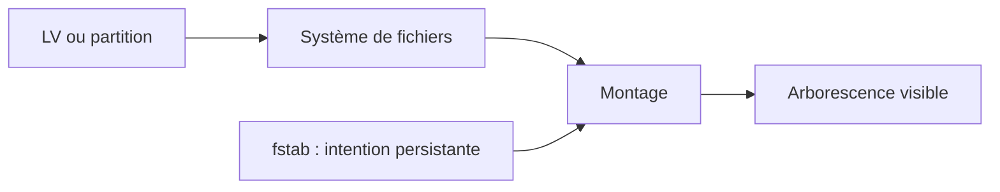

# Module 09 — Gestion des espaces de stockage — File System

**Cours optimisé — reformulation pédagogique du support et des TP associés.** Les exemples du parcours conservent leur contexte Debian 11 ; les corrections et actualisations sont identifiées comme compléments externes. Les transcriptions intégrales se consultent dans l’onglet Original.
## Objectifs

- Identifier, formater et agrandir les systèmes de fichiers du TP.
- Préparer une copie stable de `/var` et vérifier ses données et attributs.
- Déclarer le montage, tester sa persistance et prévoir un retour arrière.

## Du volume aux fichiers

Le système de fichiers organise les données, les répertoires et leurs métadonnées sur un volume. Le support utilise les notions de blocs, d’inodes et d’entrées de répertoire. Un nom dans un répertoire renvoie à un inode ; l’inode décrit notamment type, propriétaire, droits, dates et références aux données. Le nom du fichier ne réside pas simplement dans l’inode.

Le nombre de liens physiques renseigne les entrées qui désignent un même inode. La place n’est pas nécessairement rendue dès que le dernier nom disparaît : un processus peut conserver le fichier ouvert. Cette précision explique les divergences possibles entre fichiers visibles et occupation du disque.

## Dates et familles de systèmes de fichiers

| Date | Sens |
|---|---|
| `atime` | Accès, selon les options et la politique de mise à jour |
| `mtime` | Modification du contenu |
| `ctime` | Modification de l’état / métadonnées de l’inode, pas date de création |

Le support compare ext2 sans journal, ext3 avec journal et ext4, puis les formats utilisables pour des échanges avec d’autres systèmes. Une journalisation facilite la cohérence après incident ; elle n’est ni une sauvegarde ni une garantie que toute écriture applicative a atteint le disque.

!!! info "Clarification externe — valeurs historiques"
    La taille d’inode de 128 octets et les limites des systèmes de fichiers du support ne sont pas des constantes applicables à tous les volumes. Les paramètres dépendent du format et de sa création ; ext4 est une évolution de la famille ext, pas un format sans lien avec ext3. Références : [ext4(5)](https://manpages.debian.org/trixie/e2fsprogs/ext4.5.en.html) et [inode(7)](https://manpages.debian.org/trixie/manpages/inode.7.en.html).

## Identifier avant de formater

```bash
lsblk -f
blkid
findmnt
```

`lsblk -f` relie périphériques, types de systèmes de fichiers, étiquettes et montages. `blkid` lit des identifiants ; `findmnt` décrit les montages effectifs. Comparer ces trois vues avec LVM avant de viser un LV. **Formater remplace les structures du système de fichiers ciblé** : vérifier son identité et les données à préserver.

```bash
mkfs.ext4 -L VAR /dev/vggroup1/lvvar
tune2fs -l /dev/vggroup1/lvvar
tune2fs -L VAR /dev/vggroup1/lvvar
```

Le premier exemple crée un ext4 avec étiquette ; le troisième change l’étiquette d’un ext existant. Ce ne sont pas des opérations équivalentes. `mkfs.ntfs`, également cité, suppose les outils correspondants disponibles. `tune2fs` peut examiner ou régler les paramètres ext, dont les intervalles de contrôle ; il ne s’utilise pas comme outil universel pour tous les formats.

## Agrandir et vérifier

`resize2fs` adapte les systèmes ext compatibles. Dans le TP, il permet à home d’utiliser la capacité de LV ajoutée au module 8. S’il a déjà été adapté par une extension `-r`, aucun agrandissement supplémentaire n’est nécessaire. `fsck` est une famille de vérificateurs : choisir le bon outil et l’état de montage requis, généralement démonté pour une réparation. Ne pas réparer à l’aveugle un système de fichiers monté en écriture.

## Monter et démonter

```bash
mount -t ext4 /dev/vggroup1/lvvar /mnt/var
findmnt /mnt/var
umount /mnt/var
```

Créer auparavant le point de montage. Monter un volume sur un répertoire masque temporairement le contenu auparavant visible sous ce répertoire ; cela ne le copie pas et ne le supprime pas. Une erreur « occupé » au démontage demande d’identifier les processus ou répertoires courants concernés.

Le support décrit `ro/rw`, `exec/noexec`, `suid/nosuid`, `sync/async` et `remount`. Ces options affectent le montage ; leur choix doit correspondre à l’usage. `remount` modifie un montage existant et ne remplace pas un premier montage.

## Déclarer un montage durable

`/etc/fstab` comporte six champs : source, point de montage, type, options, champ dump et ordre de vérification. La source peut être un chemin, `UUID=` ou `LABEL=`. L’UUID est généralement plus stable que l’ordre `/dev/sdX`, mais un clone peut dupliquer un identifiant : vérifier le volume réel.

```text
LABEL=VAR  /var  ext4  defaults  0  2
```

Cette entrée reprend le principe du TP, avec une étiquette unique sur la machine. Les options `defaults` regroupent des comportements comme lecture-écriture, montage automatique et exécution ; elles ne constituent pas une politique adaptée à tous les usages. Tester `mount /var`, puis `findmnt /var`, avant de compter sur le prochain démarrage. Le test lit l’entrée fstab au lieu de répéter tous les paramètres manuellement.

## TP — Migrer /var en conservant les données

### Préparer les systèmes de fichiers

Dans la VM de formation, prendre le snapshot demandé avant toute modification. Identifier le volume `lvvar` créé au module 08 et le type du système de fichiers de `/home`. Le formatage ci-dessous s’applique uniquement au nouveau `lvvar` vide. Le TP agrandit le système de fichiers de `lvhome` séparément et suppose ext4.

```bash
lsblk -f
sudo lvs
findmnt --mountpoint /home
sudo mkfs.ext4 -L VAR /dev/vgsystem/lvvar
sudo blkid /dev/vgsystem/lvvar
sudo resize2fs /dev/vgsystem/lvhome
df -hT /home
```

Si `resize2fs` indique que le système de fichiers occupe déjà tout le volume, relever le message et les tailles. Vérifier le label `VAR` avec `blkid`. [Manuel Debian de resize2fs](https://manpages.debian.org/bookworm/e2fsprogs/resize2fs.8.en.html)

### Copier à partir d’un état stable

1. Relever les processus qui utilisent `/var`. Passer en secours depuis la console de la VM, puis s’assurer que les services concernés n’écrivent plus dans cette arborescence. Arrêter uniquement les unités identifiées si le mode secours ne suffit pas.
2. Monter `lvvar` dans un répertoire de travail et vérifier la source avant la copie. Copier le contenu avec `/var/.` pour inclure les entrées masquées. Contrôler les répertoires, fichiers et attributs attendus avant de démonter le montage provisoire.

```bash
sudo lsof | grep '/var/'
sudo mkdir -p /mnt/var
sudo mount -t ext4 /dev/vgsystem/lvvar /mnt/var
findmnt --mountpoint /mnt/var
sudo cp -a -- /var/. /mnt/var/
sudo du -xsh /var /mnt/var
sudo ls -ld /var/log /mnt/var/log
sudo umount /mnt/var
```

La présence des mêmes dossiers et de tailles proches aide à contrôler la copie. Vérifier aussi quelques fichiers et leurs propriétaires. L’ancien contenu de `/var` demeure sur le système de fichiers racine après le montage par-dessus.

### Valider le montage définitif

Sauvegarder `/etc/fstab`. Dans la VM, ajouter l’entrée demandée en vérifiant que le label est unique. Le sixième champ indique un contrôle au démarrage après la racine.

```fstab
LABEL=VAR  /var  ext4  defaults  0  2
```

En mode secours, valider le fichier et tester le montage avant de redémarrer.

```bash
sudo findmnt --verify
sudo mount /var
findmnt --mountpoint /var
df -hT /var
ls -ld /var/log
```

Revenir à la cible habituelle, vérifier qu’un service du scénario écrit dans son journal, puis vérifier le montage après redémarrage. En cas d’échec, revenir en secours, arrêter les écritures, restaurer le fichier `fstab` sauvegardé et démonter le nouveau `/var`. Le contenu précédent redevient alors visible. Si l’état de la VM est incertain, revenir au snapshot. [Manuel Debian de fstab](https://manpages.debian.org/bookworm/mount/fstab.5.en.html) · [Manuel de findmnt](https://manpages.debian.org/bookworm/util-linux/findmnt.8.en.html)

## Mesurer l’espace

```bash
df -h
df -i
du -sh /etc
```

`df` renseigne le système de fichiers, `df -i` ses inodes et `du` l’espace des objets parcourus. La taille affichée par `ls -l` pour un répertoire n’est pas la taille récursive de ses contenus, ni la taille de son inode. Des fichiers supprimés encore ouverts, les métadonnées et les permissions de parcours peuvent expliquer des écarts.

## Schéma explicatif — complément pédagogique



## À retenir

L’agrandissement d’un LV et celui de son système de fichiers sont deux actions. Une migration de `/var` exige des écritures arrêtées, un montage temporaire vérifié et un test avant redémarrage.

## Autoévaluation

1. Monter un volume sur `/var` copie-t-il l’ancien contenu ?
2. `ctime` indique-t-il la création du fichier ?
3. Quelle commande observe les inodes disponibles ?
4. Pourquoi utiliser `/var/.` comme source de copie dans l’atelier ?
5. Quel enchaînement valide l’entrée `fstab` avant de relancer les services ?

??? success "Réponses commentées"
    1. Non ; la migration nécessite une copie et une phase de validation.
    2. Non, c’est la modification de l’état de l’inode.
    3. `df -i`.
    4. La copie prend le contenu du répertoire, y compris les entrées cachées, vers le système de fichiers monté temporairement.
    5. Vérifier le fichier avec `findmnt --verify`, monter `/var`, puis vérifier avec `findmnt --mountpoint /var` que la source et le type sont ceux attendus.

## Pour travailler ce module

- [Fiche de révision](../../revision/administration-linux/module-09-gestion-des-espaces-de-stockage-file-system.md)
- [Travaux pratiques](../../tp/administration-linux/module-09/index.md)
- [Progression du cours](index.md)
