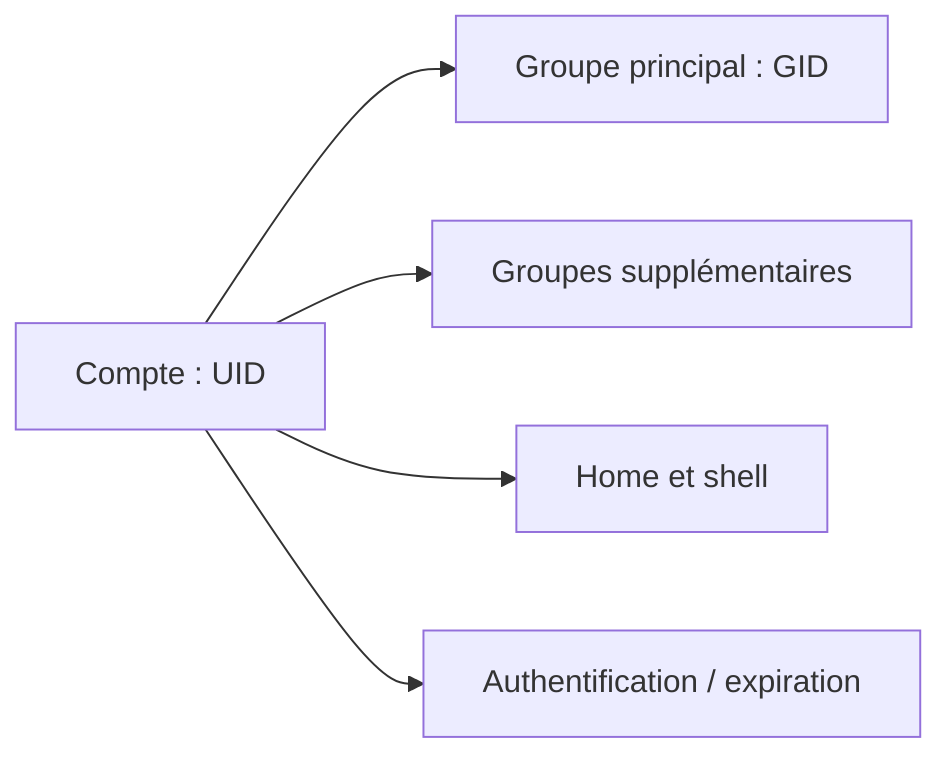

# Module 10 — Gestion des utilisateurs et groupes

**Cours optimisé — reformulation pédagogique du support et des TP associés.** Les exemples du parcours conservent leur contexte Debian 11 ; les corrections et actualisations sont identifiées comme compléments externes. Les transcriptions intégrales se consultent dans l’onglet Original.
## Identités et groupes

Linux contrôle les identités à partir d’identifiants numériques. L’**UID** identifie l’utilisateur ; le **GID** représente un groupe. Un compte possède un groupe principal et peut appartenir à plusieurs groupes supplémentaires. Le nom est une résolution lisible de ces nombres : renommer un compte ne change pas automatiquement l’UID propriétaire des fichiers.

Root possède l’UID 0. Les comptes système sont utilisés par des services, tandis que les comptes de connexion permettent l’usage interactif. Le support utilise les plages Debian usuelles, mais ses formules « humains > 1000 » et « 99 % des services » sont trop générales : l’allocation se règle dans la configuration et un premier compte peut précisément avoir l’UID 1000.

```bash
id
id francois
getent passwd francois
getent group documentation
```

`getent`, ajouté ici comme contrôle pratique, consulte la résolution configurée ; elle peut aller au-delà des seuls fichiers locaux.

## Les quatre fichiers locaux

| Fichier | Champs essentiels du support | Rôle |
|---|---|---|
| `/etc/passwd` | login, marqueur de mot de passe, UID, GID, commentaire, home, shell | Définition des comptes |
| `/etc/shadow` | login, hash, dernier changement, âges, avertissement, inactivité, expiration, réservé | Authentification et vieillissement |
| `/etc/group` | nom, marqueur de mot de passe, GID, membres supplémentaires | Définition des groupes |
| `/etc/gshadow` | nom, mot de passe, administrateurs, membres | Informations protégées des groupes |

Dans les TP, utiliser les commandes dédiées plutôt qu’éditer ces fichiers. Un `x` dans passwd renvoie à shadow. La liste de membres de group ne permet pas, seule, de déduire tous les utilisateurs dont le groupe principal porte ce GID.

!!! info "Correction externe — exemples de fichiers"
    La capture intitulée `/etc/gshadow` dans le support reproduit en réalité la structure à neuf champs de shadow ; gshadow a quatre champs. L’exemple passwd attribue aussi un même UID à deux noms : ce n’est pas un modèle à reproduire. Les formats exacts sont décrits dans [gshadow(5)](https://manpages.debian.org/trixie/passwd/gshadow.5.en.html) et [passwd(5)](https://manpages.debian.org/trixie/passwd/passwd.5.en.html).

## Gérer les groupes

```bash
groupadd -g 1500 informatique
groupmod -n exploitation informatique
gpasswd -a francois documentation
gpasswd -d francois documentation
```

`groupadd -g` choisit le GID. `groupmod -n` renomme ; `groupmod -g` change le numéro et impose de vérifier les fichiers qui restent associés à l’ancien GID. Une suppression de groupe ne supprime pas automatiquement les fichiers qu’il possédait.

La restriction usuelle de `groupdel` porte sur le groupe principal d’utilisateurs existants, pas sur la nécessité de retirer toute appartenance secondaire comme l’affirme le support. Ne pas utiliser une option de forçage pour contourner la compréhension de ces références. Référence externe : [groupdel(8)](https://manpages.debian.org/trixie/passwd/groupdel.8.en.html).

## Créer et modifier les utilisateurs

| Option | Commande | Rôle |
|---|---|---|
| `-m` | useradd | Créer le home et initialiser avec `/etc/skel` selon la configuration |
| `-d` | useradd/usermod | Chemin du home ; avec usermod, `-m` demande aussi son déplacement |
| `-u` | useradd/usermod | UID |
| `-g` | useradd/usermod | Groupe principal |
| `-G` | useradd/usermod | Liste de groupes supplémentaires |
| `-aG` | usermod | Ajouter des groupes sans remplacer les appartenances existantes |
| `-s` | useradd/usermod | Shell |
| `-r` | useradd | Compte système |
| `-e`, `-f` | usermod | Expiration du compte, délai d’inactivité après expiration du mot de passe |
| `-L`, `-U` | usermod | Verrouiller/déverrouiller le mot de passe |

```bash
useradd -m -s /bin/sh -g admin -G stagiaires,documentation francois
usermod -aG documentation francois
passwd francois
```

Créer les groupes avant les comptes qui les utilisent. Vérifier l’identité, le home et les appartenances, puis tester une nouvelle session : les processus déjà ouverts ne récupèrent pas nécessairement de nouveaux groupes. Debian recommande aussi son outil de plus haut niveau `adduser` ; le cours conserve `useradd` pour apprendre ses options. Référence externe : [useradd(8)](https://manpages.debian.org/trixie/passwd/useradd.8.en.html).

## Mot de passe, expiration et suppression

`passwd` change le secret, `passwd -e utilisateur` force son renouvellement à la prochaine authentification concernée, `passwd -l` verrouille l’authentification par mot de passe et `passwd -u` la déverrouille. **Verrouiller le mot de passe n’interdit pas à lui seul toute autre méthode d’accès.** Le TP désactive aussi le compte Fabrice par expiration ; distinguer ces deux effets.

Shadow enregistre des paramètres temporels en jours, notamment à partir de l’époque Unix pour certaines dates. Le hash contient des indications d’algorithme et de sel selon son format ; les exemples historiques MD5/SHA du support ne constituent pas un choix moderne à imposer. Un hash de mot de passe ne se « déchiffre » pas : on compare des dérivations, et le sel rend deux mots de passe identiques moins facilement corrélables.

`userdel utilisateur` supprime le compte ; `userdel -r utilisateur` traite aussi son home et sa boîte locale selon la commande. Les fichiers situés ailleurs doivent être recherchés et pris en charge séparément. La syntaxe « nom du groupe » écrite dans le support pour userdel est une coquille.

## Changer d’identité et déléguer

`su - utilisateur` ouvre un environnement de connexion de l’utilisateur cible ; `su -c 'commande' utilisateur` lance une commande. L’authentification dépend de PAM et des droits courants ; le cas ordinaire du support demande le secret de la cible. `sudo commande` applique une délégation configurée, généralement avec le mot de passe de l’appelant.

La source montre l’appartenance au groupe sudo et `sudo -i`. La durée de mémorisation n’est pas une constante de cinq minutes : elle dépend de la configuration. Examiner les autorisations avec `sudo -l` ; administrer les règles avec les outils appropriés, tels que `visudo`, plutôt qu’éditer à l’aveugle une règle. Référence externe : [sudoers(5)](https://manpages.debian.org/trixie/sudo-ldap/sudoers.5.en.html).

## Application au TP

Créer admin, stagiaires, documentation et vip si nécessaires. François utilise sh, le groupe principal admin et les groupes stagiaires/documentation. Frédéric utilise bash et les mêmes groupes supplémentaires ; son mot de passe doit expirer à la première connexion. Fabrice utilise bash et vip, avec compte désactivé. Les mots de passe faibles de la source sont des valeurs de laboratoire ; saisir les secrets avec `passwd` plutôt que les placer dans une ligne conservée par l’historique.

Le corrigé évoque `/home/fred`, tandis que l’énoncé demande `/home/frederic` : suivre l’énoncé et signaler cette divergence dans le compte rendu. Tester les comptes et les groupes au lieu de seulement constater que useradd n’a rien affiché.

## Schéma explicatif — complément pédagogique



## Autoévaluation

1. Pourquoi préférer `usermod -aG` pour ajouter une appartenance ?
2. Verrouiller le mot de passe suffit-il toujours à désactiver un compte ?
3. Combien de champs comporte gshadow ?

??? success "Réponses"
    1. `-G` seul remplace la liste des groupes supplémentaires.
    2. Non ; expiration et autres méthodes d’authentification doivent être considérées.
    3. Quatre.

## Pour travailler ce module

- [Fiche de révision](../../revision/administration-linux/module-10-gestion-des-utilisateurs-et-groupes.md)
- [Travaux pratiques](../../tp/administration-linux/module-10/index.md)
- [Progression du cours](index.md)
