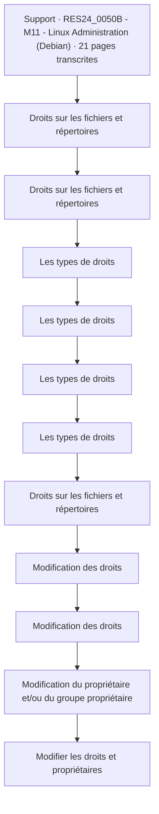
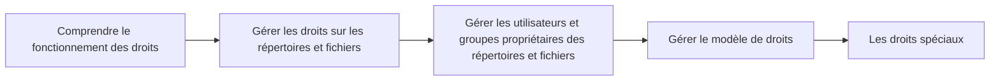
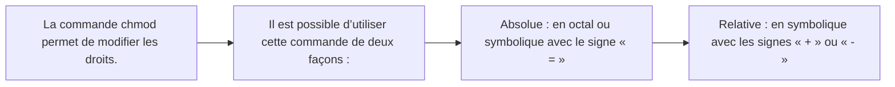
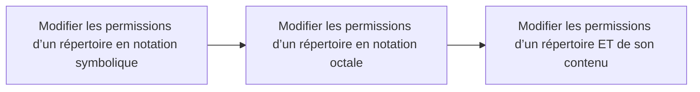

# Module 11 — Droits sur les fichiers et répertoires

[Travaux pratiques](../../tp/administration-linux/module-11/index.md)

Les parties ci-dessous reprennent le cours original, dans le même ordre. Les encadrés et les schémas répètent ses formulations.

## Parcours de lecture

1. Support · RES24_0050B - M11 - Linux Administration (Debian) · 21 pages transcrites
2. Droits sur les fichiers et répertoires
3. Droits sur les fichiers et répertoires
4. Les types de droits
5. Les types de droits
6. Les types de droits
7. Les types de droits
8. Droits sur les fichiers et répertoires
9. Modification des droits
10. Modification des droits
11. Modification du propriétaire et/ou du groupe propriétaire
12. Modifier les droits et propriétaires
13. Droits sur les fichiers et répertoires
14. Gestion du modèle de droit « Umask »
15. Gestion du modèle de droit « Umask »
16. Gestion du modèle de droit « Umask »
17. Les droits spéciaux Unix
18. Les droits spéciaux Unix
19. Modèle de droits et droits spéciaux
20. Droits sur les fichiers et répertoires
21. Conclusion
22. Transcription des commandes et informations utiles visibles
23. Transcription des commandes et informations utiles visibles
24. Transcription des commandes et informations utiles visibles
25. Transcription des commandes et informations utiles visibles

**Visuel externe**



SOURCE DRIVE · TRANSCRIPTION DU SUPPORT

Le contenu des documents du dossier TSSR est transcrit ci-dessous, page par page. Les textes et tableaux sont intégrés à la page Web. Aucun fichier PDF, aucune diapositive entière ni aucune reproduction de page n’est affiché. Seuls des croquis ou visuels isolés et vérifiés peuvent accompagner la transcription. Les versions et les consignes restent celles des supports de formation. Les compléments IA sont conservés dans leur onglet distinct.

## Support · RES24_0050B - M11 - Linux Administration (Debian) · 21 pages transcrites

### Administration Debian

### GNU/Linux

!!! note "À retenir"
    Module 11 – Droits sur les fichiers et répertoires

Module 11 – Droits sur les fichiers et répertoires

## Droits sur les fichiers et répertoires

### Objectifs

!!! note "À retenir"
    Comprendre le fonctionnement des droits Gérer les droits sur les répertoires et fichiers Gérer les utilisateurs et groupes propriétaires des répertoires et fichiers Gérer le modèle de droits Les droits spéciaux Donner les droits suffisants, ni plus, ni moins

**Visuel externe**



- Comprendre le fonctionnement des droits
- Gérer les droits sur les répertoires et fichiers
- Gérer les utilisateurs et groupes propriétaires des répertoires et fichiers
- Gérer le modèle de droits
- Les droits spéciaux

Donner les droits suffisants, ni plus, ni moins

## Droits sur les fichiers et répertoires

### Les droits Unix/Linux

## Les types de droits

!!! note "À retenir"
    Les droits d’accès sur les fichiers sont directement inscrits dans l’inode des fichiers (répertoires).

- Les droits d’accès sur les fichiers sont directement inscrits dans l’inode des fichiers (répertoires). Ils sont découpés en trois colonnes : utilisateur propriétaire (user), groupe propriétaire (group) et les autres (other).
- En pratique, il y a toujours trois groupes de trois droits.

rwxrwxr-x utilisateur groupe other

## Les types de droits

| Droit | Octal | Fichier | Répertoire |
| --- | --- | --- | --- |
| Lecture (r) | 4 | Permet de lire, ouvrir le fichier. Ex. : cat | Permet de lister le contenu du dossier. Ex. : ls |
| Écriture (w) | 2 | Permet d’écrire dans le fichier (le droit de lecture doit être présent). | Permet de modifier le contenu du dossier (créer, copier, renommer, supprimer). Ex. : mkdir cp rm |
| Exécution (x) | 1 | Permet d’exécuter le fichier binaire ou script shell (le droit de lecture doit être présent). | Permet à un utilisateur de traverser ou d’accéder à un fichier dans le dossier. Ex. : cd |

## Les types de droits

!!! note "À retenir"
    Pour calculer les droits en octal, il faut additionner les valeurs des droits présents pour les trois groupes.

Pour calculer les droits en octal, il faut additionner les valeurs des droits présents pour les trois groupes.

| Droits | Calcul octal |
| --- | --- |
| rwx | 4+2+1 = 7 |
| rw- | 4+2 = 6 |
| r-x | 4+1 = 5 |
| r-- | 4 |

### Exemples

| Droits | Octal |
| --- | --- |
| rwxrwxr-x | 775 |
| rwxr-x--- | 750 |
| rw-rw-r-- | 664 |

## Les types de droits

!!! note "À retenir"
    Pour afficher les droits d’un fichier ou répertoire, la commande ls sera utilisée : Dans cet exemple, sont mis en avant les droits de l’utilisateur propriétaire en vert, les droits du groupe propriétaire en bleu et ceux des autres en violet.

- Pour afficher les droits d’un fichier ou répertoire, la commande ls sera utilisée :

```
root@deb:~$ ls –ld
total 16
drwxr-xr-x 3 user30 user30 4096 17:36 .
-rw------- 1 user30 user30  616 09:34 Edition
drwxr-xr-x 2 user30 user30 4096 17:36 Nantes
lrwxrwxrwx 1 user30 user30   15 17:38 Quimper -> Rennes/Quimper/
drwxr-xr-x 3 user30 user30 4096 17:36 Rennes
-rw-r--r-- 1 user30 user30   33 17:35 todo.list
```

- Dans cet exemple, sont mis en avant les droits de l’utilisateur propriétaire en vert, les droits du groupe propriétaire en bleu et ceux des autres en violet.

## Droits sur les fichiers et répertoires

Modifier les droits et

propriétaires

## Modification des droits

!!! note "À retenir"
    La commande chmod permet de modifier les droits.

**Visuel externe**



```
• chmod <-R> [ugoa][+ - =][rwxX] fichier ou dossier
```

- La commande chmod permet de modifier les droits.
- Il est possible d’utiliser cette commande de deux façons :
- Absolue : en octal ou symbolique avec le signe « = »
- Relative : en symbolique avec les signes « + » ou « - »
- Attention à l’option –R, le fait de réaliser un chmod de façon récursive doit être effectué de façon réfléchie et ne doit pas être généralisé à tous les usages.

## Modification des droits

!!! note "À retenir"
    Modifier les permissions d’un répertoire en notation symbolique Modifier les permissions d’un répertoire en notation octale Modifier les permissions d’un répertoire ET de son contenu

**Visuel externe**



- Modifier les permissions d’un répertoire en notation symbolique

```
root@deb:~# chmod g+w,o-rx /data/commun
```

- Modifier les permissions d’un répertoire en notation octale

```
root@deb:~# chmod 770 /data/commun
```

- Modifier les permissions d’un répertoire ET de son contenu

```
root@deb:~# chmod –R g+w,o-rx /data/commun
```

## Modification du propriétaire et/ou du groupe propriétaire

!!! note "À retenir"
    La commande chown permet de modifier l’utilisateur propriétaire et le groupe propriétaire Modifier l’utilisateur et le groupe propriétaire Modifier seulement le groupe propriétaire de /data/commun ET son contenu

```
• chown <-R> [user]:[group] fichier(dossier)
```

- La commande chown permet de modifier l’utilisateur propriétaire et le groupe propriétaire
- Modifier l’utilisateur et le groupe propriétaire

```
root@deb:~# chown penthium:users /data
```

- Modifier seulement le groupe propriétaire de /data/commun ET son contenu

```
root@deb:~# chown –R :users /data/commun
```

## Modifier les droits et propriétaires

Démo

Modifier les droits et propriétaires

## Droits sur les fichiers et répertoires

Modèle de droits et

droits spéciaux

## Gestion du modèle de droit « Umask »

- L’umask est utilisé pour déterminer les droits des fichiers et répertoires.
- La valeur de l’umask sera « soustraite » à la valeur des droits maximaux à la création : 0666 pour un fichier, 0777 pour un répertoire.
- Sur Debian, l’umask par défaut des utilisateurs est de 0022. Il est important que l’umask de root et des utilisateurs de service (UID < 1000) reste à 0022.
- Il est possible pour chaque utilisateur de changer son umask avec la commande umask.

## Gestion du modèle de droit « Umask »

**Visuel externe**


- En pratique, on calcule toujours l’umask à partir des droits pour les répertoires (sinon le droit d’exécution ne sera pas posé pour les dossiers créés avec ce masque.)
- Si je souhaite obtenir des droits de lecture-écriture-exécution pour l’utilisateur et le groupe propriétaire :
- Je vais calculer la somme en octal : 770
- Ensuite je vais soustraire cette valeur cible de 777, le maximum possible
- Ce qui amène ici le résultat 007
- Ou 0007 avec prise en compte du premier chiffre représentant les droits spéciaux

## Gestion du modèle de droit « Umask »

```
• umask [mode]
```

- Afficher le masque courant

```
user30@deb:~$ umask 
0022
```

- Modifier le masque courant

```
user30@deb:~$ umask 0007
user30@deb:~$ umask 
0007
```

- Pour avoir un umask spécifique lors de sa connexion, il sera possible d’ajouter une entrée avec la commande umask dans son fichier de chargement de son shell (le fichier ~/.bashrc pour le shell bash)

## Les droits spéciaux Unix

| Droit | Octal | Fichier | Répertoire |
| --- | --- | --- | --- |
| SetUID. Symbolique sur colonne user, champ x : s = SetUID + droit x positionné ; S = SetUID positionné seul | 4--- | Exécution avec les droits du propriétaire du fichier. Ex : la commande /usr/bin/passwd s’exécute avec les droits de root, afin de permettre l’écriture dans les fichiers passwd et shadow. | Non utilisé pour les dossiers |
| SetGID. Symbolique sur colonne group, champ x : s = SetGID + droit x positionné ; S = SetGID positionné seul | 2--- | Exécution avec les droits du groupe. Ex : /usr/sbin/crontab s’éxecute avec les droits du groupe crontab. | Tout fichier créé dans ce dossier héritera du groupe du dossier parent. Les sous-dossiers créés hériteront quant à eux du droit SetGID. |

## Les droits spéciaux Unix

| Droit | Octal | Fichier | Répertoire |
| --- | --- | --- | --- |
| Sticky bit. Symbolique sur colonne other, champ x : t = Sticky bit + droit x positionné ; T = Sticky bit positionné seul | 1--- | Mise en zone de swap. Le but est que le fichier puisse être stocké en mémoire pour pouvoir être relancé plus rapidement. | Tout fichier créé ne pourra être supprimé que par son propriétaire et par root. Ex : /tmp |

```
chmod <-R> [ugoa][+ - =][st] fichier ou dossier
```

## Modèle de droits et droits spéciaux

Démo

Masque de droits et droits spéciaux

## Droits sur les fichiers et répertoires

TP

Démo

Gestion des permissions

## Conclusion

- Vous comprenez le fonctionnement des droits Unix Linux
- Vous savez modifier les droits et propriétaires de dossiers et fichiers
- Vous savez manipuler les modèles de droits
- Vous savez positionner des droits spéciaux

Référence du document : 1YjWdn_o7rBxiW5UEpEx2rc0vrgJXifmZ · SHA-256 321e29630af1a8bc…

| Les types de droits | Les droits d’accès sur les fichiers sont directement inscrits dans l’inode des fichiers (répertoires). |
| Les types de droits | Pour calculer les droits en octal, il faut additionner les valeurs des droits présents pour les trois groupes. |
| Les types de droits | Pour afficher les droits d’un fichier ou répertoire, la commande ls sera utilisée : Dans cet exemple, sont mis en avant les droits de l’utilisateur propriétaire en vert, les dro… |
| Modification des droits | La commande chmod permet de modifier les droits. |
| Modification des droits | Modifier les permissions d’un répertoire en notation symbolique Modifier les permissions d’un répertoire en notation octale Modifier les permissions d’un répertoire ET de son co… |
| Modification du propriétaire et/ou du groupe propriétaire | La commande chown permet de modifier l’utilisateur propriétaire et le groupe propriétaire Modifier l’utilisateur et le groupe propriétaire Modifier seulement le groupe propriéta… |
| Modifier les droits et propriétaires | Démo Modifier les droits et propriétaires |
| Gestion du modèle de droit « Umask » | L’umask est utilisé pour déterminer les droits des fichiers et répertoires. |
| Gestion du modèle de droit « Umask » | En pratique, on calcule toujours l’umask à partir des droits pour les répertoires (sinon le droit d’exécution ne sera pas posé pour les dossiers créés avec ce masque.) Si je sou… |
| Gestion du modèle de droit « Umask » | Afficher le masque courant Modifier le masque courant Pour avoir un umask spécifique lors de sa connexion, il sera possible d’ajouter une entrée avec la commande umask dans son… |
| Modèle de droits et droits spéciaux | Démo Masque de droits et droits spéciaux |
| Conclusion | Vous comprenez le fonctionnement des droits Unix Linux Vous savez modifier les droits et propriétaires de dossiers et fichiers Vous savez manipuler les modèles de droits Vous sa… |
| Transcription des commandes et informations utiles visibles | Commande ou détail d’interface isolé du document de formation. |
| Transcription des commandes et informations utiles visibles | Admin : un répertoire admin accessible en lecture / écriture pour le groupe admin uniquement Suppression de tous les droits pour others ajout du droit d’écriture pour le groupe… |
| Transcription des commandes et informations utiles visibles | Commande ou détail d’interface isolé du document de formation. |
