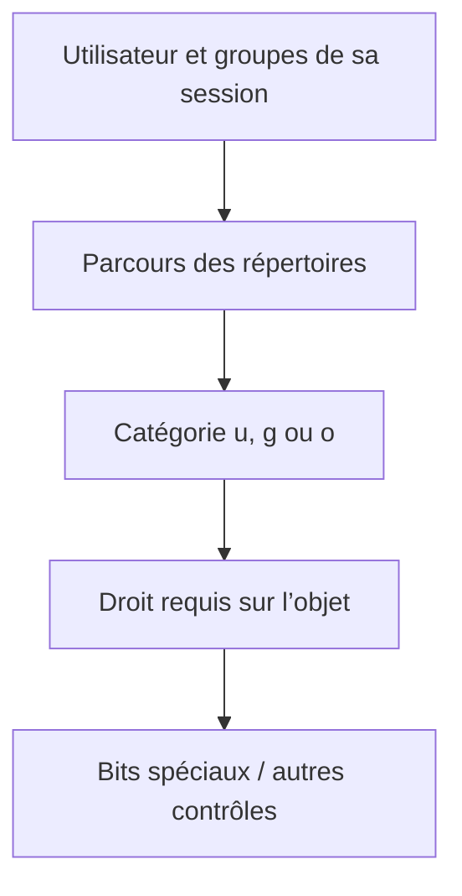

# Module 11 — Droits sur les fichiers et répertoires

**Cours optimisé — reformulation pédagogique du support et des TP associés.** Les exemples du parcours conservent leur contexte Debian 11 ; les corrections et actualisations sont identifiées comme compléments externes. Les transcriptions intégrales se consultent dans l’onglet Original.
## Lire les permissions Unix

Les droits classiques forment trois triplets : propriétaire `u`, groupe propriétaire `g`, autres `o`. Ils résident dans les métadonnées du fichier et s’affichent avec `ls -l`. Dans la chaîne `-rwxr-x---`, le premier caractère est le type ; les neuf suivants représentent les permissions. Pour examiner le répertoire lui-même, utiliser `ls -ld chemin` ; `ls -l chemin` examine son contenu si chemin est un répertoire.

| Droit | Valeur | Sur un fichier | Sur un répertoire |
|---|---|---|---|
| `r` | 4 | Lire son contenu | Lister les noms des entrées |
| `w` | 2 | Modifier son contenu | Modifier des entrées, avec les droits de parcours nécessaires |
| `x` | 1 | Autoriser l’exécution selon le type de fichier | Traverser le répertoire et accéder à un nom connu |

Pour atteindre un fichier, il faut aussi pouvoir traverser les répertoires de son chemin. Supprimer un nom dépend principalement des droits du répertoire parent, pas du bit d’écriture du fichier. Les ACL et les mécanismes supplémentaires peuvent modifier l’analyse ; ce module apprend d’abord le modèle classique.

## Octal et symbolique

Dans un triplet, additionner les valeurs présentes : `rwx=7`, `rw-=6`, `r-x=5`, `r--=4`. Ainsi `775` signifie rwx pour propriétaire et groupe, puis r-x pour les autres ; `750` donne aucun droit aux autres et `664` correspond à rw-rw-r--.

```bash
chmod g+w,o-rx /data/commun
chmod 770 /data/commun
chmod -R g+w,o-rx /data/commun
```

La première forme ajoute/retire certains droits ; la deuxième fixe les triplets classiques. La récursivité applique l’opération aux descendants et mérite une vérification préalable : fichiers et répertoires n’ont pas le même besoin d’exécution. Le symbole `X` permet l’exécution conditionnelle pour les répertoires ou les fichiers déjà exécutables.

## Propriétaire et groupe

```bash
chown penthium:users /data
chown -R :users /data/commun
```

`utilisateur:groupe` change les deux ; `:groupe` change le groupe. Vérifier ensuite avec `ls -ld` et, pour les descendants concernés, `ls -l`. Les opérations chown demandent les droits correspondants ; les permissions affichées ne donnent pas à tout utilisateur le droit de changer arbitrairement un propriétaire.

## Umask — permissions à la création

Le masque retire des bits aux droits demandés par le programme. Dans le cas habituel sans ACL par défaut : `mode_effectif = mode_demandé & ~umask`. Avec demandes classiques 0666 pour un fichier ordinaire et 0777 pour un répertoire :

| Umask | Nouveau fichier | Nouveau répertoire |
|---|---|---|
| `0022` | `0644` | `0755` |
| `0007` | `0660` | `0770` |

```bash
umask
umask 0007
```

Le changement concerne le processus courant et ses descendants, pas les objets existants. La source propose `~/.bashrc` pour un réglage Bash ; le fichier chargé dépend du type de shell et de session. Choisir une politique adaptée aux comptes et aux services au lieu de supposer que 0022 est une exigence universelle.

!!! info "Corrections externes — lecture, masque et sticky bit"
    Le droit `w` d’un fichier n’exige pas universellement `r`. Un exécutable binaire peut fonctionner sans lecture, alors qu’un interpréteur doit normalement lire son script. L’umask retire des bits, ce n’est pas une soustraction arithmétique générale. Sur un répertoire sticky, le propriétaire du répertoire est également autorisé à supprimer des entrées, en plus du propriétaire du fichier et d’un utilisateur privilégié. Références : [chmod(1)](https://manpages.debian.org/trixie/coreutils/chmod.1.en.html), [umask(2)](https://manpages.debian.org/trixie/manpages-dev/umask.2.en.html).

## Droits spéciaux

| Bit | Valeur spéciale | Fichier exécutable | Répertoire |
|---|---|---|---|
| SetUID | 4 | Exécution avec identité effective du propriétaire, sous conditions | Pas le mécanisme d’héritage utilisé ici |
| SetGID | 2 | Exécution avec groupe effectif du fichier, sous conditions | Nouveaux objets associés au groupe du répertoire ; propagation aux sous-répertoires créés |
| Sticky | 1 | L’usage historique décrit n’est pas un mécanisme actuel d’accélération sous Linux | Restriction de suppression/renommage dans un répertoire partagé |

`s` ou `t` indique que le bit spécial et `x` sont présents ; `S` ou `T` signale le bit spécial sans `x` dans la position correspondante. Le SetGID de répertoire ne rend pas automatiquement tous les nouveaux fichiers modifiables par le groupe : leur mode demandé et le masque restent déterminants. L’effet des bits spéciaux peut aussi être restreint par le montage et le système.

## TP — arborescence partagée

La correction place les données sous `/srv`, conformément au rôle de données de service du scénario. Créer les groupes requis avant d’attribuer les propriétaires.

| Besoin source | Principe de réalisation et contrôle |
|---|---|
| public : lecture/écriture pour tous | Répertoire traversable et inscriptible par les catégories prévues |
| depot : dépôt partagé protégé | Permissions partagées et sticky bit, puis test croisé entre deux utilisateurs |
| admin : groupe admin seulement | Groupe propriétaire admin, rwx du groupe, aucun droit aux autres |
| documentation : lecture pour tous, écriture du groupe | Groupe documentation, SetGID, masque cohérent pour les nouveaux objets |

Exemples pédagogiques : `chmod 1777 /srv/depot`, `chmod 2775 /srv/documentation`, avec propriétaires et groupes adaptés. Les nombres ne suffisent pas : tester création, lecture, modification et suppression avec des utilisateurs de catégories différentes. Pour depot, observer que les exceptions du propriétaire de répertoire et de root existent toujours ; le texte « seul le propriétaire du fichier » du TP est un objectif simplifié.

## Schéma explicatif — complément pédagogique



## Autoévaluation

1. Que produit umask 0007 pour un fichier demandé en 0666 ?
2. SetGID donne-t-il à lui seul le droit d’écriture au groupe sur un nouveau fichier ?
3. Qui peut supprimer un nom dans un répertoire sticky, sous réserve des autres droits ?

??? success "Réponses"
    1. 0660.
    2. Non ; il règle le groupe hérité, pas tous les bits d’accès.
    3. Le propriétaire du fichier, le propriétaire du répertoire ou un utilisateur privilégié.

## Pour travailler ce module

- [Fiche de révision](../../revision/administration-linux/module-11-droits-sur-les-fichiers-et-repertoires.md)
- [Travaux pratiques](../../tp/administration-linux/module-11/index.md)
- [Progression du cours](index.md)
