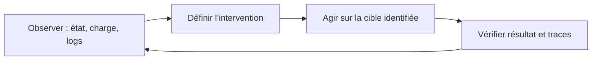

# Module 12 — Maintenance d’un système en production

**Cours optimisé — reformulation pédagogique du support et des TP associés.** Les exemples du parcours conservent leur contexte Debian 11 ; les corrections et actualisations sont identifiées comme compléments externes. Les transcriptions intégrales se consultent dans l’onglet Original.
## Objectifs

- Retrouver des événements, configurer rsyslog et démontrer le filtrage.
- Écrire et tester les trois planifications utilisateur et système du TP.
- Distinguer état de la mémoire, processus serveur et connexion client avant une action ciblée.

## Une maintenance fondée sur l’observation

Le support distingue observation proactive et réaction à un incident. Une intervention se prépare en identifiant le système, la charge, les processus, les montages et les messages utiles. Automatiser une tâche n’élimine pas la nécessité de contrôler son résultat et la place prise par ses journaux.

## Journal systemd

`systemctl status service` donne un état et quelques lignes récentes. `journalctl` permet des recherches plus complètes dans les messages effectivement conservés. Les journaux peuvent contenir les sorties de services, des messages du noyau et d’autres événements : tous les programmes n’y envoient pas nécessairement toute leur activité.

| Besoin | Commande du parcours |
|---|---|
| Lire le journal accessible | `journalctl` |
| Suivre les nouvelles entrées | `journalctl -f` |
| Filtrer un service | `journalctl -u cron.service` |
| Filtrer un PID | `journalctl _PID=1` |
| Filtrer un programme | `journalctl /usr/sbin/sshd` |
| Erreurs et niveaux plus graves | `journalctl -p err` |
| Messages du noyau | `journalctl -k` |

Les priorités vont de emerg, alert, crit, err, warning, notice, info à debug. Le filtre de priorité ordinaire inclut les niveaux plus graves ; ce n’est pas toujours une égalité stricte. Combiner unité, date ou suivi réduit le bruit. Le complément `journalctl -b` limite au démarrage courant ; un PID peut être réutilisé, il faut donc contextualiser sa période.

## Rsyslog : facility, priorité, action

La source présente rsyslog associé à journald dans son environnement Debian historique. Une règle choisit une origine logique (*facility*), un seuil de priorité et une destination. Exemples de facilities : auth, authpriv, daemon, kern, mail, user et local0 à local7. `*` sélectionne toutes les facilities ; `none` sert à une exclusion dans les sélecteurs.

```text
auth,authpriv.*          /var/log/auth.log
*.*;auth,authpriv.none   -/var/log/syslog
daemon.*                -/var/log/daemon.log
```

Le tiret devant la destination relève du comportement de synchronisation des écritures, pas de l’activation de la règle. Les fichiers réels dépendent du paquet installé et des règles actives. Configurer `/etc/rsyslog.conf` ou une entrée locale dédiée, puis valider la syntaxe et le fonctionnement.

```bash
logger -p cron.info 'Message de test du laboratoire'
```

`logger` permet de générer un événement contrôlé. Dans le TP, créer les répertoires `/adm` et `/adm/logs`, extraire les ouvertures de sessions vers `/adm/sessions.txt`, rechercher les informations noyau de sda, orienter cron vers `/adm/logs/cron.log` et les avertissements vers `/adm/logs/warnings.log`. Les mots `opened` et `CRON` des filtres source correspondent à ses exemples de messages ; ils ne définissent pas à eux seuls toutes les connexions humaines.

## Durée de conservation et taille

Le fichier de configuration journald est `/etc/systemd/journald.conf`, avec des possibilités de fragments de configuration selon la version. Le support explique le stockage volatil dans `/run/log/journal` et le stockage durable dans `/var/log/journal`. Examiner `journalctl --disk-usage` avant d’ajuster les plafonds. `SystemMaxUse` et `SystemMaxFileSize` concernent respectivement l’espace et la taille des fichiers de journal persistants.

!!! info "Correction externe — persistance et services"
    Journald n’est pas condamné à perdre ses messages au redémarrage : cela dépend de `Storage=` et de l’environnement. En mode auto, la présence de `/var/log/journal` intervient dans ce choix. Le chemin est `journal`, pas `journald`. Les valeurs par défaut dépendent aussi de la version/configuration. `systemctl disable rsyslog` ne stoppe pas le service courant et ne doit pas être présenté comme nécessaire à la persistance. Référence : [systemd-journald.service](https://www.freedesktop.org/software/systemd/man/latest/systemd-journald.service.html).

## Rotation des fichiers texte

Logrotate traite des fichiers selon des règles : période, nombre de rotations, compression et création du fichier suivant. Le support donne un journal Squid avec `daily`, `compress`, `delaycompress`, `rotate 366` et `create 640`. `delaycompress` reporte la compression de l’archive la plus récente ; le service doit continuer à écrire dans le bon fichier après rotation. L’exécution peut relever de cron ou d’un timer selon l’installation ; examiner le système réel plutôt que supposer une tâche quotidienne unique universelle.

## Planification utilisateur

`crontab -e` édite les tâches de l’utilisateur, `crontab -l` les relit. Une ligne de tâche possède cinq champs temporels, puis la commande. Les bornes sont minute 0–59, heure 0–23, jour du mois 1–31, mois 1–12 et jour de semaine 0–7, où 0 et 7 désignent dimanche.

| Syntaxe | Signification |
|---|---|
| `1,3,5` | Liste de valeurs |
| `10-20` | Intervalle |
| `*` | Toutes les valeurs du champ |
| `*/2` | Pas à partir du début de la plage du champ |

```cron
0 5 * * 1 /opt/bin/backup.sh
```

Cette tâche s’exécute le lundi à 5 h. `*/2` dans les mois vise janvier, mars, mai, juillet, septembre et novembre : ce n’est pas « deux mois après la dernière exécution ». Le calendrier, le fuseau et les changements d’heure comptent.

## Planification système et anacron

`/etc/crontab` et les tables système de `/etc/cron.d` ajoutent un champ utilisateur entre les dates et la commande. Il ne faut pas ajouter ce champ dans une crontab utilisateur. Les répertoires cron.hourly/daily/weekly/monthly accueillent des scripts exécutés selon les mécanismes configurés. Anacron peut rattraper certaines tâches périodiques manquées lorsque la machine était arrêtée ; il ne garantit pas le rattrapage de toute ligne cron arbitraire.

Complément externe : utiliser des chemins absolus, prévoir l’environnement réduit et traiter les sorties/erreurs. Lorsque jour du mois et jour de semaine sont tous deux restreints, la sémantique cron classique les combine par « ou ». Le caractère `%` possède aussi une signification particulière dans la commande. Référence : [crontab(5)](https://manpages.debian.org/trixie/cron/crontab.5.en.html).

Le TP de planification utilise François : archive du home les jours ouvrables à 9 h 15, compression le samedi à 10 h puis création d’une nouvelle archive, et relevé détaillé des processus toutes les trente minutes le mardi dans `/var/log/procstatus.log`. Le TP renvoie au dépôt « atelier 10 » alors que l’arborescence depot apparaît dans le TP permissions du module 11 : confirmer son chemin et ses droits avant la tâche.

## Inventaire et performances

| Information | Outils étudiés |
|---|---|
| Version Debian et noyau | `cat /etc/debian_version`, `uname -a` |
| CPU, PCI, USB | `lscpu`, `lspci`, `lsusb` |
| Stockage | `fdisk`, `pvs/vgs/lvs`, `lsblk`, `blkid`, `findmnt`, `df` |
| Taille d’arborescence et type de fichier | `du -sh`, `ls -lh`, `file` |
| Fichiers ouverts | `lsof` |
| Processus et charge | `ps -ef`, `top`, htop ou glances si installés |
| Mémoire | `free -h` |

La source écrit `file /vin/bash` : utiliser `file /bin/bash`. `lsof /root` ne signifie pas automatiquement tous les descendants ; l’option récursive appropriée et le périmètre doivent être choisis. Dans `free`, la colonne available estime ce qui est mobilisable sans swap ; la seule colonne free ne représente pas toute la mémoire utilisable. La charge moyenne n’est pas un simple pourcentage CPU.

## TP 01 — Rechercher et produire des événements

1. Sur le serveur du TP, relever les événements d’ouverture de session et le nom du service qui les émet. Exporter les lignes retenues dans `/adm/sessions.txt`. Pour le disque `sda`, relever dans les messages du noyau le nombre de secteurs et la capacité du support affiché.
2. Vérifier que rsyslog est présent et créer le répertoire de destination prévu par le laboratoire. Ajouter des règles dans sa configuration. Les règles ci-dessous envoient les événements cron dans un fichier dédié et les priorités warning et plus graves dans un autre.

```text
cron.*      /adm/logs/cron.log
*.warning   /adm/logs/warnings.log
```

3. Valider la configuration et la charger. Envoyer deux messages repérables, puis vérifier chacun des deux fichiers. Le message warning atteint les deux destinations. Le message info atteint la destination cron. Si le TP demande le seul niveau warning, utiliser `*.=warning`.

```bash
sudo rsyslogd -N1
sudo systemctl restart rsyslog
logger -p cron.warning 'TSSR-TP12 warning'
logger -p cron.info 'TSSR-TP12 info'
sudo grep -F 'TSSR-TP12' /adm/logs/cron.log /adm/logs/warnings.log
```

## TP 02 — Planifier les tâches de François et du système

Préparer l’archive de départ et vérifier les droits d’écriture de François dans le dépôt de l’atelier 10. Tester les commandes sous son compte avant de les planifier. Les deux entrées suivantes vont dans sa crontab utilisateur.

```cron
15 9 * * 1-5 cd / && /usr/bin/tar -uf /srv/depot/francois.tar home/francois/
0 10 * * 6 /usr/bin/bzip2 -f /srv/depot/francois.tar && /usr/bin/tar -cf /srv/depot/francois.tar -C / home/francois/
```

La première s’exécute à 9 h 15 du lundi au vendredi. La seconde compresse l’archive le samedi à 10 h et crée une nouvelle archive si la compression réussit. L’option `-f` permet de remplacer le fichier compressé de la semaine précédente comme dans le corrigé. Pour conserver plusieurs semaines, utiliser des noms distincts. L’intitulé « 1ère minute » de la correction contredit l’heure de l’énoncé et sa propre ligne de crontab.

La tâche système ajoute le compte d’exécution après les cinq champs de calendrier. L’exemple écrit l’heure et les processus détaillés à la suite du journal demandé chaque mardi, toutes les 30 minutes.

```cron
*/30 * * * 2 root { /usr/bin/date; /usr/bin/ps auxf; } >> /var/log/procstatus.log 2>&1
```

Vérifier la crontab avec `crontab -l` sous le compte concerné. Tester l’écriture du journal et de l’archive avant d’attendre l’échéance, puis vérifier les traces de cron et le résultat produit.

## TP 03 — Mesurer et agir sur le processus demandé

1. Relever la mémoire totale, disponible et le swap dans `free -m` et `/proc/meminfo`. Le corrigé donne environ 975 Mio de swap total et 0 utilisé sur sa machine. Relever les valeurs réelles du serveur du TP.
2. Ouvrir une seconde connexion depuis PuTTY, relever son terminal, son compte et son PID côté serveur. PuTTY tourne côté client, tandis que le serveur voit `sshd` et le shell distant.
3. Vérifier le processus exact par son PID avant d’agir. Envoyer SIGTERM au shell du TP et vérifier l’effet depuis la première connexion. La commande de la source dépourvue de PID est conservée dans l’Original.

```bash
free -m
grep -E '^(MemTotal|MemAvailable|SwapTotal|SwapFree):' /proc/meminfo
w
ps -eo pid,ppid,user,tty,args
```

Utiliser `ps -p "$pid" -o pid,ppid,user,tty,args` après avoir affecté à `pid` le numéro relevé. N’envoyer le signal qu’après avoir identifié la seconde session et exclu sa propre connexion de contrôle. Voir le corrigé pour les vérifications du PID et de l’arrêt.

## Schéma explicatif — complément pédagogique



## À retenir

Une règle de journalisation se valide par un message connu. Une crontab se contrôle par ses champs, son compte et sa sortie. Avant d’envoyer un signal, vérifier que le PID correspond toujours à la seconde session du TP.

## Autoévaluation

1. Une crontab utilisateur contient-elle un champ utilisateur ?
2. Comment vérifier que cron a émis un événement et qu’une règle l’a bien écrit ?
3. Pourquoi la colonne free n’est-elle pas seule suffisante ?
4. PuTTY tourne-t-il sur le serveur Debian de ce scénario ?
5. Quels journaux doivent recevoir le test `cron.warning` dans l’atelier ?

??? success "Réponses commentées"
    1. Non ; le champ supplémentaire concerne les tables système.
    2. Générer un message identifié avec logger puis examiner les destinations attendues.
    3. Des caches sont récupérables ; available apporte une estimation différente.
    4. Non ; le serveur voit notamment sshd et le shell distant.
    5. La destination `cron.*` et celle des avertissements. Un message `cron.info` ne relève que de la première de ces deux règles.

## Pour travailler ce module

- [Fiche de révision](../../revision/administration-linux/module-12-maintenance-d-un-systeme-en-production.md)
- [Travaux pratiques](../../tp/administration-linux/module-12/index.md)
- [Progression du cours](index.md)
