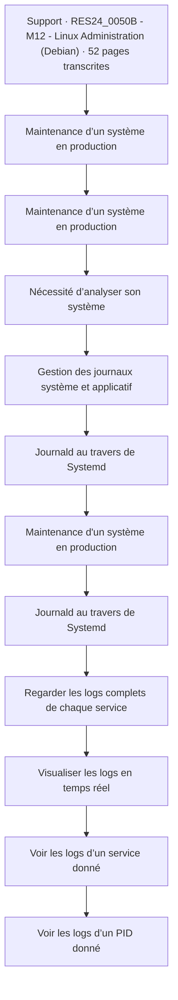
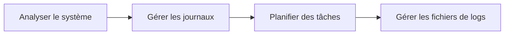
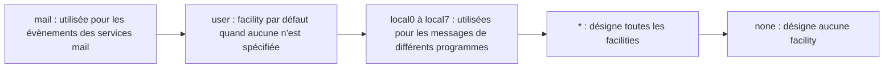
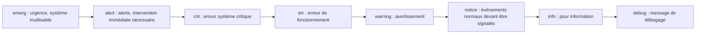

# Module 12 — Maintenance d’un système en production

[Travaux pratiques](../../tp/administration-linux/module-12/index.md)

Les parties ci-dessous reprennent le cours original, dans le même ordre. Les encadrés et les schémas répètent ses formulations.

## Parcours de lecture

1. Support · RES24_0050B - M12 - Linux Administration (Debian) · 52 pages transcrites
2. Maintenance d’un système en production
3. Maintenance d’un système en production
4. Nécessité d’analyser son système
5. Gestion des journaux système et applicatif
6. Journald au travers de Systemd
7. Maintenance d'un système en production
8. Journald au travers de Systemd
9. Regarder les logs complets de chaque service
10. Visualiser les logs en temps réel
11. Voir les logs d’un service donné
12. Voir les logs d’un PID donné
13. Voir les logs d’un programme
14. Voir les logs par niveau de priorité
15. Cumuler les options
16. Maintenance d'un système en production
17. Généralité
18. Principe de fonctionnement
19. Principe de fonctionnement
20. Principe de fonctionnement
21. Principe de fonctionnement
22. Commande d'interaction
23. Rsyslog à travers Journald
24. Rsyslog à travers Journald
25. Maintenance d’un système en production
26. Planification utilisateur
27. Planification utilisateur
28. Planification utilisateur
29. Planification utilisateur
30. Maintenance d’un système en production
31. Planification système
32. Lancement des tâches non exécutées avec anacron
33. Planification des tâches
34. Planification des tâches
35. Maintenance d’un système en production
36. Taille des logs avec Journald
37. Taille des logs avec Journald
38. Taille des logs avec Logrotate
39. Maintenance d’un système en production
40. Prise d'informations sur le système
41. Prise d'informations sur le système
42. Prise d'informations sur le système
43. Prise d'informations sur le système
44. Prise d'informations sur le système
45. Prise d'informations sur le système
46. Maintenance d’un système en production
47. Prise d'informations sur le système
48. Prise d'informations sur le système
49. Prise d'informations sur le système
50. Prise d'informations sur le système
51. Performances et processus
52. Performances et processus
53. Transcription des commandes et informations utiles visibles
54. Transcription des commandes et informations utiles visibles
55. Transcription des commandes visibles
56. Transcription des commandes et informations utiles visibles
57. Transcription des commandes et informations utiles visibles
58. Transcription des commandes et informations utiles visibles
59. Transcription des commandes et informations utiles visibles
60. Transcription des commandes et informations utiles visibles
61. Transcription des commandes visibles
62. Transcription des commandes visibles
63. Transcription des commandes et informations utiles visibles
64. Transcription des commandes et informations utiles visibles
65. Transcription des commandes et informations utiles visibles
66. Transcription des commandes et informations utiles visibles
67. Transcription des commandes et informations utiles visibles
68. Transcription des commandes et informations utiles visibles
69. Transcription des commandes et informations utiles visibles
70. Transcription des commandes et informations utiles visibles
71. Transcription des commandes visibles

**Visuel externe**



SOURCE DRIVE · TRANSCRIPTION DU SUPPORT

Le contenu des documents du dossier TSSR est transcrit ci-dessous, page par page. Les textes et tableaux sont intégrés à la page Web. Aucun fichier PDF, aucune diapositive entière ni aucune reproduction de page n’est affiché. Seuls des croquis ou visuels isolés et vérifiés peuvent accompagner la transcription. Les versions et les consignes restent celles des supports de formation. Les compléments IA sont conservés dans leur onglet distinct.

## Support · RES24_0050B - M12 - Linux Administration (Debian) · 52 pages transcrites

### Administration Debian

### GNU/Linux

!!! note "À retenir"
    Module 12 – Maintenance d’un système en production

Module 12 – Maintenance d’un système en production

## Maintenance d’un système en production

### Objectifs

!!! note "À retenir"
    Analyser le système Gérer les journaux Planifier des tâches Gérer les fichiers de logs

**Visuel externe**



- Analyser le système
- Gérer les journaux
- Planifier des tâches
- Gérer les fichiers de logs

## Maintenance d’un système en production

### Analyser le système

## Nécessité d’analyser son système

!!! note "À retenir"
    Il est important d’analyser son système d’exploitation pour vérifier que tout fonctionne correctement.

- Il est important d’analyser son système d’exploitation pour vérifier que tout fonctionne correctement. Il y a des deux types d’outils permettant cette analyse : les outils proactifs et réactifs.
- Afin d’analyser facilement son système, il est utile de lire les journaux du système (les logs).
- Afin de préserver un bon fonctionnement, il est utile d’automatiser des tâches administratives.
- Enfin, il est important de connaître des commandes de prise d’informations du système, la RAM, le CPU, les processus, etc.

## Gestion des journaux système et applicatif

!!! note "À retenir"
    La gestion des journaux applicatifs est gérée sous Debian 9 par deux services : Journald au travers de systemd L’ancien système rsyslog au travers de journald

La gestion des journaux applicatifs est gérée sous Debian 9 par deux services :

- Journald au travers de systemd
- L’ancien système rsyslog au travers de journald

## Journald au travers de Systemd

!!! note "À retenir"
    Tous les services, programmes, tâches gérées par systemd ont leurs comportements remontés dans journald.

- Tous les services, programmes, tâches gérées par systemd ont leurs comportements remontés dans journald.
- Le fait d’exécuter la commande systemctl status [daemon] affiche le statut du service mais aussi les logs de l’application.
- Ces logs sont enregistrés dans une base de données gérée par journald.

## Maintenance d'un système en production

### La commande Journalctl

## Journald au travers de Systemd

```
root@deb:~$ systemctl status sshd.service 
● ssh.service - OpenBSD Secure Shell server
   Loaded: loaded (/lib/systemd/system/ssh.service; enabled; vendor preset: enabled)
   Active: active (running) since Thu 2021-06-03 14:22:07 CEST; 6 days ago
     Docs: man:sshd(8)
           man:sshd_config(5)
  Process: 614 ExecStartPre=/usr/sbin/sshd -t (code=exited, status=0/SUCCESS)
 Main PID: 621 (sshd)
    Tasks: 1 (limit: 2315)
   Memory: 3.8M
   CGroup: /system.slice/ssh.service
           └─621 /usr/sbin/sshd -D
```

```
juin 09 15:35:20 client-linux sshd[5154]: Accepted password for jdoe from 172.19.11.13 
port 61644 ssh2
juin 09 15:35:20 client-linux sshd[5154]: pam_unix(sshd:session): session opened for 
user jdoe by (uid=0)
```

## Regarder les logs complets de chaque service

!!! note "À retenir"
    Puisque journald stocke les informations dans une base de données, il est possible de regarder les logs complets de chaque service via la commande journalctl.

- Puisque journald stocke les informations dans une base de données, il est possible de regarder les logs complets de chaque service via la commande journalctl.
- Le fichier de configuration de journald est /etc/systemd/journald.conf

```
root@deb:~$ journalctl 
- Logs begin at Thu 2021-06-03 14:22:04 CEST, end at Wed 2021-06-09 15:41:22 CEST. -
juin 03 14:22:04 client-linux kernel: Linux version 4.19.0-16-amd64 (debian-
kernel@lists.debian.org) (gcc version 8.3.0 (Debian 8.3.0-6)) #1 SMP D
juin 03 14:22:04 client-linux kernel: Command line: BOOT_IMAGE=/vmlinuz-4.19.0-16-amd64 
root=/dev/mapper/client--linux--vg-root ro quiet
juin 03 14:22:04 client-linux kernel: Disabled fast string operations
[...]
juin 09 15:41:22 client-linux anacron[4086]: Job `cron.weekly' terminated
juin 09 15:41:22 client-linux anacron[4086]: Normal exit (2 jobs run)
juin 09 15:41:22 client-linux systemd[1]: anacron.service: Succeeded.
lines 4792-4839/4839 (END)
```

## Visualiser les logs en temps réel

!!! note "À retenir"
    Il est possible de visualiser les logs en temps réel avec l’option -f

Il est possible de visualiser les logs en temps réel avec l’option -f

```
root@deb:~$ journalctl -f
-- Logs begin at Thu 2021-06-03 14:22:04 CEST. --
juin 09 15:36:22 client-linux cracklib[5204]: no dictionary update necessary.
juin 09 15:36:23 client-linux anacron[4086]: Job `cron.daily' terminated
juin 09 15:36:45 client-linux PackageKit[4305]: daemon quit
juin 09 15:36:45 client-linux systemd[1]: packagekit.service: Main process exited, 
code=killed, status=15/TERM
juin 09 15:36:45 client-linux systemd[1]: packagekit.service: Succeeded.
juin 09 15:41:22 client-linux anacron[4086]: Job `cron.weekly' started
juin 09 15:41:22 client-linux anacron[5274]: Updated timestamp for job `cron.weekly' to 
2021-06-09
juin 09 15:41:22 client-linux anacron[4086]: Job `cron.weekly' terminated
juin 09 15:41:22 client-linux anacron[4086]: Normal exit (2 jobs run)
juin 09 15:41:22 client-linux systemd[1]: anacron.service: Succeeded.
```

## Voir les logs d’un service donné

```
journalctl -u [service]
```

```
root@deb:~$ journalctl –u cron
-- Logs begin at Thu 2021-06-03 14:22:04 CEST, end at Wed 2021-06-09 15:41:22 CEST. --
juin 03 14:22:06 client-linux systemd[1]: Started Regular background program processing 
daemon.
juin 03 14:22:06 client-linux cron[529]: (CRON) INFO (pidfile fd = 3)
juin 03 14:22:07 client-linux cron[529]: (CRON) INFO (Running @reboot jobs)
juin 03 14:30:01 client-linux CRON[1337]: pam_unix(cron:session): session opened for user root 
by (uid=0)
juin 03 14:30:01 client-linux CRON[1338]: (root) CMD ([ -x /etc/init.d/anacron ] && if [ ! -d 
/run/systemd/system ]; then /usr/sbin/invoke-rc.d an
juin 03 14:30:01 client-linux CRON[1337]: pam_unix(cron:session): session closed for user root
[...]
```

## Voir les logs d’un PID donné

```
journalctl _PID=[n° pid]
```

```
root@deb:~$ journalctl _PID=1
-- Logs begin at Sun 2019-04-21 07:14:36 CEST, end at Thu 2019-05-09 13:24:52 CEST. --
avril 21 08:01:38 debian systemd[1]: Started Run anacron jobs.
avril 21 08:01:38 debian systemd[1]: anacron.timer: Adding 2min 48.679199s random time.
avril 21 08:53:38 debian systemd[1]: Starting Daily apt download activities...
avril 21 08:53:45 debian systemd[1]: Started Daily apt download activities.
avril 21 08:53:45 debian systemd[1]: apt-daily.timer: Adding 10h 23.576305s random time.
```

## Voir les logs d’un programme

```
journalctl /usr/sbin/sshd
```

```
root@deb:~$ journalctl /usr/sbin/sshd 
-- Logs begin at Thu 2021-06-03 14:22:04 CEST, end at Wed 2021-06-09 16:32:19 CEST. --
juin 03 14:22:07 client-linux sshd[621]: Server listening on 0.0.0.0 port 22.
juin 03 14:22:07 client-linux sshd[621]: Server listening on :: port 22.
juin 09 15:35:20 client-linux sshd[5154]: Accepted password for jdoe from 172.19.11.13 port 
61644 ssh2
juin 09 15:35:20 client-linux sshd[5154]: pam_unix(sshd:session): session opened for user jdoe
by (uid=0)
```

## Voir les logs par niveau de priorité

!!! note "À retenir"
    Les différents niveaux de priorités sont du plus critique au plus informatif : emerg, alert, crit, err, warning, notice, info, debug.

```
journalctl –p <level>
```

```
root@deb:~$ journalctl -p err
-- Logs begin at Thu 2021-06-03 14:22:04 CEST, end at Wed 2021-06-09 16:32:19 CEST. --
juin 03 14:22:07 client-linux kernel: sd 3:0:0:0: [sdc] No Caching mode page found
juin 03 14:22:07 client-linux kernel: sd 3:0:0:0: [sdc] Assuming drive cache: write through
juin 09 15:35:20 client-linux gdm-password][18939]: pam_unix(gdm-password:auth): conversation 
failed
juin 09 15:35:20 client-linux
gdm-password][18939]: pam_unix(gdm-password:auth): auth could 
not identify password for [jdoe]
```

Les différents niveaux de priorités sont du plus critique au plus informatif : emerg, alert, crit, err, warning, notice, info, debug.

## Cumuler les options

Il est possible de cumuler les options, par exemple :

```
root@deb:~$ journalctl -f /usr/sbin/sshd -p info
-- Logs begin at Thu 2021-06-03 14:22:04 CEST, end at Wed 2021-06-09 16:32:19 CEST. --
mai 06 09:56:48 debian sshd[18901]: Accepted password for jdoe from 10.9.121.13 
```

```
port
60042 ssh2
mai 06 09:56:48 debian sshd[18901]: pam_unix(sshd:session): session opened for user 
jdoe by 
(uid=0)
```

```
mai 06 15:48:06 debian sshd[18901]: pam_unix(sshd:session): session closed for user 
jdoe
```

## Maintenance d'un système en production

### rsyslog à travers Journald

## Généralité

- Journald a certes l’avantage de stocker les logs dans une base de données mais ces logs sont uniquement conservés pour le démarrage en cours.
- Pour conserver les logs, Debian utilise rsyslog.
- Tous les logs de journalctl sont transférés à rsyslog.

## Principe de fonctionnement

**Visuel externe**


- rsyslog travaille sur des « facilities » et des niveaux de priorités qui déclenchent une action.
- Les facilities les plus courantes sont :
- auth : utilisée pour des évènements concernant la sécurité ou l'authentification à travers des applications d'accès (type SSH)
- authpriv : utilisée pour les messages relatifs au contrôle d'accès
- daemon : utilisée par les différents processus systèmes et d'application
- kern : utilisée pour les messages concernant le noyau

## Principe de fonctionnement

**Visuel externe**



- mail : utilisée pour les évènements des services mail
- user : facility par défaut quand aucune n'est spécifiée
- local0 à local7 : utilisées pour les messages de différents programmes
- * : désigne toutes les facilities
- none : désigne aucune facility

## Principe de fonctionnement

**Visuel externe**



Les différents niveaux de priorité sont :

- emerg : urgence, système inutilisable
- alert : alerte, intervention immédiate nécessaire
- crit : erreur système critique
- err : erreur de fonctionnement
- warning : avertissement
- notice : évènements normaux devant être signalés
- info : pour information
- debug : message de débogage

## Principe de fonctionnement

- Les actions correspondent généralement à l’écriture du journal dans un fichier, mais il est possible de configurer rsyslog pour qu’il envoie les messages à enregistrer vers un autre serveur rsyslog.
- Exemple de configuration des règles dans le fichier /etc/rsyslog.conf :

```
auth,authpriv.*   
/var/log/auth.log
*.*;auth,authpriv.none -/var/log/syslog
#cron.*       
/var/log/cron.log
daemon.*       -/var/log/daemon.log
kern.*        -/var/log/kern.log
```

- Le « - » devant certains chemins indique que l’enregistrement des logs est asynchrone.

## Commande d'interaction

- Il est possible de faire des tests ou créer des scripts qui interagissent avec journald et rsyslog via la commande logger.

```
logger <option> [message]
```

- Par exemple, pour envoyer un message cron de niveau info :

```
root@deb:~$ logger -p cron.info Message de test
```

## Rsyslog à travers Journald

Démo

### Gestion des journaux

## Rsyslog à travers Journald

### TP

Démo

### Gestion de la journalisation

## Maintenance d’un système en production

### Planification des tâches

## Planification utilisateur

```
crontab –e
```

Au premier lancement de la commande, Debian vous proposera de choisir l’éditeur de texte a utiliser :

```
no crontab for root - using an empty one
```

```
Select an editor. To change later, run 'select-editor'.
1. /bin/nano <---- easiest
2. /usr/bin/vim.basic <---- the best
3. /usr/bin/vim.tiny
Choose 1-3 [1]: 2
```

## Planification utilisateur

Le fichier crontab est composé de six colonnes :

- Minute : de 0 à 59
- Heure : de 0 à 23
- Jour du mois : de 1 à 31
- Mois : de 1 à 12
- Jour de la semaine : de 0 à 7 (sachant que 0 et 7 représentent dimanche)
- Commande : la commande à exécuter suivant la planification (il est conseillé d’utiliser un script pour des raisons de simplification de suivi des actions).

## Planification utilisateur

Il est possible de formater les cinq premières colonnes :

- Avec des listes, en utilisant le caractère « , » :
- Ex. : 1,3,5 dans la colonne des jours de la semaine génèrent une tâche tous les lundis, mercredis et vendredis
- Avec des intervalles, en utilisant « - » :
- Ex. : 10-20 dans la colonne jours du mois génère une tâche exécutée du 10 au 20
- Avec un joker, en utilisant « * » :
- Ex. : * dans la colonne des heures indique toutes les heures
- Mettre un répétiteur, en utilisant « / » :
- Ex : */2 dans la colonne des mois génère une tâche exécutée en janvier, mars, mai, juillet, septembre, novembre

## Planification utilisateur

Exemple de configuration

```
0  5  *  *  1  /opt/bin/backup.sh
```

Tâche exécutée chaque lundi matin à 5h00 durant toute l'année, quel que soit le mois

## Maintenance d’un système en production

### Planification système

## Planification système

- Cron utilise aussi une table spéciale pour les tâches de planification du système.
- Ces tâches sont déclarées dans le fichier /etc/crontab.

```
SHELL=/bin/sh
PATH=/usr/local/sbin:/usr/local/bin:/sbin:/bin:/usr/sbin:/usr/bin
# m h dom mon dow user command
17 * * * * root cd / && run-parts --report /etc/cron.hourly
25 6 * * * root test -x /usr/sbin/anacron || ( cd / && run-parts --report 
/etc/cron.daily )
47 6 * * 7 root test -x /usr/sbin/anacron || ( cd / && run-parts --report 
/etc/cron.weekly)
52 6 1 * * root test -x /usr/sbin/anacron || ( cd / && run-parts --report 
/etc/cron.monthly)
```

## Lancement des tâches non exécutées avec anacron

- Pour comprendre le fonctionnement d’anacron, l’explication suivante va s’appuyer sur le travail : cron.daily
- Tous les jours, si le système reste allumé 24h/24, cron va exécuter cette tâche à 6h25 :

```
25 6 * * * root cd / && run-parts --report /etc/cron.daily
```

- Cette tâche a pour effet de lancer tous les scripts présents dans le répertoire /etc/cron.daily.
- En regardant dans ce répertoire, on voit qu’il y a un fichier 0anacron. Ce script exécute une simple commande qui est :

```
anacron –u cron.daily
```

## Planification des tâches

Démo

### Planification de tâches

## Planification des tâches

### TP

Démo

### Gestion de la planification des

### tâches

## Maintenance d’un système en production

### Gestion de la taille des fichiers

### de log

## Taille des logs avec Journald

- Nativement journald stocke ses logs dans une base de données volatile dans /run/log/journal.
- Mais il est possible de demander à journald de garder les logs de façon durable.
- Dans le fichier de configuration de journald /etc/systemd/journald.conf, le paramètre #Storage=auto est commenté, donc journald utilise sa valeur par défaut qui est auto.
- Le fait de créer un répertoire /var/log/journal rendra la conservation des logs durable.
- La taille de la base de données peut vite devenir conséquente sur un système fortement utilisé.

## Taille des logs avec Journald

- Par défaut, journald utilisera un maximum de 10% du système de fichier hébergeant /var/log/journald.
- Il est possible de définir la taille maximum utilisée sur le système de fichier de la base de données avec le paramètre SystemMaxUse=. De plus, il est possible de dire que la base de données sera subdivisée en plusieurs fichiers de taille fixe avec le paramètre SystemMaxFileSize=.
- Bien évidement si la décision est prise de garder les logs de journald de façon définitive, il sera peut-être intéressant de stopper rsyslog afin d’éviter les doublons d’information.

```
root@deb:~$ systemctl disable rsyslog
```

## Taille des logs avec Logrotate

- Logrotate est un programme exécuté par une tâche cron système tous les jours (et bien sûr géré aussi par anacron) présente dans /etc/cron.daily/logrotate.
- Le fichier de configuration principal /etc/logrotate.conf définit des valeurs de comportement par défaut.

```
/var/log/squid/access.log {
daily
compress
delaycompress
rotate 366
create 640
}
```

Exemple de configuration

## Maintenance d’un système en production

### Outils d'analyse du système

## Prise d'informations sur le système

- Connaître la version du système

```
root@deb:~$ cat /etc/debian_version
10.9
```

- Connaître la version du noyau Linux actif et son architecture

```
root@deb:~$ uname -a
Linux deb 5.2.0-8-amd64 #1 SMP Debian 5.2.0-8.1 
(2021-05-19) x86_64 GNU/Linux
```

## Prise d'informations sur le système

Connaître le type de CPU

```
root@deb:~$ lscpu
Architecture : x86_64
Mode(s) opératoire(s) des processeurs : 32-bit, 64-bit
Boutisme : Little Endian
Processeur(s) : 1
Liste de processeur(s) en ligne : 0
Thread(s) par cœur : 1
Cœur(s) par socket : 1
[…]
Famille de processeur : 6
Modèle : 42
Nom de modèle : Intel(R) Core(TM) i5-2500 CPU @ 3.30GHz
[…]
```

## Prise d'informations sur le système

Lister les informations des matériels PCI

```
root@deb:~$ lspci
00:00.0 Host bridge: Intel Corporation 440BX/ZX - 82443 Host bridge (rev 01)
00:01.0 PCI bridge: Intel Corporation 440BX/ZX – 82443 AGP bridge (rev 01)
00:07.0 ISA bridge: Intel Corporation 82371AB/EB/MB PIIX4 ISA (rev 08)
00:07.1 IDE interface: Intel Corporation 82371AB/EB/MB PIIX4 IDE (rev 01)
00:07.3 Bridge: Intel Corporation 82371AB/EB/MB PIIX4 ACPI (rev 08)
00:07.7 System peripheral: VMware Virtual Machine Communication Int. (rev 10)
00:0f.0 VGA compatible controller: VMware SVGA II Adapter
00:10.0 SCSI storage controller: LSI Logic / Symbios Logic 53c1030 PCI-X Fusion-MPT 
Dual Ultra320 SCSI (rev 01)
00:11.0 PCI bridge: VMware PCI bridge (rev 02)
00:15.0 PCI bridge: VMware PCI Express Root Port (rev 01)
00:15.1 PCI bridge: VMware PCI Express Root Port (rev 01)
```

## Prise d'informations sur le système

- Lister les périphériques USB

```
root@deb:~$ lsusb
Bus 002 Device 001: ID 1d6b:0002 Linux Foundation 2.0 root hub
Bus 001 Device 003: ID 0e0f:0002 VMware, Inc. Virtual USB Hub
Bus 001 Device 002: ID 0e0f:0003 VMware, Inc. Virtual Mouse
Bus 001 Device 001: ID 1d6b:0001 Linux Foundation 1.1 root hub
```

- Lister les informations sur stockage et systèmes de fichiers (commande déjà vue dans les modules précédents)

```
fdisk ; pvs,vgs,lvs ; lsblk,blkid,findmnt,df
```

## Prise d'informations sur le système

Lister les informations sur répertoires et fichiers

- La commande du permet de prendre des informations sur la taille utile d’un répertoire.

```
root@deb:~$ du –sh /root
76K 
/root
```

- La commande ls permet de prendre des informations sur les fichiers.

```
root@deb:~$ ls –lh fichier
-rw-r----- 1 jdoe informatique  79,4k 10:24 fichier
```

- La commande file permet de connaître la nature d’un fichier.

```
root@deb:~$ file /vin/bash
/bin/bash: ELF 64-bit LSB pie executable, x86-64, version 1 (SYSV), dynamically 
linked, interpreter /lib64/ld-linux-x86-64.so.2, for GNU/Linux 3.2.0, 
BuildID[sha1]=ffe165dc8164aea2b05beda07aeda8ad71f1e7c, stripped
```

## Prise d'informations sur le système

La commande lsof permet de connaître l’activité des fichiers ouverts dans un répertoire donné.

```
root@deb:~$ lsof /root
lsof: WARNING: can't stat() fuse.gvfsd-fuse file system /run/user/1000/gvfs
 
   Output information may be incomplete.
COMMAND 
PID 
USER FD  TYPE DEVICE SIZE/OFF NODE 
 NAME
bash 
2074 
root cwd DIR  254,0  4096     781836 
/root
bash 
2179 
root cwd DIR  254,0  4096 
   781836 
/root
lsof 
3826 
root cwd DIR  254,0  4096 
   781836 
/root
lsof 
3827 
root cwd DIR  254,0  4096 
   781836 
/root
```

## Maintenance d’un système en production

### Performances et processus

## Prise d'informations sur le système

Informations en temps réel avec top

```
top - 10:52:12 up 11:27,  3 users,  load average: 0,00, 0,00, 0,00
Tasks: 193 total,   2 running, 191 sleeping,   0 stopped,   0 zombie
%Cpu(s):  1,0 us,  0,3 sy,  0,0 ni, 98,7 id,  0,0 wa,  0,0 hi,  0,0 si,  0,0 st
MiB Mem :   1970,9 total,    406,0 free,    848,2 used,    716,7 buff/cache
MiB Swap:    976,0 total,    976,0 free,      0,0 used.    938,3 avail Mem
```

```
   PID USER      PR  NI    VIRT    RES    SHR S  %CPU  %MEM     TIME+ COMMAND
     5 root      20   0       0      0      0 I   0,3   0,0   0:41.44 kworker/0:0-
mm_percpu_wq
   550 root      20   0  122940  12316  10708 S   0,3   0,6   0:45.42 vmtoolsd
  2257 jdoe      20   0 2582664 295840 106080 S   0,3  14,7  11:46.09 gnome-shell
  6155 jdoe      20   0   16972   5968   4844 S   0,3   0,3   0:00.04 sshd
  6296 jdoe      20   0   11272   3728   3008 R   0,3   0,2   0:00.04 top
     1 root      20   0  104324  10568   7852 S   0,0   0,5   0:03.68 systemd
     2 root      20   0       0      0      0 S   0,0   0,0   0:00.00 kthreadd
     3 root       0 -20       0      0      0 I   0,0   0,0   0:00.00 rcu_gp
     
```

## Prise d'informations sur le système

Informations en temps réel avec htop (à installer)

## Prise d'informations sur le système

Informations en temps réel avec glances (à installer)

## Prise d'informations sur le système

- Lister des processus avec ps

```
root@deb:~$ ps -ef
[…]
jdoe       6155   6149  0 08:55 ?        00:00:00 sshd: jdoe@pts/2
jdoe       6156   6155  0 08:55 pts/2    00:00:00 -bash
root       6301      2  0 10:56 ?        00:00:00 [kworker/0:1-ata_sff]
root       6302      2  0 11:02 ?        00:00:00 [kworker/0:2-ata_sff]
jdoe       6309   6156  0 11:05 pts/2    00:00:00 ps -ef
```

- Informations sur la ram avec free

```
root@deb:~$ free -h
 
 
total        used        free      shared  buff/cache   available
Mem:       1,9Gi       802Mi       451Mi        23Mi       716Mi       983Mi
Swap:      975Mi          0B       975Mi2
```

## Performances et processus

Démo

### Prise d’informations

## Performances et processus

### TP

Démo

### Informations sur le système

Référence du document : 1XehoAashXbszF0_H8grwM3eVb8FwnQDT · SHA-256 a8c82659dc17c681…

| Nécessité d’analyser son système | Il est important d’analyser son système d’exploitation pour vérifier que tout fonctionne correctement. |
| Gestion des journaux système et applicatif | La gestion des journaux applicatifs est gérée sous Debian 9 par deux services : Journald au travers de systemd L’ancien système rsyslog au travers de journald |
| Journald au travers de Systemd | Tous les services, programmes, tâches gérées par systemd ont leurs comportements remontés dans journald. |
| Regarder les logs complets de chaque service | Puisque journald stocke les informations dans une base de données, il est possible de regarder les logs complets de chaque service via la commande journalctl. |
| Visualiser les logs en temps réel | Il est possible de visualiser les logs en temps réel avec l’option -f |
| Voir les logs par niveau de priorité | Les différents niveaux de priorités sont du plus critique au plus informatif : emerg, alert, crit, err, warning, notice, info, debug. |
| Cumuler les options | Il est possible de cumuler les options, par exemple : |
| Généralité | Journald a certes l’avantage de stocker les logs dans une base de données mais ces logs sont uniquement conservés pour le démarrage en cours. |
| Principe de fonctionnement | rsyslog travaille sur des « facilities » et des niveaux de priorités qui déclenchent une action. |
| Principe de fonctionnement | mail : utilisée pour les évènements des services mail user : facility par défaut quand aucune n'est spécifiée local0 à local7 : utilisées pour les messages de différents program… |
| Principe de fonctionnement | Les différents niveaux de priorité sont : emerg : urgence, système inutilisable alert : alerte, intervention immédiate nécessaire crit : erreur système critique err : erreur de… |
| Principe de fonctionnement | Les actions correspondent généralement à l’écriture du journal dans un fichier, mais il est possible de configurer rsyslog pour qu’il envoie les messages à enregistrer vers un a… |
| Commande d'interaction | Il est possible de faire des tests ou créer des scripts qui interagissent avec journald et rsyslog via la commande logger. |
| Planification utilisateur | Au premier lancement de la commande, Debian vous proposera de choisir l’éditeur de texte a utiliser : |
| Planification utilisateur | Le fichier crontab est composé de six colonnes : Minute : de 0 à 59 Heure : de 0 à 23 Jour du mois : de 1 à 31 Mois : de 1 à 12 Jour de la semaine : de 0 à 7 (sachant que 0 et 7… |
| Planification utilisateur | Il est possible de formater les cinq premières colonnes : Avec des listes, en utilisant le caractère « , » : Ex. |
| Planification utilisateur | Exemple de configuration Tâche exécutée chaque lundi matin à 5h00 durant toute l'année, quel que soit le mois |
| Planification système | Cron utilise aussi une table spéciale pour les tâches de planification du système. |
| Lancement des tâches non exécutées avec anacron | Pour comprendre le fonctionnement d’anacron, l’explication suivante va s’appuyer sur le travail : cron.daily Tous les jours, si le système reste allumé 24h/24, cron va exécuter… |
| Taille des logs avec Journald | Nativement journald stocke ses logs dans une base de données volatile dans /run/log/journal. |
| Taille des logs avec Journald | Par défaut, journald utilisera un maximum de 10% du système de fichier hébergeant /var/log/journald. |
| Taille des logs avec Logrotate | Logrotate est un programme exécuté par une tâche cron système tous les jours (et bien sûr géré aussi par anacron) présente dans /etc/cron.daily/logrotate. |
| Prise d'informations sur le système | Connaître la version du système Connaître la version du noyau Linux actif et son architecture |
| Prise d'informations sur le système | Lister les informations des matériels PCI |
| Prise d'informations sur le système | Lister les périphériques USB Lister les informations sur stockage et systèmes de fichiers (commande déjà vue dans les modules précédents) |
| Prise d'informations sur le système | Lister les informations sur répertoires et fichiers La commande du permet de prendre des informations sur la taille utile d’un répertoire. |
| Prise d'informations sur le système | La commande lsof permet de connaître l’activité des fichiers ouverts dans un répertoire donné. |
| Prise d'informations sur le système | Informations en temps réel avec htop (à installer) |
| Prise d'informations sur le système | Informations en temps réel avec glances (à installer) |
| Prise d'informations sur le système | Lister des processus avec ps Informations sur la ram avec free |
| Transcription des commandes et informations utiles visibles | Les reporter dans un fichier /adm/sessions.txt Il ne reste plus qu'à rediriger ce résultat dans /adm/sessions.txt, en ayant pris soin de créer le dossier au préalable. |
| Transcription des commandes et informations utiles visibles | Détail de la procédure du laboratoire, isolé et vérifié. |
| Transcription des commandes visibles | Stocker les informations relatives au démon cron dans le fichier /adm/logs/cron.log Dans le fichier rsyslog.conf modifier le chemin du fichier réceptacle des logs. |
| Transcription des commandes et informations utiles visibles | Capture ou visuel isolé du document de formation. |
| Transcription des commandes et informations utiles visibles | Commande ou détail d’interface isolé du document de formation. |
| Transcription des commandes et informations utiles visibles | Commande ou détail d’interface isolé du document de formation. |
| Transcription des commandes et informations utiles visibles | Commande ou détail d’interface isolé du document de formation. |
| Transcription des commandes et informations utiles visibles | Détail de la procédure du laboratoire, isolé et vérifié. |
| Transcription des commandes visibles | Détail de la procédure du laboratoire, isolé et vérifié. |
| Transcription des commandes et informations utiles visibles | Commande ou détail d’interface isolé du document de formation. |
| Transcription des commandes et informations utiles visibles | Commande ou détail d’interface isolé du document de formation. |
| Transcription des commandes et informations utiles visibles | Lsmemavec l'option -a donne des informations complète sur la mémoire Quel type de processeur a été détecté ? |
| Transcription des commandes et informations utiles visibles | Commande ou détail d’interface isolé du document de formation. |
| Transcription des commandes et informations utiles visibles | Détail de la procédure du laboratoire, isolé et vérifié. |
| Transcription des commandes et informations utiles visibles | Commande ou détail d’interface isolé du document de formation. |
| Transcription des commandes et informations utiles visibles | Détail de la procédure du laboratoire, isolé et vérifié. |
