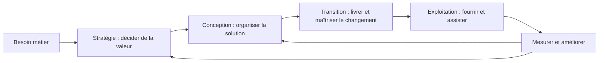

# Module 01 — Présentation d’ITIL et historique

## Objectifs

- Expliquer le passage de la livraison d’un projet à la gestion d’un service dans la durée.
- Distinguer un cadre de bonnes pratiques d’une norme et replacer le cycle ITIL v3 dans le contexte des supports.
- Comparer efficacité, efficience et qualité avec une preuve de service rendu.

## Comprendre la logique de services

ITIL fournit un vocabulaire et des bonnes pratiques pour organiser les services informatiques autour des besoins métier. Le technicien ne se limite donc pas à « faire fonctionner un serveur » : il contribue à un résultat utilisable, soutenable et mesurable pour un client.

| Notion | Question à se poser | Exemple pédagogique externe |
|---|---|---|
| Efficacité | Le résultat attendu est-il atteint ? | Les commerciaux peuvent consulter leurs commandes. |
| Efficience | Quelles ressources ont été nécessaires ? | Le résultat est obtenu sans multiplier les interventions manuelles. |
| Projet | Quel changement livrer, avec quelle échéance ? | Déployer un nouveau portail de commandes. |
| Service | Quel résultat fournir dans la durée ? | Maintenir ce portail disponible avec assistance et suivi. |
| Référentiel de pratiques | Comment organiser le travail ? | S’appuyer sur ITIL et adapter les pratiques au contexte. |
| Norme d’exigences | Quels critères faut-il satisfaire ? | Évaluer un système de management des services selon ISO/IEC 20000-1. |

Le support présente la bibliothèque historique, l’évolution d’une informatique fournisseuse de moyens vers une informatique fournisseuse de services, le forum d’utilisateurs itSMF, les acteurs de formation et de certification, puis le cycle de vie v3. Les cinq publications étudiées sont **stratégie, conception, transition, exploitation et amélioration continue**. L’amélioration accompagne l’ensemble du cycle : elle ne se limite pas à sa dernière étape.

## Repères historiques et précisions externes

Le cours suit principalement **ITIL v3** et son introduction historique à ITIL 4. Les dates, noms d’organismes et affirmations sur la propriété du référentiel dans l’Original décrivent le support ; ils ne constituent pas un annuaire actuel. En novembre 2026, PeopleCert documente aussi **ITIL (Version 5)** et sa transition depuis ITIL 4. Il serait donc trompeur de présenter ITIL 4 comme le dernier état du référentiel. Cette sensibilisation ne remplace pas un programme de certification actuel.

La phrase du support « ITIL 4 n’est pas une nouvelle version » demande à être contextualisée : ITIL 4 apporte une évolution du cadre, intégrant notamment les approches Agile, Lean et les environnements numériques. Il faut distinguer cet apport de la structure historique en cinq publications utilisée dans les modules suivants.

ISO 9001 concerne le management de la qualité dans de nombreux secteurs ; ISO/IEC 20000-1 définit les exigences d’un système de management des services. **ITIL n’est pas une norme ISO**, et suivre ITIL ne certifie pas automatiquement une organisation. La formulation « treize processus » du support ne doit pas être transformée en définition générale de la norme actuelle.

## Cas guidé — expliquer son rôle à un client

Un serveur redémarre correctement après intervention. Le service est-il rétabli ? Vérifier aussi la connexion de l’utilisateur, les données utiles, les performances et la communication de clôture. Le composant peut fonctionner alors que le résultat métier reste indisponible. Une preuve de rétablissement porte donc sur un usage réel du service.

## Notions détaillées pour approfondir

Les notions détaillées ci-dessous conservent le périmètre et les exemples du support historique, avec une mise en page réparée. Les réserves et corrections exposées plus haut s’appliquent à cette relecture. Pour la formulation source exacte, utiliser **Cours Original**. Les captures sont des illustrations isolées du support, pas des schémas générés.

### Définition et objectifs du support

<section>
<h4>Sensibilisation ITIL</h4>

Module 01 – Présentation d’ITIL et historique

<h4>Objectifs</h4>
<ul><li>Qu’est-ce qu’ITIL ?</li><li>Découvrir ITIL</li></ul>
</section>

<section>

Présentation d’ITIL

<ul><li>ITIL : Information Technology Infrastructure Library.</li><li>En français : bibliothèque pour l’infrastructure des technologies de l’information.</li></ul>
<ul><li>ITIL définit les bonnes pratiques informatiques afin d’avoir un système d’information le plus efficace et efficient que possible.</li></ul>

Historique

<ul><li>ISO 9001</li><li>Norme qui s’adresse à tous les secteurs d’activité, qui définit un système de gestion de qualité par le processus.</li></ul>
<ul><li>ISO 20000</li><li>Norme internationale, spécifique à la gestion des systèmes d’information, définie en treize processus (ces processus sont définis dans ITIL).</li><li>Cette certification est facilitée si l’on possède ISO 9001 et ITIL v2 minimum.</li></ul>
</section>

### Historique et cycle de vie v3

<section>

Historique

<ul><li>Fin des années 80<ul><li>Le gouvernement britannique lance une étude nationale pour connaître les pratiques utilisées dans la gestion des informations au niveau de l’administration et afin de garder les meilleures. Le but est d’homogénéiser le traitement des informations</li><li>Création d’une bibliothèque de 42 livres baptisée « ITIL »</li><li>Le système d’information est un fournisseur de moyens</li></ul></li><li>1991<ul><li>Création d’un forum permettant aux utilisateurs d’ITIL d’échanger les idées et leurs expériences. Il deviendra l’ITSMF</li></ul></li><li>2004<ul><li>Évolution vers ITIL v2 qui repose sur 9 livres centraux</li><li>Apparition de processus orientés sécurité et des SLA</li><li>Le système d’information est un fournisseur de services</li></ul></li></ul>

Historique

<ul><li>2007<ul><li>ITIL v3 qui repose sur 5 livres centraux</li><li>Ajout de la notion de « cycle de vie des services »</li></ul></li></ul>
<ul><li>Janvier 2020<ul><li>Le support situe ici son introduction à ITIL 4 ; les repères de version sont précisés ci-dessus.</li></ul></li></ul>
<ul><li>Référentiel international de gestion des services informatiques</li></ul>
</section>

<section>

Présentation d’ITIL v3

<ul><li>ITIL repose sur l’évolution de l’informatique dans une gestion de projets vers une gestion de service</li><li>Contenu :<ul><li>Les bonnes pratiques de la gestion des services informatiques</li><li>Définition d’un langage commun</li><li>Définition d’un cadre de travail</li></ul></li></ul>

Présentation d’ITIL v3

<ul><li>Les différents acteurs<ul><li>OGC (Office of Government Commerce) :  office public britannique du commerce</li></ul></li></ul>
<ul><li>Propriétaire du référentiel – initialise et contrôle les publications</li><li>Axelos : entreprise créée en 2014 par l’OGC pour gérer ITIL</li><li>Organismes de gestion des certifications et des examens<ul><li>APM Group, EXIN, ISEB, Loyalist College, Dansk IT, DF Certifiering</li><li>Définissent un langage commun</li></ul></li><li>ITSMF (IT Service Management Forum)<ul><li>Association d’utilisateurs</li></ul></li><li>Les organismes de formation et les formateurs agréés</li><li>Les experts et les consultants en gestion de service certifiés ITIL</li></ul>
</section>

### Évolution vers ITIL 4

<section>

Apport d’ITIL 4

<ul><li>ITIL 4 fait évoluer le cadre de gestion des services ; voir les repères de version et la précision externe ci-dessus.</li></ul>
<ul><li>Nouveautés :<ul><li>Gestion de projet Agile</li><li>Le Lean</li><li>Le Cloud</li></ul></li></ul>
</section>

## Vérifier en pratique

| Point de contrôle | Résultat attendu |
| --- | --- |
| Avant la livraison | Définir le résultat utile au client et les conditions nécessaires pour l’utiliser. |
| Après la livraison | Tester un usage réel, relever le délai et les ressources nécessaires, puis consigner les écarts. |

## Mini-quiz — 5 questions

1. Référentiel et norme sont-ils synonymes ?
2. Quelle différence entre efficacité et efficience ?
3. Pourquoi mesurer le service après livraison ?
4. Un poste a été livré dans le délai mais l’utilisateur ne peut pas accéder à son application. Quelle preuve manque ?
5. Comment distinguer deux méthodes aussi efficaces ?

??? success "Réponses commentées"
    1. Non : bonnes pratiques et exigences normatives répondent à des objectifs distincts.

    2. Atteindre le résultat ; puis examiner les ressources consommées pour y parvenir.

    3. Pour vérifier la valeur réellement fournie et décider des améliorations.

    4. Un test de l’accès avec le compte et le poste de l’utilisateur. La livraison physique ne valide pas l’usage attendu.

    5. Comparer le temps, les ressources ou le nombre de reprises nécessaires pour obtenir le même résultat.

## Pratiquer et réviser

- [Fiche de révision du module](../../revision/itil/module-01-presentation-d-itil-et-historique.md)
- [Retour à la séquence](index.md)

## Références externes vérifiées le 4 novembre 2026

- [PeopleCert — versions et transition ITIL](https://www.peoplecert.org/help-and-support/faq-itil)
- [ISO — ISO/IEC 20000-1, exigences du management des services](https://www.iso.org/standard/70636.html)
