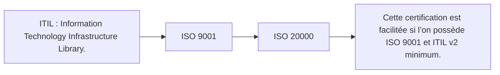
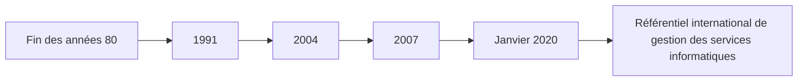

# Module 01 — Présentation d’ITIL et historique

Les parties ci-dessous reprennent le cours original, dans le même ordre. Les encadrés et les schémas répètent ses formulations.

## Parcours de lecture

1. Support · Module 01 - Support de cours · 5 pages transcrites

SOURCE DRIVE · TRANSCRIPTION DU SUPPORT

Le contenu des documents du dossier TSSR est transcrit ci-dessous, page par page. Les textes et tableaux sont intégrés à la page Web. Aucun fichier PDF, aucune diapositive entière ni aucune reproduction de page n’est affiché. Seuls des croquis ou visuels isolés et vérifiés peuvent accompagner la transcription. Les versions et les consignes restent celles des supports de formation. Les compléments IA sont conservés dans leur onglet distinct.

## Support · Module 01 - Support de cours · 5 pages transcrites

!!! note "À retenir"
    Texte, tableaux et illustrations utiles retranscrits du support ; numéros de diapositives, bandeaux répétitifs, éléments de marque et décorations exclus.

Texte, tableaux et illustrations utiles retranscrits du support ; numéros de diapositives, bandeaux répétitifs, éléments de marque et décorations exclus. Les formulations historiques sont conservées ; les précisions sont placées dans le cours optimisé.

### Page 1

#### Sensibilisation ITIL

!!! note "À retenir"
    Module 01 – Présentation d’ITIL et historique

Module 01 – Présentation d’ITIL et historique

#### Objectifs

- Qu’est-ce qu’ITIL ?
- Découvrir ITIL

### Page 2

!!! note "À retenir"
    Présentation d’ITIL ITIL : Information Technology Infrastructure Library.

**Visuel externe**

Présentation d’ITIL

- ITIL : Information Technology Infrastructure Library.
- En français : bibliothèque pour l’infrastructure des technologies de l’information.

- ITIL définit les bonnes pratiques informatiques afin d’avoir un système d’information le plus efficace et efficient que possible.

Historique

- ISO 9001
- Norme qui s’adresse à tous les secteurs d’activité, qui définit un système de gestion de qualité par le processus.

- ISO 20000
- Norme internationale, spécifique à la gestion des systèmes d’information, définie en treize processus (ces processus sont définis dans ITIL).
- Cette certification est facilitée si l’on possède ISO 9001 et ITIL v2 minimum.

### Page 3

#### Historique

!!! note "À retenir"
    Fin des années 80 - Le gouvernement britannique lance une étude nationale pour connaître les pratiques utilisées dans la gestion des informations au niveau de l’administration et afin de garder les meilleures.

**Visuel externe**

- Fin des années 80
  - Le gouvernement britannique lance une étude nationale pour connaître les pratiques utilisées dans la gestion des informations au niveau de l’administration et afin de garder les meilleures. Le but est d’homogénéiser le traitement des informations
  - Création d’une bibliothèque de 42 livres baptisée « ITIL »
  - Le système d’information est un fournisseur de moyens
- 1991
  - Création d’un forum permettant aux utilisateurs d’ITIL d’échanger les idées et leurs expériences. Il deviendra l’ITSMF
- 2004
  - Évolution vers ITIL v2 qui repose sur 9 livres centraux
  - Apparition de processus orientés sécurité et des SLA
  - Le système d’information est un fournisseur de services

- 2007
  - ITIL v3 qui repose sur 5 livres centraux
  - Ajout de la notion de « cycle de vie des services »

- Janvier 2020
  - ITIL 4 n’est pas une version, mais un dépoussiérage de la version 3 en gardant les principes fondamentaux

- Référentiel international de gestion des services informatiques

### Page 4

#### Présentation d’ITIL v3

**Visuel externe**

```mermaid
flowchart LR
    N1["Contenu :"]
    N2["Les différents acteurs"]
    N3["Propriétaire du référentiel – initialise et contrôle les publications"]
    N4["Axelos : entreprise créée en 2014 par l’OGC pour gérer ITIL"]
    N5["Organismes de gestion des certifications et des examens"]
    N6["ITSMF (IT Service Management Forum)"]
    N7["Les organismes de formation et les formateurs agréés"]
    N8["Les experts et les consultants en gestion de service certifiés ITIL"]
    N1 --> N2
    N2 --> N3
    N3 --> N4
    N4 --> N5
    N5 --> N6
    N6 --> N7
    N7 --> N8
```

- ITIL repose sur l’évolution de l’informatique dans une gestion de projets vers une gestion de service
- Contenu :
  - Les bonnes pratiques de la gestion des services informatiques
  - Définition d’un langage commun
  - Définition d’un cadre de travail

- Les différents acteurs
  - OGC (Office of Government Commerce) : office public britannique du commerce

- Propriétaire du référentiel – initialise et contrôle les publications
- Axelos : entreprise créée en 2014 par l’OGC pour gérer ITIL
- Organismes de gestion des certifications et des examens
  - APM Group, EXIN, ISEB, Loyalist College, Dansk IT, DF Certifiering
  - Définissent un langage commun
- ITSMF (IT Service Management Forum)
  - Association d’utilisateurs
- Les organismes de formation et les formateurs agréés
- Les experts et les consultants en gestion de service certifiés ITIL

### Page 5

!!! note "À retenir"
    Apport d’ITIL 4 ITIL 4 n’est pas une nouvelle version, mais représente la 4e génération industrielle.

Apport d’ITIL 4

- ITIL 4 n’est pas une nouvelle version, mais représente la 4e génération industrielle.

- Nouveautés :
  - Gestion de projet Agile
  - Le Lean
  - Le Cloud

Référence du document : 1hp8I-c8lX2TWu-40VHB5yHH8U0Q4oayi · SHA-256 2de07771b22f7326…

## Fiche de synthèse

Les lignes reprennent les titres du cours et la première phrase de chaque partie.

| Partie | Repère du cours |
| --- | --- |
| Support · Module 01 - Support de cours · 5 pages transcrites | Texte, tableaux et illustrations utiles retranscrits du support ; numéros de diapositives, bandeaux répétitifs, éléments de marque et décorations exclus. |
