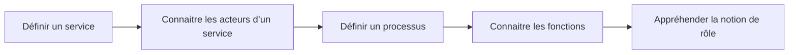
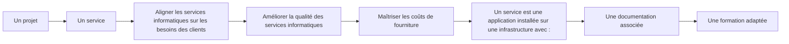
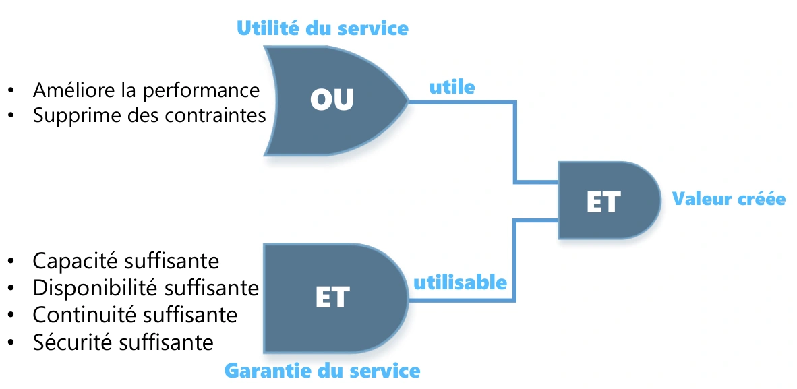
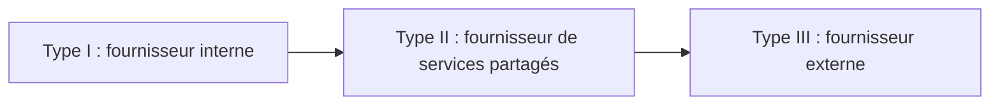
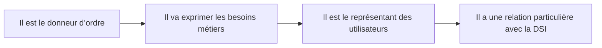
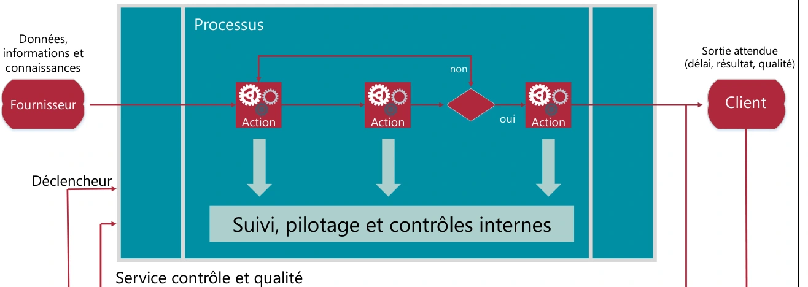
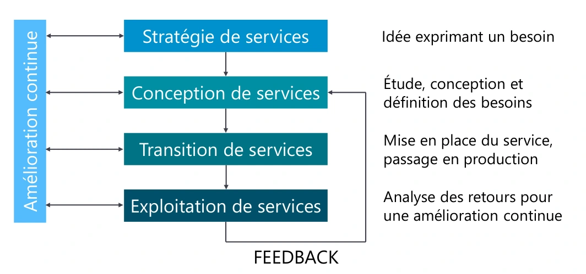

# Module 02 — La gestion des services

Les parties ci-dessous reprennent le cours original, dans le même ordre. Les encadrés et les schémas répètent ses formulations.

## Parcours de lecture

1. Support · Module 02 - Support de cours · 10 pages transcrites

SOURCE DRIVE · TRANSCRIPTION DU SUPPORT

Le contenu des documents du dossier TSSR est transcrit ci-dessous, page par page. Les textes et tableaux sont intégrés à la page Web. Aucun fichier PDF, aucune diapositive entière ni aucune reproduction de page n’est affiché. Seuls des croquis ou visuels isolés et vérifiés peuvent accompagner la transcription. Les versions et les consignes restent celles des supports de formation. Les compléments IA sont conservés dans leur onglet distinct.

## Support · Module 02 - Support de cours · 10 pages transcrites

!!! note "À retenir"
    Texte, tableaux et illustrations utiles retranscrits du support ; numéros de diapositives, bandeaux répétitifs, éléments de marque et décorations exclus.

Texte, tableaux et illustrations utiles retranscrits du support ; numéros de diapositives, bandeaux répétitifs, éléments de marque et décorations exclus. Les formulations historiques sont conservées ; les précisions sont placées dans le cours optimisé.

### Page 1

#### Sensibilisation ITIL

Module 02 – La gestion des services

#### Objectifs

!!! note "À retenir"
    Définir un service Connaitre les acteurs d’un service Définir un processus Connaitre les fonctions Appréhender la notion de rôle

**Visuel externe**

- Définir un service
- Connaitre les acteurs d’un service
- Définir un processus
- Connaitre les fonctions
- Appréhender la notion de rôle

### Page 2

**Visuel externe**

Présentation d’ITIL

- ITIL v3 propose une évolution de la gestion de projet vers la gestion de service qui est plus orientée client
- Un projet
  - C’est la capacité à implémenter de nouvelles fonctionnalités par rapport à :
    - De nouveaux besoins
    - Une nouvelle législation
    - Une avancée technologique
- Un service
  - C’est la capacité à produire le service demandé en respectant trois critères importants :

- Aligner les services informatiques sur les besoins des clients
- Améliorer la qualité des services informatiques
- Maîtriser les coûts de fourniture

Définitions

- Un service est l’ensemble des moyens mis en œuvre pour apporter à un client de la valeur sans qu’il n’en supporte ni les coûts ni les risques
- Un service est une application installée sur une infrastructure avec :

- Une documentation associée
- Une formation adaptée
- Un support mis en place
- De l’assistance aux utilisateurs
- Un service est l’engagement sur le résultat :

- Face au client
- Face au risque
- En assumant les risques

### Page 3

Les 2 conditions requises pour créer de la valeur

- Utilité (dimension de la prestation)
  - La raison d’être d’un service
    - Amélioration des performances
    - Dépassement des contraintes
    - Ou les deux

- Garantie (utilisabilité)
  - La garantie est l’assurance, pour le client, que le service va remplir les exigences de niveau de qualité contractualisé (condition, résultats, lieu, délais et moment)
  - C’est le niveau d’usage dont le client et ses utilisateurs ont besoin
  - Elle doit respecter :
    - Les heures d’ouverture
    - La disponibilité
    - La performance
    - La continuité de service
    - La sécurité

Création de valeur

Création de valeur : utilité et garantie — illustration isolée du support, page 3.

### Page 4

#### Les 5 acteurs de services

##### Le fournisseur de services informatiques (IT Service Provider)

!!! note "À retenir"
    Entité responsable de la mise à disposition des services informatiques Type I : fournisseur interne - Par exemple, l'organisation marketing d'une entreprise décide de mettre en place chez elle une équipe informatique chargée de gérer l'informatique qu'elle utilise.

**Visuel externe**

Entité responsable de la mise à disposition des services informatiques

- Type I : fournisseur interne
  - Par exemple, l'organisation marketing d'une entreprise décide de mettre en place chez elle une équipe informatique chargée de gérer l'informatique qu'elle utilise.
- Type II : fournisseur de services partagés
  - C'est le cas d'une direction informatique ayant pour clients les différentes organisations de l'entreprise (y compris elle-même).
- Type III : fournisseur externe
  - Ce type de fournisseur propose ses services à toutes les entreprises intéressées.

##### Le client

**Visuel externe**

Personne ou organisation bénéficiaire finale d’un service, comptable des résultats

- Il est le donneur d’ordre
- Il est autorisé à signer un contrat (SLA) portant sur la fourniture de service informatique
- Il va exprimer les besoins métiers
  - Négocier le service
  - Valider la solution
  - Payer la solution et le service
- Il est le représentant des utilisateurs
- Il a une relation particulière avec la DSI

### Page 5

#### Les 5 acteurs de services

##### L’utilisateur (collaborateur du client)

Personne qui utilise un système informatique

- Elle utilise les services informatiques au quotidien pour son activité professionnelle
- Il remonte ses exigences auprès du client
- Il ne paye pas l’utilisation d’un service
- Il contacte la DSI par l’intermédiaire du centre de services (helpdesk)

Propriétaire de service (Service Owner – marketing)

Entité responsable qui effectue le suivi du service informatique

- Il est responsable de la définition du service et de sa mise en œuvre

- Il participe aux propositions d’amélioration du service

- Il est responsable de la bonne mise en œuvre des améliorations validées

- Il représente le service auprès des clients

- Il participe à la négociation des SLA (Service Level Agreement) et des OLA (Operationnal Level Agreement)

- Il est un des destinataires pour les incidents majeurs lors des escalades

- Il est responsable de la vie du service (évolution et fin du service, création de tableaux de bord)

- Il s’assure que le service atteigne les objectifs

### Page 6

Les 5 acteurs de services

##### Le gestionnaire de service

Personne responsable de la mise en place de la démarche ITIL au sein de l’entreprise et de la vie du service

- Il possède une position hiérarchique élevée pour être légitime
- Il coordonne les activités des propriétaires de processus et des propriétaires de services
- Il travaille en collaboration avec le gestionnaire de l’amélioration continue des services

Les 2 dispositions spécialisées au cœur d’ITIL

- La gestion de service intègre :
  - La planification
  - La mise en œuvre
  - L’optimisation de la fourniture des services
  - Le support des services
- Pour cela, il y a 2 dispositions spécialisées :

Des fonctions Des processus

### Page 7

La notion de processus

- Un processus est une suite d’activités structurées et logiques poursuivant un objectif défini
- Il possède plusieurs caractéristiques :
  - Il comprend un ou des éléments en entrée définis
  - Il comprend un ou des éléments en sortie qui peuvent être en entrée d’un autre processus
  - Il est mesurable : coûts, qualité, gain de productivité et délais de production
  - Il a un ou des résultats attendus
  - Il a un ou des clients
  - Il a un ou des déclencheurs
  - Il définit les rôles et les responsabilités des différents acteurs
  - Il définit les besoins en outils et les contrôles de gestion
  - Il doit être documenté
  - Il doit être contrôlé

Modélisation d’un processus

Modélisation d’un processus — illustration isolée du support, page 7.

### Page 8

Les mesures d’un processus

- Les mesures (ses résultats, ses activités, ses livrables …) permettent d’améliorer son efficacité et son efficience
- L’efficacité :
  - C’est une mesure permettant de savoir si les objectifs d’un processus, d’un service ou d’une activité ont été atteints
- L’efficience :
  - C’est une mesure qui permet de savoir si la quantité de ressources attribuée à un processus, à un service ou à une activité a été suffisante et bien utilisée (coût d’argent, d’hommes, de temps)

La notion de fonction

- Une fonction est un groupe de personnes fonctionnelles (unité, équipe) disposant d’outils et de ressources spécifiques pour exécuter un certain type de travaux et sera responsable des résultats spécifiques
- Il assure une ou plusieurs activités par rapport à un ou plusieurs processus
- Il est responsable des outils (définition et utilisation)
- ITIL définit quatre fonctions

- Le centre de services
- La gestion des opérations
- La gestion technique
- La gestion des applications

### Page 9

Fonctions et processus

| Nom de processus | Commerciaux | Ressources humaines | Informatique : niveau 1 | Niveau 2 : réseau | Niveau 2 : systèmes | Niveau 2 : serveurs |
| --- | --- | --- | --- | --- | --- | --- |
| Recrutement d’une nouvelle personne |  | 1 et 4 | 2 |  |  | 3 |

#### Processus

!!! note "À retenir"
    Appel au helpdesk pour la création d’un nouveau compte 3.

1. Accueil par les ressources humaines 2. Appel au helpdesk pour la création d’un nouveau compte 3. Escalade vers l’équipe « Serveurs » 4. Retour de l’information aux ressources humaines pour test

La notion de Rôle

- Un rôle se définit à un instant T (qui fait quoi à ce moment-là)
- Le modèle R.A.C.I. va permettre à une organisation de représenter les rôles et les responsabilités de chacun.

| Rôle | Définition du support | Caractéristiques du support |
| --- | --- | --- |
| R — Responsible | réalise et reporte — chargé de faire | En charge de la réalisation de l’action (plusieurs) ; sous-traitant de A ; au moins 1 par action |
| A — Accountable | autorise et assume — responsable | Rend des comptes sur l’avancement de l’action ; assume la responsabilité de l’action ; 1 seul par action |
| C — Consulted | est consulté | Impliqué dans l’action en tant que fournisseur d’avis ; l’avis doit être pris en compte par la personne qui l’a demandé ; au moins 1 par action |
| I — Informed | est informé | Doit prendre connaissance de l’action et de son avancement ; doit être informé sur le déroulement, le résultat ; au moins 1 par action |

### Page 10

!!! note "À retenir"
    Le modèle R.A.C.I R = Responsible (réalise et reporte - chargé de faire) C = Consulted (est consulté) A = Accountable (autorise et assume - responsable) I = Informed (est informé) Le cycle de vie des services Cycle de vie des services — illustration isolée du support, page 10.

Le modèle R.A.C.I

| Activité | Gestionnaire processus 1 | Responsable service 1 | Gestionnaire processus 2 | Responsable service 2 | Gestionnaire processus 3 | Responsable service 3 |
| --- | --- | --- | --- | --- | --- | --- |
| Activité 1 | I | R | A | C | C | R |
| Activité 2 | C | I | R | C | A | I |
| Activité 3 | A |  | C | R | I |  |
| Activité 4 |  | I | A | R | C |  |

R = Responsible (réalise et reporte - chargé de faire)

C = Consulted (est consulté)

A = Accountable (autorise et assume - responsable)

I = Informed (est informé)

Le cycle de vie des services

Cycle de vie des services — illustration isolée du support, page 10.

Référence du document : 1-W0WgI7vherOpIAohym9RPrSpt9RU6QC · SHA-256 de2d54ba80fed6fc…

## Fiche de synthèse

Les lignes reprennent les titres du cours et la première phrase de chaque partie.

| Partie | Repère du cours |
| --- | --- |
| Support · Module 02 - Support de cours · 10 pages transcrites | Texte, tableaux et illustrations utiles retranscrits du support ; numéros de diapositives, bandeaux répétitifs, éléments de marque et décorations exclus. |
