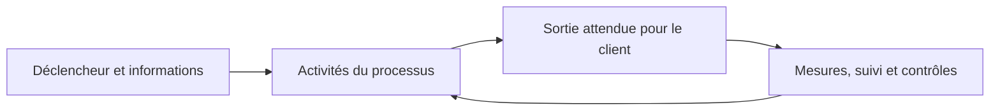
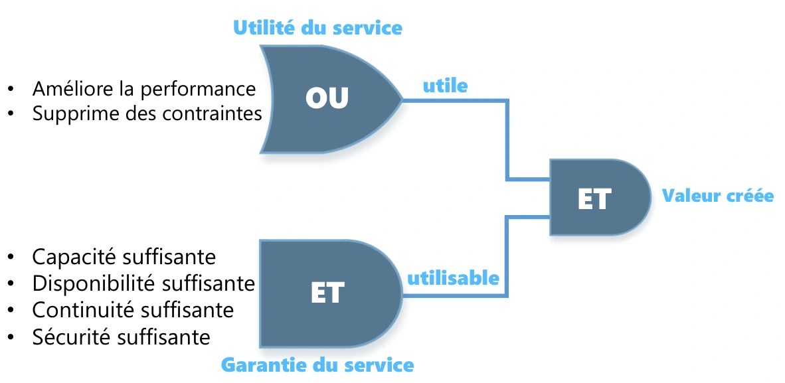
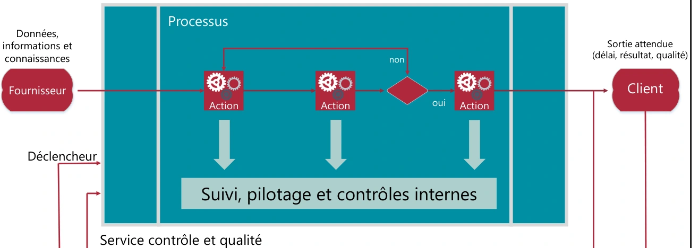
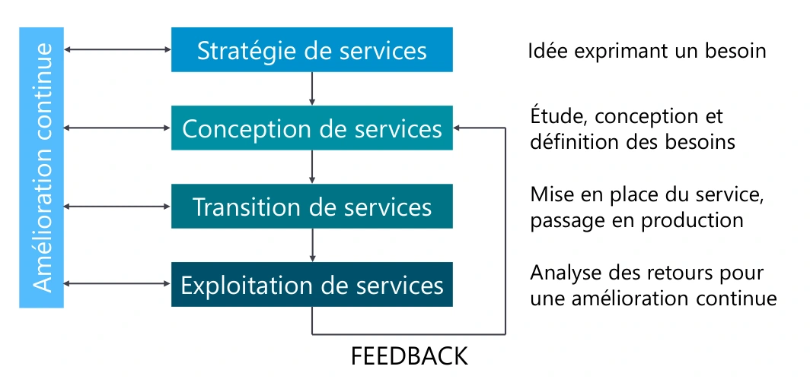

# Module 02 — La gestion des services

## Le service crée de la valeur grâce à deux conditions

L’**utilité** répond à « ce service m’aide-t-il à faire mon travail ? » ; la **garantie** répond à « puis-je compter sur lui dans les conditions prévues ? ». Une application utile mais souvent indisponible crée peu de valeur. Un système parfaitement disponible mais inutile au métier n’en crée pas davantage.

| Utilité | Garantie à préciser dans l’engagement |
|---|---|
| Améliorer les performances du métier | Disponibilité et heures de service |
| Supprimer une contrainte | Capacité et performances suffisantes |
| Répondre à un besoin réel | Continuité et sécurité |

**Précision externe :** la définition du support sur les coûts et risques signifie que le client n’a pas à gérer lui-même certains coûts et risques propres à la réalisation du service. Elle ne signifie pas que le service est gratuit ou que tout risque disparaît.

## Acteurs, processus, fonctions et rôles

| Acteur du support | Responsabilité à comprendre |
|---|---|
| Fournisseur interne, partagé ou externe | Fournir le service ; distinguer équipe interne, service partagé et prestataire externe. |
| Client | Exprimer les besoins, négocier et valider les engagements ; il peut représenter les utilisateurs. |
| Utilisateur | Utiliser le service et signaler les besoins ou difficultés. |
| Propriétaire de service | Suivre le service dans sa durée de vie, ses résultats, améliorations et relations client. |
| Gestionnaire de service | Coordonner la démarche et les responsables concernés. |

Un **processus** décrit des activités organisées : entrées, déclencheur, sorties, clients, objectifs, rôles, outils, contrôles et mesures. Une **fonction** regroupe des personnes et des moyens ; elle peut participer à plusieurs processus. Les quatre fonctions v3 du support sont le centre de services, la gestion technique, la gestion des opérations et la gestion des applications. Un **rôle** décrit une responsabilité dans une activité ; il ne se confond pas avec un poste ou un titre hiérarchique.

## Lire une matrice RACI sans confondre les lettres

| Lettre | Sens pratique | Contrôle |
|---|---|---|
| R — Responsible | Réalise l’activité et rend compte de son exécution | Au moins un acteur pour que le travail soit effectué. |
| A — Accountable | Assume la responsabilité finale | Identifier un responsable clairement désigné pour l’activité. |
| C — Consulted | Apporte un avis, échange dans les deux sens | Consulter les personnes dont l’avis est nécessaire. |
| I — Informed | Reçoit l’information utile | Prévoir qui doit connaître l’avancement ou le résultat. |

**Précision externe :** le support indique au moins un C et un I par action ; cela ne constitue pas une obligation universelle de RACI. Une activité peut n’avoir aucun consulté ou informé distinct. La matrice doit rester utile et éviter la consultation systématique de tout le monde.

## Cas guidé — arrivée d’un collaborateur

Les ressources humaines lancent l’arrivée ; le centre de services enregistre la demande ; l’équipe serveurs crée le compte ; les ressources humaines vérifient le résultat. Plusieurs fonctions participent à un même processus. Pour juger l’efficacité, contrôler que le compte existe à la date attendue et donne les accès autorisés. Pour juger l’efficience, mesurer le temps de traitement, les ressaisies et les retours.

**Mini-quiz.** 1. Qui utilise et qui négocie le service ? 2. Un processus est-il une équipe ? 3. Qui réalise dans RACI ? 4. Disponibilité élevée suffit-elle à créer de la valeur ?

??? success "Réponses commentées"
    1. L’utilisateur utilise ; le client exprime et négocie les besoins.
    2. Non, c’est une organisation d’activités ; les fonctions lui apportent des moyens.
    3. R ; A porte la responsabilité finale.
    4. Non : il faut aussi une utilité correspondant au besoin.

## Notions détaillées pour approfondir

Les notions détaillées ci-dessous conservent le périmètre et les exemples du support historique, avec une mise en page réparée. Les réserves et corrections exposées plus haut s’appliquent à cette relecture. Pour la formulation source exacte, utiliser **Cours Original**. Les captures sont des illustrations isolées du support, pas des schémas générés.

<section>
<h4>Sensibilisation ITIL</h4>

Module 02 – La gestion des services

<h4>Objectifs</h4>
<ul><li>Définir un service</li><li>Connaitre les acteurs d’un service</li><li>Définir un processus</li><li>Connaitre les fonctions</li><li>Appréhender la notion de rôle</li></ul>
</section>
<section>

Présentation d’ITIL

<ul><li>ITIL v3 propose une évolution de la gestion de projet vers la gestion de service qui est plus orientée client</li><li>Un projet<ul><li>C’est la capacité à implémenter de nouvelles fonctionnalités par rapport à :<ul><li>De nouveaux besoins</li><li>Une nouvelle législation</li><li>Une avancée technologique</li></ul></li></ul></li><li>Un service<ul><li>C’est la capacité à produire le service demandé en respectant trois critères importants :</li></ul></li></ul>
<ul><li>Aligner les services informatiques sur les besoins des clients</li><li>Améliorer la qualité des services informatiques</li><li>Maîtriser les coûts de fourniture</li></ul>

Définitions

<ul><li>Un service est l’ensemble des moyens mis en œuvre pour apporter à un client de la valeur sans qu’il n’en supporte ni les coûts ni les risques</li><li>Un service est une application installée sur une infrastructure avec :</li></ul>
<ul><li> Une documentation associée</li><li> Une formation adaptée</li><li> Un support mis en place</li><li> De l’assistance aux utilisateurs</li><li>Un service est l’engagement sur le résultat :</li></ul>
<ul><li> Face au client</li><li> Face au risque</li><li> En assumant les risques</li></ul>
</section>
<section>

Les 2 conditions requises pour créer de la valeur

<ul><li>Utilité (dimension de la prestation)<ul><li>La raison d’être d’un service<ul><li>Amélioration des performances</li><li>Dépassement des contraintes</li><li>Ou les deux</li></ul></li></ul></li></ul>
<ul><li>Garantie (utilisabilité)<ul><li>La garantie est l’assurance, pour le client, que le service va remplir les exigences de niveau de qualité contractualisé (condition, résultats, lieu, délais et moment)</li><li>C’est le niveau d’usage dont le client et ses utilisateurs ont besoin</li><li>Elle doit respecter :<ul><li>Les heures d’ouverture</li><li>La disponibilité</li><li>La performance</li><li>La continuité de service</li><li>La sécurité</li></ul></li></ul></li></ul>

Création de valeur

<figure><figcaption>Création de valeur : utilité et garantie — illustration isolée du support, page 3.</figcaption></figure>
</section>
<section>

Les 5 acteurs de services

Le fournisseur de services informatiques (IT Service Provider) Entité responsable de la mise à disposition des services informatiques • Type I : fournisseur interne • Par exemple, l'organisation marketing d'une entreprise décide de mettre en place chez elle une équipe informatique chargée de gérer l'informatique qu'elle utilise. • Type II : fournisseur de services partagés • C'est le cas d'une direction informatique ayant pour clients les différentes organisations de l'entreprise (y compris elle-même). • Type III : fournisseur externe • Ce type de fournisseur propose ses services à toutes les entreprises intéressées.

Les 5 acteurs de services

Le client Personne ou organisation bénéficiaire finale d’un service, comptable des résultats • Il est le donneur d’ordre • Il est autorisé à signer un contrat (SLA) portant sur la fourniture de service informatique • Il va exprimer les besoins métiers • Négocier le service • Valider la solution • Payer la solution et le service • Il est le représentant des utilisateurs • Il a une relation particulière avec la DSI

</section>
<section>

Les 5 acteurs de services

L’utilisateur (collaborateur du client) Personne qui utilise un système informatique • Elle utilise les services informatiques au quotidien pour son activité professionnelle • Il remonte ses exigences auprès du client • Il ne paye pas l’utilisation d’un service • Il contacte la DSI par l’intermédiaire du centre de services (helpdesk)

Les 5 acteurs de services

Propriétaire de service (Service Owner – marketing)

Entité responsable qui effectue le suivi du service informatique

<ul><li>Il est responsable de la définition du service et de sa mise en œuvre</li></ul>
<ul><li>Il participe aux propositions d’amélioration du service</li></ul>
<ul><li>Il est responsable de la bonne mise en œuvre des améliorations validées</li></ul>
<ul><li>Il représente le service auprès des clients</li></ul>
<ul><li>Il participe à la négociation des SLA (Service Level Agreement) et des OLA (Operationnal Level Agreement)</li></ul>
<ul><li>Il est un des destinataires pour les incidents majeurs lors des escalades</li></ul>
<ul><li>Il est responsable de la vie du service (évolution et fin du service, création de tableaux de bord)</li></ul>
<ul><li>Il s’assure que le service atteigne les objectifs</li></ul>
</section>
<section>

Les 5 acteurs de services

Le gestionnaire de service Personne responsable de la mise en place de la démarche ITIL au sein de l’entreprise et de la vie du service • Il possède une position hiérarchique élevée pour être légitime • Il coordonne les activités des propriétaires de processus et des propriétaires de services • Il travaille en collaboration avec le gestionnaire de l’amélioration continue des services

Les 2 dispositions spécialisées au cœur d’ITIL

<ul><li>La gestion de service intègre :<ul><li>La planification</li><li>La mise en œuvre</li><li>L’optimisation de la fourniture des services</li><li>Le support des services</li></ul></li><li>Pour cela, il y a 2 dispositions spécialisées :</li></ul>

Des fonctions Des processus

</section>
<section>

La notion de processus

<ul><li>Un processus est une suite d’activités structurées et logiques poursuivant un objectif défini</li><li>Il possède plusieurs caractéristiques :<ul><li>Il comprend un ou des éléments en entrée définis</li><li>Il comprend un ou des éléments en sortie qui peuvent être en entrée d’un autre processus</li><li>Il est mesurable : coûts, qualité, gain de productivité et délais de production</li><li>Il a un ou des résultats attendus</li><li>Il a un ou des clients</li><li>Il a un ou des déclencheurs</li><li>Il définit les rôles et les responsabilités des différents acteurs</li><li>Il définit les besoins en outils et les contrôles de gestion</li><li>Il doit être documenté</li><li>Il doit être contrôlé</li></ul></li></ul>

Modélisation d’un processus

<figure><figcaption>Modélisation d’un processus — illustration isolée du support, page 7.</figcaption></figure>
</section>
<section>

Les mesures d’un processus

<ul><li>Les mesures (ses résultats, ses activités, ses livrables …) permettent d’améliorer son efficacité et son efficience</li><li>L’efficacité :<ul><li>C’est une mesure permettant de savoir si les objectifs d’un processus, d’un service ou d’une activité ont été atteints</li></ul></li><li>L’efficience :<ul><li>C’est une mesure qui permet de savoir si la quantité de ressources attribuée à un processus, à un service ou à une activité a été suffisante et bien utilisée (coût d’argent, d’hommes, de temps)</li></ul></li></ul>

La notion de fonction

<ul><li>Une fonction est un groupe de personnes fonctionnelles (unité, équipe) disposant d’outils et de ressources spécifiques pour exécuter un certain type de travaux et sera responsable des résultats spécifiques</li><li>Il assure une ou plusieurs activités par rapport à un ou plusieurs processus</li><li>Il est responsable des outils (définition et utilisation)</li><li>ITIL définit quatre fonctions</li></ul>
<ul><li> Le centre de services</li><li> La gestion des opérations</li><li> La gestion technique</li><li> La gestion des applications</li></ul>
</section>
<section>

Fonctions et processus

<table><caption>Fonctions et processus</caption><thead><tr><th scope="col">Nom de processus</th><th scope="col">Commerciaux</th><th scope="col">Ressources humaines</th><th scope="col">Informatique : niveau 1</th><th scope="col">Niveau 2 : réseau</th><th scope="col">Niveau 2 : systèmes</th><th scope="col">Niveau 2 : serveurs</th></tr></thead><tbody><tr><td>Recrutement d’une nouvelle personne</td><td></td><td>1 et 4</td><td>2</td><td></td><td></td><td>3</td></tr></tbody></table>
<h4>Processus</h4>

1. Accueil par les ressources humaines 2. Appel au helpdesk pour la création d’un nouveau compte 3. Escalade vers l’équipe « Serveurs » 4. Retour de l’information aux ressources humaines pour test

La notion de Rôle

<ul><li>Un rôle se définit à un instant T (qui fait quoi à ce moment-là)</li><li>Le modèle R.A.C.I. va permettre à une organisation de représenter les rôles et les responsabilités de chacun.</li></ul>
<table><caption>Modèle R.A.C.I. — formulations conservées du support</caption><thead><tr><th scope="col">Rôle</th><th scope="col">Définition du support</th><th scope="col">Caractéristiques du support</th></tr></thead><tbody><tr><td>R — Responsible</td><td>réalise et reporte — chargé de faire</td><td>En charge de la réalisation de l’action (plusieurs) ; sous-traitant de A ; au moins 1 par action</td></tr><tr><td>A — Accountable</td><td>autorise et assume — responsable</td><td>Rend des comptes sur l’avancement de l’action ; assume la responsabilité de l’action ; 1 seul par action</td></tr><tr><td>C — Consulted</td><td>est consulté</td><td>Impliqué dans l’action en tant que fournisseur d’avis ; l’avis doit être pris en compte par la personne qui l’a demandé ; selon les besoins de cette activité</td></tr><tr><td>I — Informed</td><td>est informé</td><td>Doit prendre connaissance de l’action et de son avancement ; doit être informé sur le déroulement, le résultat ; selon les besoins de cette activité</td></tr></tbody></table>
</section>
<section>

Le modèle R.A.C.I

<table><caption>Exemple de matrice R.A.C.I.</caption><thead><tr><th scope="col">Activité</th><th scope="col">Gestionnaire processus 1</th><th scope="col">Responsable service 1</th><th scope="col">Gestionnaire processus 2</th><th scope="col">Responsable service 2</th><th scope="col">Gestionnaire processus 3</th><th scope="col">Responsable service 3</th></tr></thead><tbody><tr><td>Activité 1</td><td>I</td><td>R</td><td>A</td><td>C</td><td>C</td><td>R</td></tr><tr><td>Activité 2</td><td>C</td><td>I</td><td>R</td><td>C</td><td>A</td><td>I</td></tr><tr><td>Activité 3</td><td>A</td><td></td><td>C</td><td>R</td><td>I</td><td></td></tr><tr><td>Activité 4</td><td></td><td>I</td><td>A</td><td>R</td><td>C</td><td></td></tr></tbody></table>

R = Responsible (réalise et reporte - chargé de faire)

C = Consulted  (est consulté)

A = Accountable (autorise et assume - responsable)

I = Informed (est informé)

Le cycle de vie des services

<figure><figcaption>Cycle de vie des services — illustration isolée du support, page 10.</figcaption></figure>
</section>

## Pratiquer et réviser

- [Fiche de révision du module](../../revision/itil/module-02-la-gestion-des-services.md)
- [Retour à la séquence](index.md)
