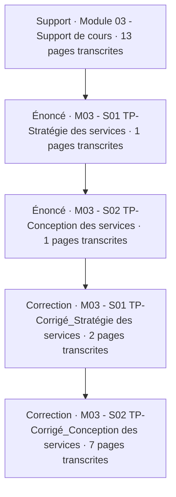
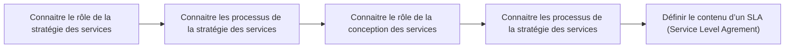
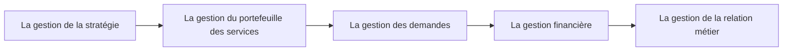
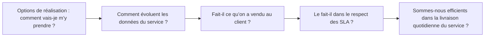
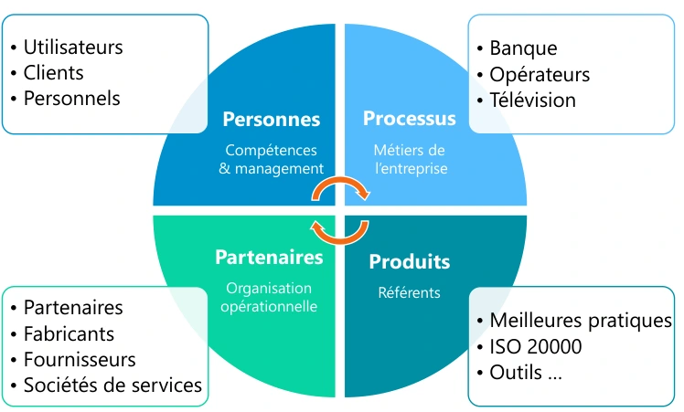
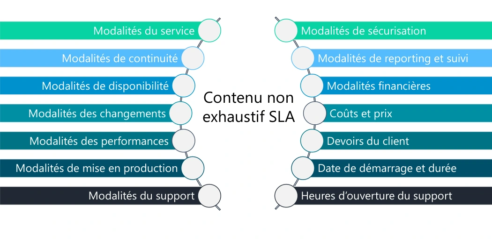
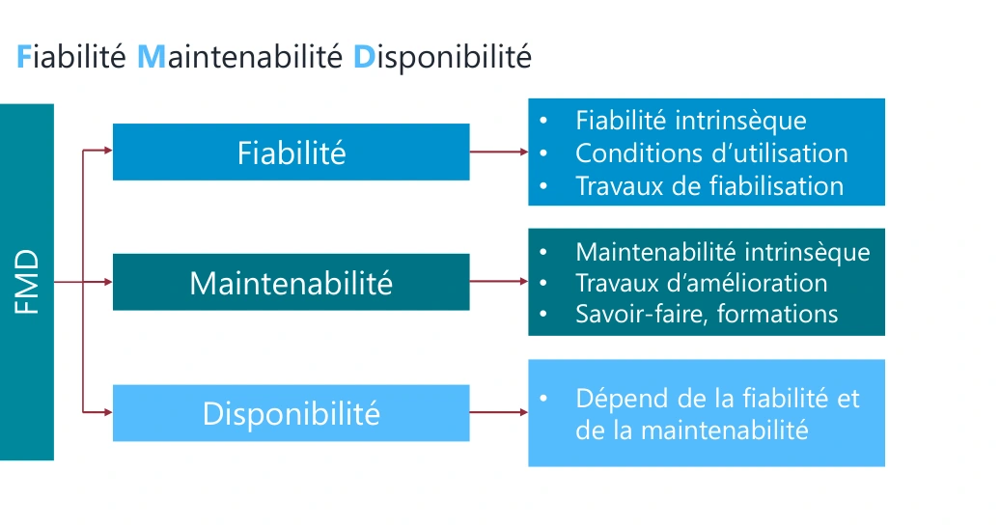
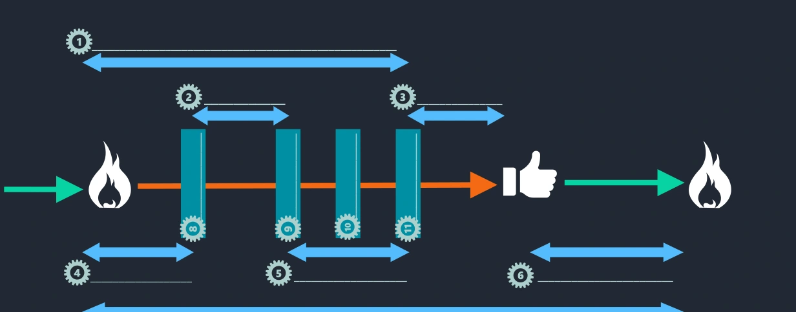

# Module 03 — Stratégie et conception des services

Les parties ci-dessous reprennent le cours original, dans le même ordre. Les encadrés et les schémas répètent ses formulations.

## Parcours de lecture

1. Support · Module 03 - Support de cours · 13 pages transcrites
2. Énoncé · M03 - S01 TP-Stratégie des services · 1 pages transcrites
3. Énoncé · M03 - S02 TP-Conception des services · 1 pages transcrites
4. Correction · M03 - S01 TP-Corrigé_Stratégie des services · 2 pages transcrites
5. Correction · M03 - S02 TP-Corrigé_Conception des services · 7 pages transcrites

**Visuel externe**

SOURCE DRIVE · TRANSCRIPTION DU SUPPORT

Le contenu des documents du dossier TSSR est transcrit ci-dessous, page par page. Les textes et tableaux sont intégrés à la page Web. Aucun fichier PDF, aucune diapositive entière ni aucune reproduction de page n’est affiché. Seuls des croquis ou visuels isolés et vérifiés peuvent accompagner la transcription. Les versions et les consignes restent celles des supports de formation. Les compléments IA sont conservés dans leur onglet distinct.

## Support · Module 03 - Support de cours · 13 pages transcrites

!!! note "À retenir"
    Texte, tableaux et illustrations utiles retranscrits du support ; numéros de diapositives, bandeaux répétitifs, éléments de marque et décorations exclus.

Texte, tableaux et illustrations utiles retranscrits du support ; numéros de diapositives, bandeaux répétitifs, éléments de marque et décorations exclus. Les formulations historiques sont conservées ; les précisions sont placées dans le cours optimisé.

### Page 1

#### Sensibilisation ITIL

!!! note "À retenir"
    Module 03 – Les publications centrales « Stratégie et Conception des services »

Module 03 – Les publications centrales « Stratégie et Conception des services »

#### Objectifs

!!! note "À retenir"
    Connaitre le rôle de la stratégie des services Connaitre les processus de la stratégie des services Connaitre le rôle de la conception des services Connaitre les processus de la stratégie des services Définir le contenu d’un SLA (Service Level Agrement)

**Visuel externe**

- Connaitre le rôle de la stratégie des services
- Connaitre les processus de la stratégie des services
- Connaitre le rôle de la conception des services
- Connaitre les processus de la stratégie des services
- Définir le contenu d’un SLA (Service Level Agrement)

### Page 2

#### Les publications centrales

#### « Stratégie des services »

!!! note "À retenir"
    La stratégie des services Objectifs - Comment développer l’offre de service dans un contexte concurrentiel ?

La stratégie des services

- Objectifs
  - Comment développer l’offre de service dans un contexte concurrentiel ?
  - Comment passer de la gestion des services à un rôle stratégique de la DSI pour l’entreprise ?
  - Comment apporter de la valeur aux clients ?
- Son rôle
  - Produire des services de qualité apportant de la valeur aux clients en prévoyant les conflits possibles
  - Planifier et définir une stratégie des services (services offerts)
  - Rester proche des demandes métiers en restant concurrentiel

### Page 3

#### Les processus de la stratégie des services

**Visuel externe**

- La gestion de la stratégie
  - Il permet l’établissement de la stratégie des services en fonction de l’état du marché, des demandes (clients), des offres (concurrence) et des capacités de l’entreprise (personnel, matériel, financière)
- La gestion du portefeuille des services
  - Il liste tous les services (futurs, actuels, retirés) et leur description (coût)
  - Les services actuels sont contenus dans le catalogue des services (clients)

- La gestion des demandes
  - C’est un des processus les plus critiques
  - Permet d’analyser les besoins des clients, actuels et surtout futurs, en fonction des évolutions des métiers et des technologies
- La gestion financière
  - Permet d’analyser les coûts d’un service afin d’en définir le prix
- La gestion de la relation métier
  - Maintient une relation de confiance avec les clients pour garantir la satisfaction générale ressentie

### Page 4

**Visuel externe**

Les 4 « P »

| Les quatre P | Repères associés |
| --- | --- |
| Positionnements (Positions) | Politiques et éléments différenciateurs |
| Perspective (Perspective) | Vision et mission |
| Plans (Plans) | Méthode et exécution |
| Pérennisation (Patterns) | Décisions et actions consistantes dans la durée |

- Les acteurs
  - La direction de l’entreprise
    - Donner des directions
    - Définir des politiques
    - Identifier les projets
    - Attribuer les ressources
  - La direction financière
    - Prioriser les investissements

Terminologie

- ROI (Return On Investment) : retour sur investissement, comparaison de la dépense par rapport à la valeur produite et sur quelle durée
- TCO (Total Cost of Ownership) : coût total de possession, ensemble des coûts de fourniture des services
- Coût d’un service : argent dépensé pour concevoir ou fournir un service

- Coûts directs : achat de matériels ou de fournitures (facture)
- Coûts indirects : frais par rapport à l’entreprise (location des locaux)
- Coûts cachés (inclus dans le TCO) : manque de formation des techniciens
- Prix d’un service : le coût augmenté d’une marge

### Page 5

#### Les publications centrales « Conception des services »

La conception des services

- Objectif
  - Produire des services en respectant les livrables produits par la stratégie des services
- Son rôle
  - Recueillir les exigences du client (SLR)
  - Définir la solution
  - Connaître les contraintes de l’architecture du système d’information
  - Définir les processus
  - Définir les indicateurs de mesure du service

### Page 6

!!! note "À retenir"
    La conception des services : définir la solution Exigences, contraintes, spécifications, validité et bénéfices : où je dois aller?

**Visuel externe**

La conception des services : définir la solution

- Exigences, contraintes, spécifications, validité et bénéfices : où je dois aller?
- Options de réalisation : comment vais-je m’y prendre ?
  - Réalisation interne ou sous-traitance ?
  - Maintenance corrective interne ou externe (TMA) ?
  - Exploitation interne ou infogérance ?
  - Sous-traitance fonctionnelle (BPO) ?
  - ASP : fournir le service directement au client final via l’infrastructure de l’informatique d’un fournisseur ?
  - KPO : appel à un ou plusieurs consultants externes pour leurs connaissances sur les métiers ou la technologie ?

La conception des services : indicateurs

- Comment évoluent les données du service ?
- Fait-il ce qu’on a vendu au client ?
- Le fait-il dans le respect des SLA ?
- Sommes-nous efficients dans la livraison quotidienne du service ?

### Page 7

#### Les processus de la conception des services

- La coordination de la conception
  - Met en relation les différents processus pour la création des services
- La gestion du catalogue des services
  - Pour gérer et garder à jour les informations des services et leur disponibilité
- La gestion des niveaux de services (SLA) *
  - Dans la matrice RACI, elle est « accountable »
  - Permet d’identifier les exigences, les besoins et les moyens nécessaires à la fourniture des services

* Processus détaillé dans les diapositives suivantes

- La gestion de la disponibilité *
  - S’assure que les niveaux de disponibilité d’un service sont conformes aux SLA
  - Permet aussi de supprimer les SPOF (Single Point Of Failure)
- La gestion de la capacité
  - S’assure que les services actuels et futurs sont et seront délivrés au meilleur coût (ressources humaines et/ou matérielles)
  - Elle contient trois sous-processus :
    - BCM (Business Capacity Management) – Gestion de la capacité orientée métier – Futurs besoins
    - SCM (Service Capacity Management) – Gestion de la capacité orientée service – Performances actuelles
    - CCM (Component Capacity Management) – Gestion de la capacité des composants – Ressources disponibles

* Processus détaillé dans les diapositives suivantes

### Page 8

Les processus de la conception des services

- La gestion de la continuité
  - S’assure de la poursuite de la livraison des services dans le respect des SLA dans un environnement dégradé (côté DSI et/ou client)
  - Nécessite de tester régulièrement et adapter les PCA
- La gestion de la sécurité
  - S’assure de la sécurité des données du système d’information
  - Disponibilité, confidentialité, intégrité, authenticité, non-répudiation
  - Nécessite de définir la politique d’utilisation du système d’information
- La gestion des fournisseurs *
  - Codifie la relation avec les fournisseurs (recrutement, contrat, niveau et qualité de service, litiges, ruptures de contrat)

- * Processus détaillé dans les diapositives suivantes

Les acteurs de la conception des services « 4P »

Les quatre P de la conception — illustration isolée du support, page 8.

- Personnes
  - Utiliser les meilleures ressources internes

- Processus
  - Créer, définir et faire évoluer les processus et les procédures en fonction de leur utilisation par les services

- Produits
  - Choisir des produits adaptés aux services

- Partenaires
  - Sélectionner et impliquer les sous-traitants et les fournisseurs spécialisés dans un domaine (apport de personnels, de savoir-faire et de compétences)

### Page 9

#### La gestion des niveaux de services

!!! note "À retenir"
    Contenu non exhaustif d’un SLA — illustration isolée du support, page 9.

Contenu non exhaustif d’un SLA — illustration isolée du support, page 9.

- Le contenu d’un OLA
  - Un contrat de services OLA est un contrat pour réaliser un SLA
  - Le document a la même structure que le SLA
  - L’OLA est un contrat interne, les conditions de pénalités sont souvent inexistantes ou non applicables
- Le contenu d’un UC
  - Un contrat de service UC est un contrat avec un prestataire externe pour réaliser un SLA
  - Le document a la même structure que le SLA
  - Des clauses juridiques sont à ajouter pour traiter la relation entre les deux organisations

### Page 10

#### La gestion des niveaux de services : terminologie

- SLR – Service Level Requirement : expression des besoins de client
- SLM – Service Level Manager : responsable de la gestion des niveaux de services
- SLA – Service Level Agreement : accord de niveaux de services conclu avec le client
- OLA – Operationnal Level Agreement : accord de niveaux de services conclu avec les fournisseurs internes

- UC – Underpinning Contract : contrat de sous-traitance
- Catalogue de services : document regroupant l’ensemble des services
- SIP – Service Improvement Program : programme d’amélioration des services

- TMA - Tierce Maintenance Applicative : maintenance corrective applicative effectuée par un tiers (développement).
- BPO - Business Process Outsourcing : sous-traitance fonctionnelle d’une application, d’un processus métier (la paie, la comptabilité).
- ASP - Application Service Provision : fournir le service directement au client final via l’infrastructure de l’informatique d’un fournisseur
- KPO - Knowledge Process Outsoursing : appel à un ou plusieurs consultants externes pour leurs connaissances sur les métiers ou la technologie

### Page 11

!!! note "À retenir"
    La gestion de la disponibilité Fiabilité, maintenabilité, disponibilité — illustration isolée du support, page 11.

La gestion de la disponibilité

Fiabilité, maintenabilité, disponibilité — illustration isolée du support, page 11.

La gestion de la disponibilité : terminologie

- Fiabilité : aptitude d’un équipement, d’un logiciel, d’un service à fonctionner durablement avec un nombre minimum d’interruptions ou d’incidents
- Maintenabilité : aptitude d’un service ou d’un équipement à être remis en marche
- Résilience : aptitude à continuer à fonctionner même si un ou plusieurs composants sont hors service
- Service-ability : aptitude que l’on a à trouver des fournisseurs ou sous-traitants externes pour assurer disponibilité, fiabilité et maintenabilité
- Recoverability : aptitude à s’auto reconfigurer jusqu’au dernier niveau d’avant arrêt

### Page 12

!!! note "À retenir"
    La gestion de la continuité : terminologie Business Continuity Plan (Plan de Continuité d’Activité en français) : orienté métier, quelles sont les activités opérationnelles et leurs ressources, que vais-je maintenir ?

La gestion de la continuité : terminologie

- Business Continuity Plan (Plan de Continuité d’Activité en français) : orienté métier, quelles sont les activités opérationnelles et leurs ressources, que vais-je maintenir ?
- Business Continuity Managment : analyse et gestion, quels sont les risques et leurs impacts ?
- Business Impact Analysis : méthode d’analyse de l’impact business qui permet d’évaluer les pertes potentielles.
- Disaster Recovery Plan (Plan de Reprise d’Activité en français) : plan de rétablissement et reprise informatique.

La gestion des fournisseurs

- Organisation externe à l’entreprise qui va intervenir dans la fourniture d’un service sous contrat de sous-traitance (UC, Underpinning Contract)
- Plusieurs relations possibles :
  - Sous-traitance : organisation externe qui s’engage pour la conception, le développement, l’exploitation et la maintenance d’un service.
  - Cotraitance : organisation externe qui s’engage à participer à des activités du cycle de vie du service.
  - Partenariat : engagement à long terme pour de nouvelles opportunités.
  - Application Service Provision (ASP) : fourniture partielle ou totale d’un service à partir de son propre SI et de son réseau.

### Page 13

La gestion de la sécurité : terminologie

- La disponibilité des données : c’est donner à l’utilisateur qui le demande l’information dont il a besoin.
- La confidentialité : c’est rendre accessible l’information à ceux qui en ont l’autorisation et à eux seuls.

- L’authenticité : c’est rendre fiables les échanges par une signature électronique.
- L’intégrité : c’est s’assurer que l’information est complète et qu’elle n’a pas été altérée de manière frauduleuse.

- La non-répudiation : c’est assumer le fait d’avoir effectué l’action.

La gestion de la disponibilité : taux

Repères numérotés du taux de disponibilité : partie principale — illustration isolée du support, page 13.

Repères numérotés du taux de disponibilité : intervalles inférieurs — illustration isolée du support, page 13.

Référence du document : 18vnbva8Vol82ZGnWwFr4uUKNSik47fmz · SHA-256 b4c1a737189c9273…

## Énoncé · M03 - S01 TP-Stratégie des services · 1 pages transcrites

Texte, tableaux et illustrations utiles retranscrits du support ; numéros de diapositives, bandeaux répétitifs, éléments de marque et décorations exclus. Les formulations historiques sont conservées ; les précisions sont placées dans le cours optimisé.

### Page 1

Sensibilisation à ITIL

#### ITIL - La stratégie des services

#### TP du Module 03 - Les publications centrales : stratégie et conception des services

Pour effectuer ce TP, il faut avoir suivi le module 1 à 3 de ce cours.

Durée estimée

1 heure

#### Énoncé

On vous demande d'étudier un nouveau service :

- Accueil d'un nouveau salarié commercial itinérant.

La liste de matériel informatique pour un commercial itinérant :

- 1 Portable : Dell XPS 15 + accessoires

- 1 Dock WD19DCS + accessoires

- 1 Moniteur 22 pouces

- 1 Téléphone IP Cisco 7811 + accessoires

- 1 Smartphone iPhone X + abonnement

Identifier tous les éléments non matériels permettant à l’utilisateur de travailler.

L’entreprise contient les éléments suivants :

- Un domaine Active Directory nommé « got.lcl »

- Un domaine de messagerie Office 365 nommé « westeros.fr »

- Un logiciel de gestion de parc GLPI

- Une entrée sécurisée par badge

Identifier également tous les éléments permettant aux différents matériels de fonctionner.

Référence du document : 1DlMlL5fUDMwsURxBSNgmmOzQp9QZRlLg · SHA-256 972c32b8a784ab9e…

## Énoncé · M03 - S02 TP-Conception des services · 1 pages transcrites

Texte, tableaux et illustrations utiles retranscrits du support ; numéros de diapositives, bandeaux répétitifs, éléments de marque et décorations exclus. Les formulations historiques sont conservées ; les précisions sont placées dans le cours optimisé.

### Page 1

Sensibilisation à ITIL

#### ITIL - La conception des services

#### TP du Module 03 - Les Publications centrales : stratégie et conception des services

Pour effectuer ce TP, il faut avoir suivi les modules 1 à 3 de ce cours.

Durée estimée

2 heures

#### Énoncé

On vous demande d'étudier un nouveau service :

o Accueil d'un nouveau salarié commercial.

1. Stratégie des Services

o Vous avez défini les grandes lignes de ce nouveau service.

2. Conception des Services

- Vous allez détailler les différentes étapes du service.
- Cette procédure est généraliste car :

- Vous n'avez pas les détails de l'infrastructure existante.

- Vous ne connaissez pas la liste des services existants.

- Vous n'avez pas toutes les connaissances informatiques.

Référence du document : 1cO8mC-9Fb4PS-A-kGEGH96oKAinqQriM · SHA-256 9e7f589328b17ffe…

## Correction · M03 - S01 TP-Corrigé_Stratégie des services · 2 pages transcrites

Texte, tableaux et illustrations utiles retranscrits du support ; numéros de diapositives, bandeaux répétitifs, éléments de marque et décorations exclus. Les formulations historiques sont conservées ; les précisions sont placées dans le cours optimisé.

Correction originale : à consulter après avoir tenté l’exercice.

### Page 1

Sensibilisation à ITIL

#### ITIL - La stratégie des services

#### TP du Module 03 - Les Publications centrales : stratégie et conception des services

Pour effectuer ce TP, il faut avoir suivi les modules 1 à 3 de ce cours.

Durée estimée

1 heure

#### Solution

| Demande de nouveaux matériels provenant du service des ressources humaines pour donner suite à une embauche |  |  |  |  |  |  |
| --- | --- | --- | --- | --- | --- | --- |
| Prérequis |  |  |  |  |  |  |
| Bureau / Fauteuil disponibles | Prises électriques disponibles | Prises réseau disponibles | Ordinateur portable, écran, dock, clavier, souris disponibles | Téléphone IP dispo | Smartphone et abonnement disponibles | Compte GLPI Compte AD Badge |
| A installer ou à tester par les services généraux |  |  | A commander si nécessaire |  |  |  |
| Vérification disponibilité mobilier | Vérification des prises électriques | Vérification des prises réseau | Vérification disponibilité du matériel | Vérification disponibilité téléphone IP | Commande smartphone et abonnement | Création compte GLPI |
| Commande du mobilier | Installation des prises électriques | Installation des prises réseau | Commande du matériel | Commande Téléphone IP |  | Création d’un compte Active Directory |
| Installation du mobilier | Installation des prises électriques | Paramétrage des prises réseau | Configuration du matériel | Création identifiant PBX |  | Création d’un badge |

### Page 2

Sensibilisation à ITIL

|  |  |  | Prérequis pour la livraison |  |  |  |
| --- | --- | --- | --- | --- | --- | --- |
| Mobilier installé ? | Prises électriques suffisantes ? | Prises réseau paramétrées ? | Ordinateur prêt ? | Téléphone IP prêt ? Identifiant IPBX créé ? |  | Compte GLPI créé ? Compte AD créé ? Badge créé ? |

Livraison, installation et connexion du matériel

Référence du document : 1Zkm1i-GXm1l54x_vbmb2waTW3CtO-kUv · SHA-256 553987d9921b8cba…

## Correction · M03 - S02 TP-Corrigé_Conception des services · 7 pages transcrites

Texte, tableaux et illustrations utiles retranscrits du support ; numéros de diapositives, bandeaux répétitifs, éléments de marque et décorations exclus. Les formulations historiques sont conservées ; les précisions sont placées dans le cours optimisé.

Correction originale : à consulter après avoir tenté l’exercice.

### Page 1

Sensibilisation à ITIL

#### ITIL - La conception des services

#### TP du Module 03 - Les Publications centrales : stratégie et conception des services

Pour effectuer ce TP, il faut avoir suivi les modules 1 à 3 de ce cours.

Durée estimée

2 heures

#### Solution

#### Etape 1 - Vérification de la disponibilité du matériel

a. Vérifier que le matériel est en stock

- Un ordinateur portable commercial + sacoche de transport
- Un dock + un câble réseau + clavier + souris
- Un écran + câble de connexion au dock
- Un téléphone IP + câble réseau
- Un smartphone + abonnement

#### b. Si nécessaire, commander le matériel manquant Etape 2 - Sortie du stock du matériel

a. Sortir le matériel du stock

- Un ordinateur portable commercial + sacoche de transport
- Un dock + un câble réseau + clavier + souris
- Un écran + câble de connexion au dock
- Un téléphone IP + câble réseau
- Un smartphone + abonnement

b. Vérifier que le matériel est identifié et étiqueté

c. Mettre à jour le CMS

#### Etape 3 - Installation du mobilier de bureau

a. Vérifier la disponibilité d'un bureau standard et d'une chaise de bureau

o Si nécessaire, commander le mobilier de bureau

### Page 2

Sensibilisation à ITIL

b. Procéder à l'installation du mobilier de bureau

#### Etape 4 - Vérification des prises électriques

a. Vérifier l'installation électrique pour le nouvel arrivant

b. Nombre de prises disponibles suffisantes

- Une prise pour le dock
- Une prise pour l'écran
- Une prise pour permettre la recharge du téléphone portable

c. Si le nombre de prises est insuffisant

o Prévoir l'installation de nouvelles prises

#### Etape 5 - Vérification des prises réseau

a. Vérifier l'installation réseau pour le nouvel arrivant

b. Vérifier qu'il y a assez de prises réseau

- Une prise pour le téléphone IP
- Une prise pour le dock de l'ordinateur

c. Vérifier qu’elles sont identifiées

d. Vérifier qu'elles sont connectées au switch

e. Mettre à jour le CMS

### Page 3

Sensibilisation à ITIL

#### Etape 6 - Vérification du paramétrage des prises réseau

a. Vérifier le paramétrage des prises réseau sur le switch

- Vérifier les ports de connexion
- Vérifier le paramétrage des ports

#### Etrape 7 - Création du compte utilisateur dans l’Active Directory

a. Fournir les informations du nouvel arrivant

- Nom
- Prénom
- Service
- Rôle dans le service (permettre la gestion des droits d'accès aux ressources)

b. Mettre à jour le CMS

#### Etape 8 - Création du compte Microsoft 365 du nouvel arrivant

a. Fournir les informations du nouvel arrivant

- Nom
- Prénom
- Service

b. Mettre à jour le CMS

#### Etape 9 - Création du compte utilisateur dans GLPI

a. Fournir les informations du nouvel arrivant

- Nom
- Prénom
- Service

#### Etape 10 - Création du badge

a. Fournir les informations du nouvel arrivant

- Nom
- Prénom
- Service

b. Mettre à jour le CMS

#### Etape 11 - Création du N° téléphone

a. Fournir les informations du nouvel arrivant

- Nom
- Prénom

### Page 4

Sensibilisation à ITIL

o Service

b. Mettre à jour le CMS

#### Etape 12 - Préparation et test du matériel

a. Vérifier le fonctionnement du téléphone IP et de son câble RJ45

o Connecter le téléphone IP sur le réseau (câble RJ45 sur le port 1 du switch du

téléphone)

- Alimenter le téléphone
- Renseigner les paramètres de l’utilisateur

- Passer un appel interne

- Passer un appel externe

- Recevoir un appel

b. Vérifier le fonctionnement du dock

- Alimenter le dock avec son alimentation
- Connecter le dock avec le câble réseau au port 2 du switch du téléphone

c. Tester le clavier et la souris

o Connecter les deux périphériques au dock

d. Vérifier le fonctionnement du moniteur et de son câble Display-Port

- Alimenter le moniteur
- Connecter l’écran au dock avec le câble Display-Port

e. Vérifier le fonctionnement de l’ordinateur portable

o Connecter le portable au dock

f. Déployer le système d’exploitation à partir du Serveur WDS

- Vérifier que l’ordinateur démarre en UEFI
- Booter à partir du réseau PXE pour se connecter au serveur de déploiement

- Choisir l’image « commercial itinérant – Win11 – Off365 »

g. Finaliser l’installation du système d’exploitation

- Procéder à la mise à jour de l’OS et du pack Office via Windows Update
- Régler la résolution du deuxième écran

h. Vérifier l’installation des logiciels

o Pack Office

- Word

- Excel

- Outlook

- PowerPoint

o Utilitaires

### Page 5

Sensibilisation à ITIL

- Acrobat Reader DC

- 7Zip 64bits

- Java 64bits

- Google Chrome

o Antivirus

- Vérification de l’installation de l’antivirus

- Vérification de la licence

- Vérification des mises à jour

o OpenVPN

- Vérification de l’installation de l’OpenVPN

- Tester la mise en place du VPN de l’entreprise

i. Vérifier le fonctionnement de l’ordinateur portable avec son alimentation externe

- Déconnecter le portable du dock
- Connecter l’alimentation externe au portable
- Déconnecter le câble Ethernet du dock
- Connecter le câble Ethernet au port réseau de l’ordinateur
- Tester les accès aux réseaux de l’entreprise et à internet

j. Mettre à jour le CMS

### Page 6

Sensibilisation à ITIL

#### Etape 13 - Livraison du matériel sur site

a. Installer le téléphone IP

o Brancher le câble RJ45 sur la prise murale RJ45

- Câble RJ45 de 5m

- Noter le numéro de la prise murale dans le tableau ci-dessous

o Vérifier que le téléphone est alimenté (POE)

- Passer un appel en interne

- Passer un appel en externe

- Recevoir un appel

b. Installer le dock

o Brancher le dock sur le switch du téléphone IP (port 2)

- Câble RJ45 de 2m

o Brancher électriquement le dock

c. Installer les périphériques

- Connecter le clavier sur le dock en USB
- Connecter la souris sur le dock en USB

d. Installer le moniteur

- Brancher le câble Display-Port au dock et sur le moniteur
- Brancher électriquement le moniteur

e. Installer l’ordinateur portable

o Ouvrir la session avec un compte technicien du domaine

- Vérifier l’obtention d’une configuration réseau à partir du serveur DHCP

- Vérifier l’application des GPO du domaine

- Vérifier le fonctionnement du deuxième écran

o Ouvrir la session avec le compte générique « Commercial itinérant » du

domaine

- Vérifier l’application des GPO du domaine pour les commerciaux itinérants

- GPO1 :

- GPO2 :

- GPO3 :

- GPO4 :

- GPO5 :

- GPO6 :

- GPO7 :

### Page 7

Sensibilisation à ITIL

- GPO8 :

- GPO9 :

- GPO10 :

o Vérifier le déploiement des imprimantes réseau pour les commerciaux

- Imprimante1 :

- Test impression

- Imprimante2 :

- Test impression

- Imprimante3 :

- Test impression

Référence du document : 19aCUc8tS5UZwTobRgFQZdGn__b92GnVg · SHA-256 2359568882b1661d…

## Fiche de synthèse

Les lignes reprennent les titres du cours et la première phrase de chaque partie.

| Partie | Repère du cours |
| --- | --- |
| Support · Module 03 - Support de cours · 13 pages transcrites | Texte, tableaux et illustrations utiles retranscrits du support ; numéros de diapositives, bandeaux répétitifs, éléments de marque et décorations exclus. |
| Énoncé · M03 - S01 TP-Stratégie des services · 1 pages transcrites | Texte, tableaux et illustrations utiles retranscrits du support ; numéros de diapositives, bandeaux répétitifs, éléments de marque et décorations exclus. |
| Énoncé · M03 - S02 TP-Conception des services · 1 pages transcrites | Texte, tableaux et illustrations utiles retranscrits du support ; numéros de diapositives, bandeaux répétitifs, éléments de marque et décorations exclus. |
| Correction · M03 - S01 TP-Corrigé_Stratégie des services · 2 pages transcrites | Texte, tableaux et illustrations utiles retranscrits du support ; numéros de diapositives, bandeaux répétitifs, éléments de marque et décorations exclus. |
| Correction · M03 - S02 TP-Corrigé_Conception des services · 7 pages transcrites | Texte, tableaux et illustrations utiles retranscrits du support ; numéros de diapositives, bandeaux répétitifs, éléments de marque et décorations exclus. |
