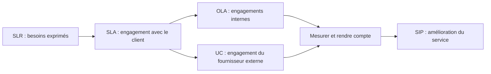
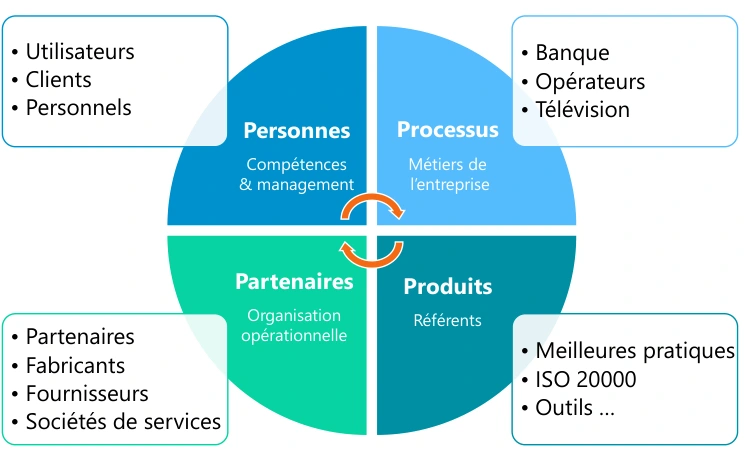
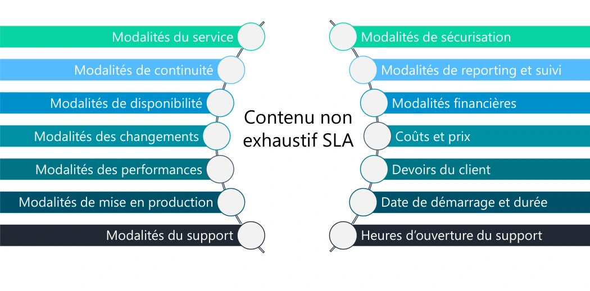
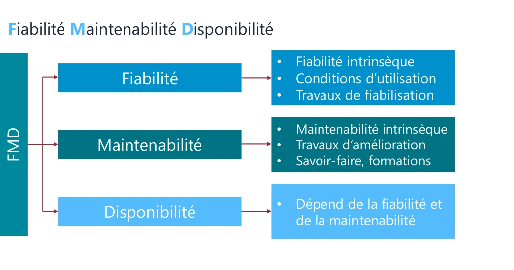
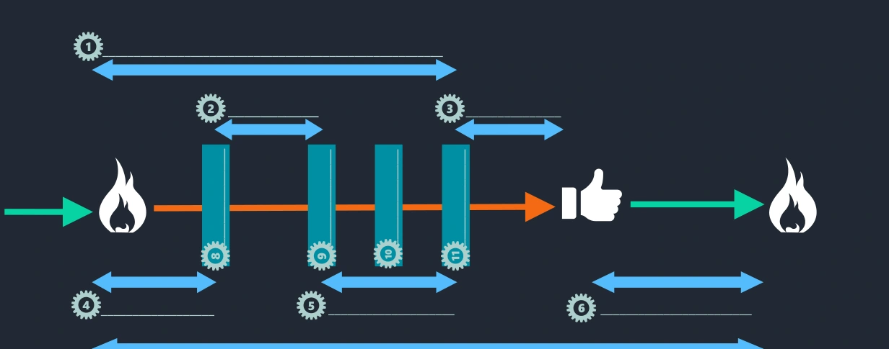

# Module 03 — Stratégie et conception des services

## De la décision stratégique à une solution exploitable

La **stratégie** choisit les services qui apporteront de la valeur en tenant compte du marché, des demandes et des moyens disponibles. La **conception** transforme ce choix en exigences, architecture, processus, responsabilités et mesures. Un choix technique intervient après la compréhension du résultat attendu.

| Processus de stratégie étudié | Décision ou information utile |
|---|---|
| Gestion de la stratégie | Positionnement, objectifs et capacités de l’organisation. |
| Portefeuille des services | Services envisagés, en exploitation et retirés ; coûts et valeur. |
| Demande | Besoins actuels et futurs, évolutions des métiers et usages. |
| Gestion financière | Coûts, financement et prix éventuel. |
| Relation métier | Confiance, satisfaction et compréhension des besoins. |

Le catalogue décrit les services proposés ; le portefeuille couvre une perspective plus large. Les **4 P de stratégie** du support sont perspective, positionnements, plans et pérennisation des comportements. Ils se distinguent des **4 P de conception : personnes, processus, produits et partenaires**.

### Relier les coûts à la décision

Le **ROI** compare le bénéfice attendu à l’investissement ; le **TCO** prend en compte le coût total de possession. Considérer les achats directs, les coûts indirects et les coûts souvent oubliés, tels que formation insuffisante ou interventions répétées. Le prix n’est pas simplement le coût d’achat d’un équipement. La conception peut choisir une réalisation interne, une sous-traitance, une TMA, une infogérance, un BPO, une fourniture de service par un ASP ou un recours à l’expertise KPO ; ces termes historiques sont détaillés dans les repères du support.

## Les huit processus de conception étudiés

| Processus | Vérification concrète |
|---|---|
| Coordination de la conception | Les différentes équipes travaillent sur des exigences cohérentes. |
| Catalogue des services | Le service, ses conditions et sa disponibilité sont décrits et à jour. |
| Niveaux de services | Les engagements sont compris, mesurables et soutenus par les accords nécessaires. |
| Disponibilité | Les engagements et les points uniques de défaillance sont examinés. |
| Capacité | Les besoins métier futurs, le service actuel et les composants sont dimensionnés. |
| Continuité | Le service peut être maintenu ou repris selon les besoins métier ; les plans sont testés. |
| Sécurité | Les règles protègent disponibilité, confidentialité, intégrité et besoins d’authenticité et de preuve. |
| Fournisseurs | Contrats, performances, litiges et fin de relation sont maîtrisés. |

Pour la capacité, distinguer **BCM** (besoins métier), **SCM** (capacité du service) et **CCM** (capacité des composants). Pour la continuité, le **BIA** évalue les impacts métier ; le **PCA** organise la poursuite d’activité ; le **PRA** prépare la reprise informatique. Un plan documentaire non testé apporte une garantie limitée.

## SLR, SLA, OLA et UC

Le SLA précise le service, horaires de support, performances, disponibilité, continuité, sécurité, changements, mise en production, suivi, responsabilités du client, dates et conditions financières. Les OLA et UC doivent permettre de tenir cet engagement global. **Précision externe :** leurs structures ne sont pas nécessairement identiques ; adapter le contenu aux responsabilités et dépendances réelles.

| Terme | Distinction utile |
|---|---|
| Fiabilité | Fonctionner durablement avec peu de défaillances. |
| Maintenabilité | Pouvoir remettre le service en état efficacement. |
| Résilience | Continuer à rendre un service malgré certaines défaillances. |
| Serviceability | Capacité des fournisseurs à assurer leurs engagements de support. |
| Recoverability | Capacité de restauration ; elle n’exige pas nécessairement une reconfiguration automatique. |

**Précision externe :** la signature électronique est un moyen possible de contribuer à l’authenticité et à la preuve ; elle n’est pas la définition de l’authenticité. L’intégrité concerne aussi les altérations accidentelles. Les numéros 1 à 11 du dessin de disponibilité de l’Original sont des repères à compléter : le support ne fournit pas leur légende, donc aucune légende n’est attribuée au document source ici.

## TP — arrivée d’un commercial

Deux sujets et leurs deux corrections sont fournis. Commencer par le schéma de stratégie, puis détailler la conception : stock, mobilier, électricité, réseau, identité, comptes, téléphonie, poste, déploiement et livraison. Vérifier chaque prérequis avant la livraison, puis les tests utilisateur et la mise à jour du CMS. Les tableaux et la procédure intégrale figurent dans l’Original et dans les pages de TP liées ci-dessous.

**Mini-quiz.** 1. Catalogue et portefeuille couvrent-ils les mêmes services ? 2. Qui signe le SLA ? 3. Que vérifie un OLA ? 4. BIA et PRA ont-ils le même objectif ?

??? success "Réponses commentées"
    1. Le portefeuille inclut aussi les services envisagés et retirés.
    2. Le fournisseur et le client selon leurs responsabilités.
    3. Les contributions internes nécessaires au respect du SLA.
    4. Non : impacts métier pour le BIA ; organisation de la reprise informatique pour le PRA.

## Notions détaillées pour approfondir

Les notions détaillées ci-dessous conservent le périmètre et les exemples du support historique, avec une mise en page réparée. Les réserves et corrections exposées plus haut s’appliquent à cette relecture. Pour la formulation source exacte, utiliser **Cours Original**. Les captures sont des illustrations isolées du support, pas des schémas générés.

<section>
<h4>Sensibilisation ITIL</h4>

Module 03 – Les publications centrales « Stratégie et Conception des services »

<h4>Objectifs</h4>
<ul><li>Connaitre le rôle de la stratégie des services</li><li>Connaitre les processus de la stratégie des services</li><li>Connaitre le rôle de la conception des services</li><li>Connaitre les processus de la stratégie des services</li><li>Définir le contenu d’un SLA (Service Level Agrement)</li></ul>
</section>
<section>
<h4>Les publications centrales</h4>
<h4>« Stratégie des services »</h4>

La stratégie des services

<ul><li>Objectifs<ul><li>Comment développer l’offre de service dans un contexte concurrentiel ?</li><li>Comment passer de la gestion des services à un rôle stratégique de la DSI pour l’entreprise ?</li><li>Comment apporter de la valeur aux clients ?</li></ul></li><li>Son rôle<ul><li>Produire des services de qualité apportant de la valeur aux clients en prévoyant les conflits possibles</li><li>Planifier et définir une stratégie des services (services offerts)</li><li>Rester proche des demandes métiers en restant concurrentiel</li></ul></li></ul>
</section>
<section>

Les processus de la stratégie des services

<ul><li>La gestion de la stratégie<ul><li>Il permet l’établissement de la stratégie des services en fonction de l’état du marché, des demandes (clients), des offres (concurrence) et des capacités de l’entreprise (personnel, matériel, financière)</li></ul></li><li>La gestion du portefeuille des services<ul><li>Il liste tous les services (futurs, actuels, retirés) et leur description (coût)</li><li>Les services actuels sont contenus dans le catalogue des services (clients)</li></ul></li></ul>

Les processus de la stratégie des services

<ul><li>La gestion des demandes<ul><li>C’est un des processus les plus critiques</li><li>Permet d’analyser les besoins des clients, actuels et surtout futurs, en fonction des évolutions des métiers et des technologies</li></ul></li><li>La gestion financière<ul><li>Permet d’analyser les coûts d’un service afin d’en définir le prix</li></ul></li><li>La gestion de la relation métier<ul><li>Maintient une relation de confiance avec les clients pour garantir la satisfaction générale ressentie</li></ul></li></ul>
</section>
<section>

Les 4 « P »

<table><caption>Stratégie des services : les quatre P</caption><thead><tr><th scope="col">Les quatre P</th><th scope="col">Repères associés</th></tr></thead><tbody><tr><td>Positionnements (Positions)</td><td>Politiques et éléments différenciateurs</td></tr><tr><td>Perspective (Perspective)</td><td>Vision et mission</td></tr><tr><td>Plans (Plans)</td><td>Méthode et exécution</td></tr><tr><td>Pérennisation (Patterns)</td><td>Décisions et actions consistantes dans la durée</td></tr></tbody></table>
<ul><li>Les acteurs<ul><li>La direction de l’entreprise<ul><li>Donner des directions</li><li>Définir des politiques</li><li>Identifier les projets</li><li>Attribuer les ressources</li></ul></li><li>La direction financière<ul><li>Prioriser les investissements</li></ul></li></ul></li></ul>

Terminologie

<ul><li>ROI (Return On Investment) : retour sur investissement, comparaison de la dépense par rapport à la valeur produite et sur quelle durée</li><li>TCO (Total Cost of Ownership) : coût total de possession, ensemble des coûts de fourniture des services</li><li>Coût d’un service : argent dépensé pour concevoir ou fournir un service</li></ul>
<ul><li>Coûts directs : achat de matériels ou de fournitures (facture)</li><li>Coûts indirects : frais par rapport à l’entreprise (location des locaux)</li><li>Coûts cachés (inclus dans le TCO) : manque de formation des techniciens</li><li>Prix d’un service : le coût augmenté d’une marge</li></ul>
</section>
<section>
<h4>Les publications centrales « Conception des services »</h4>

La conception des services

<ul><li>Objectif<ul><li>Produire des services en respectant les livrables produits par la stratégie des services</li></ul></li><li>Son rôle<ul><li>Recueillir les exigences du client (SLR)</li><li>Définir la solution</li><li>Connaître les contraintes de l’architecture du système d’information</li><li>Définir les processus</li><li>Définir les indicateurs de mesure du service</li></ul></li></ul>
</section>
<section>

La conception des services : définir la solution

<ul><li>Exigences, contraintes, spécifications, validité et bénéfices : où je dois aller?</li><li>Options de réalisation : comment vais-je m’y prendre ?<ul><li>Réalisation interne ou sous-traitance ?</li><li>Maintenance corrective interne ou externe (TMA) ?</li><li>Exploitation interne ou infogérance ?</li><li>Sous-traitance fonctionnelle (BPO) ?</li><li>ASP : fournir le service directement au client final via l’infrastructure de l’informatique d’un fournisseur ?</li><li>KPO : appel à un ou plusieurs consultants externes pour leurs connaissances sur les métiers ou la technologie ?</li></ul></li></ul>

La conception des services : indicateurs

<ul><li>Comment évoluent les données du service ?</li><li>Fait-il ce qu’on a vendu au client ?</li><li>Le fait-il dans le respect des SLA ?</li><li>Sommes-nous efficients dans la livraison quotidienne du service ?</li></ul>
</section>
<section>

Les processus de la conception des services

<ul><li>La coordination de la conception<ul><li>Met en relation les différents processus pour la création des services</li></ul></li><li>La gestion du catalogue des services<ul><li>Pour gérer et garder à jour les informations des services et leur disponibilité</li></ul></li><li>La gestion des niveaux de services (SLA) *<ul><li>Dans la matrice RACI, elle est « accountable »</li><li>Permet d’identifier les exigences, les besoins et les moyens nécessaires à la fourniture des services</li></ul></li></ul>

* Processus détaillé dans les diapositives suivantes

Les processus de la conception des services

<ul><li>La gestion de la disponibilité *<ul><li>S’assure que les niveaux de disponibilité d’un service sont conformes aux SLA</li><li>Permet aussi de supprimer les SPOF (Single Point Of Failure)</li></ul></li><li>La gestion de la capacité<ul><li>S’assure que les services actuels et futurs sont et seront délivrés au meilleur coût (ressources humaines et/ou matérielles)</li><li>Elle contient trois sous-processus :<ul><li>BCM (Business Capacity Management) – Gestion de la capacité orientée métier – Futurs besoins</li><li>SCM (Service Capacity Management) – Gestion de la capacité orientée service – Performances actuelles</li><li>CCM (Component Capacity Management) – Gestion de la capacité des composants – Ressources disponibles</li></ul></li></ul></li></ul>

* Processus détaillé dans les diapositives suivantes

</section>
<section>

Les processus de la conception des services

<ul><li>La gestion de la continuité<ul><li>S’assure de la poursuite de la livraison des services dans le respect des SLA dans un environnement dégradé (côté DSI et/ou client)</li><li>Nécessite de tester régulièrement et adapter les PCA</li></ul></li><li>La gestion de la sécurité<ul><li>S’assure de la sécurité des données du système d’information</li><li>Disponibilité, confidentialité, intégrité, authenticité, non-répudiation</li><li>Nécessite de définir la politique d’utilisation du système d’information</li></ul></li><li>La gestion des fournisseurs *<ul><li>Codifie la relation avec les fournisseurs (recrutement, contrat, niveau et qualité de service, litiges, ruptures de contrat)</li></ul></li></ul>
<ul><li>* Processus détaillé dans les diapositives suivantes</li></ul>

Les acteurs de la conception des services « 4P »

<figure><figcaption>Les quatre P de la conception — illustration isolée du support, page 8.</figcaption></figure>
<ul><li>Personnes<ul><li> Utiliser les meilleures ressources internes</li></ul></li></ul>
<ul><li>Processus<ul><li> Créer, définir et faire évoluer les processus et les procédures en fonction de leur utilisation par les services</li></ul></li></ul>
<ul><li>Produits<ul><li> Choisir des produits adaptés aux services</li></ul></li></ul>
<ul><li>Partenaires<ul><li> Sélectionner et impliquer les sous-traitants et les fournisseurs spécialisés dans un domaine (apport de personnels, de savoir- faire et de compétences)</li></ul></li></ul>
</section>
<section>

La gestion des niveaux de services

<figure><figcaption>Contenu non exhaustif d’un SLA — illustration isolée du support, page 9.</figcaption></figure>

La gestion des niveaux de services

<ul><li>Le contenu d’un OLA<ul><li>Un contrat de services OLA est un contrat pour réaliser un SLA</li><li>Le document a la même structure que le SLA</li><li>L’OLA est un contrat interne, les conditions de pénalités sont souvent inexistantes ou non applicables</li></ul></li><li>Le contenu d’un UC<ul><li>Un contrat de service UC est un contrat avec un prestataire externe pour réaliser un SLA</li><li>Le document a la même structure que le SLA</li><li>Des clauses juridiques sont à ajouter pour traiter la relation entre les deux organisations</li></ul></li></ul>
</section>
<section>

La gestion des niveaux de services : terminologie

<ul><li>SLR – Service Level Requirement : expression des besoins de client</li><li>SLM – Service Level Manager : responsable de la gestion des niveaux de services</li><li>SLA – Service Level Agreement : accord de niveaux de services conclu avec le client</li><li>OLA – Operationnal Level Agreement : accord de niveaux de services conclu avec les fournisseurs internes</li></ul>
<ul><li>UC – Underpinning Contract : contrat de sous-traitance</li><li>Catalogue de services : document regroupant l’ensemble des services</li><li>SIP – Service Improvement Program : programme d’amélioration des services</li></ul>

La gestion des niveaux de services : terminologie

<ul><li>TMA - Tierce Maintenance Applicative : maintenance corrective applicative effectuée par un tiers (développement).</li><li>BPO - Business Process Outsourcing : sous-traitance fonctionnelle d’une application, d’un processus métier (la paie, la comptabilité).</li><li>ASP - Application Service Provision : fournir le service directement au client final via l’infrastructure de l’informatique d’un fournisseur</li><li>KPO - Knowledge Process Outsoursing : appel à un ou plusieurs consultants externes pour leurs connaissances sur les métiers ou la technologie</li></ul>
</section>
<section>

La gestion de la disponibilité

<figure><figcaption>Fiabilité, maintenabilité, disponibilité — illustration isolée du support, page 11.</figcaption></figure>

La gestion de la disponibilité : terminologie

<ul><li>Fiabilité : aptitude d’un équipement, d’un logiciel, d’un service à fonctionner durablement avec un nombre minimum d’interruptions ou d’incidents</li><li>Maintenabilité : aptitude d’un service ou d’un équipement à être remis en marche</li><li>Résilience : aptitude à continuer à fonctionner même si un ou plusieurs composants sont hors service</li><li>Service-ability : aptitude que l’on a à trouver des fournisseurs ou sous-traitants externes pour assurer disponibilité, fiabilité et maintenabilité</li><li>Recoverability : aptitude à s’auto reconfigurer jusqu’au dernier niveau d’avant arrêt</li></ul>
</section>
<section>

La gestion de la continuité : terminologie

<ul><li>Business Continuity Plan (Plan de Continuité d’Activité en français) : orienté métier, quelles sont les activités opérationnelles et leurs ressources, que vais-je maintenir ?</li><li>Business Continuity Managment : analyse et gestion, quels sont les risques et leurs impacts ?</li><li>Business Impact Analysis : méthode d’analyse de l’impact business qui permet d’évaluer les pertes potentielles.</li><li>Disaster Recovery Plan (Plan de Reprise d’Activité en français) : plan de rétablissement et reprise informatique.</li></ul>

La gestion des fournisseurs

<ul><li>Organisation externe à l’entreprise qui va intervenir dans la fourniture d’un service sous contrat de sous-traitance (UC, Underpinning Contract)</li><li>Plusieurs relations possibles :<ul><li>Sous-traitance : organisation externe qui s’engage pour la conception, le développement, l’exploitation et la maintenance d’un service.</li><li>Cotraitance : organisation externe qui s’engage à participer à des activités du cycle de vie du service.</li><li>Partenariat : engagement à long terme pour de nouvelles opportunités.</li><li>Application Service Provision (ASP) : fourniture partielle ou totale d’un service à partir de son propre SI et de son réseau.</li></ul></li></ul>
</section>
<section>

La gestion de la sécurité : terminologie

<ul><li>La disponibilité des données : c’est donner à l’utilisateur qui le demande l’information dont il a besoin.</li><li>La confidentialité : c’est rendre accessible l’information à ceux qui en ont l’autorisation et à eux seuls.</li></ul>
<ul><li>L’authenticité : c’est rendre fiables les échanges par une signature électronique.</li><li>L’intégrité : c’est s’assurer que l’information est complète et qu’elle n’a pas été altérée de manière frauduleuse.</li></ul>
<ul><li>La non-répudiation : c’est assumer le fait d’avoir effectué l’action.</li></ul>

La gestion de la disponibilité : taux

<figure><figcaption>Repères numérotés du taux de disponibilité : partie principale — illustration isolée du support, page 13.</figcaption></figure>
<figure><figcaption>Repères numérotés du taux de disponibilité : intervalles inférieurs — illustration isolée du support, page 13.</figcaption></figure>
</section>

## Pratiquer et réviser

- [Travaux pratiques du module](../../tp/itil/module-03/index.md)
- [Fiche de révision du module](../../revision/itil/module-03-strategie-et-conception-des-services.md)
- [Retour à la séquence](index.md)
