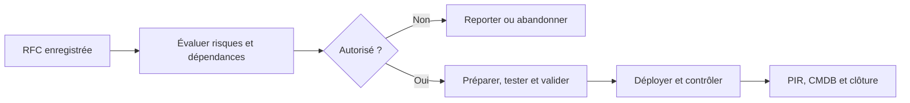
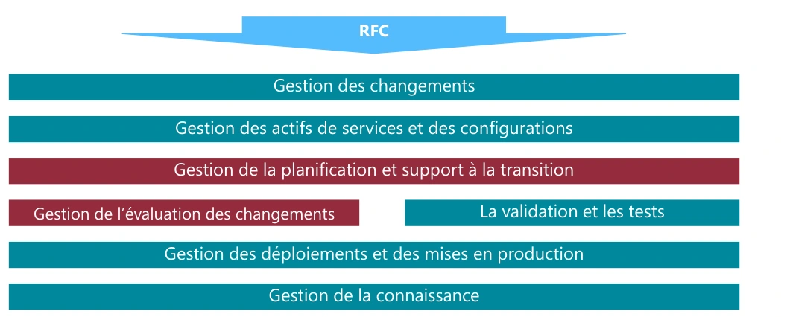
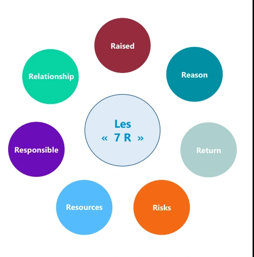
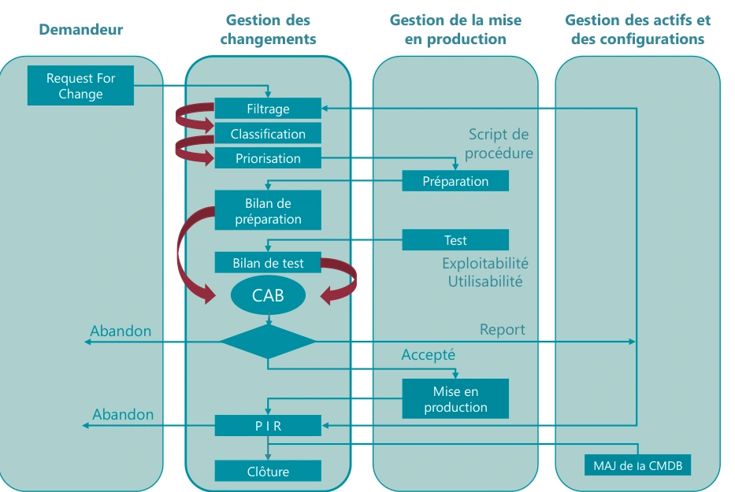
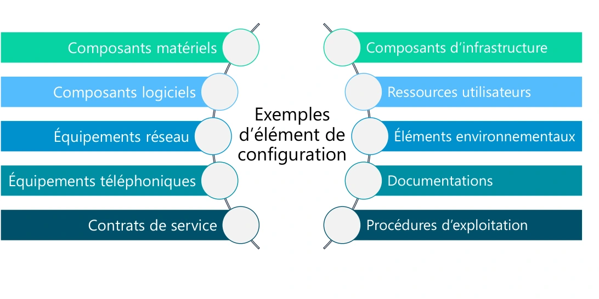
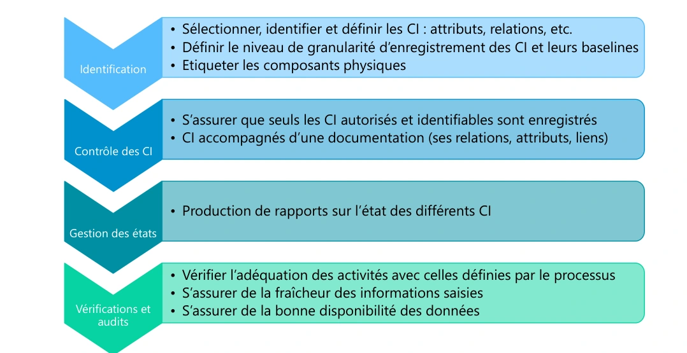

# Module 04 — Transition des services

## Objectifs

- Justifier une demande de changement et distinguer les circuits standard, normal et urgent étudiés.
- Relier les éléments de configuration, leurs états et les contrôles de déploiement.
- Ordonnancer les tâches du TP, identifier l’intervenant et justifier la durée de chaque étape.

## Préparer un changement que l’exploitation saura prendre en charge

La transition réalise, construit, teste, valide et déploie les services conçus. Elle prépare aussi les équipes, la documentation et les utilisateurs. Livrer un composant sans procédure de support, sans test ou sans retour arrière peut déplacer la panne vers l’exploitation.

| Processus étudié | Résultat attendu |
|---|---|
| Changements | Demandes évaluées, autorisées selon les responsabilités et suivies. |
| Actifs et configurations | CI identifiés, relations connues et données à jour. |
| Planification et support à la transition | Ressources et calendrier cohérents. |
| Évaluation | Effets, risques et résultats du changement examinés. |
| Validation et tests | Recette fonctionnelle, performance, exploitabilité et service vérifiées. |
| Déploiements et mises en production | Version contrôlée, transfert à l’exploitation et utilisateurs préparés. |
| Connaissances | Informations fiables, accessibles et réellement utilisées. |

## Formuler une RFC avec les sept R

Un changement ajoute, modifie ou retire un CI ou un service. Une RFC identifie le demandeur, la date, le périmètre, la priorité proposée, les risques, les dates et les ressources nécessaires. Les **sept R** aident à examiner la demande : **Raised** (qui demande), **Reason** (pourquoi), **Return** (bénéfice), **Risks**, **Resources**, **Responsible** et **Relationship** avec les autres changements.

| Type | Traitement |
|---|---|
| Standard | Connu, documenté, peu risqué et préautorisé selon une procédure établie. |
| Normal | Évaluation et autorisation adaptées avant réalisation. Le CAB apporte avis et expertise. |
| Urgent | Procédure d’urgence avec autorité désignée, contrôles proportionnés et traçabilité. |

**Précisions externes :** urgent ne signifie pas « aucun test ni documentation ». L’autorité de changement dépend de l’organisation ; le CAB est un comité consultatif, pas nécessairement l’autorité finale de tous les changements. La **PIR** est une revue après mise en œuvre, et non la définition d’un comité permanent.

## CI, CMDB, CMS, DML et SKMS

Un **CI** est un élément géré pour fournir le service : matériel, logiciel, réseau, téléphonie, infrastructure, documentation, procédure, contrat ou ressource pertinente. Définir son type, ses attributs, ses relations et sa référence de configuration (*baseline*).

| Outil ou ensemble | Usage |
|---|---|
| CMDB — Configuration Management Database | Enregistrements des éléments de configuration et de leurs relations. |
| CMS — Configuration Management System | Ensemble d’informations et d’outils de gestion de configuration, pouvant fédérer plusieurs CMDB. |
| DML — Definitive Media Library | Médias logiciels de référence contrôlés, documentation et informations associées. |
| SKMS — Service Knowledge Management System | Ensemble organisé pour gérer et exploiter les connaissances du service. |

Le développement « Content Management System » associé au CMS dans certaines pages du support est une confusion : **dans ce contexte, CMS signifie Configuration Management System**. Définir d’abord périmètre, politique, granularité, responsables et outils, puis charger les données et former les équipes. Ensuite contrôler les modifications, produire les états et auditer la fiabilité des données. Une CMDB très remplie mais obsolète reste peu utile.

## Choisir le déploiement et préparer la connaissance

Les axes **push/pull**, **big bang/par phases**, **manuel/automatique** répondent à des questions différentes. Une diffusion automatique peut être faite par phases. Prévoir nommage, versions, responsabilités, informations aux utilisateurs, formation, procédures d’exploitation, critères de succès et retour arrière.

Pour la connaissance, partir des besoins et de la fiabilité de l’information : architecture, outils, procédures de maintenance, responsables, promotion, formation et mesures d’utilisation. Compter les articles ne prouve pas qu’ils aident les techniciens ; observer leur usage et leurs résultats.

## TP — documenter la transition

Le TP reprend l’arrivée d’un commercial : pour chaque étape, préciser qui intervient et estimer le temps nécessaire. Comparer ensuite ses hypothèses aux tableaux de la correction, en tenant compte des dépendances et des contrôles à réaliser. La grille de priorité du cours est un **exemple** : « priorité = impact × urgence » désigne ici un croisement dans une matrice. Il ne faut pas multiplier arbitrairement les codes numériques.

### Passer de la procédure à un ordre réalisable

| Étape | Prérequis | Trace à relever |
| --- | --- | --- |
| Vérifier le stock puis sortir le matériel | Équipements définis dans les TP précédents. | Disponibilité et date de mise à disposition. |
| Préparer le poste et les prises | Lieu connu, accès aux intervenants concernés. | Alimentation, réseau et paramétrage contrôlés. |
| Ouvrir les comptes et les accès | Identité, rôle et validations disponibles. | Accès AD, messagerie, GLPI et badge prêts pour le test. |
| Configurer et livrer le portable | Matériel, réseau et comptes testables. | Test de l’équipement avant puis après livraison. |

Reporter chaque ligne de la procédure dans une grille avec l’intervenant, la durée et la dépendance. Les temps du corrigé illustrent le laboratoire. Dans sa première grille, un technicien parc prévoit 15 minutes pour vérifier le stock et 10 minutes pour créer la commande lorsque le matériel manque. Pour justifier une action parallèle, vérifier ses dépendances et la disponibilité de l’intervenant.

[Ouvrir le TP et sa grille de correction](../../tp/itil/module-04/index.md).

## Notions détaillées pour approfondir

Les notions détaillées ci-dessous conservent le périmètre et les exemples du support historique, avec une mise en page réparée. Les réserves et corrections exposées plus haut s’appliquent à cette relecture. Pour la formulation source exacte, utiliser **Cours Original**. Les captures sont des illustrations isolées du support, pas des schémas générés.

### Transition et types de changements

<section>
<h4>Sensibilisation ITIL et</h4>
<h4>gestion de parc</h4>

Module 04 – Transition des services

<h4>Objectifs</h4>
<ul><li>Connaitre le rôle de la transition des services</li><li>Identifier les différents processus</li><li>Définir un changement</li><li>Définir un CI (Configuration Item)</li><li>Identifier les outils</li><li>Définir la connaissance</li></ul>
</section>

<section>
<h4>Les publications centrales « Transition des services »</h4>

La transition des services

<ul><li>Objectif<ul><li>Mise en production des services (nouveaux ou améliorés)</li></ul></li><li>Son rôle<ul><li>Mettre en production en respectant les livrables produits par la conception des services ainsi que les coûts</li></ul></li></ul>
<ul><li>Réalisation, construction, test, validation et déploiement des services</li><li>Prévoir et gérer les ressources nécessaires</li><li>Produire la documentation</li><li>Surveiller et améliorer les services</li><li>Respecter les critères de qualité, de sécurité et les délais dans la délivrance des services</li><li>Prendre en compte et améliorer la perception client</li></ul>
</section>

<section>

La transition des services

<ul><li>Dans la phase de transition, tout commence par le processus de gestion des changements avec une RFC Request For Change</li></ul>
<figure><figcaption>Processus de transition des services — illustration isolée du support, page 3.</figcaption></figure>

La gestion des changements

<ul><li>Ses objectifs<ul><li>S’assurer que les procédures et les méthodes pour traiter les changements sont efficaces, voire efficientes</li><li>S’assurer que les modifications des CI (Configuration Item) sont bien enregistrées dans le CMS (Configuration Management System)</li><li>Répondre aux évolutions exprimées par les clients en minimisant les risques d’interruption de service et en maximisant la valeur fournie</li></ul></li><li>Définition d’un changement<ul><li>Ajout, modification,  ou retrait d’un ou plusieurs CI du système d’information ou d’un ou plusieurs services fournis par ce système d’information</li></ul></li></ul>
</section>

<section>

La gestion des changements

<figure><figcaption>Les sept R du changement — illustration isolée du support, page 4.</figcaption></figure>
<ul><li>Les « 7 R » de la gestion des changements</li></ul>
<ul><li>Raised : qui a fait la demande ?</li><li>Reason : pour quelle raison ?</li><li>Return : quel est le retour attendu ?</li><li>Risks : quels sont les risques ?</li><li>Resources : quelles seront les ressources ?</li><li>Responsible : qui est le responsable ?</li><li>Relationship : quelles sont les relations avec les autres changements ?</li></ul>

La gestion des changements

<ul><li>Les origines d’un changement<ul><li>Les correctifs (événement, incident, problème…)</li><li>La législation</li><li>L’organisation</li><li>Des directives ou des standards</li><li>Des évolutions des services existants</li><li>Des nouveaux services</li><li>Un nouveau modèle de sourcing</li><li>Une innovation technologique…</li></ul></li></ul>
</section>

<section>

La gestion des changements

<ul><li>La demande de changement<ul><li>Tous les clients sont habilités à émettre une demande de changement, mais cela ne veut pas dire qu’elle sera acceptée.</li><li>Toute demande de changement doit être formalisée par une RFC.</li><li>RFC (Request For Change) est une formalisation d’une modification d’un ou plusieurs éléments de configuration (CI).</li><li>Une RFC doit contenir :<ul><li>Un identifiant unique</li><li>Une date de demande</li><li>Le nom du demandeur</li><li>Une proposition de priorité de changement (priorité = impact x urgence)</li><li>Une description du changement</li><li>Les risques durant l’implémentation du changement</li><li>Les dates de mise en place du changement</li><li>Une estimation des ressources nécessaires (humaine, matériels…)</li></ul></li></ul></li></ul>

La gestion des changements

<ul><li>La gestion de la priorité d’une demande de changement</li></ul>

Code de

priorité Description Dans GLPI Priorité de changement

Urgence

Code de priorité

Elevée Moyenne Faible

Critique Très haute Urgent / Critique

Elevé

<table><caption>Correspondances de priorité du support</caption><thead><tr><th scope="col">Code de priorité</th><th scope="col">Description</th><th scope="col">Dans GLPI</th><th scope="col">Priorité de changement</th></tr></thead><tbody><tr><td>1</td><td>Critique</td><td>Très haute</td><td>Urgent / Critique</td></tr><tr><td>2</td><td>Élevée</td><td>Haute</td><td>Urgent</td></tr><tr><td>3</td><td>Moyen</td><td>Moyenne</td><td>Normal</td></tr><tr><td>4</td><td>Faible</td><td>Basse</td><td>Normal</td></tr><tr><td>5</td><td>Très faible</td><td>Très basse</td><td>Standard / Planifié</td></tr></tbody></table>

Impact

Moyen

<table><caption>Code de priorité : croisement impact et urgence</caption><thead><tr><th scope="col">Impact / urgence</th><th scope="col">Élevée</th><th scope="col">Moyenne</th><th scope="col">Faible</th></tr></thead><tbody><tr><td>Élevé</td><td>1</td><td>2</td><td>3</td></tr><tr><td>Moyen</td><td>2</td><td>3</td><td>4</td></tr><tr><td>Faible</td><td>3</td><td>4</td><td>5</td></tr></tbody></table>
</section>

<section>

Les types de changement

<ul><li>Le changement standard<ul><li>Actions connues, documentées, déjà réalisées et testées</li><li>Les risques sont faibles et bien maîtrisés</li><li>Changement préapprouvé, maîtrisé et associé à des procédures établies</li><li>Référencé dans un mini-catalogue de changements préautorisés</li></ul></li><li>Le changement normal<ul><li>Il nécessite une évaluation complète et une autorisation avant sa réalisation par le CAB</li></ul></li><li>Le changement urgent<ul><li>L’urgence est exceptionnelle et devra être validée et autorisée par l’ECAB</li><li>Court-circuitage des procédures (réalisation, mise en œuvre, documentation et tests)</li></ul></li></ul>

Cycle de vie d’un changement

<figure><figcaption>Cycle de vie d’un changement — illustration isolée du support, page 6.</figcaption></figure>
</section>

### Actifs et gestion des configurations

<section>

La gestion des changements : terminologie

<ul><li>CI - Configuration Item : composant du système d’information qui va contribuer à la fourniture d’un ou plusieurs services</li><li>CMS - Configuration Management System : logiciel de gestion des CI, de la base connaissance…</li></ul>
<ul><li>CAB - Change Advisory Board : comité consultatif qui évalue et donne un avis sur la mise en œuvre des changements dits normaux</li><li>ECAB - Emergency Change Advisory Board : comité qui donne l’autorisation de traiter le changement en urgence</li><li>PIR - Post Implementation Review : comité qui analyse les résultats des mises en production des changements</li></ul>

La gestion des actifs de services et des configurations

<ul><li>Son objectif<ul><li>Identifier, contrôler et enregistrer les actifs de services et les éléments de configuration (CI - Configuration Item, les « baselines »)</li><li>Éditer des rapports sur l’état des actifs de services et des éléments de configuration</li><li>Auditer et vérifier les actifs de services et les éléments de configuration</li><li>Protéger l’intégrité des actifs de services et des éléments de configuration</li><li>Gérer un système de gestion de configuration (CMS ou Configuration Management System)</li></ul></li></ul>
</section>

<section>

La gestion des actifs de services et des configurations

<ul><li>Élément de configuration</li><li>Un élément de configuration, dénommé CI, est un composant du système d’information qui va contribuer à la fourniture d’un ou plusieurs services</li></ul>
<ul><li>Identifiable par un type et un ensemble d’attributs pour le décrire</li><li>Relation possible avec d’autres CI : situation, physique et fonctionnelle</li></ul>

La gestion des actifs de services et des configurations

<figure><figcaption>Exemples d’éléments de configuration — illustration isolée du support, page 8.</figcaption></figure>
</section>

<section>

La gestion des actifs de services et des configurations

<ul><li>Activités : planification initiale<ul><li>Définir le périmètre, la stratégie, la politique de gestion des éléments de configuration</li><li>Connaître les outils et les données des différents composants existants (véracité et mise à jour) : analyse de l’existant</li><li>Sélection, configuration et modélisation du CMS/CMDB (type de CI, attributs, relations)</li><li>Chargement initial</li><li>Nomination du propriétaire, des acteurs clés avec leurs rôles et responsabilités</li><li>Formation des collaborateurs</li></ul></li><li>Activités : planification itérative<ul><li>Chargement des CMDB</li><li>Ajustement des procédures, rôles et responsabilités</li></ul></li></ul>

La gestion des actifs de services et des configurations

<ul><li>Les outils : la CMDB<ul><li>Configuration Management Data Base</li><li>BDD de l’outil de gestion associé</li><li>Contient des enregistrements CI</li></ul></li><li>Les outils : le CMS<ul><li>Configuration Management System</li><li>Ensemble d’outils pour gérer les données de configuration</li><li>Prend les données de plusieurs CMDB pour constituer une CMDB fédérée</li></ul></li><li>Les outils : la DML<ul><li>Definitive Media Library : lieu de stockage sécurisé des CI logiciels</li><li>Référence pour tous les logiciels : contient les médias, documentations et clés de licence associées</li></ul></li></ul>
</section>

<section>

La gestion des actifs de services et des configurations

<figure><figcaption>Identification, contrôle, état et audit des configurations — illustration isolée du support, page 10.</figcaption></figure>

La gestion des mises en production et des déploiements

<ul><li>La gestion des mises en production et des déploiements<ul><li>Valide, organise et planifie le déploiement des services (nouveaux ou mis à jour) de façon « industrielle », en garantissant la valeur apportée, dans le respect des SLA.</li><li>Crée et fournit le document à l’exploitation des services</li><li>S’assure que les utilisateurs ont reçu les informations et sont formés pour utiliser les nouveaux services</li><li>Gestion des versions, convention de nommage, le R.A.C.I, les délais…</li></ul></li></ul>

Fonction 1 Fonction 2 Fonction 3

<table><caption>Matrice R.A.C.I. du déploiement</caption><thead><tr><th scope="col">Activité</th><th scope="col">Fonction 1</th><th scope="col">Fonction 2</th><th scope="col">Fonction 3</th></tr></thead><tbody><tr><td>Activité 1</td><td>A</td><td>R, C</td><td>C</td></tr><tr><td>Activité 2</td><td>A, I</td><td>R</td><td>C</td></tr><tr><td>Activité 3</td><td>A</td><td>R</td><td>C</td></tr><tr><td>Activité 4</td><td>A</td><td>R</td><td>C, I</td></tr><tr><td>Activité 5</td><td>A</td><td>R</td><td>C, I</td></tr></tbody></table>

R – Responsible – qui réalise la tâche A – Accountable – qui est le responsable, celui qui valide C – Consulted – qui est consulté comme expert I – Informed – qui doit être forcément informé

</section>

### Mises en production et connaissance

<section>

La gestion des mises en production et des déploiements

<ul><li>Les différents modes de déploiement</li></ul>
<table><caption>Les différents modes de déploiement</caption><thead><tr><th scope="col">Mode de déploiement</th><th scope="col">Définition du support</th></tr></thead><tbody><tr><td>Push</td><td>Le déploiement est à l’initiative d’un centre vers les sites utilisateurs cibles. Déploiement d’une mise à jour sur l’ensemble des utilisateurs concernés.</td></tr><tr><td>Pull</td><td>Le déploiement est mis à disposition des utilisateurs sur un serveur. Les utilisateurs vont initier le déploiement à leur convenance.</td></tr><tr><td>Big bang</td><td>Le déploiement est effectué en une seule opération vers tous les utilisateurs.</td></tr><tr><td>Par phase</td><td>Le déploiement s’effectue selon un plan en tenant compte des périmètres définis par le client.</td></tr><tr><td>Manuel</td><td>Déploiement avec l’aide du personnel de la DSI avec contrôles et surveillance.</td></tr><tr><td>Automatique</td><td>Fortement conseillé, déploiement sans l’aide du personnel de la DSI.</td></tr></tbody></table>

Les autres processus de la transition des services

<ul><li>La gestion de l’évaluation des changements<ul><li>Mesure l’impact des changements, en évaluant les effets et les risques</li><li>Crée la revue de post-implémentation (PIR)</li><li>Indépendante de la gestion des changements</li></ul></li><li>La validation et les tests<ul><li>Garant du bon fonctionnement des services (nouveaux et mise à jour) et de la gestion des erreurs découvertes pendant les phases d’intégration, de préproduction et de post-mise en production</li><li>Création de procès-verbaux de recette (fonctionnelle, performance, d’exploitabilité, de service régulier)</li></ul></li><li>La gestion de la planification et le support à la transition<ul><li>Organise le ou les changements de services (nouveaux ou mise à jour) et gère les ressources nécessaires (humaines et matérielles)</li></ul></li></ul>
</section>

<section>

La gestion de la connaissance

<ul><li>Ses objectifs<ul><li>Donner de l’information à un collaborateur avec la granularité dont il a besoin</li><li>Fournir une information compréhensible et fiable</li><li>Permettre une prise de décision à tous les instants du cycle de vie</li><li>Permettre d’optimiser et de fiabiliser les prises de décision (efficience)</li><li>Permettre d’enregistrer les situations déjà connues</li><li>Mettre en place et faire vivre un système de gestion de la connaissance</li><li>Gérer l’information</li><li>S’assurer de la bonne utilisation de la base de connaissances</li><li>SKMS - Service Knowledge Management System</li></ul></li></ul>

La gestion de la connaissance

<ul><li>Gestion de l’information<ul><li>Identifier les exigences, les contraintes, les spécifications des données traitées</li><li>Définir une architecture permettant de supporter ces données</li><li>Définir des outillages appropriés pour mettre en œuvre cette architecture</li><li>Écrire les procédures qui vont faire vivre ces données</li><li>Effectuer une analyse précise de l’état des lieux en matière de gestion de la connaissance</li><li>Appréhender cette spécificité pour mieux bâtir une solution adaptée</li><li>Évaluer la performance des bases de connaissances et être force de propositions pour l’amélioration des bases</li></ul></li></ul>
</section>

<section>

La gestion de la connaissance

<ul><li>Bonne utilisation de la base<ul><li>Savoir si ce que l’on a mis en place sert à quelque chose ou si des collaborateurs l’utilisent</li><li>Comprendre qui partage la connaissance, qui capitalise la connaissance de l’entreprise</li><li>L’important n’est pas une base de connaissances contenant beaucoup d’informations, mais une base de connaissances qui est utilisée</li><li>Gérer la promotion, l’information, la formation sur les bases de connaissances</li></ul></li></ul>
</section>

## Vérifier en pratique

| Point de contrôle | Résultat attendu |
| --- | --- |
| Avant le changement | Noter le motif, le résultat attendu, la configuration de référence et la méthode de retour. |
| Après le changement | Tester le service, relever les écarts et mettre à jour la configuration et les consignes d’exploitation. |

## Mini-quiz — 5 questions

1. À quoi sert une baseline ?
2. Quelle différence entre CMS et CMDB ?
3. Un changement urgent échappe-t-il à toute autorisation ?
4. Push et big bang sont-ils synonymes ?
5. Deux actions durent chacune une heure. Dans quel cas leur durée ne s’additionne-t-elle pas dans le planning ?

??? success "Réponses commentées"
    1. À disposer d’une référence de configuration maîtrisée.

    2. Le CMS est l’ensemble de gestion ; une CMDB contient des enregistrements et relations.

    3. Non : appliquer le circuit d’urgence et conserver les preuves.

    4. Non : initiative de diffusion et rythme de déploiement sont deux axes distincts.

    5. Lorsqu’elles peuvent démarrer en parallèle, que les prérequis sont satisfaits et que les intervenants sont disponibles.

## Pratiquer et réviser

- [Travaux pratiques du module](../../tp/itil/module-04/index.md)
- [Fiche de révision du module](../../revision/itil/module-04-transition-des-services.md)
- [Retour à la séquence](index.md)
