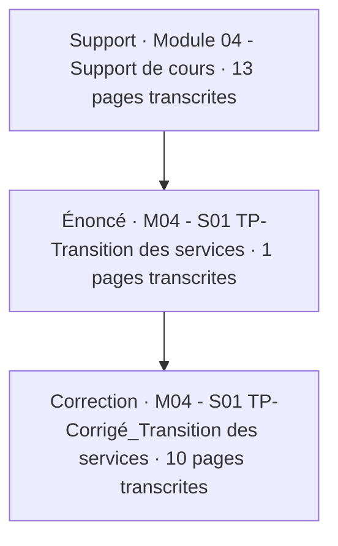
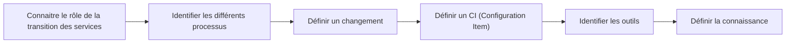
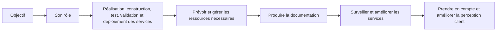
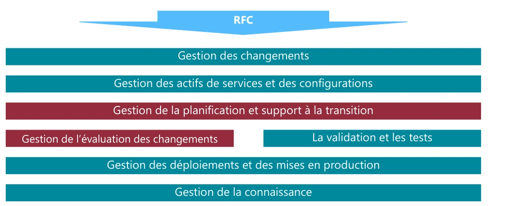

# Module 04 — Transition des services

Les parties ci-dessous reprennent le cours original, dans le même ordre. Les encadrés et les schémas répètent ses formulations.

## Parcours de lecture

1. Support · Module 04 - Support de cours · 13 pages transcrites
2. Énoncé · M04 - S01 TP-Transition des services · 1 pages transcrites
3. Correction · M04 - S01 TP-Corrigé_Transition des services · 10 pages transcrites

**Visuel externe**

SOURCE DRIVE · TRANSCRIPTION DU SUPPORT

Le contenu des documents du dossier TSSR est transcrit ci-dessous, page par page. Les textes et tableaux sont intégrés à la page Web. Aucun fichier PDF, aucune diapositive entière ni aucune reproduction de page n’est affiché. Seuls des croquis ou visuels isolés et vérifiés peuvent accompagner la transcription. Les versions et les consignes restent celles des supports de formation. Les compléments IA sont conservés dans leur onglet distinct.

## Support · Module 04 - Support de cours · 13 pages transcrites

!!! note "À retenir"
    Texte, tableaux et illustrations utiles retranscrits du support ; numéros de diapositives, bandeaux répétitifs, éléments de marque et décorations exclus.

Texte, tableaux et illustrations utiles retranscrits du support ; numéros de diapositives, bandeaux répétitifs, éléments de marque et décorations exclus. Les formulations historiques sont conservées ; les précisions sont placées dans le cours optimisé.

### Page 1

#### Sensibilisation ITIL et

#### gestion de parc

Module 04 – Transition des services

#### Objectifs

!!! note "À retenir"
    Connaitre le rôle de la transition des services Identifier les différents processus Définir un changement Définir un CI (Configuration Item) Identifier les outils Définir la connaissance

**Visuel externe**

- Connaitre le rôle de la transition des services
- Identifier les différents processus
- Définir un changement
- Définir un CI (Configuration Item)
- Identifier les outils
- Définir la connaissance

### Page 2

#### Les publications centrales « Transition des services »

**Visuel externe**

La transition des services

- Objectif
  - Mise en production des services (nouveaux ou améliorés)
- Son rôle
  - Mettre en production en respectant les livrables produits par la conception des services ainsi que les coûts

- Réalisation, construction, test, validation et déploiement des services
- Prévoir et gérer les ressources nécessaires
- Produire la documentation
- Surveiller et améliorer les services
- Respecter les critères de qualité, de sécurité et les délais dans la délivrance des services
- Prendre en compte et améliorer la perception client

### Page 3

!!! note "À retenir"
    La transition des services Dans la phase de transition, tout commence par le processus de gestion des changements avec une RFC Request For Change Processus de transition des services — illustration isolée du support, page 3.

La transition des services

- Dans la phase de transition, tout commence par le processus de gestion des changements avec une RFC Request For Change

Processus de transition des services — illustration isolée du support, page 3.

La gestion des changements

- Ses objectifs
  - S’assurer que les procédures et les méthodes pour traiter les changements sont efficaces, voire efficientes
  - S’assurer que les modifications des CI (Configuration Item) sont bien enregistrées dans le CMS (Content Managment System)
  - Répondre aux évolutions exprimées par les clients en minimisant les risques d’interruption de service et en maximisant la valeur fournie
- Définition d’un changement
  - Ajout, modification, ou retrait d’un ou plusieurs CI du système d’information ou d’un ou plusieurs services fournis par ce système d’information

### Page 4

#### La gestion des changements

!!! note "À retenir"
    Les sept R du changement — illustration isolée du support, page 4.

**Visuel externe**

Les sept R du changement — illustration isolée du support, page 4.

- Les « 7 R » de la gestion des changements

- Raised : qui a fait la demande ?
- Reason : pour quelle raison ?
- Return : quel est le retour attendu ?
- Risks : quels sont les risques ?
- Resources : quelles seront les ressources ?
- Responsible : qui est le responsable ?
- Relationship : quelles sont les relations avec les autres changements ?

- Les origines d’un changement
  - Les correctifs (événement, incident, problème…)
  - La législation
  - L’organisation
  - Des directives ou des standards
  - Des évolutions des services existants
  - Des nouveaux services
  - Un nouveau modèle de sourcing
  - Une innovation technologique…

### Page 5

#### La gestion des changements

!!! note "À retenir"
    La demande de changement - Tous les clients sont habilités à émettre une demande de changement, mais cela ne veut pas dire qu’elle sera acceptée.

- La demande de changement
  - Tous les clients sont habilités à émettre une demande de changement, mais cela ne veut pas dire qu’elle sera acceptée.
  - Toute demande de changement doit être formalisée par une RFC.
  - RFC (Request For Change) est une formalisation d’une modification d’un ou plusieurs éléments de configuration (CI).
  - Une RFC doit contenir :
    - Un identifiant unique
    - Une date de demande
    - Le nom du demandeur
    - Une proposition de priorité de changement (priorité = impact x urgence)
    - Une description du changement
    - Les risques durant l’implémentation du changement
    - Les dates de mise en place du changement
    - Une estimation des ressources nécessaires (humaine, matériels…)

- La gestion de la priorité d’une demande de changement

| Code de priorité | Description | Dans GLPI | Priorité de changement |
| --- | --- | --- | --- |
| 1 | Critique | Très haute | Urgent / Critique |
| 2 | Élevée | Haute | Urgent |
| 3 | Moyen | Moyenne | Normal |
| 4 | Faible | Basse | Normal |
| 5 | Très faible | Très basse | Standard / Planifié |

| Impact / urgence | Élevée | Moyenne | Faible |
| --- | --- | --- | --- |
| Élevé | 1 | 2 | 3 |
| Moyen | 2 | 3 | 4 |
| Faible | 3 | 4 | 5 |

### Page 6

**Visuel externe**

Les types de changement

- Le changement standard
  - Actions connues, documentées, déjà réalisées et testées
  - Les risques sont faibles et bien maîtrisés
  - Changement préapprouvé, maîtrisé et associé à des procédures établies
  - Référencé dans un mini-catalogue de changements préautorisés
- Le changement normal
  - Il nécessite une évaluation complète et une autorisation avant sa réalisation par le CAB
- Le changement urgent
  - L’urgence est exceptionnelle et devra être validée et autorisée par l’ECAB
  - Court-circuitage des procédures (réalisation, mise en œuvre, documentation et tests)

Cycle de vie d’un changement

Cycle de vie d’un changement — illustration isolée du support, page 6.

### Page 7

La gestion des changements : terminologie

- CI - Configuration Item : composant du système d’information qui va contribuer à la fourniture d’un ou plusieurs services
- CMS - Content Managment System : logiciel de gestion des CI, de la base connaissance…

- CAB - Change Advisory Board : comité consultatif qui évalue et donne un avis sur la mise en œuvre des changements dits normaux
- ECAB - Emergency Change Advisory Board : comité qui donne l’autorisation de traiter le changement en urgence
- PIR - Post Implementation Review : comité qui analyse les résultats des mises en production des changements

La gestion des actifs de services et des configurations

- Son objectif
  - Identifier, contrôler et enregistrer les actifs de services et les éléments de configuration (CI - Configuration Item, les « baselines »)
  - Éditer des rapports sur l’état des actifs de services et des éléments de configuration
  - Auditer et vérifier les actifs de services et les éléments de configuration
  - Protéger l’intégrité des actifs de services et des éléments de configuration
  - Gérer un système de gestion de configuration (CMS ou Configuration Management System)

### Page 8

#### La gestion des actifs de services et des configurations

- Élément de configuration
- Un élément de configuration, dénommé CI, est un composant du système d’information qui va contribuer à la fourniture d’un ou plusieurs services

- Identifiable par un type et un ensemble d’attributs pour le décrire
- Relation possible avec d’autres CI : situation, physique et fonctionnelle

Exemples d’éléments de configuration — illustration isolée du support, page 8.

### Page 9

#### La gestion des actifs de services et des configurations

- Activités : planification initiale
  - Définir le périmètre, la stratégie, la politique de gestion des éléments de configuration
  - Connaître les outils et les données des différents composants existants (véracité et mise à jour) : analyse de l’existant
  - Sélection, configuration et modélisation du CMS/CMDB (type de CI, attributs, relations)
  - Chargement initial
  - Nomination du propriétaire, des acteurs clés avec leurs rôles et responsabilités
  - Formation des collaborateurs
- Activités : planification itérative
  - Chargement des CMDB
  - Ajustement des procédures, rôles et responsabilités

- Les outils : la CMDB
  - Configuration Management Data Base
  - BDD de l’outil de gestion associé
  - Contient des enregistrements CI
- Les outils : le CMS
  - Configuration Management System
  - Ensemble d’outils pour gérer les données de configuration
  - Prend les données de plusieurs CMDB pour constituer une CMDB fédérée
- Les outils : la DML
  - Definitive Media Library : lieu de stockage sécurisé des CI logiciels
  - Référence pour tous les logiciels : contient les médias, documentations et clés de licence associées

### Page 10

!!! note "À retenir"
    La gestion des actifs de services et des configurations Identification, contrôle, état et audit des configurations — illustration isolée du support, page 10.

La gestion des actifs de services et des configurations

Identification, contrôle, état et audit des configurations — illustration isolée du support, page 10.

La gestion des mises en production et des déploiements

- La gestion des mises en production et des déploiements
  - Valide, organise et planifie le déploiement des services (nouveaux ou mis à jour) de façon « industrielle », en garantissant la valeur apportée, dans le respect des SLA.
  - Crée et fournit le document à l’exploitation des services
  - S’assure que les utilisateurs ont reçu les informations et sont formés pour utiliser les nouveaux services
  - Gestion des versions, convention de nommage, le R.A.C.I, les délais…

Fonction 1 Fonction 2 Fonction 3

| Activité | Fonction 1 | Fonction 2 | Fonction 3 |
| --- | --- | --- | --- |
| Activité 1 | A | R, C | C |
| Activité 2 | A, I | R | C |
| Activité 3 | A | R | C |
| Activité 4 | A | R | C, I |
| Activité 5 | A | R | C, I |

R – Responsible – qui réalise la tâche A – Accountable – qui est le responsable, celui qui valide C – Consulted – qui est consulté comme expert I – Informed – qui doit être forcément informé

### Page 11

La gestion des mises en production et des déploiements

- Les différents modes de déploiement

| Mode de déploiement | Définition du support |
| --- | --- |
| Push | Le déploiement est à l’initiative d’un centre vers les sites utilisateurs cibles. Déploiement d’une mise à jour sur l’ensemble des utilisateurs concernés. |
| Pull | Le déploiement est mis à disposition des utilisateurs sur un serveur. Les utilisateurs vont initier le déploiement à leur convenance. |
| Big bang | Le déploiement est effectué en une seule opération vers tous les utilisateurs. |
| Par phase | Le déploiement s’effectue selon un plan en tenant compte des périmètres définis par le client. |
| Manuel | Déploiement avec l’aide du personnel de la DSI avec contrôles et surveillance. |
| Automatique | Fortement conseillé, déploiement sans l’aide du personnel de la DSI. |

Les autres processus de la transition des services

- La gestion de l’évaluation des changements
  - Mesure l’impact des changements, en évaluant les effets et les risques
  - Crée la revue de post-implémentation (PIR)
  - Indépendante de la gestion des changements
- La validation et les tests
  - Garant du bon fonctionnement des services (nouveaux et mise à jour) et de la gestion des erreurs découvertes pendant les phases d’intégration, de préproduction et de post-mise en production
  - Création de procès-verbaux de recette (fonctionnelle, performance, d’exploitabilité, de service régulier)
- La gestion de la planification et le support à la transition
  - Organise le ou les changements de services (nouveaux ou mise à jour) et gère les ressources nécessaires (humaines et matérielles)

### Page 12

#### La gestion de la connaissance

- Ses objectifs
  - Donner de l’information à un collaborateur avec la granularité dont il a besoin
  - Fournir une information compréhensible et fiable
  - Permettre une prise de décision à tous les instants du cycle de vie
  - Permettre d’optimiser et de fiabiliser les prises de décision (efficience)
  - Permettre d’enregistrer les situations déjà connues
  - Mettre en place et faire vivre un système de gestion de la connaissance
  - Gérer l’information
  - S’assurer de la bonne utilisation de la base de connaissances
  - SKMS - Service Knowledge Management System

- Gestion de l’information
  - Identifier les exigences, les contraintes, les spécifications des données traitées
  - Définir une architecture permettant de supporter ces données
  - Définir des outillages appropriés pour mettre en œuvre cette architecture
  - Écrire les procédures qui vont faire vivre ces données
  - Effectuer une analyse précise de l’état des lieux en matière de gestion de la connaissance
  - Appréhender cette spécificité pour mieux bâtir une solution adaptée
  - Évaluer la performance des bases de connaissances et être force de propositions pour l’amélioration des bases

### Page 13

La gestion de la connaissance

- Bonne utilisation de la base
  - Savoir si ce que l’on a mis en place sert à quelque chose ou si des collaborateurs l’utilisent
  - Comprendre qui partage la connaissance, qui capitalise la connaissance de l’entreprise
  - L’important n’est pas une base de connaissances contenant beaucoup d’informations, mais une base de connaissances qui est utilisée
  - Gérer la promotion, l’information, la formation sur les bases de connaissances

Référence du document : 1CH-nXTabYXiRxfIZKOiUCyEIco1T8x6q · SHA-256 6ab33825d3402c7f…

## Énoncé · M04 - S01 TP-Transition des services · 1 pages transcrites

!!! note "À retenir"
    Texte, tableaux et illustrations utiles retranscrits du support ; numéros de diapositives, bandeaux répétitifs, éléments de marque et décorations exclus.

Texte, tableaux et illustrations utiles retranscrits du support ; numéros de diapositives, bandeaux répétitifs, éléments de marque et décorations exclus. Les formulations historiques sont conservées ; les précisions sont placées dans le cours optimisé.

### Page 1

Sensibilisation à ITIL

#### ITIL-La transition des services TP du Module 04 - La transition des services

!!! note "À retenir"
    Avant de démarrer ce TP, il convient d’avoir suivi les vidéos des modules 1 à 4 et d’avoir réalisé les TP proposés.

Avant de démarrer ce TP, il convient d’avoir suivi les vidéos des modules 1 à 4 et d’avoir réalisé les TP proposés.

Durée estimée

#### 1 heure Énoncé

On vous demande d'étudier un nouveau service :

o Accueil d'un nouveau salarié commercial.

1. Stratégie des Services

o Vous avez défini les grandes lignes de ce nouveau service.

2. Conception des Services

o Vous avez détaillé les différentes étapes du service.

3. Transition des Services

o Vous allez définir les temps d'intervention et le rôle de chaque technicien pour

chaque étape.

Référence du document : 1TTngfnVbMBHx7Ivr602MAbu9yIZV_uC5 · SHA-256 6a370c3454c4f25e…

## Correction · M04 - S01 TP-Corrigé_Transition des services · 10 pages transcrites

Texte, tableaux et illustrations utiles retranscrits du support ; numéros de diapositives, bandeaux répétitifs, éléments de marque et décorations exclus. Les formulations historiques sont conservées ; les précisions sont placées dans le cours optimisé.

Correction originale : à consulter après avoir tenté l’exercice.

### Page 1

Sensibilisation à ITIL

#### ITIL - La transition des services TP du Module 04 - La transition des services

Avant de démarrer ce TP, il convient d’avoir suivi les vidéos des modules 1 à 4 et d’avoir réalisé les TP proposés.

Durée estimée

1 heure

#### Solution

#### Etape 1 - Vérifier la disponibilité du matériel

a. Demande de vérification de la disponibilité du matériel et sortie du stock

- Un ordinateur portable commercial + sacoche de transport
- Un dock + un câble réseau + un câble antivol
- Un écran + câble de connexion au dock
- Un téléphone IP + câble réseau
- Un smartphone + abonnement

b. Si nécessaire, commander le matériel manquant

| Vérification disponibilité du matériel du stock | 15 min | 1 technicien Parc |
| --- | --- | --- |
| Création du bon de commande du matériel manquant | 10 min | 1 technicien Parc |

### Page 2

Sensibilisation à ITIL

#### Etape 2 - Sortir le matériel du stock

a. Sortir le matériel du stock

- Un ordinateur portable commercial + sacoche de transport
- Un dock + un câble réseau + un câble antivol
- Un écran + câble de connexion au dock
- Un téléphone IP + câble réseau
- Un smartphone + abonnement

b. Regrouper le matériel pour qu’il soit préparé

c. Vérifier l’identification du matériel

o Imprimer les étiquettes d’inventaire si nécessaire

| d. Mettre à jour le CMS |  |  |
| --- | --- | --- |
| Sortie du stock du matériel | 15 min | 1 technicien Parc |
| Vérification de l’identification du matériel | 15 min | 1 technicien Parc |
| Impression des étiquettes d’identification et mise à jour CMS | 5 min / matériel | 1 technicien Parc |
| Création du bon de commande du matériel manquant | 10 min | 1 technicien Parc |

### Page 3

Sensibilisation à ITIL

#### Etape 3 - Installation du mobilier de bureau

| a. Vérifier la disponibilité d'un bureau et d'une chaise de bureau. |  |  |
| --- | --- | --- |
| o Si nécessaire, commander le mobilier de bureau |  |  |
| b. Procéder à l'installation du mobilier de bureau |  |  |
| Vérification de la présence d’un bureau et d’une chaise dans le service | 10 min | 1 technicien parc |
| Vérification la présence d’un bureau et d’une chaise en stock | 15 min | 1 technicien Parc |
| Installation d’un bureau | 30 min | 1 technicien Parc |
| Installation d’un fauteuil | 30 min | 1 technicien Parc |
| Création du bon de commande du mobilier manquant | 10 min | 1 technicien Parc |
| Etape 4 - Vérification des prises électriques |  |  |
| a. Vérifier l'installation électrique pour le nouvel arrivant |  |  |
| o Une prise pour le dock |  |  |
| o Une prise pour l'écran |  |  |
| o Une prise pour permettre la recharge du téléphone portable |  |  |
| b. Si le nombre de prises est insuffisant |  |  |
| o Prévoir l'installation de nouvelles prises |  |  |
| Vérification de la présence et du fonctionnement des prises électriques | 15 min | 1 technicien Parc |
| Création du bon de commande prise les prises manquantes | 10 min | 1 technicien Parc |
| Installation des nouvelles prises électriques | 10 jours | Entreprise externe |

### Page 4

Sensibilisation à ITIL

| Etape 5 - Vérification des prises réseau |  |  |
| --- | --- | --- |
| a. Vérifier l'installation réseau pour le nouvel arrivant |  |  |
| b. Vérifier qu'il y a assez de prises réseau |  |  |
| o Une prise pour le téléphone IP |  |  |
| o Une prise pour le dock de l'ordinateur |  |  |
| c. Vérifier qu’elles sont identifiées |  |  |
| d. Vérifier qu'elles sont connectées au switch |  |  |
| e. Mettre à jour le CMS |  |  |
| Vérification de la présence, de l’identification et de la connexion des prises réseau au switch | 40 min | 1 technicien Parc |
| Création du bon de commande prise les prises manquantes | 10 min | 1 technicien Parc |
| Installation des nouvelles prises réseau | 10 jours | Entreprise externe |
| Etape 6 - Vérification du paramétrage des prises réseau |  |  |
| a. Vérifier le branchement des prises réseau sur les switchs |  |  |
| o Vérifier les ports de connexion |  |  |
| o Vérifier le paramétrage des ports |  |  |
| Vérification du paramétrage des ports du switch | 10 min | 1 technicien parc |
| Paramétrage des ports du switch | 20 min | 1 technicien parc |

### Page 5

Sensibilisation à ITIL

#### Etape 7 - Création du compte utilisateur dans l’Active Directory

a. Informations du nouvel arrivant

- Nom
- Prénom
- Service
- Rôle dans le service (permettre la gestion des droits d'accès aux ressources)

#### Création du compte Active Directory 10 min 1 Administrateur AD Etape 8 - Création du compte Microsoft 365 du nouvel arrivant

a. Informations du nouvel arrivant

- Nom
- Prénom
- Service

b. Mettre à jour le CMS

#### Etape 9 - Création du compte utilisateur dans GLPI

| Création compte messagerie Microsoft 365 | 10 min | 1 Administrateur |
| --- | --- | --- |
|  |  | AD |

a. Informations du nouvel arrivant

- Nom
- Prénom
- Service

b. Mettre à jour le CMS

| Création du compte utilisateur dans GLPI | 10 min | 1 Administrateur |
| --- | --- | --- |
|  |  | AD |

### Page 6

Sensibilisation à ITIL

#### Etape 10 - Création du badge

a. Informations du nouvel arrivant

- Nom
- Prénom
- Service

b. Mettre à jour le CMS

Création du badge 10 min 1 Administrateur AD

|  | Etape 11 - Création du N° téléphone |  |  |  |  |
| --- | --- | --- | --- | --- | --- |
|  | a. Informations du nouvel arrivant |  |  |  |  |
|  | o Nom |  |  |  |  |
|  | o Prénom |  |  |  |  |
|  | o Service |  |  |  |  |
|  | b. Mettre à jour le CMS |  |  |  |  |
| Création du N° téléphone |  | 10 min |  | 1 |  |
|  |  |  |  | Administrateur |  |
|  |  |  |  | AD |  |

### Page 7

Sensibilisation à ITIL

#### Etape 12 - Configuration d’un ordinateur portable

a. Vérifier le fonctionnement téléphone IP et de son câble RJ45

o Connecter le téléphone IP sur le réseau (câble RJ45 sur le port 1 du switch du

téléphone)

- Alimenter le téléphone
- Renseigner les paramètres de l’utilisateur

- Passer un appel interne

- Passer un appel externe

- Recevoir un appel

b. Vérifier le fonctionnement du dock

- Alimenter le dock avec son alimentation
- Connecter le dock avec le câble réseau au port 2 du switch du téléphone

c. Tester le clavier et la souris

o Connecter les deux périphériques au dock

d. Vérifier le fonctionnement du moniteur et de son câble Display-Port

- Alimenter le moniteur
- Connecter l’écran au dock avec le câble Display-Port

e. Vérifier le fonctionnement de l’ordinateur portable

o Connecter le portable au dock

f. Déployer le système d’exploitation à partir du Serveur WDS

- Vérifier que l’ordinateur démarre en UEFI
- Booter à partir du réseau PXE pour se connecter au serveur de déploiement

- Choisir l’image « commercial itinérant – Win11 – Off365 »

g. Finaliser l’installation du système d’exploitation

- Procéder à la mise à jour de l’OS et du pack Office via Windows Update
- Régler la résolution du deuxième écran

h. Vérifier l’installation des logiciels

o Pack Office

- Word

- Excel

- Outlook

- Powerpoint

o Utilitaires

- Acrobat Reader DC

- 7Zip 64bits

### Page 8

Sensibilisation à ITIL

- Java 64bits

- Google Chrome

o Antivirus

- Vérification de l’installation de l’antivirus

- Vérification de la licence

- Vérification des mises à jour

o OpenVPN

- Vérification de l’installation de l’OpenVPN

- Tester la mise en place du VPN de l’entreprise

i. Vérifier le fonctionnement de l’ordinateur portable avec son alimentation externe

- Déconnecter le portable du dock
- Connecter l’alimentation externe au portable
- Déconnecter le câble Ethernet du dock
- Connecter le câble Ethernet au port réseau de l’ordinateur
- Tester les accès aux réseaux de l’entreprise et à internet

j. Mettre à jour le CMS

| Vérification de l’identification du matériel | 15 min | 1 technicien Parc |
| --- | --- | --- |
| Impression des étiquettes d’identification et mise à jour CMS | 5 min / matériel | 1 technicien Parc |
| Configuration et vérification du fonctionnement du matériel | 3 heures | 1 technicien parc |

### Page 9

Sensibilisation à ITIL

#### Etape 13 - Livraison du matériel sur site

a. Installer le téléphone IP

o Brancher le câble RJ45 sur la prise murale RJ45

- Câble RJ45 de 5m

- Noter le numéro de la prise murale dans le tableau ci-dessous

o Vérifier que le téléphone est alimenté (POE)

- Passer un appel en interne

- Passer un appel en externe

- Recevoir un appel

b. Installer le dock

o Brancher le dock sur le switch du téléphone IP (port 2)

- Câble RJ45 de 2m

o Brancher électriquement le dock

c. Installer les périphériques

- Connecter le clavier sur le dock en USB
- Connecter la souris sur le dock en USB

d. Installer le moniteur

- Brancher le câble Display-Port au dock et sur le moniteur
- Brancher électriquement le moniteur

e. Installer l’ordinateur portable

o Ouvrer la session avec un compte technicien du domaine

- Vérifier l’obtention d’une configuration réseau à partir du serveur DHCP

- Vérifier l’application des GPO du domaine

- Vérifier le fonctionnement du deuxième écran

o Ouvrer la session avec le compte générique « Commercial itinérant »

du domaine

- Vérifier l’application des GPO du domaine pour les commerciaux itinérants

- GPO1 :

- GPO2 :

- GPO3 :

- GPO4 :

- GPO5 :

- GPO6 :

### Page 10

Sensibilisation à ITIL

| • GPO7 : • GPO8 : • GPO9 : • GPO10 : o Vérifier le déploiement des imprimantes réseau pour les commerciaux ▪ Imprimante1 : • Test impression ▪ Imprimante2 : • Test impression ▪ Imprimante3 : • Test impression f. Mettre à jour les informations dans le CMS |  |  |  |  |
| --- | --- | --- | --- | --- |
| Livraison et configuration d'un ordi portable commercial | 2 heures |  | 1 |  |
|  |  |  | technicien |  |
|  |  |  | parc |  |

Référence du document : 1dezVfetyjnXv890Ra4sjgz_FnjrDk7hP · SHA-256 7f7bfc6431359d97…

## Fiche de synthèse

Les lignes reprennent les titres du cours et la première phrase de chaque partie.

| Partie | Repère du cours |
| --- | --- |
| Support · Module 04 - Support de cours · 13 pages transcrites | Texte, tableaux et illustrations utiles retranscrits du support ; numéros de diapositives, bandeaux répétitifs, éléments de marque et décorations exclus. |
| Énoncé · M04 - S01 TP-Transition des services · 1 pages transcrites | Texte, tableaux et illustrations utiles retranscrits du support ; numéros de diapositives, bandeaux répétitifs, éléments de marque et décorations exclus. |
| Correction · M04 - S01 TP-Corrigé_Transition des services · 10 pages transcrites | Texte, tableaux et illustrations utiles retranscrits du support ; numéros de diapositives, bandeaux répétitifs, éléments de marque et décorations exclus. |
