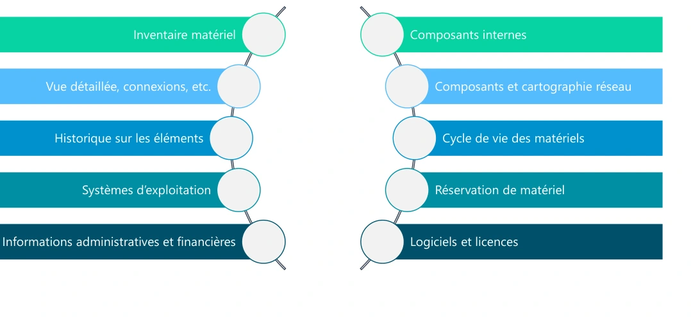
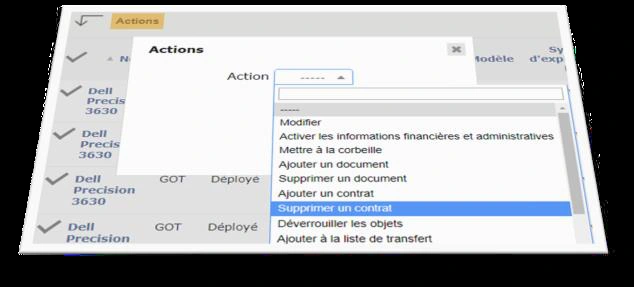
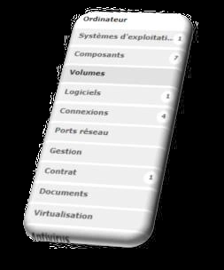
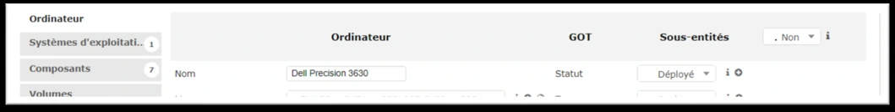

# Module 05 — Découverte de GLPI

## GLPI relie les équipements, les personnes et l’assistance

Le support présente GLPI comme outil libre de gestion de parc et de centre de services. Comprendre les **objets et leurs relations** avant de mémoriser les menus : ordinateur, utilisateur, logiciel, contrat, composant et ticket. Les captures de l’Original montrent la version utilisée en formation ; l’emplacement des menus peut différer dans une autre version.

| Gestion de parc | Utilité pour le technicien |
|---|---|
| Inventaire matériel et informations administratives/financières | Identifier l’équipement et son contexte. |
| Composants internes, externes et cartographie réseau | Relier le symptôme aux dépendances réelles. |
| Historique, systèmes d’exploitation et cycle de vie | Retrouver les changements et prévoir maintenance ou remplacement. |
| Réservation, déploiement et licences | Planifier les moyens et vérifier les droits d’usage. |

L’interface **simplifiée** vise les usages utilisateur, selon les droits : tickets, réservations et FAQ. L’interface **standard** donne accès aux fonctions techniques, administratives et de configuration autorisées. Voir un menu dépend des habilitations ; être dans l’interface standard ne donne pas tous les droits.

## Construire une recherche reproductible

1. Choisir le type d’objet et les colonnes utiles.
2. Définir le champ recherché et l’opérateur adapté.
3. Combiner les critères avec **ET**, **OU** et les exclusions nécessaires.
4. Vérifier quelques fiches du résultat avant de généraliser.
5. Enregistrer la recherche si elle sera réutilisée et définir sa portée.

La recherche rapide porte sur les champs affichés ; la recherche multicritères permet d’interroger des paramètres plus précis et de grouper les conditions. Le support mentionne notamment `^` pour le début, `$` pour la fin et `NULL` pour une valeur vide, ainsi que des recherches numériques et relatives aux dates. **Précision externe :** vérifier les opérateurs réellement proposés par le champ et la version ; ne pas traiter toutes les zones de recherche comme un moteur d’expressions régulières complet.

| Fonction | Contrôle à effectuer |
|---|---|
| Colonnes et tri | Le résultat montre les informations permettant de décider. |
| Export | Le format et le périmètre correspondent au besoin. |
| Recherche enregistrée | Nom, visibilité, entité, récursivité et comptage adaptés. |
| Modification massive | Sélection exacte et action validée sur un petit échantillon. |
| Corbeille | Distinguer élément actif, supprimé et purge définitive. |
| Fiche d’un élément | Consulter ses onglets, relations et historique ; plusieurs onglets sont communs aux objets. |

## Cas guidé — préparer un renouvellement

**Exemple externe :** rechercher les ordinateurs d’un service avec le système visé, afficher modèle, utilisateur et date utile, puis ouvrir plusieurs fiches pour vérifier les données. Exporter la liste pour validation. Avant une modification massive, refaire le contrôle du nombre d’éléments sélectionnés et de leur entité ; une erreur de filtre peut toucher tout le parc.

**Mini-quiz.** 1. Pourquoi un technicien ne voit-il pas tous les menus ? 2. ET et OU donnent-ils le même résultat ? 3. Quelle précaution avant une modification massive ?

??? success "Réponses commentées"
    1. Les droits et la portée des habilitations limitent les accès.
    2. Non : ET exige toutes les conditions ; OU accepte les alternatives prévues.
    3. Vérifier filtre, sélection, entité et action sur un échantillon.

## Notions détaillées pour approfondir

Les notions détaillées ci-dessous conservent le périmètre et les exemples du support historique, avec une mise en page réparée. Les réserves et corrections exposées plus haut s’appliquent à cette relecture. Pour la formulation source exacte, utiliser **Cours Original**. Les captures sont des illustrations isolées du support, pas des schémas générés.

<section>
<h4>Sensibilisation ITIL et</h4>
<h4>gestion de parc</h4>

Module 05 – Découverte de GLPI

<h4>Objectifs</h4>
<ul><li>Découvrir l’outil GLPI</li><li>Définir les différentes fonctionnalités</li><li>Découvrir les fonctionnalités de recherche</li><li>Découvrir son utilisation au quotidien</li></ul>
</section>
<section>

GLPI : présentation

<ul><li>GLPI : Gestion Libre de Parc Informatique</li><li>ITSM : Information Technology Service Management conforme avec ITIL</li><li>Logiciel libre sous licence GPL 100% libre</li><li>Logiciel complet pour la gestion de parc et centre de services</li><li>Plusieurs langues et plug-ins disponibles</li><li>Installation possible sous Windows et Linux</li><li>Pour les petits comme les grands systèmes d’information</li></ul>

GLPI : fonctionnalités gestion de parc

<figure><figcaption>Fonctionnalités de gestion du parc — illustration isolée du support, page 2.</figcaption></figure>
</section>
<section>

GLPI : les interfaces

<ul><li>Interface simplifiée<ul><li>Interface la plus restrictive</li><li>Destinée aux utilisateurs finaux</li><li>Permet de créer un ticket, suivre ses tickets, accéder aux réservations et à la FAQ</li></ul></li><li>Interface standard<ul><li>Interface principale de GLPI</li><li>Tous les modules y sont disponibles en fonction des droits de chacun</li><li>Utilisée pour les taches techniciens, d’administration et de configuration</li><li>3 vues de travail : personnelle, groupe et globale</li></ul></li></ul>

GLPI : recherche rapide

<ul><li>Permet d’effectuer une recherche uniquement sur les champs affichés</li><li>Étendue de la recherche aux champs affichés par défaut de tous les éléments d’inventaire</li><li>Utilisation possible des caractères suivants (REGEX) :<ul><li>« ^ » pour symboliser le début du champ</li><li>« $ » pour symboliser la fin du champ</li><li>« NULL » pour rechercher les champs vides</li><li>Utilisation conjointe de « ^ » et « $ » pour la valeur exacte d’un champ</li></ul></li></ul>
<figure><figcaption>Interface GLPI présentée dans le support — illustration isolée du support, page 3.</figcaption></figure>
</section>
<section>

GLPI : gestion de parc

Menu parc

<ul><li>Affichage par défaut des ordinateurs</li></ul>
<ul><li>Possibilité de personnaliser les colonnes affichées</li></ul>
<ul><li>Menu de recherche avancée</li></ul>
<ul><li>Export possible des données sous différents formats</li></ul>
<ul><li>Sélection du nombre d’éléments à afficher par page</li></ul>
<ul><li>Navigation entre les pages</li></ul>
<ul><li>Affichage possible de la corbeille</li></ul>
<figure><figcaption>Interface GLPI présentée dans le support — illustration isolée du support, page 4.</figcaption></figure>

GLPI : gestion de parc

Recherche basique multicritères

<ul><li>Possibilité de recherches combinant plusieurs critères</li></ul>
<ul><li>Combinaison possible de critères à l’aide d’opérateurs logiques</li></ul>
<ul><li>Opérateurs logiques disponibles : ET/OU – ET PAS/OU PAS</li></ul>
<ul><li>S’applique à un grand nombre de paramètres de l’objet concerné</li></ul>
<ul><li>Plusieurs critères de recherches selon le paramètre choisi</li></ul>

Contient – Est – N’est pas – Sous – Pas sous – Avant – Après, etc.

<ul><li>Critères globaux de recherche possibles</li></ul>
<figure><figcaption>Interface GLPI présentée dans le support — illustration isolée du support, page 4.</figcaption></figure>
</section>
<section>

GLPI : gestion de parc

Recherche avancée

<ul><li>Possibilité d’utiliser des caractères spéciaux pour les recherches</li></ul>
<ul><li> NULL : s’assurer qu’un champ est vide</li></ul>
<ul><li> &lt;Nb ou &gt;Nb : utilisé dans le cas des dates, prend un nombre de mois</li></ul>
<ul><li> ^ : tester le début d’un champ</li></ul>
<ul><li> $ : tester la fin d’un champ</li></ul>
<ul><li> ^$ : tester une valeur exacte pour un champ</li></ul>
<ul><li> [Année]-[Mois]-[Jours] : tester un champ date</li></ul>

GLPI : gestion de parc

Recherche sauvegardée • Possibilité de sauvegarder ses recherches • Création d’une recherche sauvegardée • Un nom • Une visibilité/portée • Entité de rattachement avec ou sans récursivité • Comptage • Accès à ses recherches

<figure><figcaption>Interface GLPI présentée dans le support — illustration isolée du support, page 5.</figcaption></figure>
<figure><figcaption>Interface GLPI présentée dans le support — illustration isolée du support, page 5.</figcaption></figure>
</section>
<section>

GLPI : gestion de parc

Modification massive • Pour effectuer une modification sur un ensemble d’éléments • Utilisé conjointement aux recherches avancées • Généralement appliquée sur tous les éléments retournés d’une recherche • Plusieurs actions possibles

<figure><figcaption>Interface GLPI présentée dans le support — illustration isolée du support, page 6.</figcaption></figure>

GLPI : gestion de parc

<figure><figcaption>Interface GLPI présentée dans le support — illustration isolée du support, page 6.</figcaption></figure>

Fiche élément • Accessible en cliquant sur un élément • Contient toutes les informations de l’élément • Menu de navigation vertical sur la gauche • Certains onglets communs à tous les éléments • Possibilité d’afficher tous les onglets sur la même page • Navigation possible entre les fiches des éléments de la page courante

<figure><figcaption>Interface GLPI présentée dans le support — illustration isolée du support, page 6.</figcaption></figure>
</section>

## Pratiquer et réviser

- [Fiche de révision du module](../../revision/itil/module-05-decouverte-de-glpi.md)
- [Retour à la séquence](index.md)

## Références externes vérifiées le 4 novembre 2026

- [GLPI — documentation utilisateur officielle](https://help.glpi-project.org/documentation)
