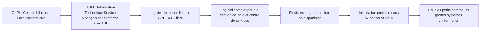
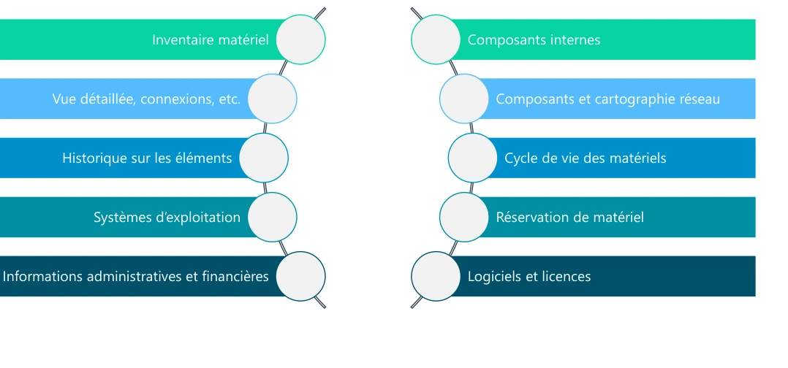
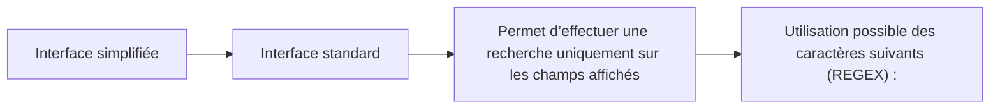
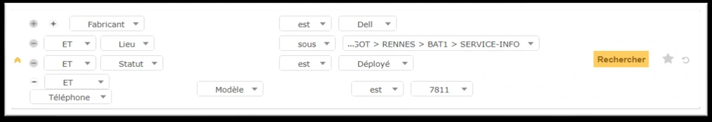
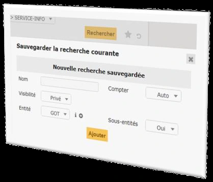
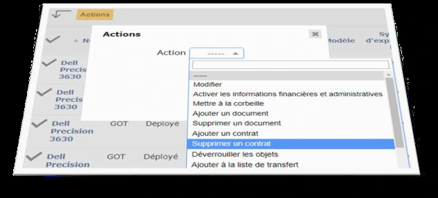
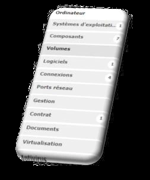
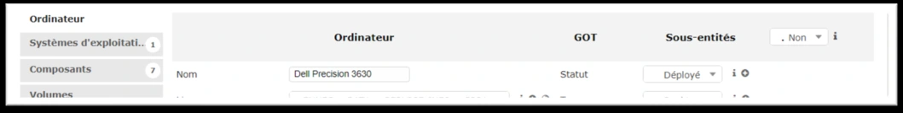

# Module 05 — Découverte de GLPI

Les parties ci-dessous reprennent le cours original, dans le même ordre. Les encadrés et les schémas répètent ses formulations.

## Parcours de lecture

1. Support · Module 05 - Support de cours · 6 pages transcrites

SOURCE DRIVE · TRANSCRIPTION DU SUPPORT

Le contenu des documents du dossier TSSR est transcrit ci-dessous, page par page. Les textes et tableaux sont intégrés à la page Web. Aucun fichier PDF, aucune diapositive entière ni aucune reproduction de page n’est affiché. Seuls des croquis ou visuels isolés et vérifiés peuvent accompagner la transcription. Les versions et les consignes restent celles des supports de formation. Les compléments IA sont conservés dans leur onglet distinct.

## Support · Module 05 - Support de cours · 6 pages transcrites

!!! note "À retenir"
    Texte, tableaux et illustrations utiles retranscrits du support ; numéros de diapositives, bandeaux répétitifs, éléments de marque et décorations exclus.

Texte, tableaux et illustrations utiles retranscrits du support ; numéros de diapositives, bandeaux répétitifs, éléments de marque et décorations exclus. Les formulations historiques sont conservées ; les précisions sont placées dans le cours optimisé.

### Page 1

Sensibilisation ITIL et

gestion de parc

Module 05 – Découverte de GLPI

#### Objectifs

!!! note "À retenir"
    Découvrir l’outil GLPI Définir les différentes fonctionnalités Découvrir les fonctionnalités de recherche Découvrir son utilisation au quotidien

**Visuel externe**

- Découvrir l’outil GLPI
- Définir les différentes fonctionnalités
- Découvrir les fonctionnalités de recherche
- Découvrir son utilisation au quotidien

### Page 2

**Visuel externe**

GLPI : présentation

- GLPI : Gestion Libre de Parc Informatique
- ITSM : Information Technology Service Management conforme avec ITIL
- Logiciel libre sous licence GPL 100% libre
- Logiciel complet pour la gestion de parc et centre de services
- Plusieurs langues et plug-ins disponibles
- Installation possible sous Windows et Linux
- Pour les petits comme les grands systèmes d’information

GLPI : fonctionnalités gestion de parc

Fonctionnalités de gestion du parc — illustration isolée du support, page 2.

### Page 3

**Visuel externe**

GLPI : les interfaces

- Interface simplifiée
  - Interface la plus restrictive
  - Destinée aux utilisateurs finaux
  - Permet de créer un ticket, suivre ses tickets, accéder aux réservations et à la FAQ
- Interface standard
  - Interface principale de GLPI
  - Tous les modules y sont disponibles en fonction des droits de chacun
  - Utilisée pour les taches techniciens, d’administration et de configuration
  - 3 vues de travail : personnelle, groupe et globale

GLPI : recherche rapide

- Permet d’effectuer une recherche uniquement sur les champs affichés
- Étendue de la recherche aux champs affichés par défaut de tous les éléments d’inventaire
- Utilisation possible des caractères suivants (REGEX) :
  - « ^ » pour symboliser le début du champ
  - « $ » pour symboliser la fin du champ
  - « NULL » pour rechercher les champs vides
  - Utilisation conjointe de « ^ » et « $ » pour la valeur exacte d’un champ

Interface GLPI présentée dans le support — illustration isolée du support, page 3.

### Page 4

#### GLPI : gestion de parc

**Visuel externe**

```mermaid
flowchart LR
    N1["Affichage par défaut des ordinateurs"]
    N2["Possibilité de personnaliser les colonnes affichées"]
    N3["Menu de recherche avancée"]
    N4["Export possible des données sous différents formats"]
    N5["Sélection du nombre d’éléments à afficher par page"]
    N6["Navigation entre les pages"]
    N7["Affichage possible de la corbeille"]
    N8["Possibilité de recherches combinant plusieurs critères"]
    N1 --> N2
    N2 --> N3
    N3 --> N4
    N4 --> N5
    N5 --> N6
    N6 --> N7
    N7 --> N8
```

Menu parc

- Affichage par défaut des ordinateurs

- Possibilité de personnaliser les colonnes affichées

- Menu de recherche avancée

- Export possible des données sous différents formats

- Sélection du nombre d’éléments à afficher par page

- Navigation entre les pages

- Affichage possible de la corbeille

Interface GLPI présentée dans le support — illustration isolée du support, page 4.

Recherche basique multicritères

- Possibilité de recherches combinant plusieurs critères

- Combinaison possible de critères à l’aide d’opérateurs logiques

- Opérateurs logiques disponibles : ET/OU – ET PAS/OU PAS

- S’applique à un grand nombre de paramètres de l’objet concerné

- Plusieurs critères de recherches selon le paramètre choisi

Contient – Est – N’est pas – Sous – Pas sous – Avant – Après, etc.

- Critères globaux de recherche possibles

Interface GLPI présentée dans le support — illustration isolée du support, page 4.

### Page 5

#### GLPI : gestion de parc

Recherche avancée

- Possibilité d’utiliser des caractères spéciaux pour les recherches

- NULL : s’assurer qu’un champ est vide

- <Nb ou >Nb : utilisé dans le cas des dates, prend un nombre de mois

- ^ : tester le début d’un champ

- $ : tester la fin d’un champ

- ^$ : tester une valeur exacte pour un champ

- [Année]-[Mois]-[Jours] : tester un champ date

##### Recherche sauvegardée

!!! note "À retenir"
    Possibilité de sauvegarder ses recherches Création d’une recherche sauvegardée - Un nom - Une visibilité/portée - Entité de rattachement avec ou sans récursivité - Comptage Accès à ses recherches Interface GLPI présentée dans le support — illustration isolée du support, page 5.

- Possibilité de sauvegarder ses recherches
- Création d’une recherche sauvegardée
  - Un nom
  - Une visibilité/portée
  - Entité de rattachement avec ou sans récursivité
  - Comptage
- Accès à ses recherches

Interface GLPI présentée dans le support — illustration isolée du support, page 5.

Interface GLPI présentée dans le support — illustration isolée du support, page 5.

### Page 6

#### GLPI : gestion de parc

##### Modification massive

!!! note "À retenir"
    Pour effectuer une modification sur un ensemble d’éléments Utilisé conjointement aux recherches avancées Généralement appliquée sur tous les éléments retournés d’une recherche Plusieurs actions possibles Interface GLPI présentée dans le support — illustration isolée du support, page 6.

- Pour effectuer une modification sur un ensemble d’éléments
- Utilisé conjointement aux recherches avancées
- Généralement appliquée sur tous les éléments retournés d’une recherche
- Plusieurs actions possibles

Interface GLPI présentée dans le support — illustration isolée du support, page 6.

Interface GLPI présentée dans le support — illustration isolée du support, page 6.

##### Fiche élément

- Accessible en cliquant sur un élément
- Contient toutes les informations de l’élément
- Menu de navigation vertical sur la gauche
- Certains onglets communs à tous les éléments
- Possibilité d’afficher tous les onglets sur la même page
- Navigation possible entre les fiches des éléments de la page courante

Interface GLPI présentée dans le support — illustration isolée du support, page 6.

Référence du document : 1_BoSYufbTgkE17bKE2mrlP5wUeuH_6x8 · SHA-256 23ce31ec50409678…

## Fiche de synthèse

Les lignes reprennent les titres du cours et la première phrase de chaque partie.

| Partie | Repère du cours |
| --- | --- |
| Support · Module 05 - Support de cours · 6 pages transcrites | Texte, tableaux et illustrations utiles retranscrits du support ; numéros de diapositives, bandeaux répétitifs, éléments de marque et décorations exclus. |
